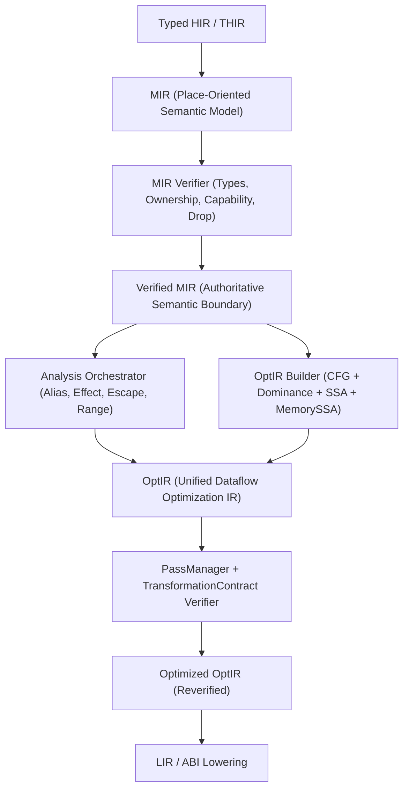

# SPEC-70 — Unified Dataflow Optimization IR (`OptIR`), SSA / `MemorySSA` & Pass-Legality Framework

## Tóm tắt
Tài liệu chuẩn hóa kiến trúc biểu diễn trung gian tối ưu hóa hợp nhất (`OptIR`), dạng gán đơn tĩnh cho giá trị (`SSA`) và bộ nhớ (`MemorySSA`), bộ điều phối phân tích chứng minh (`Analysis Orchestrator` & `ProofProvenance`), khung hợp đồng hợp lệ của trình quản lý pha tối ưu (`PassManager` / `TransformationContract`), và các quy tắc bảo toàn hành vi quan sát được cho trình biên dịch `axiomc` (Epic `E15.1`, Phase 15 `P15-optimizer-2-0`):
- **Phân tách vai trò nghiêm ngặt giữa `Verified MIR` và `OptIR` (`AXS-OPT-001..006`)**: `Verified MIR` là mô hình thực thi ngữ nghĩa duy nhất có thẩm quyền về kiểu, sở hữu (`ownership`), năng lực (`view`/`mut_view`), và hủy tất định (`Drop`). `OptIR` được xây dựng độc quyền từ `Verified MIR` (`REQ-OPT-016`, `REQ-OPT-296`), không tự suy luận lại an toàn ngữ nghĩa (`REQ-OPT-017`, `REQ-OPT-360`), và dùng dàn phẳng độ chắc chắn 3 giá trị (`Proven`, `Possible`, `Unknown` — `REQ-OPT-392`, `REQ-OPT-403`) có lưu vết nguồn gốc chứng minh (`ProofProvenance`).
- **Biểu diễn `SSA`, cây thống trị và chiếu gộp thành phần vô hướng (`AXS-OPT-010..015`)**: Định nghĩa cây thống trị Cooper-Harvey-Kennedy (`DominatorTree`), biên thống trị (`DominanceFrontier`), đặt nút `phi` tối thiểu, phân biệt giá trị `SSA` với đối tượng sở hữu (`Move`/`Copy` không bắt buộc chép vật lý, `Clone` giữ nguyên lời gọi tường minh, `Drop` không bị xóa khi tách trường SROA — `REQ-OPT-050`, `REQ-OPT-054..055`, `REQ-OPT-304..306`).
- **`MemorySSA`, `AliasInfo` và suy luận hiệu ứng `EffectInfo` bảo thủ (`AXS-OPT-020..024`)**: Mô hình hóa trạng thái bộ nhớ bằng `LiveOnEntry`, `MemoryDef`, `MemoryUse`, `MemoryPhi` kết hợp phân vùng `MemoryRegion` và truy vấn clobber dựa trên `AliasInfo` (`NoAlias`, `MustAlias`, `PartialAlias`, `MayAlias`, `Unknown` — `REQ-OPT-051`, `REQ-OPT-056..058`) cùng hệ thống suy luận hiệu ứng tất định (`Pure`, `ReadsMemory`, `WritesMemory`, `MayPanic`, `Allocates`, `IO`, `Atomic`, `Volatile`, `FFI`, `Unknown` — `REQ-OPT-348..349`, `REQ-OPT-393..396`).
- **Khung hợp đồng `PassManager` & trình kiểm định biến đổi (`AXS-OPT-030..034`)**: Mỗi pha tối ưu phải khai báo phân tích bắt buộc, tiền điều kiện hợp lệ, phân tích được bảo toàn/vô hiệu hóa và hậu điều kiện (`REQ-CORE-447`, `REQ-OPT-052`, `REQ-OPT-350`, `REQ-OPT-404..406`); khi chứng minh thất bại (`Unknown` / `NotProven`), bộ tối ưu đóng an toàn (fail-closed) và giữ nguyên IR (`REQ-OPT-332`, `REQ-OPT-402`).
- **Bảo toàn hành vi quan sát được & tối ưu hóa vô hướng (`AXS-OPT-040..047`)**: SCCP, GVN, CSE, DCE và rút gọn đại số bảo toàn tuyệt đối giá trị trả về, thứ tự `Drop`, bẫy tràn số có kiểm tra so với `wrapping_*`, thứ tự I/O, `atomic`, `volatile`, FFI, rào cản `black_box` và xóa bộ nhớ nhạy cảm (`zeroize`) (`0165 §1–13`, `REQ-OPT-010..011`, `REQ-OPT-018..023`, `REQ-OPT-351..353`, `REQ-OPT-363..364`).

Status: draft (T600, 2026-11-03). Owner: axiom-architect.
Rule IDs `AXS-OPT-NNN` are stable and never renumbered.
Consolidates: `0161 §17, §37`, `0162 §40`, `0165 §1–16`, `0261 §27`, `0309 §1–4`, `tasks/0315` (`BOOTSTRAP-056`), `tasks/0366` (`BOOTSTRAP-107`, `AOPT-20..65`), `tasks/0398` (`BOOTSTRAP-139`, `AOPTIR-20..75`), `tasks/0399` (`BOOTSTRAP-140`, `AOPT-70..110`), `tasks/0423`, `tasks/0438`, `tasks/0443`, `tasks/0447`, `tasks/0456`, `tasks/0465`, `tasks/0467`, `tasks/0474`, `tasks/0480`, `tasks/0487`, `tasks/0545` (`BOOTSTRAP-286`), `tasks/0546` (`BOOTSTRAP-287`), `tasks/0547` (`BOOTSTRAP-288`), `tasks/0579`, `tasks/0794` (`BOOTSTRAP-572`), `tasks/0795` (`BOOTSTRAP-573`), `tasks/0796` (`BOOTSTRAP-574`), `tasks/0797` (`BOOTSTRAP-575`), `spec/SPEC-03-core-semantics.md`, and `spec/SPEC-04-core-extensibility.md` (`AXS-EXT-045`).
Covers: `REQ-OPT-010`, `REQ-OPT-016`, `REQ-OPT-017`, `REQ-OPT-018`, `REQ-OPT-019`, `REQ-OPT-020`, `REQ-OPT-021`, `REQ-OPT-022`, `REQ-OPT-023`, `REQ-OPT-047`, `REQ-OPT-048`, `REQ-OPT-049`, `REQ-OPT-050`, `REQ-OPT-051`, `REQ-OPT-052`, `REQ-OPT-053`, `REQ-OPT-054`, `REQ-OPT-055`, `REQ-OPT-056`, `REQ-OPT-057`, `REQ-OPT-058`, `REQ-OPT-059`, `REQ-OPT-296`, `REQ-OPT-297`, `REQ-OPT-298`, `REQ-OPT-321`, `REQ-OPT-322`, `REQ-OPT-323`, `REQ-OPT-324`, `REQ-OPT-325`, `REQ-OPT-326`, `REQ-OPT-327`, `REQ-OPT-328`, `REQ-OPT-329`, `REQ-OPT-330`, `REQ-OPT-331`, `REQ-OPT-332`, `REQ-OPT-333`, `REQ-OPT-359`, `REQ-OPT-360`, `REQ-OPT-361`, `REQ-OPT-362` (and governs implementation/QA tasks `T601`–`T604` covering `REQ-CORE-447`, `REQ-VER-027`, `REQ-OPT-011`, `REQ-OPT-014`, `REQ-OPT-037..041`, `REQ-OPT-060..065`, `REQ-OPT-304..306`, `REQ-OPT-337..341`, `REQ-OPT-343`, `REQ-OPT-348..353`, `REQ-OPT-355..356`, `REQ-OPT-363..364`, `REQ-OPT-373..374`, `REQ-OPT-390..406`).
Consumers: `T601` (`compiler/opt/optir`, `tests/run/optir_ssa`), `T602` (`compiler/opt/passmgr`, `compiler/opt/effects`, `tests/run/opt_passmgr`), `T603` (`compiler/opt/scalar`, `tests/run/opt_scalar`), `T604` (`tests/conformance/p15/e15_1_optir_ssa`), and later P15 epics (`E15.2`–`E15.7`).

---

## 1. Architectural Role Separation: Verified MIR vs. `OptIR`

**AXS-OPT-001 — Verified MIR Entry Gate and Semantic Authority (`REQ-OPT-010`, `REQ-OPT-016`, `REQ-OPT-017`, `REQ-OPT-296`, `REQ-OPT-325`, `REQ-OPT-360`).**
1. **Post-verification entry gate (`REQ-OPT-016`, `REQ-OPT-296`):** Only `MirBody` instances that have passed the structural, type, initialization, ownership, capability, and `Drop` verifier (`verify_mir`, `INV-PIPE-002`, `INV-PIPE-003`) may enter the optimizer or be lowered to `OptIR`. If an unverified or verifier-rejected `MirBody` reaches `OptIR` construction, the compiler aborts compilation with `AX_ICE_MIR_VERIFY` (`AXD-042`).
2. **MIR is the sole semantic source of truth (`REQ-OPT-010`, `REQ-OPT-325`):** `Verified MIR` defines the canonical execution semantics of every Axiom program (`SPEC-03`, `SPEC-10..12`). Optimization passes MUST NOT alter the observable semantics of a `Verified MIR` program.
3. **No independent semantic or safety inference (`REQ-OPT-017`, `REQ-OPT-360`, `REQ-OPT-062`):** The optimizer (`optimizer.inference = None`) MUST NOT re-infer types, invent ownership transitions, manufacture capability disjointness, or create safety proofs on behalf of unverified code. Safety verification precedes optimization; optimization never participates in accepting or rejecting a source program.
[0161 §17; 0165 §1–3; tasks/0366 §1, §71 AOPT-20/49; tasks/0398 §70, §81 AOPTIR-20/73/74; tasks/0399 §2, §59, §73 AOPT-73/110; tasks/0545 §1]

**AXS-OPT-002 — Strict Separation of Roles Between `MIR` and `OptIR` (`REQ-OPT-047`, `REQ-OPT-048`, `REQ-OPT-049`, `REQ-OPT-053`, `REQ-OPT-059`, `REQ-OPT-324`, `REQ-OPT-362`).**
Axiom separates the semantic representation from the dataflow optimization representation (`REQ-OPT-059`):
1. **`MIR` is the Semantic Execution Model (`REQ-OPT-047`, `REQ-OPT-048`):** `MIR` is place-oriented and preserves explicit ownership transfers (`Move` vs. `Copy`), capability regions (`view` / `mut_view`), `StorageLive`/`StorageDead` scopes, drop flags, and deterministic `Drop` elaboration for verification and oracle interpretation (`--interp`).
2. **`OptIR` is the Unified Dataflow Optimization Model (`REQ-OPT-047`, `REQ-OPT-049`):** `OptIR` is a value-based Static Single Assignment (`SSA`) and `MemorySSA` representation constructed exclusively from `Verified MIR` (`SPEC-04 AXS-EXT-045`). It is designed for sparse constant propagation, global value numbering, scalar replacement of aggregates, alias/escape promotion, and loop/vector transformations.
3. **No direct destructive semantic mutation on `MIR` (`REQ-OPT-053`, `REQ-OPT-362`):** High-level dataflow optimizations operate on `OptIR` (or through `OptIR` → `MirBody` / `LirBody` reconstruction verified by `verify_mir`), never by mutating `MIR` into an unverified ad-hoc dialect. `OptIR` may carry richer analysis metadata (`AliasInfo`, `EffectInfo`, `EscapeInfo`, `RangeInfo`, `LoopInfo`, `CostInfo`) than `MIR`, but MUST NOT define semantics that diverge from `Verified MIR` (`REQ-OPT-362`).
4. **Freedom from surface syntax (`REQ-OPT-324`):** `OptIR` is not required to preserve surface syntactic constructs (such as structured loops, syntactic temporaries, or source local groupings) so long as observable semantics and debug provenance (`AXS-OPT-004`) are preserved.
[tasks/0366 §2–3, §71 AOPT-48/49; tasks/0398 §1–3, §65, §81 AOPTIR-20/21; tasks/0546 §2–3]



**AXS-OPT-003 — Compiler-Derived Ownership/Capability Facts and Zero-Cost Abstraction Erasure (`REQ-OPT-037`, `REQ-OPT-038`, `REQ-OPT-039`, `REQ-OPT-040`, `REQ-OPT-298`, `REQ-OPT-322`, `REQ-OPT-323`).**
1. **AOT native execution without hidden runtime (`REQ-OPT-037`, `REQ-OPT-038`, `REQ-OPT-322`, `INV-SEM-005`):** Axiom compiles ahead-of-time (AOT) to native machine code without a virtual machine, garbage collector, or mandatory runtime ownership service. Optimization passes MUST NOT introduce hidden runtime services or reference counting.
2. **Independence from source-level optimization annotations (`REQ-OPT-298`):** Because ownership exclusivity and `view`/`mut_view` capability disjointness are verified by the compiler (`INV-SEM-001`, `INV-SEM-002`), `OptIR` derives `NoAlias`, `ReadOnly`, and `UniqueOwner` facts directly from `Verified MIR` without requiring C-style `restrict` or lifetime annotations in user code (`tasks/0366 §8–10, AOPT-22/23`).
3. **Erasure of compiler-only metadata (`REQ-OPT-039`, `REQ-OPT-040`, `REQ-OPT-323`):** Once `Verified MIR` has been lowered to `OptIR` and its ownership/capability guarantees have been materialized into `AliasInfo`, `EffectInfo`, and `EscapeInfo` facts, compiler-only capability wrappers and unobservable abstraction boundaries may be completely erased so they incur zero runtime space or instruction overhead (`AOPT-47`, `AOPTIR-72`).
[0165 §15–18, §23–25; 0309 §1–4; tasks/0366 §9–11, §70–71 AOPT-22/23/46/47; tasks/0398 §81 AOPTIR-71/72]

**AXS-OPT-004 — Source-to-Machine Debug Provenance and Explainability (`REQ-OPT-329`, `REQ-OPT-341`).**
1. **Provenance preservation (`REQ-OPT-341`):** Every `OptValue`, `OptInst`, `OptTerminator`, and `MemoryAccess` node in `OptIR` carries an explicit `OptOrigin` record `{ span: Span, mir_bb: MirBbId, mir_stmt_idx: u32, pass_id: u16 }` linking the node back to its originating `Verified MIR` instruction and source byte span (`SPEC-04 AXS-EXT-040/054`). When a pass rewrites or folds instructions, the replacement node inherits the primary `Span` and `mir_bb` of the root operation.
2. **Explainable optimization decisions (`REQ-OPT-329`):** Every transformation applied or rejected by a pass is attributable to a deterministic `PassId`, a `Proposition` / `ProofProvenance` record (`AXS-OPT-005`), and a rejection or application reason code so `inspect` dumps and remarks can explain why an optimization succeeded or was withheld (`AOPT-53`, `AOPTIR-66/70`, `AOPT-98/99`).
[tasks/0366 §61–63, §71 AOPT-53/65; tasks/0398 §76–77, §81 AOPTIR-66/70; tasks/0399 §72–73 AOPT-98/99]

**AXS-OPT-005 — Analysis Orchestrator, Three-Valued Certainty Lattice, and Proof Provenance (`REQ-OPT-359`, `REQ-OPT-390`, `REQ-OPT-391`, `REQ-OPT-392`, `REQ-OPT-397`, `REQ-OPT-398`, `REQ-OPT-399`, `REQ-OPT-400`, `REQ-OPT-401`, `REQ-OPT-402`, `REQ-OPT-403`).**
1. **Centralized Analysis Orchestrator (`REQ-OPT-359`):** Optimization passes MUST NOT invoke semantic analyses ad-hoc in cyclic cross-dependencies. Instead, the `AnalysisOrchestrator` (`tasks/0545`) coordinates analysis execution in a deterministic DAG (`Ownership` / `Capability` → `AliasInfo` / `EscapeInfo` → `EffectInfo` → `RangeInfo` / `SymbolicProof`) and exposes immutable, revision-tagged query results to `OptIR` passes.
2. **Three-valued certainty lattice (`REQ-OPT-392`, `REQ-OPT-400`, `REQ-OPT-403`):** Every static analysis query and symbolic/abstract-interpretation fact in the optimizer evaluates to an explicit certainty grade:
   ```text
   Certainty = Proven | Possible | Unknown
   ```
   - `Proven`: The proposition holds on all reachable execution paths under the language semantics.
   - `Possible`: The proposition holds on at least one feasible path or under unverified conditions, or its negation is reachable.
   - `Unknown`: The analysis reached its step/depth budget, encountered an opaque boundary (external FFI call, dynamic dispatch, inline assembly, unanalyzed pointer arithmetic), or could not decide the property (`REQ-OPT-400`).
3. **Strict fail-closed boundary (`REQ-OPT-392`, `REQ-OPT-399`, `REQ-OPT-402`, `REQ-OPT-403`):**
   - `Unknown` and `Possible` are strictly distinct from `Proven`. Timeout, missing metadata, dynamic dispatch, floating-point special values (`+0.0`, `-0.0`, `NaN`, `±∞` — `REQ-OPT-397`), or open-world assumptions MUST degrade certainty to `Possible` or `Unknown`, never to a false `Proven` result.
   - Only `Certainty.Proven` (or an explicit language-level `TrustedContract` inside `unsafe`/FFI where permitted by policy) may authorize a semantics-sensitive optimization transformation (`REQ-OPT-399`, `REQ-OPT-402`).
4. **Non-intrusive static analysis (`REQ-OPT-390`, `REQ-OPT-391`):** Static analysis and symbolic execution operate purely as an internal compiler analysis and proof layer; they MUST NOT turn Axiom into a mandatory Rust-style surface lifetime/borrow-annotation checker (`REQ-OPT-391`), and every fixed analysis bug is locked in as a permanent regression test (`REQ-OPT-390`).
5. **Deterministic bounded symbolic execution and `ProofProvenance` (`REQ-OPT-398`, `REQ-OPT-401`, `REQ-OPT-403`):**
   - Symbolic/range evaluation is bounded by a deterministic per-function step/path budget. Identical source inputs, compiler revision, and budget parameters MUST produce bit-identical analysis results (`REQ-OPT-401`).
   - Every optimization proof records a structured `ProofProvenance` entry (`REQ-OPT-398`):
     ```text
     ProofProvenance {
         proof_id: u32,
         proposition: PropositionKind,   // NoAlias | InBounds | NonZero | NoOverflow | PureCall | NoEscape | DeadStore | Reachable
         certainty: Certainty,           // Proven | Possible | Unknown
         source_analysis: AnalysisId,    // Capability | Alias | Effect | Escape | Range | Symbolic | Dominator
         subject_inst: u32,              // OptInstId or OptValueId
         ir_revision: u32,               // OptBody revision at proof creation
     }
     ```
[tasks/0545 §1–12; tasks/0794 §572.193, §572.196, §572.200; tasks/0796 §574.1, §574.43, §574.76, §574.88, §574.110, §574.190, §574.200]

**AXS-OPT-006 — Deterministic and Target-Neutral `OptIR` Semantics (`REQ-OPT-014`, `REQ-OPT-330`, `REQ-OPT-333`, `REQ-OPT-343`).**
1. **Target-independent optimization layer (`REQ-OPT-014`, `REQ-OPT-333`):** High-level scalar, memory, control-flow, and loop optimizations (constant folding, SCCP, CSE, GVN, DCE, SROA, LICM, bounds-check elimination, inlining) run before target instruction selection (`OptIR` → `LIR`), preserving target-independent Axiom semantics (`SPEC-03`). When `TargetDesc` cost parameters are consulted (e.g., register count or vector width), they affect profitability only and never alter target-independent semantics (`REQ-OPT-333`, `AOPT-57`, `AOPT-108`).
2. **Determinism across runs and optimization levels (`REQ-OPT-330`, `REQ-OPT-343`, `INV-DET-001`):**
   - Under identical inputs, flags, and compiler version, `OptIR` construction, analysis queries, and pass executions produce byte-identical IR dumps and native binaries (`REQ-OPT-330`). All worklists, CFG traversals, phi operand lists, and hash tables iterate in deterministic ID order (`OptBbId`, `OptValueId`, `OptInstId`), never by memory address (`INV-KERN-002`).
   - Programs compiled at `-O0`, `-O1`, `-O2`, `-O3`, `-Os`, `-Oz`, and LTO MUST produce identical observable execution results (`REQ-OPT-343`, `INV-PIPE-004`, `INV-ORACLE-002`).
[0162 §40; 0165 §3–5; tasks/0366 §66–67, §71 AOPT-54/57; tasks/0399 §16, §73 AOPT-94/107/108; tasks/0423 §80 ATEST2-28/29/73]

---

## 2. `OptIR` SSA Representation, Dominance & Aggregate Scalarization

**AXS-OPT-010 — `OptIR` Structural Data Model (`OptBody`, `OptBlock`, `OptValue`, `OptInst`).**
An `OptBody` represents a single function, closure, or drop-glue body lowered from a `Verified MIR` `MirBody`:
```text
OptBbId    { v: u32 }   // 0 = entry block; OPT_BB_NONE = 0xFFFF_FFFF
OptValueId { v: u32 }   // 1-based typed SSA value ID; 0 = OPT_VALUE_NONE
OptInstId  { v: u32 }   // 0-based instruction ID within OptBody
MemSsaId   { v: u32 }   // 0 = LiveOnEntry; >= 1 = MemoryDef or MemoryPhi version

OptValue {
    id: OptValueId,
    ty: TypeId,
    def_kind: u8,       // OPT_DEF_PARAM | OPT_DEF_CONST | OPT_DEF_PHI | OPT_DEF_INST | OPT_DEF_PROJ
    def_bb: OptBbId,
    def_inst: OptInstId,
    mir_local: MirLocalId,
    proj_field: u32,    // field/element index when scalarized from an aggregate local (OPT_PROJ_NONE = 0xFFFF_FFFF)
    use_count: u32,
    origin: OptOrigin,
}

OptPhi {
    result: OptValueId,
    ty: TypeId,
    mir_local: MirLocalId,
    proj_field: u32,
    incoming_vals: [OptValueId], // parallel to block.preds[]
    incoming_bbs: [OptBbId],
}

OptInst {
    id: OptInstId,
    opcode: u8,         // OPT_INST_CONST | OPT_INST_COPY | OPT_INST_BINOP | OPT_INST_CHECKED_BINOP
                        // | OPT_INST_WRAPPING_BINOP | OPT_INST_UNOP | OPT_INST_CAST
                        // | OPT_INST_AGGREGATE | OPT_INST_EXTRACT_FIELD | OPT_INST_INSERT_FIELD
                        // | OPT_INST_LOAD | OPT_INST_STORE | OPT_INST_VOLATILE_LOAD | OPT_INST_VOLATILE_STORE
                        // | OPT_INST_ATOMIC | OPT_INST_BLACK_BOX | OPT_INST_ZEROIZE | OPT_INST_DROP_FLAG
                        // | OPT_INST_ADDR_OF | OPT_INST_LEN | OPT_INST_DISCRIMINANT | OPT_INST_NOP
    op_subkind: u8,     // MirBinOp / MirUnOp / MirCastKind / AtomicOrdering
    result: OptValueId, // OPT_VALUE_NONE for store-only / barrier instructions
    ty: TypeId,
    arg0: OptValueId,
    arg1: OptValueId,
    imm_u64: u64,
    place: MirPlace,    // preserved for memory / projection / address-taken operations
    mem_use: MemSsaId,  // reaching MemorySSA version read by this instruction
    mem_def: MemSsaId,  // new MemorySSA version defined by this instruction (0 if none)
    effects: u32,       // EffectFlags bitset
    origin: OptOrigin,
}

OptTerminator {
    kind: u8,           // OPT_TERM_GOTO | OPT_TERM_BRANCH | OPT_TERM_SWITCH_INT | OPT_TERM_RETURN
                        // | OPT_TERM_CALL | OPT_TERM_ASSERT | OPT_TERM_DROP | OPT_TERM_UNREACHABLE
    cond_or_ret: OptValueId,
    target0: OptBbId,
    target1: OptBbId,
    call_result: OptValueId,
    mem_use: MemSsaId,
    mem_def: MemSsaId,
    effects: u32,
    origin: OptOrigin,
}
```
Every basic block `OptBlock` explicitly stores its sorted predecessor list `preds: [OptBbId]`, successor list `succs: [OptBbId]`, `phis: [OptPhi]`, `mem_phi: MemSsaId`, `insts: [OptInst]`, and a single `terminator: OptTerminator`.
[tasks/0366 §3–5; tasks/0398 §4–5, §65–68]

**AXS-OPT-011 — Dominator Tree and Dominance Frontier Construction.**
For every `OptBody`:
1. **Reachability and Reverse Post-Order (RPO):** Starting from entry block `bb0`, depth-first search computes deterministic RPO numbering `rpo_idx[B]` and `rpo_order[]`. Unreachable blocks not visited from `bb0` are pruned or marked unreachable before dominance computation.
2. **Immediate Dominators (`DominatorTree`):** Using the Cooper-Harvey-Kennedy iterative reverse-post-order algorithm:
   - $\mathrm{idom}(\mathrm{bb0}) = \mathrm{bb0}$.
   - For each reachable block $B \ne \mathrm{bb0}$ in RPO order, $\mathrm{idom}(B) = \bigcap_{P \in \mathrm{preds}(B),\; \mathrm{idom}(P) \ne \bot} P$, computed by walking two fingers up the current `idom` tree by `rpo_idx` until they meet.
   - `dom_depth[B]` records the depth of $B$ in the dominator tree, and `dom_ates(A, B)` holds if and only if $A$ is an ancestor of $B$ in the `idom` tree.
3. **Dominance Frontiers (`DominanceFrontier`):** For every join block $J$ with $|\mathrm{preds}(J)| \ge 2$ and each reachable predecessor $P \in \mathrm{preds}(J)$:
   - Walk `runner = P` upward via `runner = idom(runner)` while `runner != idom(J)`, adding $J$ to $\mathrm{DF}[\mathrm{runner}]$.
   - Duplicate entries in $\mathrm{DF}[B]$ are eliminated, and $\mathrm{DF}[B]$ is stored in deterministic ascending `OptBbId` order.
[tasks/0398 §4–5, §73, §81 AOPTIR-59/69]

**AXS-OPT-012 — Minimal SSA Form and Phi Node Semantics.**
1. **Single static definition (`AOPTIR-22`):** Every `OptValueId` in `OptIR` has **exactly one** defining instruction, `OptPhi`, function parameter, or constant entry. Reassigning an `OptValueId` is a structural verifier error.
2. **Dominance property (`AOPTIR-59`):** Every use of an `OptValueId` $v$ in an instruction or terminator of block $U$ MUST be dominated by the definition block $\mathrm{def\_bb}(v)$. For an `OptPhi` in block $J$ with incoming pair $(v_i, P_i)$, the definition block $\mathrm{def\_bb}(v_i)$ MUST dominate predecessor $P_i$.
3. **Minimal iterated dominance frontier (`IDF`) phi placement:** For each promotable scalar local (or scalarized aggregate field) $L$ with definition block set $\mathrm{Defs}(L)$:
   - Compute the iterated dominance frontier $\mathrm{IDF}(\mathrm{Defs}(L))$ using a deterministic worklist seeded with $\mathrm{Defs}(L)$.
   - Place an `OptPhi` for $L$ at the header of each block $J \in \mathrm{IDF}(\mathrm{Defs}(L))$ where $L$ is live-in, and rename definitions and uses in a top-down traversal of the `DominatorTree`.
4. **Phi arity invariant:** Every `OptPhi` in block $J$ has `incoming_vals.len == J.preds.len`, with entry $i$ corresponding to predecessor `J.preds[i]`. Trivial phis where all non-self incoming values equal the same `OptValueId` $v$ may be simplified to $v$.
[tasks/0366 §4; tasks/0398 §4–5, §81 AOPTIR-22/50/59]

**AXS-OPT-013 — SSA Values vs. Ownership, `Move`, `Copy`, and `Clone` Semantics (`REQ-OPT-023`, `REQ-OPT-054`, `REQ-OPT-304`, `REQ-OPT-305`, `REQ-OPT-306`, `REQ-OPT-326`, `REQ-OPT-337`, `REQ-OPT-338`).**
1. **SSA values are not ownership objects (`REQ-OPT-054`, `REQ-OPT-326`):** An `OptValueId` represents the dataflow value produced at a program point, not a source-level ownership slot. Ownership validity, definite initialization, and move legality have already been proven on `Verified MIR` before `OptIR` construction (`AOPT-50`, `AOPTIR-23`).
2. **Preservation of move semantics and drop flags (`REQ-OPT-023`):** When a `Verified MIR` `Move(place)` transfers ownership of a non-`Copy` type that requires `Drop`, any associated `MirBody` conditional drop-flag update (`MIR_DROP_FLAG_NONE` vs. active drop flag) MUST be preserved in `OptIR` (`OPT_INST_DROP_FLAG` / `OPT_TERM_DROP`) so the moved-from place is never double-dropped and the moved-to place is dropped on all active exit paths.
3. **Value renaming for unobservable moves and copies (`REQ-OPT-304`, `REQ-OPT-305`, `REQ-OPT-337`, `REQ-OPT-338`):**
   - `Move` semantics do not mandate physical `memcpy` or distinct stack storage (`REQ-OPT-304`). In `OptIR`, an unobservable move `dst = Move(src)` of a non-address-taken local lowers directly to SSA value renaming (`%dst = %src`) without a memory copy (`REQ-OPT-338`, `AOPT-28`, `AOPT-62`, `AOPTIR-24`).
   - `Copy` semantics do not mandate physical copying (`REQ-OPT-305`). An unobservable copy `dst = Copy(src)` of a `Copy` local lowers to SSA value sharing (`%dst = %src`), eliminating redundant temporary copies (`REQ-OPT-337`, `AOPT-29`, `AOPT-61`, `AOPTIR-25`).
4. **Explicit `Clone` preservation (`REQ-OPT-306`):** Unlike compiler-inserted `Copy`/`Move` operands, a user-level `.clone()` call (`Clone.clone`) is an explicit function call with its own `EffectInfo` and potential user-observable side effects or panics. The optimizer MUST NOT treat arbitrary `Clone` calls as trivial bitwise copies unless inlining and effect analysis prove the body is pure and unobservable (`AOPT-30`).
[0165 §13–14; tasks/0366 §71 AOPT-28..30, AOPT-50, AOPT-61/62; tasks/0398 §6–8, §81 AOPTIR-23..25]

**AXS-OPT-014 — Aggregate SSA Projection and Scalar Replacement of Aggregates (`SROA`) (`REQ-OPT-050`, `REQ-OPT-055`).**
1. **Scalar Replacement of Aggregates (`REQ-OPT-050`, `AOPTIR-52`):** A local struct or tuple variable $S$ of type `Adt(Struct)` or `Tuple` with scalar leaf fields $f_0, f_1, \dots, f_{m-1}$ is eligible for aggregate SSA scalarization (`SROA`) when:
   - $S$ is never address-taken (`address_of` / `address_of_mut` is never applied to $S$ or its fields),
   - $S$ does not escape to an external or opaque call via a pointer or `view`/`mut_view` whose region outlives or aliases unknown memory,
   - Every access to $S$ is either a whole-struct assignment (`Aggregate`, `Copy`, `Move`) or a constant-offset field projection `S.f_i` (`MIR_PROJ_FIELD`).
   When eligible, `OptIR` decomposes $S$ into independent SSA value streams `%S.f_0`, `%S.f_1`, …, `%S.f_{m-1}` (`OptValue.proj_field = i`), allowing field reads and writes to reside in virtual registers with zero physical struct allocation (`0165 §15–16`).
2. **Mandatory `Drop` preservation under `SROA` and partial moves (`REQ-OPT-055`, `AOPTIR-26/27/53`):**
   - If an aggregate type `T` implements `Drop` (or contains fields that implement `Drop`), scalarizing its fields MUST NEVER erase or reorder the `Drop` glue execution for `T` or its remaining unmoved fields (`REQ-OPT-055`).
   - Either `T` is reconstructed before its `OPT_TERM_DROP` terminator, or `Drop` is lowered to the exact sequence of field drops only when `T` itself has no custom `impl Drop` and field drop order (declaration order per `SPEC-12`) is preserved identically.
   - Partial ownership states (drop flags for conditionally moved fields) MUST NOT be silently discarded during scalarization (`AOPTIR-27`).
[0165 §15–16; tasks/0366 §19, §71 AOPT-27; tasks/0398 §9–11, §41, §81 AOPTIR-26/27/52/53]

**AXS-OPT-015 — Deterministic Text Inspection (`inspect --emit=optir` and `--emit=memssa`).**
To support deterministic testing (`T601`–`T604`) and AI/compiler inspection (`tasks/0398 §77`, `AOPTIR-70`):
1. `axiomc inspect --emit=optir <file.ax>` prints each function's `OptBody` in deterministic order: basic blocks `bb0..bbN` with `preds`, `dom_idom`, `dom_frontier`, `OptPhi` nodes (`%v = phi [bb_pred: %v_in, ...]`), SSA instructions with certainty/effect tags, and terminators.
2. `axiomc inspect --emit=memssa <file.ax>` prints the `MemorySSA` version graph per basic block: `LiveOnEntry` (`mem0`), `MemoryPhi` merges (`memK = MemoryPhi(bb_pred: memIn, ...)`), `MemoryDef` transitions (`memNext = MemoryDef(memPrev)`), and `MemoryUse(memReaching)` attachments on loads, stores, calls, atomics, volatiles, and drops.
[tasks/0398 §77, §81 AOPTIR-70; SPEC-04 AXS-EXT-013/081]

---

## 3. `MemorySSA`, Alias Integration & Canonical Effect Inference

**AXS-OPT-020 — `MemorySSA` Versioning Model (`LiveOnEntry`, `MemoryDef`, `MemoryUse`, `MemoryPhi`) (`REQ-OPT-057`, `REQ-OPT-327`).**
Because scalar SSA tracks only register/value dataflow, `OptIR` constructs `MemorySSA` alongside value SSA to model memory state dependencies (`tasks/0398 §12–13`):
1. **`LiveOnEntry` (`MemSsaId = 0`):** Every `OptBody` has a single initial memory version `mem0 = LiveOnEntry` representing the memory state upon function entry (including caller-provided arguments, globals, and heap state).
2. **`MemoryDef`:** Every instruction or terminator that may modify memory or act as a memory ordering barrier — `OPT_INST_STORE`, `OPT_INST_VOLATILE_STORE`, `OPT_INST_VOLATILE_LOAD` (modeled as a def-barrier so volatile reads are never reordered across each other), `OPT_INST_ATOMIC`, `OPT_INST_ZEROIZE`, `OPT_INST_BLACK_BOX`, `OPT_TERM_DROP`, and any `OPT_TERM_CALL` whose `EffectInfo` includes `WritesMemory`, `IO`, `Volatile`, `Atomic`, `FFI`, or `Unknown` — defines a fresh `MemSsaId` version `mem_next = MemoryDef(mem_prev, region, inst_id)`.
3. **`MemoryUse`:** Every instruction or terminator that reads memory without modifying it — `OPT_INST_LOAD`, `OPT_INST_LEN` (on slice view memory), `OPT_INST_DISCRIMINANT` (on memory-backed enums), and read-only calls (`ReadsMemory`) — attaches `MemoryUse(mem_reaching)` naming the dominating `MemSsaId` version active at that program point (or walked past provably non-aliasing defs via `AXS-OPT-022`).
4. **`MemoryPhi`:** At any CFG join block $J \in \mathrm{IDF}(\mathrm{Defs}_{\mathrm{mem}})$ where distinct memory versions reach along predecessor edges, `OptBlock.mem_phi` defines `mem_join = MemoryPhi([pred_i: mem_in_i])`.
5. **Compiler-only representation (`REQ-OPT-057`, `REQ-OPT-327`, `AOPT-51`, `AOPTIR-28..30/51`):** `MemorySSA` is strictly a compile-time dependence graph. It does not redefine the Axiom language memory model (`REQ-OPT-327`), does not imply physical heap/stack allocation (`AOPTIR-51`), and emits zero runtime metadata (`REQ-OPT-057`, `AOPTIR-29/30`).
[tasks/0366 §5, §71 AOPT-51; tasks/0398 §12–13, §55–64, §81 AOPTIR-28..30, AOPTIR-51/58]

**AXS-OPT-021 — `MemoryRegion` and Storage Domain Identity (`REQ-OPT-058`).**
1. **Abstract `MemoryRegion` (`REQ-OPT-058`, `AOPTIR-33/69`):** Each memory access in `OptIR` is associated with a `MemoryRegion`:
   ```text
   StorageDomain = LocalStack | EscapedStack | Heap | ConstRData | GlobalStatic | FixedMmio | ThreadLocal | DeviceSpace | ExternalUnknown

   MemoryRegion {
       region_id: u32,
       domain: StorageDomain,
       base_local: MirLocalId,     // originating local or MIR_LOCAL_NONE
       proj_offset: i64,           // known byte or field offset, or -1 if dynamic
       access_size: u32,           // access width in bytes, or 0 if unbounded/slice
       address_space: u8,          // 0 = host generic; non-zero = device/special (SPEC-04 AXS-EXT-020/051)
       provenance_id: u32,         // capability/allocation provenance ID
   }
   ```
2. **`MemoryRegion` is not a surface syntax region (`REQ-OPT-058`):** A `MemoryRegion` in `OptIR` is an internal optimizer partition keyed by storage domain, provenance, and layout offset (`tasks/0398 §68–69`). It does not require preserving source-level expression syntax (`user.name`), while strictly retaining storage-domain and address-space separation (`AOPTIR-33/34/57`).
[tasks/0398 §67–69, §81 AOPTIR-33/34/57]

**AXS-OPT-022 — Alias Lattice and `MemorySSA` Clobber Queries (`REQ-OPT-051`, `REQ-OPT-056`, `REQ-OPT-328`).**
1. **Five-element `AliasResult` lattice (`tasks/0366 §8`, `tasks/0398 §15–19`):**
   ```text
   AliasResult = NoAlias | MustAlias | PartialAlias | MayAlias | UnknownAlias
   ```
   - `NoAlias`: The two memory accesses are **proven** (`Certainty.Proven`) to access disjoint byte ranges in all executions (e.g., distinct non-escaping stack locals, distinct struct fields `s.a` vs. `s.b`, array elements `a[i]` vs. `a[j]` with proven $i \ne j$, or disjoint capability regions `view`/`mut_view` verified by `INV-SEM-002`).
   - `MustAlias` (`REQ-OPT-056`): The two memory accesses are **proven** (`Certainty.Proven`) to start at the exact same runtime memory address and cover the same byte range (enabling store-to-load forwarding and redundant load elimination, `tasks/0398 §18`).
   - `PartialAlias`: The two accesses are proven to overlap partially or share a base object with different widths/sub-offsets (blocking naive forwarding while allowing field/range refinement).
   - `MayAlias`: The accesses may overlap on some execution paths.
   - `UnknownAlias`: Alias relationship could not be determined within analysis bounds.
2. **Proven-facts-only invariant (`REQ-OPT-328`, `AOPT-24/52`, `AOPTIR-32`, `AOPT-83`):** `AliasInfo` MUST derive `NoAlias` and `MustAlias` exclusively from proven semantic/layout/range facts. `UnknownAlias` and `MayAlias` MUST NEVER be treated as `NoAlias`.
3. **Clobber query (`memssa_does_clobber(def, load_access)`) (`REQ-OPT-051`, `AOPTIR-31`):**
   To answer *"Does store/def $D$ actually clobber load $L$?"* (`REQ-OPT-051`):
   - If $D$ or $L$ is `volatile`, `atomic` (with acquire/release/seqcst ordering), or `black_box`, `memssa_does_clobber` returns `true` (strict barrier).
   - If $D$ is a `MemoryDef` for a store to region $R_D$ and $L$ loads from region $R_L$:
     - If `alias_query(R_D, R_L) == NoAlias` (`Certainty.Proven`), then $D$ **does not clobber** $L$ (`false`), and `MemorySSA` walker may walk upward past $D$ to its `mem_prev` when finding the reaching definition for $L$ (`tasks/0398 §14–16`).
     - If `alias_query(R_D, R_L) == MustAlias` and byte widths/types match, $D$ is the exact defining store for $L$ (enabling store-to-load forwarding).
     - If `alias_query(R_D, R_L)` is `PartialAlias`, `MayAlias`, or `UnknownAlias`, $D$ **conservatively clobbers** $L$ (`true`, `tasks/0398 §17`).
[tasks/0366 §6–15, §71 AOPT-23..26, AOPT-52; tasks/0398 §14–21, §81 AOPTIR-31/32]

**AXS-OPT-023 — Canonical Conservative Effect System (`EffectInfo`) (`REQ-OPT-321`, `REQ-OPT-348`, `REQ-OPT-349`, `REQ-OPT-393`, `REQ-OPT-394`, `REQ-OPT-395`, `REQ-OPT-396`, `REQ-VER-027`).**
1. **Effect flags and summary (`REQ-OPT-396`):** Every instruction, basic block, and function in `OptIR` has a deterministic, conservatively inferred `EffectSummary` over the bitset:
   ```text
   EFFECT_PURE          = 0          // no memory reads/writes, no panic, no I/O, no synchronization
   EFFECT_READS_MEM     = 1 << 0     // reads mutable memory (stack/heap/global)
   EFFECT_WRITES_MEM    = 1 << 1     // writes mutable memory
   EFFECT_MAY_PANIC     = 1 << 2     // may panic/trap (checked overflow, div-by-zero, bounds, assert, explicit panic)
   EFFECT_ALLOCATES     = 1 << 3     // allocates or frees dynamic storage
   EFFECT_IO            = 1 << 4     // performs host/OS I/O or time/env/process query (REQ-OPT-348, REQ-OPT-349)
   EFFECT_ATOMIC        = 1 << 5     // performs atomic access or synchronization fence
   EFFECT_VOLATILE      = 1 << 6     // performs volatile / MMIO / @at / zeroize access
   EFFECT_FFI           = 1 << 7     // invokes an external foreign function
   EFFECT_NONTERM       = 1 << 8     // may loop infinitely or diverge without returning
   EFFECT_UNKNOWN       = 1 << 9     // conservative top element (indirect call / unanalyzed extern)
   ```
2. **Transitive bottom-up inference and conservative `Unknown` (`REQ-OPT-396`, `AOPT-84`):**
   - A function's `EffectSummary` is the bitwise union of the effects of its reachable MIR/`OptIR` instructions and the transitive `EffectSummary` of all callees in the call graph SCC.
   - Unresolved indirect calls (`FnPtr`, `Virtual`), recursive cycles without a closed pure base, and unannotated `extern` FFI declarations default to `EFFECT_UNKNOWN | EFFECT_READS_MEM | EFFECT_WRITES_MEM | EFFECT_IO | EFFECT_FFI`.
   - `EFFECT_UNKNOWN` is **never** treated as `EFFECT_PURE` (`REQ-OPT-396`, `AOPT-84`).
3. **Zero runtime overhead & no second surface type system (`REQ-OPT-393`, `REQ-OPT-394`, `REQ-OPT-395`):**
   - `EffectInfo` is an internal compiler analysis with zero runtime representation or overhead in native builds (`REQ-OPT-393`).
   - It does not require users to write mandatory effect annotations on functions (`REQ-OPT-395`).
   - Summary invalidation follows the call-graph dependency DAG so a local change in a function whose `EffectSummary` does not change never triggers whole-program reanalysis (`REQ-OPT-394`).
4. **I/O, OS resources, and execution profile boundaries (`REQ-OPT-321`, `REQ-OPT-348`, `REQ-OPT-349`, `REQ-VER-027`):**
   - Every host-interface intrinsic (`host.read`, `host.write`, `host.open`, `host.close`, `host.remove`, `host.mkdir`, `host.monotonic_ns`, `print`, `print_int`, `SPEC-04 AXS-EXT-101/110`) carries `EFFECT_IO`.
   - `EffectInfo` constrains DCE, CSE, GVN, and instruction motion (`REQ-OPT-321`): operations with `EFFECT_IO` have observable external ordering that MUST NOT be eliminated or reordered relative to other I/O, panic, volatile, atomic, or FFI operations (`REQ-OPT-348`, `REQ-OPT-349`).
   - Effect verification enforces execution domain boundaries (`REQ-VER-027`): forbidden `EFFECT_IO` / OS host calls inside restricted execution profiles (such as `@kernel` GPU bodies or `comptime` deterministic fingerprinting) are flagged by the effect verifier.
[0165 §11–12; tasks/0366 §52–54, §71 AOPT-45; tasks/0398 §22–24, §81 AOPTIR-39..45; tasks/0438 §95–96 AIOOPT-20..22; tasks/0443 §184.145 AOS-30/31; tasks/0487 AEFFECT-40..70; tasks/0795 §573.89, §573.194, §573.199, §573.200]

**AXS-OPT-024 — Call-Site Memory Clobber Refinement via Effect and Alias Summaries.**
When `MemorySSA` queries whether a `Call` instruction $C$ clobbers a memory load $L$ from region $R_L$ (`tasks/0398 §22–24`, `AOPTIR-41..46`):
1. If $\mathrm{effects}(C) = \mathrm{EFFECT\_PURE}$ (or `EFFECT_READS_MEM` only, with no write, volatile, atomic, I/O, or unknown effect), then $C$ **does not clobber** $L$ (`false`), so loads across $C$ remain available for GVN/CSE (`tasks/0398 §23–24`).
2. If $C$ writes only to regions proven disjoint from $R_L$ (`NoAlias` between $R_L$ and every mutable argument/global reachable by $C$, e.g., $R_L$ is a non-escaping local stack variable whose address was never taken), then $C$ **does not clobber** $L$ (`false`, `tasks/0398 §22`, `tasks/0547 §18`).
3. Otherwise ($C$ has `EFFECT_WRITES_MEM` on a potentially aliasing region, or `EFFECT_UNKNOWN` / `EFFECT_FFI`), $C$ **conservatively clobbers** $L$ (`true`).
[tasks/0398 §22–24, §61, §81 AOPTIR-41..46; tasks/0547 §18]

---

## 4. Optimization Pass Manager, Legality Contracts & Transformation Verifier

**AXS-OPT-030 — `PassManager` and Explicit Analysis Dependency/Invalidation Tracking (`REQ-CORE-447`, `REQ-OPT-052`, `REQ-OPT-350`).**
1. **Explicit analysis registry (`REQ-CORE-447`):** The `PassManager` (`compiler/opt/passmgr`) manages cached analysis results per `OptBody` indexed by `AnalysisId`:
   ```text
   AnalysisId =
       ANALYSIS_CFG            // Predecessors, successors, RPO numbering
     | ANALYSIS_DOMINATORS     // Cooper-Harvey-Kennedy DominatorTree + DominanceFrontier
     | ANALYSIS_SSA            // Value SSA def-use and phi integrity
     | ANALYSIS_MEMORY_SSA     // MemorySSA LiveOnEntry / MemoryDef / MemoryUse / MemoryPhi
     | ANALYSIS_EFFECT_INFO    // Instruction, block, and call EffectSummary
     | ANALYSIS_ALIAS_INFO     // Capability + provenance + layout AliasInfo
     | ANALYSIS_ESCAPE_INFO    // Allocation and address EscapeInfo
     | ANALYSIS_RANGE_INFO     // Path-sensitive integer RangeInfo / KnownBits
     | ANALYSIS_LOOP_INFO      // Natural loop nesting tree and SCEV (E15.3)
   ```
2. **Staleness prevention and automatic recomputation (`REQ-CORE-447`, `REQ-OPT-052`, `REQ-OPT-350`, `AOPTIR-60/61`, `AOPT-92/93`):**
   - Each cached analysis entry records `{ valid_mask: u32, ir_revision_at_compute: u32 }`.
   - Before executing pass $P$, `PassManager` checks every analysis in $P.\mathrm{required\_analyses}$. Any analysis not currently marked valid (or whose prerequisite analysis was invalidated) is deterministically recomputed before $P$ runs.
   - When pass $P$ completes with `changed == true`, `PassManager` increments `body.ir_revision` and clears the validity bit of every analysis not listed in $P.\mathrm{preserved\_analyses}$ (and explicitly clears all analyses in $P.\mathrm{invalidated\_analyses}$, plus their transitive dependents in the analysis DAG).
   - No pass is permitted to read an invalidated or stale analysis result (`AOPTIR-61`, `AOPT-93`).
[0261 §27; tasks/0398 §71–73, §81 AOPTIR-60/61; tasks/0399 §3–5, §17, §73 AOPT-92/93; tasks/0447 §29 ATEST-24..27; tasks/0546 §4–7, §17]

**AXS-OPT-031 — Transformation Contract Declaration (`TransformationContract`) (`REQ-OPT-052`, `REQ-OPT-060`, `REQ-OPT-331`, `REQ-OPT-356`, `REQ-OPT-404`, `REQ-OPT-405`, `REQ-OPT-406`).**
Every optimization pass registered with `PassManager` MUST declare a formal `TransformationContract` (`REQ-OPT-406`, `tasks/0797 §575.2`):
```text
TransformationContract {
    pass_id: u16,
    pass_name: Str,
    required_analyses: u32,      // bitmask of AnalysisId required before pass runs
    required_proofs: u32,        // bitmask of PropositionKind required per candidate
    preserved_analyses: u32,     // bitmask of AnalysisId guaranteed valid if changed == true
    invalidated_analyses: u32,   // bitmask of AnalysisId invalidated when changed == true
    preserved_properties: u32,   // PROP_TYPES | PROP_OWNERSHIP | PROP_DROP | PROP_EFFECTS
                                 // | PROP_CHECKED_ARITH | PROP_MEMORY_ORDER | PROP_SSA
    postconditions: u32,         // POST_CFG_VALID | POST_DOM_VALID | POST_SSA_VALID
                                 // | POST_MEMSSA_VALID | POST_EFFECTS_COMPATIBLE | POST_MIR_VERIFIED
}
```
1. **Standard pass contracts in E15.1 (`REQ-OPT-331`, `REQ-OPT-356`):**
   | Pass | `required_analyses` | `required_proofs` | `preserved_analyses` | `invalidated_analyses` |
   |---|---|---|---|---|
   | `opt_sccp` | `CFG`, `DOMINATORS`, `SSA`, `EFFECT_INFO`, `RANGE_INFO` | `NoOverflow` (for checked ops), `Reachable` | `SSA` (unless CFG pruned) | `CFG`, `DOMINATORS`, `MEMORY_SSA`, `RANGE_INFO` (when branches pruned) |
   | `opt_inst_combine` | `CFG`, `SSA`, `EFFECT_INFO`, `RANGE_INFO` | `NoOverflow`, `NonZero` (for div/rem) | `CFG`, `DOMINATORS`, `SSA`, `MEMORY_SSA`, `ALIAS_INFO`, `EFFECT_INFO` | `RANGE_INFO` |
   | `opt_gvn_cse` | `CFG`, `DOMINATORS`, `SSA`, `MEMORY_SSA`, `ALIAS_INFO`, `EFFECT_INFO` | `NoAlias` / `MustAlias`, `PureCall` | `CFG`, `DOMINATORS`, `SSA`, `MEMORY_SSA`, `ALIAS_INFO`, `EFFECT_INFO` | `RANGE_INFO` |
   | `opt_sroa` | `CFG`, `DOMINATORS`, `SSA`, `MEMORY_SSA`, `ALIAS_INFO`, `ESCAPE_INFO` | `NoEscape` | `CFG`, `DOMINATORS` | `SSA`, `MEMORY_SSA`, `ALIAS_INFO`, `RANGE_INFO` |
   | `opt_dce` | `CFG`, `SSA`, `MEMORY_SSA`, `EFFECT_INFO`, `ESCAPE_INFO` | `PureCall`, `DeadStore` | `CFG`, `DOMINATORS`, `SSA`, `ALIAS_INFO`, `EFFECT_INFO` | `MEMORY_SSA` (if dead store removed), `RANGE_INFO` |
   | `opt_cfg_simplify` | `CFG`, `SSA`, `EFFECT_INFO` | `Reachable` | none (if blocks merged/removed) | `CFG`, `DOMINATORS`, `SSA`, `MEMORY_SSA`, `LOOP_INFO` |

2. **Proof-producing transformation principle (`REQ-OPT-060`, `REQ-OPT-405`):** Optimization is a proof-carrying transformation, never a heuristic guess. No pass may emit machine or IR transformations based on an unproven assumption (`REQ-OPT-405`).
[tasks/0366 §64, §71 AOPT-55; tasks/0398 §71, §81 AOPTIR-60/62; tasks/0399 §5–8, §73 AOPT-70/72; tasks/0480 §26 ACOMP-221-07; tasks/0546 §4–5; tasks/0797 §575.1–575.10, §575.200]

**AXS-OPT-032 — Fail-Closed Proof Gate and Rollback Discipline (`REQ-OPT-062`, `REQ-OPT-064`, `REQ-OPT-332`, `REQ-OPT-350`, `REQ-OPT-402`).**
1. **Legality precedes profitability (`tasks/0399 §11–12`, `AOPT-71`, `AOPT-104`):** Every candidate transformation undergoes a two-stage gate:
   - **Stage 1 (Legality Proof Gate):** Verify all preconditions in `TransformationContract` and check that every required `ProofProvenance` has `certainty == Certainty.Proven` and `ir_revision == body.ir_revision`.
   - **Stage 2 (Cost Model Gate):** Evaluate profitability only after Stage 1 succeeds. A favorable cost estimate (`CostModel`) NEVER overrides a missing or `Unknown` legality proof.
2. **Fail-closed behavior (`REQ-OPT-332`, `REQ-OPT-350`, `REQ-OPT-402`, `AOPT-56`, `AOPTIR-64`, `AOPT-96/97`):**
   - If a required proof evaluates to `Certainty.Possible` or `Certainty.Unknown`, or if the transformation contract verifier rejects a candidate proof, the transformation MUST NOT be applied (`REQ-OPT-402`).
   - The pass leaves the candidate instruction/block unchanged and continues compilation without emitting a user error diagnostic (`AOPT-96/97`).
   - If a transactional pass detects a postcondition failure during its local verification check (`tasks/0399 §56`), it rolls back the candidate change to the pre-pass snapshot so the IR remains valid.
3. **Forbidden capability/sharing promotions (`REQ-OPT-064`):** No optimization pass may promote a shared read-only capability (`view<T>`) into an exclusive mutable capability (`mut_view<T>`) or assume exclusive ownership of shared memory.
[tasks/0366 §64, §71 AOPT-56; tasks/0398 §81 AOPTIR-63/64; tasks/0399 §6–8, §11–12, §56, §58, §73 AOPT-71/72/96/97/104; tasks/0447 §29 ATEST-25; tasks/0796 §574.190; tasks/0797 §575.25–575.27]

**AXS-OPT-033 — Objective-Driven Pipeline Planning and Bounded Fixed-Point Termination (`REQ-OPT-065`, `REQ-OPT-373`, `REQ-OPT-374`).**
1. **Objective profiles (`REQ-OPT-374`, `0165 §5`, `tasks/0546 §10`, `tasks/0579 §320.2`):** The optimizer plans pass execution according to an explicit `OptProfile` that balances execution speed, binary size, compile-time budget, memory usage, code locality, and startup time:
   - `OptProfile.Debug` (`-O0`): Runs only mandatory structural/lowering preparation with zero optional passes for minimum compile time and maximum debuggability; `-O0` still produces 100% semantically valid code (`REQ-OPT-065`).
   - `OptProfile.Balanced` (`-O1`): Runs deterministic single-round `OptIR` canonicalization, SCCP, `InstCombine`, GVN/CSE, DCE, and CFG simplification.
   - `OptProfile.Speed` (`-O2` / `-O3`): Enables iterative fixed-point scalar/memory cleanup, SROA, capability-based alias/escape promotion (`E15.2`), loop LICM/BCE (`E15.3`), inlining/devirtualization (`E15.4`), and SIMD vectorization (`E15.5`).
   - `OptProfile.Size` (`-Os` / `-Oz`): Constrains inlining and loop unrolling budgets to prevent code growth, prioritizing dead-code/dead-section elimination and compact code sequences.
2. **Fact- and budget-driven pass scheduling (`REQ-OPT-373`, `tasks/0579 §320`):** Rather than blindly executing every pass on every function regardless of structure, the `PassManager` planner schedules passes based on available semantic facts (e.g., skipping `SROA` when a function declares no aggregate locals, skipping loop passes when `LoopInfo` finds zero natural loops, skipping alias-refinement passes when a function has no memory loads/stores), the active `OptProfile`, and the `OptBudget`:
   ```text
   OptBudget {
       max_fixedpoint_rounds: u32,   // default 4 at -O1, 8 at -O2
       max_ir_insts_per_fn: u32,     // default 16384
       max_symbolic_steps: u32,      // default 1024 per query
   }
   ```
3. **Guaranteed fixed-point termination (`tasks/0399 §64–65`, `tasks/0546 §8`, `AOPT-102`):** Iterative pass groups (`ScalarCleanup`) terminate immediately when a full round reports `changed == false` across all member passes or when `round == budget.max_fixedpoint_rounds`. Canonical rewrite ordering (`InstCombine` normalizes constants to the right operand of commutative operations and never expands an expression that another rule contracts) prevents oscillation (`A → B → A`).
[0165 §5; tasks/0399 §13–14, §62–65, §73 AOPT-102/107; tasks/0546 §7–14; tasks/0579 §320, §320.2]

**AXS-OPT-034 — Post-Pass Semantic Reverification (`--verify-each`) (`REQ-OPT-361`, `REQ-OPT-404`).**
1. **No unverified IR assumption (`REQ-OPT-361`, `REQ-OPT-404`, `INV-PIPE-004`):** The compilation pipeline strictly enforces transformation verification before native LIR/Machine IR lowering proceeds (`tasks/0546 §2`, `tasks/0797 §575.33–575.68`).
2. **`OptIR` and `MIR` contract verifier (`verify_optir_contract`):** After each pass (unconditionally for structural invariants, and with full `verify_mir` + dominance + SSA + `MemorySSA` + `EffectSummary` compatibility checking whenever `--verify-each` / `--verify-mir` is active):
   - **CFG & Dominance check:** Every terminator target is a valid `OptBbId`; `preds` and `succs` are symmetric; `DominatorTree` is acyclic and covers all reachable blocks.
   - **SSA check:** Every `OptValueId` has a single definition; every use is dominated by its definition; every `OptPhi` has one incoming entry per predecessor.
   - **`MemorySSA` check:** Every memory-touching instruction references a valid dominating `MemSsaId`; every `MemoryPhi` matches predecessor count.
   - **Effect & Barrier check:** No observable `IO`, `Volatile`, `Atomic`, `MayPanic`, `Drop`, or `Zeroize` operation present in the pre-pass body was illegally dropped without a verified `ProofProvenance` (`Certainty.Proven`).
   - **MIR reconstruction check:** Lowering the optimized `OptBody` back to `MirBody` passes `verify_mir` with zero `AX_VERIFY_*` errors.
   Any violation of `verify_optir_contract` on compiler-transformed IR triggers a deterministic rollback (if inside a candidate transaction) or reports `AX_ICE_MIR_VERIFY` / `AX_ICE_INTERNAL` (`data.stage = "optir_verify"`, exit code 3, `AXD-042`) and emits no binary artifact.
[0161 §17; tasks/0399 §73 AOPT-109; tasks/0546 §2; tasks/0796 §574.200; tasks/0797 §575.33–575.62]

---

## 5. Observable Behavior Preservation & Unified Scalar Optimization Rules

**AXS-OPT-040 — Observable Behavior Equivalence Contract (`REQ-OPT-010`, `REQ-OPT-018`, `REQ-OPT-019`, `REQ-OPT-041`, `REQ-OPT-297`, `REQ-OPT-340`, `REQ-OPT-355`).**
For every program $P$ and every optimization pass or pipeline $T$, $\mathrm{ObservableBehavior}(T(P)) = \mathrm{ObservableBehavior}(P)$ across all feasible execution paths (`REQ-OPT-018`, `REQ-OPT-297`, `REQ-OPT-355`, `SPEC-03 AXS-SEM-003`). Specifically, `T(P)` MUST preserve (`REQ-OPT-019`, `REQ-OPT-041`, `REQ-OPT-340`):
1. The function return value and process exit code (`SPEC-03 AXS-SEM-081`).
2. The presence, cause message, and ordering relative to I/O of every runtime panic (`SPEC-03 AXS-SEM-070..073`).
3. The exact sequence of bytes written to stdout/stderr and the ordering of all host/OS I/O intrinsics (`ADR-0002`, `REQ-OPT-348`, `REQ-OPT-349`).
4. The execution count and reverse-declaration-order sequencing of all observable `Drop.drop` implementations (`INV-SEM-003`, `SPEC-12`).
5. All `atomic` memory operations and synchronization orderings (`Relaxed`, `Acquire`, `Release`, `AcqRel`, `SeqCst`, fences).
6. All `volatile` and fixed-address (`@at` / `Mmio` / `Volatile`) memory reads and writes in exact program order and access width.
7. All observable effects and ABI contracts across `extern` FFI boundaries, async suspension points, and GPU execution domains (`REQ-OPT-340`).
[0165 §3; 0309 §4; tasks/0366 §71 AOPT-21/64; tasks/0398 §81 AOPTIR-65/75; tasks/0399 §8–9, §73 AOPT-74..91; tasks/0474 §215.70 ASEM-51/52]

**AXS-OPT-041 — Checked Arithmetic Trap Preservation vs. Wrapping Arithmetic (`REQ-OPT-020`, `REQ-OPT-021`, `REQ-OPT-363`, `REQ-OPT-364`).**
1. **Checked vs. wrapping distinction (`REQ-OPT-020`, `REQ-OPT-021`, `0165 §8–9`):**
   - Standard integer arithmetic (`+`, `-`, `*`, unary `-`, `/`, `%`, `<<`, `>>`) in Axiom is **checked** in every build profile (`SPEC-03 AXS-SEM-030..034`) and panics on overflow, division by zero, `MIN / -1`, or out-of-range shift.
   - Modular wrapping arithmetic (`wrapping_add`, `wrapping_sub`, `wrapping_mul`, `wrapping_neg`, `SPEC-03 AXS-SEM-031`) is represented by distinct `OptIR` opcodes (`OPT_INST_WRAPPING_BINOP` / `MIR_BINOP_WRAPPING_*`).
   - The optimizer MUST NEVER lower or rewrite a checked arithmetic instruction (`OPT_INST_CHECKED_BINOP` / `MIR_RVALUE_OVERFLOWS_BINARY_OP` + `OPT_TERM_ASSERT`) into a wrapping instruction unless `RangeInfo` / `SymbolicProof` has established `PropositionKind.NoOverflow` with `Certainty.Proven` (`REQ-OPT-020`, `REQ-OPT-021`, `0165 §9`).
2. **No C/C++ signed-overflow UB assumptions (`REQ-OPT-363`, `REQ-OPT-364`, `tasks/0547 §1, §3`):**
   - Because signed integer overflow in Axiom is a defined panic (never undefined behavior), scalar optimization MUST NOT assume that `x + 1 > x`, `(x * 2) / 2 == x`, or `x + c != x` (for $c \ne 0$) without a `Proven` non-overflow fact (`tasks/0399 §16`, `tasks/0547 §3`).
   - Constant folding of a checked operation that overflows on constant operands (e.g., `2147483647i32 + 1i32` or `1i32 / 0i32` in runtime code) MUST fold the overflow flag to `true` and preserve the unconditional `OPT_TERM_ASSERT` panic trap (`SPEC-03 AXS-SEM-037`, `0165 §8`, `tasks/0547 §6`).
3. **Overflow-faithful algebraic identities (`InstCombine`, `tasks/0399 §17–19`, `tasks/0547 §12–15`):**
   - **Unconditionally legal identities (preserve both value and overflow behavior across all inputs of integer type `T`):**
     - Checked or wrapping `x + 0 → x`, `0 + x → x`, `x - 0 → x`, `x * 1 → x`, `1 * x → x`, `x / 1 → x` (never overflows and never divides by zero).
     - Checked or wrapping `x * 0 → 0` and `0 * x → 0` (mathematical product is $0 \in [\mathrm{MIN}, \mathrm{MAX}]$, so overflow can never occur; operand `x` is still evaluated for any prior side effects).
     - Bitwise identities: `x & 0 → 0`, `x & x → x`, `x | 0 → x`, `x | x → x`, `x ^ 0 → x`, `x ^ x → 0`, `~~x → x`, `!!b → b`.
     - Wrapping-only identities: `wrapping_sub(x, x) → 0`, `wrapping_add(wrapping_sub(x, y), y) → x`.
   - **Conditionally legal identities (require `Certainty.Proven` preconditions):**
     - Checked `x - x → 0`: legal for all `x: T` (since $x - x = 0$ never overflows in two's complement!), **provided** `x` is a pure SSA value (`OptValueId` evaluated once).
     - Checked `(x + c1) + c2 → x + (c1 + c2)`: **forbidden** in general because `(MAX + 1) + (-1)` panics whereas `MAX + 0` does not! Legal **only** for `wrapping_add` or when `RangeInfo` proves neither `x + c1` nor `x + (c1 + c2)` can overflow (`tasks/0399 §19`, `tasks/0547 §13`).
     - Checked `x / x → 1` or `x % x → 0`: **forbidden** unless `RangeInfo` proves `x != 0` (`PropositionKind.NonZero` with `Certainty.Proven`, since `0 / 0` must panic with `division by zero`, `tasks/0399 §17`).
     - Floating-point identities (`E12.2`): under default `StrictFP`, `(x + y) + z` is never reassociated, `x - x` is not folded to `0.0` (since `NaN - NaN == NaN` and `Inf - Inf == NaN`), and `x * 0.0` is not folded to `0.0` (due to `-0.0` and `NaN`, `REQ-OPT-397`, `tasks/0547 §14`).
[0165 §8–9; SPEC-03 AXS-SEM-030..037; tasks/0399 §15–19, §73 AOPT-80..82; tasks/0547 §1–15]

**AXS-OPT-042 — Deterministic `Drop` Ordering and Cleanup Preservation (`REQ-OPT-019`, `REQ-OPT-055`, `REQ-OPT-340`).**
1. Every `OPT_TERM_DROP` terminator (and any drop glue call) is treated by `OptIR` as an operation with the `EffectSummary` of the target type's `Drop.drop` implementation (and `MemoryDef` on the dropped place).
2. A `Drop` terminator may be eliminated **if and only if**:
   - `needs_drop<T>()` is `false` (trivial drop), OR
   - The local's drop flag is proven `false` (uninitialized or already moved out on all incoming paths, `Certainty.Proven`).
3. Two `Drop` terminators for types with observable effects (`EffectSummary != EFFECT_PURE`) MUST NEVER be reordered relative to each other or relative to I/O, panics, atomics, or volatile accesses (`INV-SEM-003`, `REQ-OPT-019`, `REQ-OPT-055`).
[0165 §3; SPEC-12; tasks/0398 §11, §41, §81 AOPTIR-26/53; tasks/0399 §73 AOPT-76; tasks/0797 §575.59–575.62]

**AXS-OPT-043 — I/O, Atomic, Volatile, FFI, and Abstraction Boundary Barriers (`REQ-OPT-019`, `REQ-OPT-061`, `REQ-OPT-063`, `REQ-OPT-339`, `REQ-OPT-348`, `REQ-OPT-349`).**
1. **Effect-constrained reordering (`REQ-OPT-339`):** Two instructions $I_1$ and $I_2$ may be reordered only when neither depends on the SSA or `MemorySSA` output of the other and their `EffectSummary` bitsets commute (at least one is `EFFECT_PURE`, or one is `EFFECT_READS_MEM` and the other touches only a `NoAlias` region with no panic, I/O, volatile, or atomic ordering conflict).
2. **Atomic operations (`REQ-OPT-063`, `AOPT-36/77`, `AOPTIR-35/36`):**
   - `OPT_INST_ATOMIC` operations (`Load`, `Store`, `Rmw`, `CmpXchg`, `Fence`) MUST NEVER be lowered to ordinary non-atomic loads/stores, merged, or eliminated by DCE even when the returned SSA value is unused (`REQ-OPT-063`, `tasks/0399 §12`).
   - Memory accesses MUST NOT be hoisted below an `Acquire` / `AcqRel` / `SeqCst` load/fence or sunk above a `Release` / `AcqRel` / `SeqCst` store/fence.
3. **Volatile and `@at` / `Mmio` operations (`REQ-OPT-019`, `REQ-OPT-063`, `AOPT-37/78`, `AOPTIR-37`):**
   - `OPT_INST_VOLATILE_LOAD` and `OPT_INST_VOLATILE_STORE` are unconditionally observable external hardware transactions (`tasks/0399 §13`).
   - They MUST NEVER be eliminated by DCE, deduplicated by CSE/GVN, coalesced with adjacent stores, widened/narrowed in byte width, or reordered relative to any other volatile, atomic, I/O, call, or trapping instruction.
4. **Observable abstraction boundaries (`REQ-OPT-061`):** The optimizer may look through internal module, struct, closure, and function abstraction boundaries when semantics permit (e.g., via inlining or `EffectSummary`), but MUST NOT violate any boundary whose identity or protocol the program or host environment can observe (such as `extern "C"` FFI call boundaries, `@export` public ABI entry points, `volatile` MMIO registers, or pinned `@at` addresses, `tasks/0399 BOOTSTRAP-141`, `AOPT-38/91`).
[0165 §3, §11–12; tasks/0366 §71 AOPT-36..38, AOPT-45, AOPT-63/64; tasks/0398 §25–27, §81 AOPTIR-35..40; tasks/0399 §12–14, §73 AOPT-77..79, AOPT-91]

**AXS-OPT-044 — Optimization Barriers: `black_box`, Intrinsics, and Secure Zeroization (`REQ-OPT-011`, `REQ-OPT-351`, `REQ-OPT-352`, `REQ-OPT-353`).**
1. **Semantic intrinsic recognition (`REQ-OPT-351`):** Compiler intrinsics (`SPEC-04 AXS-EXT-100..110`, plus `black_box` and `zeroize` / `volatile_set_memory`) are identified by their canonical `IntrinsicId` in `MIR`/`OptIR`, never by fragile symbol-name string heuristics (`tasks/0456 §197.51 ASTDL-29/30/41`). Each `IntrinsicId` carries a fixed, built-in `EffectSummary` and alias/escape contract.
2. **`black_box` optimization barrier (`REQ-OPT-011`, `0161 §37`):**
   - `black_box<T>(x: T) -> T` (`OPT_INST_BLACK_BOX`) is an opaque identity barrier.
   - The optimizer MUST treat `black_box(x)` as reading `x` (and any memory reachable from `x`), potentially observing its value and address, and returning an opaque `Overdefined` result (`ScalarLattice.Overdefined`).
   - Constant folding, SCCP, GVN, CSE, and algebraic simplification MUST NOT fold through `black_box(x)` (`black_box(42)` is never replaced by constant `42`), and DCE MUST NEVER delete `black_box(x)` or the computation producing `x` even if the result of `black_box(x)` is unused (`REQ-OPT-011`).
3. **Security-sensitive memory zeroization (`REQ-OPT-352`, `REQ-OPT-353`):**
   - Cryptographic and network/protocol zeroization operations (`OPT_INST_ZEROIZE` / `volatile_write_bytes` / `secure_zeroize` on a buffer before scope exit or deallocation) carry `EFFECT_VOLATILE | EFFECT_WRITES_MEM` (`tasks/0465 §206.28 ANET2-56`, `tasks/0467 §208.7 ASEC2-25`).
   - Even when the target buffer local $B$ reaches `StorageDead` or function return immediately after the zeroization write with no subsequent reads in the program, DCE and Dead Store Elimination (DSE) MUST treat the zeroization write as **semantically observable** and MUST NEVER eliminate or shrink it (`REQ-OPT-352`, `REQ-OPT-353`).
[0161 §37; tasks/0456 §197.51 ASTDL-29/30/41; tasks/0465 §206.28 ANET2-56; tasks/0467 §208.7 ASEC2-25]

**AXS-OPT-045 — Sparse Conditional Constant Propagation (`SCCP`) and Reachability Pruning (`T603`).**
1. **Scalar value lattice (`tasks/0547 §4–5, §9`):** `SCCP` maintains a map `val_state[OptValueId]` over the lattice:
   $$\top\;(\text{Unknown / Unvisited}) \;\sqsubset\; \mathrm{Const}(c) \;\sqsubset\; \mathrm{Range}([lo, hi]) \;\sqsubset\; \bot\;(\text{Overdefined / Varying})$$
   alongside a control-flow edge reachability bitset `edge_executable[(pred, succ)]`.
2. **Simultaneous value and CFG propagation:**
   - Entry block `bb0` is marked executable; function parameters, `OPT_INST_LOAD` (unless forwarded from a constant), `OPT_INST_BLACK_BOX`, and call results initialize to $\bot$ (`Overdefined`).
   - At an `OptPhi` in block $J$, the meet operator $\sqcap$ combines incoming values **only along predecessor edges currently marked executable** (`edge_executable[(P_i, J)] == true`).
   - At a conditional `OPT_TERM_BRANCH` or `OPT_TERM_SWITCH_INT` whose condition evaluates to $\mathrm{Const}(c)$, **only** the matching successor edge is marked executable; the non-taken branch targets remain unvisited unless reached via another executable path.
3. **Rewrite and unreachable-branch pruning (`tasks/0547 §9–10`):**
   - Once the worklist reaches its fixed point, every `OptValueId` with `val_state[v] == Const(c)` is replaced by constant $c$ (provided its defining instruction has no unpreserved side effect).
   - Conditional branches with constant conditions are rewritten to unconditional `OPT_TERM_GOTO` to the taken successor, and unreachable basic blocks (together with any panics or effects inside them that are provably unreachable on all paths, `Certainty.Proven`) are disconnected and pruned (`tasks/0547 §10`).
[0165 §8–10; tasks/0547 §4–10]

**AXS-OPT-046 — Memory- and Effect-Aware Global Value Numbering (`GVN`) and `CSE` (`T603`).**
1. **Value numbering key (`tasks/0399 §20–22`, `tasks/0547 §17–18`):** During a top-down traversal of the `DominatorTree`, `GVN` assigns a canonical value number `VN(inst)` to eligible instructions:
   - For pure scalar operations (`OPT_INST_BINOP`, `OPT_INST_CHECKED_BINOP`, `OPT_INST_WRAPPING_BINOP`, `OPT_INST_UNOP`, `OPT_INST_CAST` with `effects == EFFECT_PURE` or `EFFECT_MAY_PANIC` where the dominating identical instruction already passed its `Assert` check), the key is `(opcode, op_subkind, ty, norm_vn0, norm_vn1)` (with commutative operands canonicalized so `norm_vn0 <= norm_vn1`).
   - For non-volatile, non-atomic memory loads (`OPT_INST_LOAD`), the key includes `(OPT_INST_LOAD, ty, base_vn, proj_path, reaching_mem_ssa_id)` where `reaching_mem_ssa_id` is obtained by walking `MemorySSA` upward past any `MemoryDef` that `memssa_does_clobber` (`AXS-OPT-022`, `AXS-OPT-024`) proves `NoAlias` (`Certainty.Proven`).
   - For pure function calls (`OPT_TERM_CALL` with `callee_effects == EFFECT_PURE`), the key is `(OPT_TERM_CALL, fn_id, arg_vns[])` (`tasks/0398 §23`, `AOPTIR-41`).
2. **Dominance-scoped replacement:** If an identical key `(K) → v_dom` is already present in a dominating block $B_{\mathrm{dom}}$ (and for a load or pure call, no clobbering `MemoryDef` intervenes), the redundant instruction is replaced by a copy of `v_dom`.
3. **Exclusions:** Instructions with `EFFECT_VOLATILE`, `EFFECT_ATOMIC`, `EFFECT_IO`, `EFFECT_ALLOCATES` (when allocation identity is observable), `EFFECT_FFI`, `EFFECT_UNKNOWN`, or `OPT_INST_BLACK_BOX` are never value-numbered or merged (`AOPTIR-40`).
[tasks/0398 §20–24, §78, §81 AOPTIR-40..46; tasks/0399 §20–22; tasks/0547 §17–18]

**AXS-OPT-047 — Effect-Aware Dead Code Elimination (`DCE`) (`REQ-OPT-022`, `REQ-OPT-304`, `REQ-OPT-305`, `REQ-OPT-306`).**
1. **Liveness root set (`REQ-OPT-022`, `0165 §11–12`, `tasks/0399 §10–15`, `tasks/0547 §19`):** Backward worklist liveness marks an instruction or terminator as inherently live (cannot be removed by DCE) if and only if it is:
   - A control-flow terminator (`OPT_TERM_RETURN`, `OPT_TERM_GOTO`, `OPT_TERM_BRANCH`, `OPT_TERM_SWITCH_INT`, `OPT_TERM_UNREACHABLE`),
   - A panic/trap check (`OPT_TERM_ASSERT`) whose condition is not `Proven` true (`AXS-OPT-041`),
   - A `Drop` terminator (`OPT_TERM_DROP`) for a type that requires drop and whose drop flag is not `Proven` false (`AXS-OPT-042`),
   - A memory store (`OPT_INST_STORE`) that is not proven to be a dead store to a non-escaping, non-volatile local (`E15.2`),
   - Any operation carrying `EFFECT_IO`, `EFFECT_VOLATILE`, `EFFECT_ATOMIC`, `EFFECT_FFI`, `EFFECT_MAY_PANIC`, `EFFECT_UNKNOWN`, `OPT_INST_BLACK_BOX` (`REQ-OPT-011`), or `OPT_INST_ZEROIZE` (`REQ-OPT-352`, `REQ-OPT-353`).
2. **Iterative dead-value pruning:** Any instruction not in the root set whose result `OptValueId` has `use_count == 0` (including pure arithmetic, unused `Copy`/`Move` renamings `REQ-OPT-304..305`, unused aggregate projections, and calls proven `EFFECT_PURE` with no panic or drop effect) is removed from its `OptBlock`, and the `use_count` of its operand `OptValueId`s is decremented until a fixed point is reached.
[0165 §11–13; tasks/0366 §71 AOPT-28..30, AOPT-45, AOPT-61/62; tasks/0399 §10–15; tasks/0547 §19]

---

## 6. Canonical Axiom Examples (Positive & Negative Cases)

All examples use canonical Axiom surface syntax (`=` for bindings and assignment, `.` for paths; no `:=`, no `var`, no `::`).

### 6.1 Positive — SSA Phi Placement, `SCCP`, and Dead Branch Pruning (`AXS-OPT-011`, `AXS-OPT-012`, `AXS-OPT-045`)
```axiom
module examples.optir_sccp

pub fn select_constant_path(seed: i32) -> i32 {
    let mode = 1
    let mut factor = 0
    if mode == 1 {
        factor = 4
    } else {
        // Unreachable branch: SCCP proves `mode == 1` is `Const(true)`.
        // Even though `100 / 0` would panic if reached, `bb_else` is provably
        // unreachable (`Certainty.Proven`) and pruned by SCCP + CFG simplify.
        factor = 100 / 0
    }
    // At join block `bb_join`, `factor` phi simplifies from `phi(4, _)` to `Const(4)`.
    // `wrapping_mul(seed, 4)` simplifies with constant operand `4`.
    wrapping_mul(seed, factor)
}
```

### 6.2 Positive — Aggregate SSA (`SROA`) and `MemorySSA` + `AliasInfo` Load Forwarding (`AXS-OPT-014`, `AXS-OPT-022`, `AXS-OPT-046`)
```axiom
module examples.optir_sroa_memssa

struct Pair {
    x: i64
    y: i64
}

pub fn forward_across_disjoint_view(out: mut_view<i64>, r: view<i64>) -> i64 {
    // 1. `p` does not escape and is never address-taken:
    //    `SROA` (`AXS-OPT-014`) decomposes `p` into scalar SSA values `%p.x = 10`, `%p.y = 20`
    //    without allocating stack storage for `Pair`.
    let p = Pair { x: 10i64, y: 20i64 }

    // 2. Capability verification (`INV-SEM-002`) proves `mut_view` `out` and `view` `r`
    //    have disjoint regions (`AliasResult.NoAlias`, `Certainty.Proven`).
    //    In `MemorySSA` (`AXS-OPT-022`):
    //      %v1 = Load(*r)       [MemoryUse(mem0)]
    //      Store(*out, 99)      [mem1 = MemoryDef(mem0)]
    //      %v2 = Load(*r)       [memssa_does_clobber(mem1, *r) == false -> MemoryUse(mem0)]
    //    GVN/CSE (`AXS-OPT-046`) proves `%v2` reads the same `mem0` state as `%v1`
    //    and rewrites `%v2` to `%v1`, eliminating the second memory load!
    let first_read = *r
    *out = p.x + p.y
    let second_read = *r
    first_read + second_read
}
```

### 6.3 Negative (Transformation Rejected) — Checked Arithmetic Overflow Trap Preserved (`AXS-OPT-041`, `REQ-OPT-020`, `REQ-OPT-021`, `REQ-OPT-363`)
```axiom
module examples.optir_checked_trap

pub fn must_preserve_overflow_trap(x: i32) -> i32 {
    // NEGATIVE REASSOCIATION / DCE CASE:
    // In C/C++, a compiler assuming signed overflow UB might rewrite `(x + 1) - 1` to `x`
    // or delete `let unused = x + 1` as dead code.
    // In Axiom (`AXS-OPT-041`, `REQ-OPT-020`, `REQ-OPT-363`):
    //   1. `x + 1` has `EFFECT_MAY_PANIC` (panics with `arithmetic overflow` when `x == 2147483647`).
    //   2. Without a `RangeInfo` proof that `x < 2147483647` (`Certainty.Proven`),
    //      `InstCombine` MUST NOT fold `(x + 1) - 1` to `x`, and `DCE` MUST NOT remove
    //      the overflow check on `x + 1` even if the sum is unused!
    let unused_checked = x + 1
    let _ = unused_checked
    0
}
```

### 6.4 Negative (Transformation Rejected) — `black_box`, `volatile`, I/O, and Secure Zeroization Barriers (`AXS-OPT-043`, `AXS-OPT-044`, `AXS-OPT-047`)
```axiom
module examples.optir_barriers

@intrinsic fn black_box<T>(x: T) -> T
@intrinsic unsafe fn volatile_write_u8(dst: *mut u8, val: u8)

pub fn preserve_observable_barriers(secret: u8) -> i32 {
    // 1. `black_box` barrier (`AXS-OPT-044`, `REQ-OPT-011`):
    //    Even though `hidden` is not used in the return value `0`,
    //    DCE MUST NOT eliminate `black_box(secret)` or the computation feeding it.
    let hidden = black_box(secret)

    // 2. Secure zeroization / volatile barrier (`AXS-OPT-043`, `AXS-OPT-044`, `REQ-OPT-352`, `REQ-OPT-353`):
    //    Writing `0u8` to clear sensitive stack buffer `buf` immediately before return
    //    carries `EFFECT_VOLATILE | EFFECT_WRITES_MEM` (`OPT_INST_ZEROIZE` / `OPT_INST_VOLATILE_STORE`).
    //    DCE/DSE MUST NOT remove this store as a "dead write before scope exit".
    let mut buf: u8 = hidden
    unsafe {
        let p = address_of_mut(buf)
        volatile_write_u8(p, 0u8)
    }

    // 3. I/O ordering barrier (`AXS-OPT-023`, `AXS-OPT-043`, `REQ-OPT-348`):
    //    `print` carries `EFFECT_IO`; the two calls MUST execute in exact source order.
    print("step-1\n")
    print("step-2\n")
    0
}
```

### 6.5 Negative (Transformation Rejected) — Unproven Alias (`Unknown` / `MayAlias`) Fails Closed (`AXS-OPT-005`, `AXS-OPT-022`, `AXS-OPT-032`)
```axiom
module examples.optir_unknown_alias

pub unsafe fn raw_ptr_no_speculative_forwarding(p: *mut i64, q: *mut i64) -> i64 {
    // NEGATIVE ALIAS / GVN CASE:
    // Raw pointers `p` and `q` have `AliasResult.UnknownAlias` (`Certainty.Unknown`).
    // By `AXS-OPT-022` (`REQ-OPT-328`) and `AXS-OPT-032` (`REQ-OPT-332`, `REQ-OPT-402`):
    //   - `Store(*q, 20)` defines `mem2 = MemoryDef(mem1)` which conservatively clobbers `*p`.
    //   - `GVN` / store-to-load forwarding MUST fail closed and MUST NOT forward `10`
    //     from `*p = 10` across `*q = 20` to the final read `*p`.
    *p = 10i64
    *q = 20i64
    *p
}
```

---

## 7. Requirement & Conformance Traceability Matrix

| Requirement | Summary | Canonical Rule(s) in SPEC-70 | Delivering / Verifying Tasks |
|---|---|---|---|
| `REQ-OPT-010` | Optimization passes MUST NOT alter observable semantics of a Verified MIR program | `AXS-OPT-001`, `AXS-OPT-040` | `T600`, `T601`, `T602`, `T603`, `T604` |
| `REQ-OPT-011` | `black_box` intrinsic is an optimization barrier; operand never DCE'd or folded | `AXS-OPT-044`, `AXS-OPT-047` | `T603`, `T604` |
| `REQ-OPT-014` | Target-independent optimizations (CF, CSE, DCE, GVN, LICM, inlining, SROA) run before target lowering | `AXS-OPT-006`, `AXS-OPT-045..047` | `T603`, `T604` |
| `REQ-OPT-016` | `optimizer.phase = after Verified MIR` | `AXS-OPT-001` | `T600`, `T601` |
| `REQ-OPT-017` | `optimizer.inference = None` (no independent semantic safety inference) | `AXS-OPT-001` | `T600`, `T602` |
| `REQ-OPT-018` | `optimizer.behavior = unchanged observable behavior` | `AXS-OPT-040` | `T600`, `T604` |
| `REQ-OPT-019` | `optimizer.preserved_behavior = result, panic, I/O, atomic, volatile, FFI, Drop` | `AXS-OPT-040`, `AXS-OPT-042`, `AXS-OPT-043` | `T600`, `T601`, `T602`, `T603`, `T604` |
| `REQ-OPT-020` | `optimizer.checked_arithmetic = preserves panic/trap` | `AXS-OPT-041` | `T600`, `T603`, `T604` |
| `REQ-OPT-021` | `optimizer.semantics.wrapping = distinct from checked arithmetic` | `AXS-OPT-041` | `T600`, `T601`, `T603`, `T604` |
| `REQ-OPT-022` | `optimizer.dce.side_effects = preserved` | `AXS-OPT-047` | `T600`, `T603`, `T604` |
| `REQ-OPT-023` | `optimizer.move.propagation = preserves move semantics` | `AXS-OPT-013` | `T600`, `T601`, `T603` |
| `REQ-OPT-037` | Axiom native execution is AOT by default | `AXS-OPT-003` | `T604` |
| `REQ-OPT-038` | Native execution does not require a virtual machine | `AXS-OPT-003` | `T604` |
| `REQ-OPT-039` | Language abstractions may be fully erased when unobservable | `AXS-OPT-003`, `AXS-OPT-014` | `T604` |
| `REQ-OPT-040` | Zero-cost abstraction means no mandatory overhead beyond observable semantics | `AXS-OPT-003` | `T604` |
| `REQ-OPT-041` | Optimization must preserve observable language semantics | `AXS-OPT-040` | `T604` |
| `REQ-OPT-047` | MIR represents semantic correctness; OptIR represents program for optimization | `AXS-OPT-002` | `T600`, `T601` |
| `REQ-OPT-048` | MIR is the semantic execution model | `AXS-OPT-002` | `T600`, `T601` |
| `REQ-OPT-049` | OptIR is the optimization model | `AXS-OPT-002`, `AXS-OPT-010` | `T600`, `T601` |
| `REQ-OPT-050` | Scalar Replacement of Aggregates (SROA) in Aggregate SSA | `AXS-OPT-014` | `T600`, `T601`, `T603` |
| `REQ-OPT-051` | `MemorySSA` + `AliasInfo` clobber query ("Does this store clobber that load?") | `AXS-OPT-022` | `T600`, `T601`, `T603` |
| `REQ-OPT-052` | Every pass declares precondition, legality proof, preserved/invalidated analyses, and rollback | `AXS-OPT-030`, `AXS-OPT-031`, `AXS-OPT-032` | `T600`, `T602` |
| `REQ-OPT-053` | Do not optimize semantics directly on MIR without OptIR / reverification contract | `AXS-OPT-002` | `T600`, `T601` |
| `REQ-OPT-054` | SSA value is not an ownership object | `AXS-OPT-013` | `T600`, `T601` |
| `REQ-OPT-055` | `Drop` semantics must be preserved under partial move and aggregate SSA | `AXS-OPT-014`, `AXS-OPT-042` | `T600`, `T601`, `T603`, `T604` |
| `REQ-OPT-056` | `MustAlias` enables exact clobber and store-to-load forwarding | `AXS-OPT-022` | `T600`, `T601`, `T603` |
| `REQ-OPT-057` | `MemorySSA` is compiler representation only, not runtime memory | `AXS-OPT-020` | `T600`, `T601` |
| `REQ-OPT-058` | `MemoryRegion` is an optimizer partition, not a source syntax region | `AXS-OPT-021` | `T600`, `T601` |
| `REQ-OPT-059` | Architectural separation of HIR → MIR → Verified MIR → OptIR → ABI/LIR | `AXS-OPT-002` | `T600`, `T601` |
| `REQ-OPT-060` | Optimization is a proof-producing transformation, not a guess | `AXS-OPT-031`, `AXS-OPT-032` | `T602`, `T604` |
| `REQ-OPT-061` | Compiler may look through unobservable abstractions, never observable boundaries | `AXS-OPT-043` | `T602`, `T604` |
| `REQ-OPT-062` | Optimizer must not invent semantics | `AXS-OPT-001`, `AXS-OPT-032` | `T602` |
| `REQ-OPT-063` | Atomic and volatile operations are never arbitrarily eliminated by DCE | `AXS-OPT-043`, `AXS-OPT-047` | `T602`, `T603`, `T604` |
| `REQ-OPT-064` | Never promote shared capability (`view`) to unique (`mut_view`) | `AXS-OPT-032` | `T602` |
| `REQ-OPT-065` | `-O0` remains semantically valid | `AXS-OPT-033` | `T602`, `T604` |
| `REQ-CORE-447` | Pass Manager tracks pass dependencies, preserved analyses, and invalidated analyses | `AXS-OPT-030` | `T602` |
| `REQ-VER-027` | Effect verification enforces execution profile boundaries and constrains DCE | `AXS-OPT-023` | `T602` |
| `REQ-OPT-296` | Only Verified MIR enters optimization (`AOPT-20`) | `AXS-OPT-001` | `T600`, `T601` |
| `REQ-OPT-297` | Optimization preserves observable program semantics (`AOPT-21`) | `AXS-OPT-040` | `T600`, `T604` |
| `REQ-OPT-298` | Optimization is independent of source ownership annotations (`AOPT-22`) | `AXS-OPT-003` | `T600` |
| `REQ-OPT-304` | Move semantics do not require physical data movement (`AOPT-28`) | `AXS-OPT-013`, `AXS-OPT-047` | `T603` |
| `REQ-OPT-305` | Copy semantics do not require physical copying (`AOPT-29`) | `AXS-OPT-013`, `AXS-OPT-047` | `T603` |
| `REQ-OPT-306` | `Clone` remains an explicit semantic operation (`AOPT-30`) | `AXS-OPT-013`, `AXS-OPT-047` | `T603` |
| `REQ-OPT-321` | Effect information constrains elimination and reordering (`AOPT-45`) | `AXS-OPT-023`, `AXS-OPT-043`, `AXS-OPT-047` | `T600`, `T602`, `T603` |
| `REQ-OPT-322` | Optimization does not introduce mandatory runtime services (`AOPT-46`) | `AXS-OPT-003` | `T600` |
| `REQ-OPT-323` | Optimization may erase compiler-only capability metadata after verification (`AOPT-47`) | `AXS-OPT-003` | `T600` |
| `REQ-OPT-324` | `OptIR` is not required to preserve source-level syntax (`AOPT-48`) | `AXS-OPT-002` | `T600` |
| `REQ-OPT-325` | MIR remains the semantic source of truth (`AOPT-49`) | `AXS-OPT-001`, `AXS-OPT-002` | `T600` |
| `REQ-OPT-326` | SSA construction does not redefine ownership semantics (`AOPT-50`) | `AXS-OPT-013` | `T600`, `T601` |
| `REQ-OPT-327` | `MemorySSA` does not redefine the language memory model (`AOPT-51`) | `AXS-OPT-020` | `T600`, `T601` |
| `REQ-OPT-328` | Alias analysis may only use proven facts (`AOPT-52`) | `AXS-OPT-022` | `T600`, `T601` |
| `REQ-OPT-329` | Optimization diagnostics and remarks must be explainable (`AOPT-53`) | `AXS-OPT-004`, `AXS-OPT-015` | `T600`, `T601`, `T602` |
| `REQ-OPT-330` | Optimization results are deterministic under the same configuration (`AOPT-54`) | `AXS-OPT-006` | `T600`, `T601`, `T602`, `T603` |
| `REQ-OPT-331` | Optimization passes declare or encode their semantic preconditions (`AOPT-55`) | `AXS-OPT-031` | `T600`, `T602` |
| `REQ-OPT-332` | Failed optimization proof results in no transformation (`AOPT-56`) | `AXS-OPT-032` | `T600`, `T602` |
| `REQ-OPT-333` | Target-specific optimization preserves target-independent semantics (`AOPT-57`) | `AXS-OPT-006` | `T600` |
| `REQ-OPT-337..341` | Unobservable copy/move elimination, effect-constrained reordering, barrier/provenance preservation | `AXS-OPT-004`, `AXS-OPT-013`, `AXS-OPT-040`, `AXS-OPT-043` | `T601`, `T603` |
| `REQ-OPT-343` | `-O0` and optimized configurations (`-O1`, `-O2`, `-O3`, LTO) produce equivalent observable results | `AXS-OPT-006`, `AXS-OPT-040` | `T604` |
| `REQ-OPT-348..356` | I/O & OS `EffectInfo`, explicit pass preconditions, intrinsic contracts, secure zeroization preservation | `AXS-OPT-023`, `AXS-OPT-031`, `AXS-OPT-040`, `AXS-OPT-044` | `T602`, `T603` |
| `REQ-OPT-359` | Analysis Orchestrator coordinates semantic analyses without cyclic cross-calls | `AXS-OPT-005` | `T600`, `T601`, `T602` |
| `REQ-OPT-360` | Optimizer must not independently infer semantic safety | `AXS-OPT-001`, `AXS-OPT-005` | `T600`, `T602` |
| `REQ-OPT-361` | Pipeline strictly follows optimization and reverification stages | `AXS-OPT-034` | `T600`, `T602` |
| `REQ-OPT-362` | `OptIR` may hold richer optimization facts than MIR without defining divergent semantics | `AXS-OPT-002` | `T600`, `T601` |
| `REQ-OPT-363..364` | Scalar transformations rely on proven semantic facts, never C/C++ UB assumptions | `AXS-OPT-041` | `T603`, `T604` |
| `REQ-OPT-373..374` | Fact/profile/budget-driven optimization planning across speed, size, and compile time | `AXS-OPT-033` | `T602` |
| `REQ-OPT-390..406` | `Proven`/`Possible`/`Unknown` lattice, conservative `EffectInfo`, bounded symbolic proof provenance, transformation contract verifier | `AXS-OPT-005`, `AXS-OPT-023`, `AXS-OPT-031`, `AXS-OPT-032`, `AXS-OPT-034` | `T601`, `T602` |

---

## 8. Sources
- `docs/base/specs/0161 - AXIOM MIR v0.1.md` (§17 MIR verifier, §19–20, §37 `black_box`, §41)
- `docs/base/specs/0162 - AXIOM LIR v0.1.md` (§40 target-independent vs. machine-level optimization split)
- `docs/base/specs/0165 - AXIOM SEMANTIC OPTIMIZER v0.1.md` (§1–16 pipeline, observable behavior, checked vs. wrapping folding, DCE, move/SROA)
- `docs/base/specs/0261 - 1. Mục tiêu của chương này.md` (§27 PassManager analysis dependency and invalidation tracking)
- `docs/base/specs/0309 - 1. Native-first, AOT-first.md` (§1–4 AOT execution and zero-cost abstraction erasure)
- `docs/base/tasks/0315 - BOOTSTRAP-056 - Optimization IR, Alias Analysis & Native Performance.md`
- `docs/base/tasks/0366 - BOOTSTRAP-107 — Axiom Semantic Optimization & OptIR.md` (§1–71, `AOPT-20..65`)
- `docs/base/tasks/0398 - BOOTSTRAP-139 — SSA, MemorySSA & Unified Dataflow Optimization IR.md` (§1–81, `AOPTIR-20..75`)
- `docs/base/tasks/0399 - BOOTSTRAP-140 — Optimization Pass Manager & Legality Framework.md` (§1–73, `AOPT-70..110`)
- `docs/base/tasks/0423` (`ATEST2-28..29, 73`), `docs/base/tasks/0438` (`AIOOPT-20..22`), `docs/base/tasks/0443` (`AOS-30..31`), `docs/base/tasks/0447` (`ATEST-24..27`), `docs/base/tasks/0456` (`ASTDL-29..30, 41`), `docs/base/tasks/0465` (`ANET2-56`), `docs/base/tasks/0467` (`ASEC2-25`), `docs/base/tasks/0474` (`ASEM-51..52`), `docs/base/tasks/0480` (`ACOMP-221-07`), `docs/base/tasks/0487` (`AEFFECT-40..70`)
- `docs/base/tasks/0545 - BOOTSTRAP-286 — AXIOM ANALYSIS ORCHESTRATOR & PROOF DEPENDENCY ENGINE.md` (§1–12)
- `docs/base/tasks/0546 - BOOTSTRAP-287 — AXIOM OPTIMIZATION PASS MANAGER & TRANSFORMATION PIPELINE.md` (§1–17)
- `docs/base/tasks/0547 - BOOTSTRAP-288 — AXIOM SCALAR OPTIMIZATION ENGINE.md` (§1–19)
- `docs/base/tasks/0579` (§320, §320.2), `docs/base/tasks/0794` (`BOOTSTRAP-572`, §572.193–200), `docs/base/tasks/0795` (`BOOTSTRAP-573`, §573.89–200), `docs/base/tasks/0796` (`BOOTSTRAP-574`, §574.1–200), `docs/base/tasks/0797` (`BOOTSTRAP-575`, §575.1–200)
- `spec/SPEC-03-core-semantics.md` (`AXS-SEM-001..003`, `AXS-SEM-030..037`, `AXS-SEM-040..044`, `AXS-SEM-070..073`), `spec/SPEC-04-core-extensibility.md` (`AXS-EXT-040..045`, `AXS-EXT-100..110`), `spec/invariants.md` (`INV-DET-001`, `INV-PIPE-002..004`, `INV-ORACLE-001..002`, `INV-SEM-001..005`)
