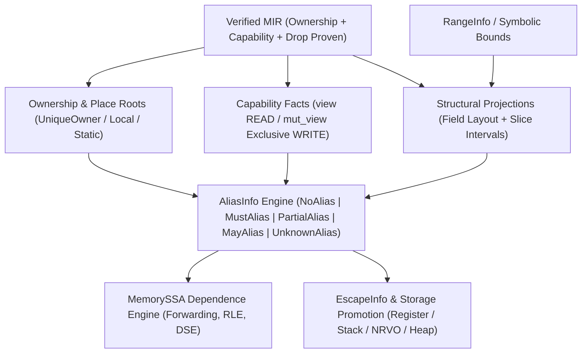
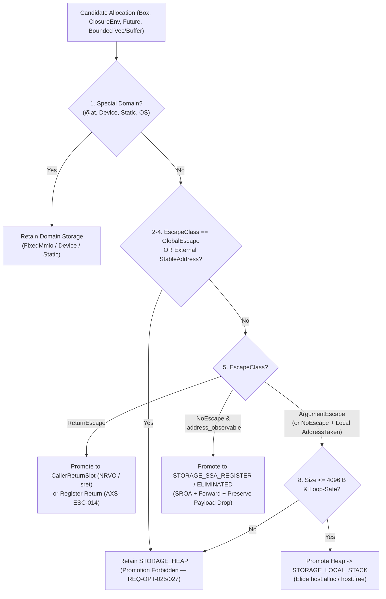

# SPEC-71 — Capability-Driven Alias Analysis (`AliasInfo`), Escape Analysis (`EscapeInfo`) & Storage/Allocation Promotion

## Tóm tắt
Tài liệu chuẩn hóa hệ thống phân tích bí danh dựa trên năng lực và nguồn gốc (`AliasInfo`), tối ưu hóa phụ thuộc bộ nhớ trên `MemorySSA`, phân tích thoát (`EscapeInfo`), và hạ tầng thăng cấp/loại bỏ cấp phát lưu trữ (`Storage & Allocation Promotion`) cho trình biên dịch `axiomc` (Epic `E15.2`, Phase 15 `P15-optimizer-2-0`):
- **Phân tích bí danh dẫn xuất từ `Verified MIR` (`AXS-ALIAS-001..005`)**: Định nghĩa dàn 5 giá trị `AliasResult` (`NoAlias`, `MustAlias`, `PartialAlias`, `MayAlias`, `UnknownAlias`) kết hợp quan hệ vùng không gian (`Disjoint`, `Same`, `Contains`, `ContainedBy`, `Overlaps`). Tận dụng chứng minh độc quyền của `mut_view<T>`, tính bất biến chỉ đọc của `view<T>`, gốc cấp phát tách biệt (`AllocationIdentity`), cây chiếu trường nhạy cảm cấu trúc (`S.f_i` vs `S.f_j`), và khoảng chỉ số `RangeInfo` để sinh sự kiện `NoAlias` nội bộ tương đương `restrict` mà không bắt lập trình viên viết chú thích (`REQ-OPT-299..303`, `REQ-OPT-358`). Mọi quan hệ chưa chứng minh được (`UnknownAlias`, con trỏ thô `*const T`/`*mut T`, FFI) bắt buộc giữ bảo thủ (`MayAlias`), tuyệt đối không suy diễn thành `NoAlias` (`REQ-OPT-028`, `REQ-OPT-300`).
- **Tối ưu hóa bộ nhớ thống nhất trên `MemorySSA` (`AXS-ALIAS-006`)**: Chuẩn hóa điều kiện hợp lệ cho chuyển tiếp ghi-sang-đọc (`Store-to-Load Forwarding`), loại bỏ đọc dư thừa (`RLE`), loại bỏ ghi chết (`DSE`), và tối ưu `memcpy`/`memmove`/`memset` trong khi bảo toàn nghiêm ngặt rào cản `atomic`, `volatile`/`@at`, FFI, `Drop`, và đường truyền zero-copy/DMA (`REQ-OPT-029`, `REQ-OPT-312..314`, `REQ-OPT-347`, `REQ-OPT-365..366`).
- **Phân tích thoát `EscapeInfo` và phân tách quyền sở hữu khỏi lưu trữ vật lý (`AXS-ESC-001..004`)**: Tách biệt hoàn toàn quyền sở hữu (`Ownership`), thời gian sống ngữ nghĩa (`Lifetime`), tính hợp lệ năng lực (`Capability`), và trạng thái thoát (`NoEscape`, `ArgumentEscape`, `ReturnEscape`, và nhóm `GlobalEscape` gồm `HeapEscape`, `ThreadEscape`, `ExternalEscape`, `UnknownEscape` — `REQ-OPT-042..045`, `REQ-OPT-357`).
- **Quy tắc thăng cấp lưu trữ và rào cản quan sát địa chỉ (`AXS-ESC-010..017`)**: Quy định thứ tự ưu tiên 8 bước để thăng cấp `Box<T>`, môi trường bao đóng (`Closure`), máy trạng thái `Future`, bộ sưu tập hữu hạn (`Vec`/`String` cục bộ), và khe trả về do hàm gọi cấp phát (`NRVO`/`sret`) từ heap lên stack hoặc thanh ghi SSA (`REQ-OPT-008`, `REQ-OPT-012`, `REQ-OPT-024..025`, `REQ-OPT-307..310`, `REQ-OPT-335..336`, `REQ-OPT-345..346`, `REQ-OPT-385..386`), đồng thời tôn trọng tuyệt đối rào cản quan sát địa chỉ (`address_of`, `@at`, `volatile`) (`REQ-OPT-027`, `REQ-OPT-029`).

Status: draft (T605, 2026-11-03). Owner: axiom-architect.
Rule IDs `AXS-ALIAS-NNN` and `AXS-ESC-NNN` are stable and never renumbered.
Consolidates: `0131 §86`, `0162 §29`, `0165 §15–20`, `0226 §1–26`, `tasks/0366` (`BOOTSTRAP-107`, `AOPT-23..38`, `AOPT-59..60`), `tasks/0395` (`BOOTSTRAP-136`, `AALIAS-20..70`), `tasks/0397` (`BOOTSTRAP-138`, `AESCAPE-20..80`), `tasks/0429` (`BOOTSTRAP-170`, `ACOL-31..37`), `tasks/0436` (`BOOTSTRAP-177`, `AMEMALLOC-21..29`, `AALLOC-20..29`, `AFRAG-20..24`), `tasks/0438` (`BOOTSTRAP-179`, `AZCOPY-20..25`, `ADMA-20..25`), `tasks/0480` (`BOOTSTRAP-221`, §27–28), `tasks/0486` (`BOOTSTRAP-227`, `ACAP-45..52`), `tasks/0548` (`BOOTSTRAP-289`, `AMEMOPT-20..85`), `tasks/0615` (`BOOTSTRAP-356`, `ACLOS-01..30`), `spec/SPEC-10-ownership.md`, `spec/SPEC-11-capability.md`, `spec/SPEC-12-drop.md`, and `spec/SPEC-70-optir-ssa-memoryssa.md`.
Covers: `REQ-OPT-008`, `REQ-OPT-012`, `REQ-OPT-024`, `REQ-OPT-025`, `REQ-OPT-027`, `REQ-OPT-028`, `REQ-OPT-029`, `REQ-OPT-299`, `REQ-OPT-300`, `REQ-OPT-301`, `REQ-OPT-302`, `REQ-OPT-303` (and governs implementation/QA tasks `T606`–`T608` covering `REQ-OPT-042`, `REQ-OPT-043`, `REQ-OPT-044`, `REQ-OPT-045`, `REQ-OPT-046`, `REQ-OPT-307`, `REQ-OPT-308`, `REQ-OPT-309`, `REQ-OPT-310`, `REQ-OPT-312`, `REQ-OPT-313`, `REQ-OPT-314`, `REQ-OPT-335`, `REQ-OPT-336`, `REQ-OPT-345`, `REQ-OPT-346`, `REQ-OPT-347`, `REQ-OPT-357`, `REQ-OPT-358`, `REQ-OPT-365`, `REQ-OPT-366`, `REQ-OPT-385`, `REQ-OPT-386`).
Consumers: `T606` (`compiler/opt/alias`, `compiler/opt/memopt`, `tests/run/opt_alias`), `T607` (`compiler/opt/escape`, `tests/run/opt_escape`), `T608` (`tests/conformance/p15/e15_2_alias_escape`), and later P15 epics (`E15.3`–`E15.7`).

---

## 1. Capability- and Provenance-Driven Alias Analysis (`AliasInfo`)

**AXS-ALIAS-001 — Semantic Memory vs. Physical Memory and Identity Separation (`REQ-OPT-028`, `REQ-OPT-299`, `REQ-OPT-300`, `REQ-OPT-366`).**
1. **Semantic memory vs. physical machine memory (`REQ-OPT-366`, `tasks/0548 §3`, `AMEMOPT-21/84/85`):**
   - *Semantic memory access* is defined by `Verified MIR` places (`MirPlace`), ownership states (`SPEC-10`), capability regions (`SPEC-11`), and deterministic `Drop` obligations (`SPEC-12`).
   - *Physical machine memory access* consists of target load/store instructions, stack frame slots, registers, and allocator calls in `OptIR`/`LIR`.
   - Memory optimization is permitted to eliminate, forward, scalarize, or relocate physical memory operations if and only if the observable semantic memory behavior remains identical (`REQ-OPT-366`).
2. **Three orthogonal identity domains (`tasks/0395 §7, §26, §31–32`, `tasks/0436 §2020`, `AALIAS-22..24`, `AMEMOPT-64..65`):**
   - `ValueIdentity` (`OptValueId`): The dataflow value computed by an SSA definition (`SPEC-70 AXS-OPT-013`).
   - `StorageIdentity` / `AllocationIdentity` (`AllocId`): The distinct abstract storage root backing a place (a local variable `MirLocalId`, a dynamic allocation site `Box.new` / `Arena.alloc` / `Vec` buffer, a `static` or thread-local item, a fixed hardware `@at` region, or a `DeviceBuffer`). Two values of the same type do not share `AllocationIdentity` unless derived from the same storage root (`tasks/0395 §26`).
   - `LogicalIdentity`: Application-level identifiers (such as generation handles `EntityId(index, gen)`, table keys, or file descriptors). `LogicalIdentity` is not a memory capability; equal handles do not establish storage aliasing without an explicit container contract, and physical storage relocation does not alter `LogicalIdentity` (`AALIAS-24`, `AMEMOPT-64/65`).
3. **Spatial region vs. temporal lifetime (`tasks/0395 §4, §7`, `AALIAS-21..23`):**
   - A `RegionId` represents a spatial byte/field/slice sub-range rooted at an `AllocationIdentity`. Multiple disjoint `RegionId`s may reside inside the same `AllocationIdentity` (e.g., `user.name` and `user.address`, or `buf[0..64]` and `buf[64..128]`).
   - A capability `Lifetime` represents the CFG program-point interval `[start_pt, end_pt]` during which a capability (`view<T>` or `mut_view<T>`) is active (`SPEC-11 AXS-CAP-009`).
4. **Safety verification precedes optimization (`tasks/0395 §58, §74`, `AALIAS-52..56`):**
   - Safety verification (`compiler/own`, `verify_mir`) asks *"Is this access permitted by ownership and capability rules?"* and rejects invalid safe programs at compile time (`INV-SEM-001`, `INV-SEM-002`).
   - Optimizer alias analysis (`compiler/opt/alias`) runs **after** `verify_mir` (`SPEC-70 AXS-OPT-001`), consumes proven ownership and capability facts (`REQ-OPT-299`), and NEVER manufactures safety proofs or weakens verified invariants (`AALIAS-53/54/70`). When an optimization alias proof is `Unknown`, the compiler simply optimizes less (`AALIAS-55`).
[0226 §1–7; tasks/0366 §6–11; tasks/0395 §1, §4, §7, §26, §31–32, §58, §74, §81 AALIAS-20..24, AALIAS-52..56, AALIAS-70; tasks/0548 §3, §34, §43 AMEMOPT-20..23, AMEMOPT-64..65, AMEMOPT-84..85]



**AXS-ALIAS-002 — `AliasInfo` Lattice, Spatial Region Relations, and Fail-Closed `Unknown` Invariant (`REQ-OPT-028`, `REQ-OPT-299`, `REQ-OPT-300`).**
1. **Spatial `RegionRelation` domain (`tasks/0395 §5–6, §77–78`):**
   Given two memory regions $R_A$ and $R_B$, the region analyzer computes their spatial relationship:
   ```text
   RegionRelation =
       REGION_DISJOINT       // Byte intervals of R_A and R_B have empty intersection on all paths
     | REGION_SAME           // R_A and R_B have identical base provenance, byte offset, and non-zero size
     | REGION_CONTAINS       // R_A strictly encloses R_B (e.g., struct S contains field S.x)
     | REGION_CONTAINED_BY   // R_A is strictly enclosed by R_B (e.g., element a[i] inside slice a[..])
     | REGION_OVERLAPS       // R_A and R_B share a common base and partially overlap (e.g., [0..100) and [50..150))
     | REGION_UNKNOWN        // Relationship cannot be statically proven (dynamic indices, opaque pointers)
   ```
2. **Lowering to the `AliasResult` lattice (`tasks/0366 §8`, `tasks/0395 §2–3`, `SPEC-70 AXS-OPT-022`):**
   Every pairwise alias query `alias_query(access_a, access_b, prog_pt)` returns a structured `AliasFact`:
   ```text
   AliasResult = NoAlias | MustAlias | PartialAlias | MayAlias | UnknownAlias

   AliasReason =
       ALIAS_REASON_DISTINCT_ALLOC      // Distinct local/heap/static/domain allocation roots
     | ALIAS_REASON_CAP_MUT_DISJOINT    // Concurrent live mut_view<T> vs view<T>/mut_view<T> (INV-SEM-002)
     | ALIAS_REASON_CAP_VIEW_READONLY   // Shared view<T> read-only stability interval
     | ALIAS_REASON_FIELD_DISJOINT      // Distinct struct/tuple/closure fields (S.f_i != S.f_j)
     | ALIAS_REASON_CONST_INDEX         // Distinct constant array/slice indices (a[c1] vs a[c2])
     | ALIAS_REASON_RANGE_DISJOINT      // Half-open intervals proven disjoint by RangeInfo
     | ALIAS_REASON_NOESCAPE_EXTERNAL   // Non-address-taken NoEscape local vs external/call pointer
     | ALIAS_REASON_IDENTICAL_PLACE     // Identical SSA base value, projection path, and access width
     | ALIAS_REASON_SUBREGION_CONTAINS  // Parent/child projection containment (PartialAlias)
     | ALIAS_REASON_SHARED_OWNER        // Shared Arc<T>/Rc<T> storage handle (MayAlias)
     | ALIAS_REASON_DYNAMIC_INDEX       // Unproven runtime index relationship (MayAlias)
     | ALIAS_REASON_RAW_PTR_PROVENANCE  // Raw pointer (*const T / *mut T) or FFI barrier (UnknownAlias)

   AliasFact {
       result: AliasResult,
       relation: RegionRelation,
       certainty: Certainty,            // Proven | Possible | Unknown (SPEC-70 AXS-OPT-005)
       reason: AliasReason,
       valid_start: u32,                // Program point interval start (0 = whole function)
       valid_end: u32,                  // Program point interval end (0xFFFF_FFFF = whole function)
   }
   ```
   - `NoAlias` (`relation == REGION_DISJOINT`, `certainty == Certainty.Proven`): $R_A$ and $R_B$ access disjoint byte locations in all executions within `[valid_start, valid_end]`.
   - `MustAlias` (`relation == REGION_SAME`, `certainty == Certainty.Proven`): $R_A$ and $R_B$ are guaranteed to resolve to the exact same runtime address and byte width at the query point.
   - `PartialAlias` (`relation ∈ {REGION_CONTAINS, REGION_CONTAINED_BY, REGION_OVERLAPS}`): $R_A$ and $R_B$ share the same storage root and overlap partially or hierarchically. A write to either clobbers the other, and naive whole-value store-to-load forwarding is forbidden unless byte offset/width extraction is exact.
   - `MayAlias`: Overlap is feasible on at least one path (`Certainty.Possible`).
   - `UnknownAlias` (`relation == REGION_UNKNOWN`, `certainty == Certainty.Unknown`): Provenance or offset relationship is opaque.
3. **Strict prohibition on treating `Unknown` as `NoAlias` (`REQ-OPT-028`, `REQ-OPT-300`, `0226 §6`, `tasks/0366 §7, AOPT-24`, `tasks/0395 §3, §76, AALIAS-26`, `tasks/0548 §8, AMEMOPT-25`):**
   - The optimizer MUST NEVER treat `UnknownAlias` or `MayAlias` as `NoAlias` unless an explicit compile-time proof (`Certainty.Proven`) or verified API/FFI contract establishes disjointness (`REQ-OPT-028`, `REQ-OPT-300`).
   - Any pass requiring disjointness (`PropositionKind.NoAlias`) MUST fail closed whenever `alias_query` returns `PartialAlias`, `MayAlias`, or `UnknownAlias` (`SPEC-70 AXS-OPT-032`).
[0226 §4–7; tasks/0366 §6–10, §71 AOPT-23/24/52; tasks/0395 §2–6, §75–78, §81 AALIAS-25/26; tasks/0486 §43–44 ACAP-45..47; tasks/0548 §6–8, §43 AMEMOPT-24/25]

**AXS-ALIAS-003 — Capability Derivation Rules: `mut_view<T>` Disjointness and `view<T>` Read Stability (`REQ-OPT-299`, `REQ-OPT-301`, `REQ-OPT-302`, `REQ-OPT-358`).**
1. **Verified `mut_view<T>` disjointness as compiler-derived `NoAlias` (`REQ-OPT-299`, `REQ-OPT-358`, `0226 §5, §7`, `tasks/0366 §9–10, AOPT-23`, `tasks/0395 §12, §14–15, §37–39`, `tasks/0486 ACAP-45..46`):**
   - By `SPEC-11 AXS-CAP-002..003` and `INV-SEM-002`, an active `mut_view<T>` capability $M$ holds exclusive read-write access to its target region $R_M$: no other active `view` or `mut_view` capability (and no direct owner access) may overlap $R_M$ during $M$'s live interval `[create_pt(M), last_use_pt(M)]`.
   - `compiler/own` exports these verified disjointness relationships directly to `AliasInfo` as `AliasFact { result: NoAlias, relation: REGION_DISJOINT, certainty: Proven, reason: ALIAS_REASON_CAP_MUT_DISJOINT, valid_start, valid_end }` (`REQ-OPT-299`, `REQ-OPT-358`).
   - For function parameters `fn kernel(a: mut_view<[f32]>, b: mut_view<[f32]>, c: view<[f32]>)`, `AliasInfo` records `NoAlias(a, b)` and `NoAlias(a, c)` across the entire function body (unless invalidated by an unsafe/relocation boundary), giving `OptIR` and the loop vectorizer (`E15.5`) C-`restrict` optimization power with zero source annotations (`0226 §5, §7`, `tasks/0395 §37`).
2. **`view<T>` read-only stability and load caching (`REQ-OPT-301`, `0165 §2`, `tasks/0366 §12, AOPT-25`, `tasks/0395 §13, AALIAS-28`):**
   - By `SPEC-11 AXS-CAP-001/003`, a `view<T>` capability $V$ grants shared `READ`-only access to region $R_V$. Multiple `view<T>` capabilities $V_1, V_2$ may overlap (`READ + READ` is allowed, so `alias_query(V_1, V_2)` may be `MustAlias` or `MayAlias`), but **no safe mutation** (`WRITE`) may overlap $R_V$ while $V$ is live.
   - Therefore, across any CFG path within $V$'s active interval `[create_pt(V), last_use_pt(V)]` that contains no raw-pointer write with unknown/matching provenance (`AXS-ALIAS-005`), no `volatile`/`atomic` barrier, and no unannotated `extern` FFI call, the memory contents of $R_V$ are provably invariant (`ReadOnly`, `Certainty.Proven`).
   - This `CAP_VIEW_READONLY` fact authorizes redundant load elimination (`RLE`), read caching across calls that only mutate disjoint regions, and loop-invariant load hoisting (`LICM`, `E15.3`) (`REQ-OPT-301`).
3. **`mut_view<T>` write ordering constraints (`REQ-OPT-302`, `tasks/0366 §13, AOPT-26`, `tasks/0395 §65–66`):**
   - A store through `mut_view<T>` carries `EFFECT_WRITES_MEM` scoped to region $R_M$ (`tasks/0366 §13`).
   - Memory reads and writes that `MustAlias`, `PartialAlias`, or `MayAlias` $R_M$ (including parent/child projections where `R_child CONTAINED_BY R_M` or `R_M CONTAINED_BY R_parent`, `tasks/0395 §65`) MUST NOT be reordered across a `WRITE` to $R_M$ (`REQ-OPT-302`).
4. **Capability splitting and joining (`tasks/0395 §67–68`, `AALIAS-48..49`):**
   - When a `mut_view` over an aggregate or slice is split into provably non-overlapping sub-capabilities — either structurally via distinct field views `mut_view(s.left)` and `mut_view(s.right)` (`tasks/0395 §12`) or via library slice-splitting contracts such as `split_at_mut(mid)` producing `[0..mid)` and `[mid..len)` (`tasks/0395 §17, §67`) — `AliasInfo` assigns sibling `RegionId`s with `REGION_DISJOINT` (`NoAlias`, `Certainty.Proven`) for the sub-capabilities' lifetimes.
   - When the child capabilities reach their last use (`SPEC-11 AXS-CAP-009`), they expire with zero runtime instructions and full access returns to the parent owner (`tasks/0395 §68`, `AALIAS-49`).
[0165 §2; 0226 §5, §7; SPEC-11 AXS-CAP-001..009; tasks/0366 §9–13, §71 AOPT-23/25/26; tasks/0395 §12–17, §37–39, §65–68, §81 AALIAS-27..29, AALIAS-48..51; tasks/0486 §43–44 ACAP-45/46]

**AXS-ALIAS-004 — Structural, Allocation-Root, Field-Sensitive, and Range-Aware Disjointness (`REQ-OPT-303`, `REQ-OPT-358`).**
`AliasInfo` operates in three cooperative precision tiers (`tasks/0395 §75`):
1. **Tier 1 — Allocation-Root and Storage-Domain Separation (`tasks/0395 §26–27, §52–53, §60`, `AALIAS-35, AALIAS-63/65`):**
   Two memory accesses $A$ and $B$ evaluate to `NoAlias` (`ALIAS_REASON_DISTINCT_ALLOC`, `Certainty.Proven`) when:
   - Both have known `AllocationIdentity` roots $I_A \ne I_B$ (e.g., two distinct stack locals `_1` and `_2`, two distinct `Box.new` allocations, or a stack local and a `static` item); OR
   - One access targets a `LocalStack` variable $L$ with `EscapeClass == NoEscape` (`AXS-ESC-002`) whose address is not exposed to the other access's provenance chain (`ALIAS_REASON_NOESCAPE_EXTERNAL`, `tasks/0395 §60`); OR
   - $A$ and $B$ reside in disjoint `StorageDomain`s (`SPEC-70 AXS-OPT-021`): e.g., `Host` (`LocalStack` / `Heap`) vs. `DeviceSpace` (`DeviceBuffer`), or mutable storage vs. immutable `ConstRData` (`tasks/0395 §52–53`, `AALIAS-65`).
2. **Tier 2 — Field-Sensitive Projection Trees (`tasks/0366 §14`, `tasks/0395 §4–6, §21`, `tasks/0548 §5, §19`, `AALIAS-30`, `AMEMOPT-53`):**
   Given two accesses rooted at the same base object $B$ (a `Struct`, `Tuple`, enum payload of the same variant, or compiler-synthesized closure/future environment):
   - Walk their projection paths $[p_0, p_1, \dots, p_{k-1}]$ and $[q_0, q_1, \dots, q_{m-1}]$ from $B$:
     - If at the first index $d$ where $p_d \ne q_d$, both $p_d$ and $q_d$ are struct/tuple field projections (`MIR_PROJ_FIELD(f_1)` vs. `MIR_PROJ_FIELD(f_2)` with $f_1 \ne f_2$ on a non-union type), the two regions are byte-disjoint: `alias_query` returns `NoAlias` (`ALIAS_REASON_FIELD_DISJOINT`, `Certainty.Proven`).
     - If one path is a strict prefix of the other ($k < m$ and $p_i = q_i$ for all $0 \le i < k$), `alias_query` returns `PartialAlias` (`REGION_CONTAINS` / `REGION_CONTAINED_BY`).
     - If $k = m$, all projections match ($p_i = q_i$), and the base `OptValueId`s are identical, `alias_query` returns `MustAlias` (`ALIAS_REASON_IDENTICAL_PLACE`, `Certainty.Proven`).
   - Ownership facts over aggregates and fields enable scalar replacement (`SROA`) and allocation elimination (`REQ-OPT-303`, `AOPT-27`).
3. **Tier 3 — Array/Slice Half-Open Intervals and `RangeInfo` Disjointness (`tasks/0366 §15–16`, `tasks/0395 §16–22, §78`, `tasks/0548 §20–21`, `AALIAS-31..34`, `AMEMOPT-54..55`):**
   Given two element or sub-slice accesses on the same array/slice base $S$ with element byte size $E > 0$:
   - **Constant indices:** `S[c1]` and `S[c2]` return `MustAlias` if $c_1 = c_2$, and `NoAlias` (`ALIAS_REASON_CONST_INDEX`, `Certainty.Proven`) if $c_1 \ne c_2$.
   - **Half-open sub-slice ranges (`AALIAS-32..33`):** Slice ranges `S[lo1..hi1]` and `S[lo2..hi2]` use half-open interval semantics $[lo_1, hi_1)$ and $[lo_2, hi_2)$. When $hi_1 \le lo_2$ or $hi_2 \le lo_1$ is proven (including adjacent ranges such as `buf[0..100]` and `buf[100..200]` where $hi_1 = lo_2 = 100$), `alias_query` returns `NoAlias` (`ALIAS_REASON_RANGE_DISJOINT`, `Certainty.Proven`). When $\max(lo_1, lo_2) < \min(hi_1, hi_2)$ is proven, `alias_query` returns `PartialAlias` (`REGION_OVERLAPS`, e.g., `buf[0..100]` and `buf[50..150]`).
   - **Symbolic/Range-refined dynamic indices (`AALIAS-31/34/62`, `AMEMOPT-54/55`):** For `S[i]` and `S[j]` where `RangeInfo` establishes $i \in [l_i, u_i]$ and $j \in [l_j, u_j]$ (or symbolic affine offsets $i = k + c_1$, $j = k + c_2$ with $c_1 \ne c_2$ and proven non-wrapping), if $u_i < l_j$ or $u_j < l_i$ holds with `Certainty.Proven`, `alias_query` returns `NoAlias` (`ALIAS_REASON_RANGE_DISJOINT`). Otherwise, unknown dynamic indices return `MayAlias` (`ALIAS_REASON_DYNAMIC_INDEX`, never `NoAlias`).
[tasks/0366 §14–16, §19–21, §71 AOPT-27; tasks/0395 §4–6, §16–23, §26–27, §52–53, §60, §75, §78, §81 AALIAS-30..35, AALIAS-62..65; tasks/0548 §5, §18–21, §43 AMEMOPT-53..55]

**AXS-ALIAS-005 — Raw-Pointer Provenance, Shared Ownership (`Arc`/`Rc`), and Conservative Invalidation Barriers (`REQ-OPT-028`, `REQ-OPT-300`, `REQ-OPT-314`).**
1. **Raw-pointer provenance rules (`SPEC-11 AXS-CAP-008`, `tasks/0395 §10–11, §41, §62–63`, `AALIAS-38..41`):**
   - By `SPEC-11 AXS-CAP-008`, raw pointers (`*const T`, `*mut T`) created by `address_of(place)` / `address_of_mut(place)` inside `unsafe` are **not** capabilities and carry no compile-time exclusivity guarantee.
   - **Known local provenance:** When a raw pointer `p` is traced via SSA def-use chains to `OPT_INST_ADDR_OF(place_root)` (plus constant/bounded pointer offsets `ptr.add`), `p` inherits `AllocationIdentity(place_root)`. Consequently:
     - Any dereference `*p` has `MayAlias` (or `MustAlias` when offset and width match exactly) with `place_root`, preventing the optimizer from caching or reordering `place_root` accesses across writes through `p`.
     - If `place_root` is a distinct non-escaping local `_a`, `*p` still has `NoAlias` with any other distinct non-address-taken local `_b` ($\_a \ne \_b$).
   - **Unknown / integer-derived provenance (`AALIAS-38..40`):** A raw pointer obtained from an integer cast (`addr as *mut T`), loaded from untyped memory, or returned by an unannotated `extern` FFI call has `Provenance.Unknown`. Dereferencing such a pointer returns `UnknownAlias` (`Certainty.Unknown`) against all address-taken locals, heap allocations, globals, and caller-provided pointers, while remaining `NoAlias` only against purely local `NoEscape` variables whose address is **never** taken (`address_taken == false`, `tasks/0395 §60, §62`).
   - Numeric pointer equality at runtime does not manufacture safe capability provenance (`tasks/0395 §11`, `AALIAS-39`).
2. **Shared ownership (`Arc<T>`, `Rc<T>`) (`tasks/0395 §28–30, §47–49, §51`, `AALIAS-36..37, AALIAS-45`):**
   - Multiple `Arc<T>` or `Rc<T>` handles may point to the same underlying heap allocation; thus two `Arc<T>` / `Rc<T>` dereferences have `MayAlias` (or `MustAlias` when cloned from the same SSA handle) on their storage region (`AALIAS-36`).
   - Shared ownership grants `READ` access only (`AALIAS-37`). Mutation through shared ownership requires an explicit interior synchronization abstraction (`Mutex<T>`, `RwLock<T>`, `Atomic<T>`), whose lock/unlock or atomic acquire/release operations act as memory ordering and alias invalidation boundaries (`AALIAS-45`).
3. **Invalidation boundaries for scoped alias and read-only facts (`tasks/0395 §24–25, §39–40, §42–43, §50`, `AALIAS-42, AALIAS-46, AALIAS-50..51`):**
   Scoped `NoAlias` and `ReadOnly` facts are invalidated at:
   - Container relocation/reallocation operations (`Vec.push`, `Vec.reserve`, `String.push_str`) on any capability derived from that container's buffer (`tasks/0395 §24–25`, `AALIAS-46`),
   - Async `.await` suspension points for any region reachable across concurrent tasks (`tasks/0395 §50`),
   - Synchronization acquire/release fences and mutex/rwlock guard boundaries (`tasks/0395 §47–49`),
   - Unannotated `extern` FFI calls (`REQ-OPT-314`, `tasks/0395 §42–43`, `AALIAS-42`): an FFI call without an explicit verified `@ffi_contract` conservatively clobbers all `ExternalEscape`, `HeapEscape`, `GlobalStatic`, and address-exposed regions.
[0226 §3–6; SPEC-11 AXS-CAP-008; tasks/0395 §10–11, §24–25, §28–30, §39–51, §62–63, §81 AALIAS-36..46, AALIAS-50..51, AALIAS-64/66]

**AXS-ALIAS-006 — Unified Memory Dependence Engine: Forwarding, `RLE`, `DSE`, and Hardware/Zero-Copy Barriers (`REQ-OPT-029`, `REQ-OPT-301`, `REQ-OPT-302`, `REQ-OPT-312`, `REQ-OPT-313`, `REQ-OPT-314`, `REQ-OPT-347`, `REQ-OPT-365`, `REQ-OPT-366`).**
1. **Unified `MemoryAccess` engine (`REQ-OPT-365`, `tasks/0548 §1, §4, AMEMOPT-22`):**
   `compiler/opt/memopt` models all memory operations through a unified classification covering `Load`, `Store`, `AtomicLoad`, `AtomicStore`, `AtomicRMW`, `VolatileLoad`, `VolatileStore`, `Copy`, `Move`, `Memcpy`, `Memmove`, `Memset`, `Init`, `Drop`, `Allocation`, and `Deallocation` (`REQ-OPT-365`), combining `MemorySSA` (`SPEC-70 AXS-OPT-020..024`) with `AliasInfo` (`AMEMOPT-26..28`) to answer pairwise memory dependence queries (`MustDepend`, `MayDepend`, `NoDepend`, `UnknownDepend`, `tasks/0548 §6`).
2. **Store-to-Load Forwarding (`tasks/0548 §9–10, AMEMOPT-29..30`):**
   Given a non-volatile, non-atomic `OPT_INST_LOAD` $L$ reading region $R_L$ with `MemoryUse(mem_in)`:
   - Walk upward through the `MemorySSA` chain starting at `mem_in`.
   - For each `MemoryDef` $D$:
     - If $D$ is a store (`OPT_INST_STORE`) of value $v_S$ to region $R_D$ with `alias_query(R_D, R_L) == NoAlias` (`Certainty.Proven`) or a non-clobbering call (`SPEC-70 AXS-OPT-024`), continue walking to $D.\mathrm{mem\_prev}$.
     - If $D$ is a non-volatile, non-atomic store of $v_S$ to $R_D$ with `alias_query(R_D, R_L) == MustAlias` (`Certainty.Proven`) and identical `TypeId` (or proven bitwise-valid sub-field extraction), replace $L$ with $v_S$ (`PropositionKind.MustAlias`, `Certainty.Proven`).
     - If $D$ is `PartialAlias`, `MayAlias`, `UnknownAlias`, `volatile`, `atomic`, or a clobbering call/join, stop and retain $L$.
3. **Redundant Load Elimination (`RLE`) (`REQ-OPT-301`, `tasks/0548 §11, AMEMOPT-31`):**
   Given two non-volatile, non-atomic loads $L_1$ and $L_2$ where $L_1$ dominates $L_2$, `alias_query(R_{L1}, R_{L2}) == MustAlias` (`Certainty.Proven`), and either:
   - $L_1$ and $L_2$ resolve to the same non-clobbered `MemSsaId` version in `MemorySSA`, OR
   - Both read through an active `view<T>` capability over `[L_1, L_2]` with no intervening invalidating effect (`AXS-ALIAS-003` rule 2, `REQ-OPT-301`),
   then $L_2$ is replaced by the SSA result of $L_1$.
4. **Dead Store Elimination (`DSE`) and Dead Initialization Elimination (`tasks/0548 §25–27, AMEMOPT-32..33, AMEMOPT-45..47`):**
   A memory write $S_1$ (`OPT_INST_STORE` or field initialization) to region $R_1$ may be eliminated (`PropositionKind.DeadStore`, `Certainty.Proven`) if and only if:
   - $S_1$ is NOT `volatile`, NOT `atomic`, and NOT a security zeroization write (`OPT_INST_ZEROIZE`, `SPEC-70 AXS-OPT-044`),
   - Overwriting $R_1$ does not skip a required `Drop` of a previously initialized resource (`AMEMOPT-45`, `tasks/0548 §42 Test 10`),
   - Partial initialization states are not falsely treated as whole-struct initialization (`AMEMOPT-47`, `tasks/0548 §26`), AND
   - One of the following holds on all paths from $S_1$:
     1. **Post-dominating overwrite:** Every path from $S_1$ reaches another store $S_2$ to region $R_2$ with `MustAlias(R_1, R_2)` (or $R_2$ completely covering $R_1$) before any `MemoryUse`, `Drop`, panic/unwind exit, or call that `MayDepend` on $R_1$; OR
     2. **Dead local at scope exit:** $R_1$ belongs to a local or promoted allocation with `EscapeClass == NoEscape` and `address_observable == false`, and all paths from $S_1$ reach `StorageDead(local)` or function `Return` without any intervening read or `Drop` that observes $R_1$.
5. **`memcpy`, `memmove`, and `memset` Optimization Legality (`tasks/0548 §22–24, AMEMOPT-48..52`):**
   - `memmove(dst, src, len)` may be rewritten to `memcpy(dst, src, len)` **only** when `AliasInfo` proves `NoAlias` (`REGION_DISJOINT`, `Certainty.Proven`) between `[src, src + len)` and `[dst, dst + len)` (`AMEMOPT-50..51`).
   - Small constant-length `memcpy(dst, src, K)` on non-volatile, properly aligned aggregates with `NoAlias(dst, src)` may be lowered to scalar/register loads and stores.
   - `memset(dst, 0, sizeof(T))` may be converted into a typed zero constant assignment `dst = zero_init<T>()` **only** when every field of `T` admits the all-zero bit pattern as a valid representation (true for primitive integers, floats, `bool`, and plain arrays/structs thereof; forbidden for types with non-zero niches, capabilities, or invalid zero discriminants, `AMEMOPT-49/52`).
6. **Mandatory Hardware, Synchronization, FFI, and Zero-Copy Barriers (`REQ-OPT-029`, `REQ-OPT-312`, `REQ-OPT-313`, `REQ-OPT-314`, `REQ-OPT-347`):**
   - **`Atomic` barrier (`REQ-OPT-312`, `0226 §25–26`, `tasks/0366 AOPT-36`, `tasks/0548 §28, §30, AMEMOPT-36..39`):** Atomic loads, stores, RMWs, and fences MUST NOT be replaced by ordinary memory accesses, merged across synchronization boundaries, or reordered in any way that weakens `happens-before` or `synchronizes-with` relations.
   - **`Volatile` and `@at` barrier (`REQ-OPT-029`, `REQ-OPT-313`, `0226 §14, §26`, `tasks/0366 AOPT-37`, `tasks/0548 §29, AMEMOPT-34..35`):** Volatile memory operations (`OPT_INST_VOLATILE_LOAD`, `OPT_INST_VOLATILE_STORE`, `@at` hardware registers) MUST NOT be removed by DSE/RLE, forwarded by GVN, or reordered relative to each other or to observable operations.
   - **Foreign call (`FFI`) barrier (`REQ-OPT-314`, `tasks/0366 AOPT-38`, `tasks/0548 §31, AMEMOPT-40..41`):** Foreign calls are optimized conservatively according to their effect and alias contracts; without an explicit verified contract, a foreign call acts as a read/write clobber on all escaped or address-observable memory.
   - **Zero-copy I/O, `mmap`, scatter/gather, and DMA buffers (`REQ-OPT-347`, `tasks/0438 §2097 AZCOPY-20..25, AIOASYNC-20..21, ADMA-20..25`):** Zero-copy data paths (eliding staging buffer copies across `host.read`/`host.write`, memory-mapped views, scatter/gather slices, or device DMA transfers) are legal **only** when compile-time proofs establish capability non-aliasing (`NoAlias`) and lifetime validity covering the entire synchronous or asynchronous transfer (`REQ-OPT-347`). While an active I/O or DMA capability holds a buffer, the optimizer MUST NOT relocate, reuse, or deallocate that buffer (`AZCOPY-25`, `AIOASYNC-21`, `ADMA-22`).
[0226 §14, §22–26; tasks/0366 §71 AOPT-25/26/36..38; tasks/0438 §2097 AZCOPY-20..25, AIOASYNC-20..21, ADMA-20..25; tasks/0548 §1–39, §42–43 AMEMOPT-20..85]

---

## 2. Escape Analysis (`EscapeInfo`) & Semantic vs. Physical Lifetime

**AXS-ESC-001 — Separation of Ownership, Semantic Lifetime, Capability Validity, and Physical Storage (`REQ-OPT-042`, `REQ-OPT-044`, `REQ-OPT-045`, `REQ-OPT-303`).**
1. **Compiler-managed storage without programmer annotation burden (`REQ-OPT-042`, `REQ-OPT-044`, `tasks/0397 §1, §77 AESCAPE-74`):**
   - Axiom programmers are NOT required to manually choose between register, stack, or heap syntax for ordinary values, closures, or futures, and are NOT required to write lifetime parameters (`'a`), borrow-checker annotations, `restrict`, or `pure` (`REQ-OPT-042`, `REQ-OPT-044`).
   - The compiler determines the most efficient physical storage placement from semantic lifetime, `EscapeInfo`, and address-observability facts.
2. **Four distinct semantic vs. physical axes (`REQ-OPT-045`, `tasks/0397 §1, §3, §22–24, §77 AESCAPE-20..23, AESCAPE-34`):**
   | Axis | Question Answered | Governing Layer |
   |---|---|---|
   | **Ownership** (`SPEC-10`) | Which binding owns the value and is responsible for its `Drop`? | `compiler/own` + `verify_mir` |
   | **Semantic Lifetime & Capability Validity** (`SPEC-11`) | Over what lexical/CFG scope is a binding or `view`/`mut_view` capability valid? | `compiler/own` + `verify_mir` |
   | **Escape Status** (`EscapeInfo`) | Can the value, capability, or storage address outlive or be observed outside the current activation frame or thread? | `compiler/opt/escape` (`SPEC-71`) |
   | **Physical Storage** (`StorageDecision`) | Where do the bytes physically reside at runtime (SSA register, stack slot, caller return slot, inline buffer, heap, arena, MMIO, device)? | `compiler/opt/escape` + `LIR`/`ABI` |
   - **Ownership $\ne$ Heap Allocation (`AESCAPE-20, AESCAPE-34`):** Owning a `Box<T>`, closure, or collection expresses *semantic ownership of dynamic storage*, never a mandate to invoke a runtime heap allocator when the storage identity is unobservable.
   - **Escape $\ne$ Semantic Lifetime (`REQ-OPT-045`, `AESCAPE-21`):** A local variable `x` has a semantic lifetime spanning its lexical block `{ let x = make(); use(x); }`, yet its escape classification is `NoEscape` (`tasks/0397 §3`).
3. **Physical lifetime shortening (`tasks/0397 §3, §54–56`, `AESCAPE-68..69`):**
   For any `NoEscape` local or promoted allocation whose `Drop` is trivial (or after its last use when `Drop` order is unaffected), the optimizer may contract its physical storage liveness from `[scope_entry, scope_exit]` to `[first_def, last_use_or_active_view_end]`, enabling physical register and stack-slot reuse across non-overlapping locals without creating semantic aliasing (`AESCAPE-68/69`).
[0165 §17–20; 0226 §8–13; tasks/0366 §20–23, §71 AOPT-27/33; tasks/0397 §1–3, §22–24, §54–56, §77 AESCAPE-20..23, AESCAPE-34, AESCAPE-68..69, AESCAPE-74]

**AXS-ESC-002 — `EscapeKind` Classification, Four-Tier Promotion Lattice, and `EscapeInfo` Data Model (`REQ-OPT-025`, `REQ-OPT-043`, `REQ-OPT-357`).**
1. **Fine-grained `EscapeKind` flags and four-tier `EscapeClass` lattice (`tasks/0397 §2, §4–12`, `tasks/0480 §28`, `REQ-OPT-043`, `REQ-OPT-357`, `AESCAPE-24`):**
   `EscapeInfo` categorizes every place (`MirLocalId` / `OptValueId`) and allocation site (`AllocId`) using a fine-grained bitmask `EscapeSet` that maps directly onto four canonical promotion tiers (`EscapeClass`):
   ```text
   // Fine-grained escape bitset (REQ-OPT-357, tasks/0397 §4, tasks/0480 §28):
   ESC_NONE       = 0          // NoEscape: confined strictly to the current function frame
   ESC_ARGUMENT   = 1 << 0     // ArgumentEscape: passed to a callee that does not retain it past return (REQ-OPT-043)
   ESC_RETURN     = 1 << 1     // ReturnEscape: returned by value or capability to the immediate caller
   ESC_HEAP       = 1 << 2     // HeapEscape: stored into a heap object, global static, or thread-local variable
   ESC_THREAD     = 1 << 3     // ThreadEscape: sent across a thread/task/channel boundary (spawn)
   ESC_EXTERNAL   = 1 << 4     // ExternalEscape: exposed to an FFI call, volatile/MMIO store, or OS/DMA handle
   ESC_UNKNOWN    = 1 << 5     // UnknownEscape: reaches an unresolved indirect call or analysis budget limit

   // Coarse four-tier promotion lattice (T605, T607):
   EscapeClass =
       NoEscape                // escape_set == ESC_NONE
     | ArgumentEscape          // (escape_set & ~ESC_ARGUMENT) == 0 && (escape_set & ESC_ARGUMENT) != 0
     | ReturnEscape            // (escape_set & ~(ESC_ARGUMENT | ESC_RETURN)) == 0 && (escape_set & ESC_RETURN) != 0
     | GlobalEscape            // (escape_set & (ESC_HEAP | ESC_THREAD | ESC_EXTERNAL | ESC_UNKNOWN)) != 0
   ```
   The four promotion tiers form a strict join semilattice under $\sqcup$:
   $$\mathrm{NoEscape} \;\sqsubset\; \mathrm{ArgumentEscape} \;\sqsubset\; \mathrm{ReturnEscape} \;\sqsubset\; \mathrm{GlobalEscape}\;(\mathrm{HeapEscape} \cup \mathrm{ThreadEscape} \cup \mathrm{ExternalEscape} \cup \mathrm{UnknownEscape})$$
2. **Data model (`tasks/0397 §71–72`, `AESCAPE-25..26`):**
   ```text
   EscapeRecord {
       subject_id: u32,                // MirLocalId, OptValueId, or AllocId
       escape_set: u16,                // Bitwise union of ESC_* flags along all reachable paths
       escape_class: EscapeClass,      // NoEscape | ArgumentEscape | ReturnEscape | GlobalEscape
       address_taken: bool,            // True if OPT_INST_ADDR_OF is applied to this subject
       address_observable: bool,       // True if raw address escapes, is cast to int, compared, or @at/volatile
       stable_address: bool,           // True if storage relocation is forbidden during lifetime
       has_active_view_escape: bool,   // True if a derived view/mut_view escapes
       certainty: Certainty,           // Proven (for NoEscape/ArgEscape/ReturnEscape) | Unknown
       storage_decision: PhysicalStorage,
       decision_reason: StorageReason,
   }
   ```
   Value escape (`value_escape`) and allocation escape (`alloc_escape`) are tracked distinctly (`AESCAPE-26`): reading a scalar field `*box_ptr` and returning that scalar `i32` causes the loaded `i32` value to `ReturnEscape`, while the `Box<i32>` allocation itself remains `NoEscape`!
3. **Conservative `UnknownEscape` (`REQ-OPT-025`, `tasks/0397 §11, §64, AESCAPE-27..28`):**
   When an allocation or pointer reaches an unresolved indirect call (`FnPtr` / `dyn Trait`), inline assembly, or unannotated `extern` FFI call, `escape_set` includes `ESC_UNKNOWN`, which maps to `EscapeClass.GlobalEscape` (`Certainty.Unknown`) and prevents allocation elimination or stack promotion (`REQ-OPT-025`, `AESCAPE-27/28`).
[0165 §17–19; tasks/0366 §22; tasks/0397 §2–14, §64, §71–72, §77 AESCAPE-24..28; tasks/0480 §28]

**AXS-ESC-003 — Interprocedural Escape Summaries and Call-Graph SCC Fixed-Point Propagation (`REQ-OPT-043`, `REQ-OPT-357`).**
1. **Per-function `EscapeSummary` (`tasks/0397 §59–63`, `AESCAPE-57..60`):**
   Bottom-up over the call graph DAG (and iteratively to a fixed point within recursive Strongly Connected Components, `AESCAPE-57`), `compiler/opt/escape` computes an `EscapeSummary` for each function:
   ```text
   FunctionEscapeSummary {
       fn_id: FnId,
       param_escape: [u16],            // EscapeSet of parameter i within callee (masked of ESC_NONE)
       param_flows_to_return: [bool],  // True if parameter i (or a view/sub-allocation of it) is returned
       param_addr_observed: [bool],    // True if callee observes raw address identity of parameter i
   }
   ```
2. **`ArgumentEscape` propagation rule (`REQ-OPT-043`, `tasks/0397 §6, §43, §62`):**
   When caller $F$ passes an argument derived from local/allocation $A$ as parameter $i$ of a direct call to $G$:
   - If `G.param_escape[i]` contains any of `ESC_HEAP | ESC_THREAD | ESC_EXTERNAL | ESC_UNKNOWN`, that flag propagates into $A.\mathrm{escape\_set}$ (`GlobalEscape`).
   - If `G.param_flows_to_return[i] == true`, the escape status of the call's destination value in $F$ propagates backward into $A.\mathrm{escape\_set}$ (so if $F$ returns the call result, $A$ becomes `ReturnEscape`; if $F$ uses the call result only locally, $A$ is `ArgumentEscape`).
   - If `G.param_escape[i]` is `ESC_NONE` or `ESC_ARGUMENT` (and `param_flows_to_return[i] == false`), $A$ acquires only `ESC_ARGUMENT` (`ArgumentEscape`, `REQ-OPT-043`).
   - **Effect-driven refinement (`tasks/0397 §43, §62`, `AESCAPE-43`):** A callee proven `EFFECT_PURE` or `EFFECT_READS_MEM` (with no `EFFECT_WRITES_MEM`, `EFFECT_FFI`, `EFFECT_IO`, or `EFFECT_UNKNOWN` in `SPEC-70 AXS-OPT-023`) cannot store a parameter into a global, heap, or thread channel; thus any parameter not flowing to its return value is guaranteed `ArgumentEscape` at worst.
[tasks/0397 §6, §12–13, §43, §59–63, §75–77 AESCAPE-43, AESCAPE-57..60]

**AXS-ESC-004 — Capability Outlives, Active View Lifetimes, and `ThreadEscape` Concurrency Rules (`REQ-OPT-045`, `REQ-OPT-386`).**
1. **Escape analysis never weakens capability verification (`tasks/0397 §21–25, §65`, `AESCAPE-22, AESCAPE-30..32, AESCAPE-66`):**
   - If a `view<T>` or `mut_view<T>` escapes via `ReturnEscape` (`return view(x)`), its provenance is checked by `compiler/own` (`SPEC-11 AXS-CAP-004`): if the owner `x` is a local variable that dies on function return, compilation fails with `AX_CAP_OUTLIVES_OWNER` before optimization ever runs (`AESCAPE-31/66`).
   - When a function validly returns a capability derived from an input capability parameter (`fn first(v: view<[i32]>) -> view<i32>`), `EscapeInfo` records `param_flows_to_return[0] = true` and preserves the input provenance chain (`tasks/0397 §25`, `AESCAPE-30`).
   - If an owner `x` is `NoEscape` (`EscapeClass.NoEscape`) while a local capability `v = view(x)` or `m = mut_view(x)` is derived from `x`, physical storage for `x` MUST remain valid and un-relocated for the entire active lifetime of `v` or `m` (`tasks/0397 §21–22`, `AESCAPE-22/41`).
2. **`ThreadEscape` and closure/task concurrency obligations (`tasks/0397 §9, §34`, `tasks/0615 §20–23`, `AESCAPE-29, AESCAPE-45`, `REQ-OPT-386`):**
   - Any value, allocation, or closure environment classified as `ESC_THREAD` (`ThreadEscape`, e.g., passed to `spawn`) must satisfy `Send` (and `Share` for shared references), enforced by semantic verification (`AESCAPE-29`).
   - A closure capturing state by `MUTATE` (`mut_view<T>`) requires exclusive capability over the captured variable for the closure's entire lifetime and cannot coexist with concurrent reads/writes or be implicitly shared across threads (`REQ-OPT-386`, `tasks/0615 §7, §20, ACLOS-07, ACLOS-20`).
   - An allocation with `ESC_THREAD` MUST NOT be promoted to a caller stack frame that can exit before the spawned task terminates (`tasks/0397 §9, §46`).
[SPEC-11 AXS-CAP-004..009; tasks/0397 §9, §21–25, §34, §46, §65, §77 AESCAPE-22, AESCAPE-29..32, AESCAPE-41, AESCAPE-45, AESCAPE-66; tasks/0615 §7, §20–23, §39 ACLOS-07..09, ACLOS-17..20]

---

## 3. Storage Selection, Allocation Promotion & Observability Barriers

**AXS-ESC-010 — Eight-Step Storage Decision Priority Hierarchy (`REQ-OPT-012`, `REQ-OPT-024`, `REQ-OPT-025`, `REQ-OPT-042`, `REQ-OPT-046`, `REQ-OPT-307`, `REQ-OPT-309`, `REQ-OPT-335`, `REQ-OPT-346`).**
1. **Physical storage classes (`tasks/0397 §49, §72`):**
   ```text
   PhysicalStorage =
       STORAGE_ELIMINATED        // Completely folded away / dead allocation eliminated
     | STORAGE_SSA_REGISTER      // Promoted to scalar SSA virtual registers (SROA / register promotion)
     | STORAGE_LOCAL_STACK       // Allocated in the current function's fixed stack frame (alloca/frame slot)
     | STORAGE_CALLER_RET_SLOT   // Constructed in-place in caller-provided return storage (NRVO / sret)
     | STORAGE_INLINE_BUFFER     // Promoted to a bounded inline array inside the enclosing stack/struct
     | STORAGE_ARENA_POOL        // Retained in explicit Arena/Pool storage per lifetime contract
     | STORAGE_HEAP              // Retained as dynamic heap allocation (host.alloc / malloc)
     | STORAGE_STATIC_TLS        // Global static or thread-local storage section
     | STORAGE_FIXED_MMIO        // Pinned hardware @at address (never promoted or relocated)
     | STORAGE_DEVICE_EXTERNAL   // GPU DeviceBuffer or external OS/FFI resource
   ```
2. **Mandatory 8-step evaluation order (`REQ-OPT-046`, `tasks/0397 §46, §50, §73`, `AESCAPE-47..50, AESCAPE-75/78`):**
   Not every allocation can be promoted (`REQ-OPT-046`). To guarantee that optimization never overrides semantic contracts, `compiler/opt/escape` evaluates candidate allocations in strict priority order:
   1. **Step 1 — Storage-domain check (`AESCAPE-47, AESCAPE-49..50`):** If the object belongs to `FixedMmio` (`@at`), `DeviceSpace` (`DeviceBuffer`), `GlobalStatic`, `ThreadLocal`, an explicit `Arena`/`Pool` whose lifetime outlives the frame (`AESCAPE-71`), or an external OS resource (`File`, `Socket`), retain its domain storage (`STORAGE_FIXED_MMIO`, `STORAGE_DEVICE_EXTERNAL`, etc.) and stop.
   2. **Step 2 — Capability & ownership validity check (`AESCAPE-32, AESCAPE-70`):** Verify that any candidate promotion preserves active `view`/`mut_view` intervals (`AXS-ESC-004`).
   3. **Step 3 — Stable-address and address-observability check (`REQ-OPT-027`, `REQ-OPT-308`, `AESCAPE-37..40`):** If `stable_address == true` or `address_observable == true` (`AXS-ESC-015`), forbid `STORAGE_SSA_REGISTER` and `STORAGE_ELIMINATED`; if the exposed address escapes the frame (`GlobalEscape`), retain `STORAGE_HEAP`.
   4. **Step 4 — Observable allocation identity check (`REQ-OPT-024`, `REQ-OPT-307`, `AESCAPE-35..36`):** If the program observes whether two allocations have distinct storage identity (`same_storage(a, b)` or pointer equality comparison `p == q`), forbid merging their storage or eliminating the allocation in a way that alters identity comparison results.
   5. **Step 5 — Escape classification gate (`REQ-OPT-025`, `REQ-OPT-309`, `AESCAPE-33`):**
      - `GlobalEscape` (`ESC_HEAP | ESC_THREAD | ESC_EXTERNAL | ESC_UNKNOWN`): Promotion to local stack or SSA registers is **forbidden** (`REQ-OPT-025`); retain `STORAGE_HEAP`.
      - `ReturnEscape`: Eligible for `STORAGE_SSA_REGISTER` (small value return) or `STORAGE_CALLER_RET_SLOT` (`NRVO` / `sret`, `AXS-ESC-014`).
      - `ArgumentEscape`: Eligible for `STORAGE_LOCAL_STACK` (or `STORAGE_SSA_REGISTER` after callee inlining).
      - `NoEscape`: Eligible for `STORAGE_SSA_REGISTER`, `STORAGE_ELIMINATED`, `STORAGE_INLINE_BUFFER`, or `STORAGE_LOCAL_STACK` (`REQ-OPT-012`, `REQ-OPT-335`, `REQ-OPT-346`).
   6. **Step 6 — Effect & `Drop` preservation check (`AMEMOPT-58`, `AESCAPE-70`):** Ensure that promoting or eliminating the container allocation preserves the exact execution and ordering of the payload's `Drop.drop` glue (`AXS-ESC-011` rule 3).
   7. **Step 7 — ABI & layout check (`0226 §15`):** If an aggregate is passed by pointer to an `@repr(C)` FFI function (`ArgumentEscape` with `address_taken`), keep its contiguous layout in `STORAGE_LOCAL_STACK` rather than decomposing it into disjoint registers.
   8. **Step 8 — Frame-size budget check:** Enforce the per-allocation stack promotion cap (`MAX_STACK_PROMOTE_BYTES = 4096`) and per-function promoted frame cap (`MAX_FN_PROMOTED_STACK_BYTES = 16384`) so stack promotion never causes unbounded stack growth in loops or deep recursion. Allocations inside a loop body may be promoted to a single reused stack slot only when their lifetime does not cross loop iterations (`AMEMOPT-60`).
[0162 §29; 0165 §17–20; 0226 §8–15; tasks/0366 §20–24, §71 AOPT-31..34, AOPT-59; tasks/0397 §14–20, §45–53, §72–73, §77 AESCAPE-33..40, AESCAPE-47..51, AESCAPE-70..78; tasks/0436 §2018–2047 AMEMALLOC-21..29, AFRAG-23..24; tasks/0548 §17, §35–37, §43 AMEMOPT-56..63]



**AXS-ESC-011 — `Box<T>` and Dynamic Allocation Promotion (`Heap → Stack → SSA Register → Eliminated`) (`REQ-OPT-012`, `REQ-OPT-024`, `REQ-OPT-025`, `REQ-OPT-303`, `REQ-OPT-307`, `REQ-OPT-309`, `REQ-OPT-335`, `REQ-OPT-346`).**
1. **Heap-to-Stack Promotion (`REQ-OPT-024`, `REQ-OPT-309`, `REQ-OPT-346`, `0226 §10, §12`, `tasks/0397 §14–15, §45`):**
   When a dynamic allocation $A$ (`Box.new(v)` or heap temporary) satisfies Steps 1–8 of `AXS-ESC-010` with `EscapeClass ∈ {NoEscape, ArgumentEscape}` (`PropositionKind.NoEscape`, `Certainty.Proven`):
   - The dynamic heap allocation call (`host.alloc`) is replaced by a typed `MirLocalId` stack slot in the current `OptBody` (`STORAGE_LOCAL_STACK`).
   - The matching deallocation call (`host.free` in `Box`'s drop glue) is replaced by `StorageDead` of the stack slot.
2. **Stack-to-Register (`SSA`) Promotion and Complete Allocation Elimination (`REQ-OPT-012`, `REQ-OPT-024`, `REQ-OPT-303`, `REQ-OPT-307`, `REQ-OPT-335`, `REQ-OPT-346`, `0162 §29`, `0165 §17–20`, `tasks/0397 §16–17`, `tasks/0548 §17`):**
   When $A$ has `EscapeClass == NoEscape` and `address_observable == false` (`REQ-OPT-012`, `REQ-OPT-024`):
   - If the payload type `T` is a scalar or an aggregate eligible for `SROA` (`SPEC-70 AXS-OPT-014`), the stack slot is further promoted to `STORAGE_SSA_REGISTER`: stores into `*box_val` become SSA definitions, loads from `*box_val` become direct uses of those `OptValueId`s (`Store-to-Load Forwarding`), and the container allocation/deallocation is completely eliminated (`STORAGE_ELIMINATED`, `REQ-OPT-335`).
3. **Preservation of payload `Drop` semantics under allocation elimination (`tasks/0548 §37, AMEMOPT-58`, `tasks/0397 AESCAPE-70`):**
   - Eliminating the physical heap allocation of `Box<T>` removes only the memory allocator/deallocator pair (`alloc`/`free`).
   - If the inner payload `T` has a non-trivial destructor (`needs_drop<T>() == true`, e.g., `Box<Resource>`), the `OPT_TERM_DROP` invocation for `T` MUST be preserved at the exact program point where the `Box<T>` was dropped (`INV-SEM-003`, `AMEMOPT-58`).
[0162 §29; 0165 §17–20; 0226 §9–13; tasks/0366 §20–23, §71 AOPT-27/31/33/59; tasks/0397 §14–18, §45, §77 AESCAPE-33..36, AESCAPE-70; tasks/0436 §2023 AMEMALLOC-26..27; tasks/0548 §17, §37, §43 AMEMOPT-56..59]

**AXS-ESC-012 — Closure Environment and Async Future Promotion (`REQ-OPT-008`, `REQ-OPT-336`, `REQ-OPT-385`, `REQ-OPT-386`).**
1. **Explicit closure semantic signature and compiler-derived capture modes (`REQ-OPT-385`, `REQ-OPT-386`, `tasks/0615 §2–9, §18–23, §32–34, §39 ACLOS-01..11, ACLOS-20`):**
   - Every closure expression creates a unique anonymous compile-time type `ClosureTypeId` with an explicit, non-ambiguous `ClosureSignature { params, return_type, effects, is_async, is_unsafe, is_comptime }` (`REQ-OPT-385`, `ACLOS-01..03`). Whether a closure is `sync`, `async`, `unsafe`, or `comptime` is fixed deterministically by its declaration and typed HIR lowering, never guessed by the optimizer (`REQ-OPT-385`).
   - The compiler analyzes actual variable uses inside the closure body to derive the minimal per-variable capture mode (`READ` via `view<T>`, `MUTATE` via exclusive `mut_view<T>`, or `MOVE` ownership transfer) (`tasks/0615 §4–8, ACLOS-03..07`).
   - When a closure captures a variable or field by `MUTATE`, the capability verifier enforces that the closure holds an exclusive `mut_view` capability for the closure's entire active lifetime, rejecting any concurrent external read or write to that variable and never silently creating shared mutable references (`REQ-OPT-386`, `tasks/0615 §7, §20, ACLOS-07, ACLOS-20`).
   - Field-sensitive partial capture (`tasks/0615 §8–9, ACLOS-10..11`): If a closure reads or mutates only `d.field`, it captures only `d.field` rather than the entire struct `d`, provided `d` does not implement custom `Drop` (`SPEC-10 AXS-OWN-005`).
2. **Non-escaping closure environment promotion and elimination (`REQ-OPT-008`, `REQ-OPT-336`, `0131 §86`, `tasks/0366 §27, AOPT-60`, `tasks/0397 §29–30, AESCAPE-54`, `tasks/0615 §1, §10, §16, §28–29, ACLOS-12, ACLOS-25..27`):**
   - Closure creation NEVER implicitly allocates on the heap (`ACLOS-02, ACLOS-27`).
   - **Register/Eliminated placement (`NoEscape`):** When a closure has `EscapeClass == NoEscape` (called directly in its defining scope or passed to a higher-order function that is inlined/specialized), `compiler/opt/escape` decomposes its `ClosureEnv` fields into SSA virtual registers (`STORAGE_SSA_REGISTER`) and eliminates the closure aggregate completely (`STORAGE_ELIMINATED`, `REQ-OPT-008`, `REQ-OPT-336`, `ACLOS-12/26`).
   - **Stack/Value placement (`ArgumentEscape` / `ReturnEscape`):** When a closure is passed to a non-inlined function (`ArgumentEscape`) or returned by value (`ReturnEscape`, e.g., `fn make_adder(offset: i32) -> impl Fn(i32) -> i32`), its `ClosureEnv` is represented as a flat stack or register value aggregate without heap allocation (`REQ-OPT-008`, `tasks/0615 §17`).
   - Non-capturing closures (`captures.len == 0`) have a zero-sized environment and may coerce directly to a plain function pointer `fn(A) -> R` with zero allocation (`tasks/0615 §13, ACLOS-15..16`).
3. **Async `Future` state-machine minimization and stack/register placement (`REQ-OPT-008`, `0131 §86`, `tasks/0397 §31–33, AESCAPE-55..56`, `tasks/0615 §24–25, ACLOS-21..22`):**
   - Liveness analysis across `.await` suspension points partitions locals of an `async fn` or `async` closure into:
     - *Suspension-local temporaries* (defined and last-used within a single segment between suspension points): kept in SSA virtual registers and excluded from the `Future` state struct (`AESCAPE-56`, `ACLOS-22`).
     - *Cross-suspension live state* (live across at least one `.await`): stored as fields of the compiler-synthesized `Future` state machine.
   - When the resulting `Future` has `EscapeClass ∈ {NoEscape, ArgumentEscape, ReturnEscape}` (e.g., immediately awaited via `foo().await` without being boxed into a dynamic heap task queue), the `Future` state machine is allocated directly on the caller's stack frame or in registers (`STORAGE_LOCAL_STACK` / `STORAGE_SSA_REGISTER`) without heap allocation (`REQ-OPT-008`, `tasks/0397 §31`).
[0131 §86; tasks/0366 §27, §71 AOPT-60; tasks/0395 §33–34; tasks/0397 §29–33, §77 AESCAPE-54..56; tasks/0615 §1–39 ACLOS-01..30]

**AXS-ESC-013 — Bounded Collection Storage Promotion and Disjoint-Lifetime Slot Reuse (`REQ-OPT-345`, `REQ-OPT-346`).**
1. **Bounded collection promotion (`REQ-OPT-345`, `REQ-OPT-346`, `tasks/0429 §6, §52 ACOL-31..33`, `tasks/0436 §2023 AMEMALLOC-26..27, AFRAG-23`):**
   A dynamic collection (`Vec<T>`, `String`, or temporary buffer) constructed and consumed within a function may have its backing element buffer promoted from `STORAGE_HEAP` to `STORAGE_INLINE_BUFFER` (fixed stack array `[C]T`) or `STORAGE_SSA_REGISTER` when all of the following are `Proven`:
   - Both the collection struct and its element buffer have `EscapeClass == NoEscape` (`Certainty.Proven`),
   - Neither the collection nor any element pointer has `address_observable == true`,
   - Range/symbolic analysis proves a compile-time maximum element count $C$ across all reachable `push`/`reserve`/`with_capacity` operations such that $C \times \mathrm{sizeof}(T) \le \mathrm{MAX\_STACK\_PROMOTE\_BYTES}$,
   - All observable collection semantics — `len()`, `capacity() >= len()`, bounds-checked indexing traps, iteration order, and deterministic element `Drop` in index order `0..len` on scope exit (`ACOL-29..30`) — are preserved identically (`REQ-OPT-345`).
2. **Disjoint-lifetime physical storage reuse (`tasks/0397 §55`, `tasks/0436 AMEMALLOC-28, AFRAG-24`, `tasks/0548 §35–36, AMEMOPT-60..62`):**
   Two `STORAGE_LOCAL_STACK` or `STORAGE_INLINE_BUFFER` allocations $A$ and $B$ within the same function may be coalesced into a single shared stack frame slot of size $\max(\mathrm{size}(A), \mathrm{size}(B))$ and alignment $\max(\mathrm{align}(A), \mathrm{align}(B))$ if and only if:
   - Their physical live intervals (including all active `view`/`mut_view` capabilities and `Drop` executions) are provably disjoint (`live_end(A) < live_start(B)` on all CFG paths, `AMEMOPT-60`),
   - Both reside in `LocalStack` and neither has a `StableAddress` contract spanning the other's lifetime (`AMEMOPT-61..62`).
[tasks/0397 §54–56, §77 AESCAPE-68..69; tasks/0429 §6, §52 ACOL-29..33; tasks/0436 §2023–2047 AMEMALLOC-26..29, AFRAG-23..24; tasks/0548 §35–36, §43 AMEMOPT-60..62]

**AXS-ESC-014 — `ReturnEscape` and Caller-Allocated Return Slot Optimization (`NRVO` / `SRET`) (`REQ-OPT-012`, `REQ-OPT-310`).**
1. **Register return of promoted allocations (`REQ-OPT-012`, `0162 §29`, `tasks/0397 §7, §27`):**
   - When a function returns a value by ownership (`fn make() -> Vec2`) whose size fits the target ABI register return convention ($\le 16$ bytes on x86-64 per `SPEC-04` / `ADR-0003`) and whose address is not observed, the return value is passed directly in machine registers (`rax`/`rdx`/`xmm0`) with zero stack or heap allocation (`REQ-OPT-012`).
   - When a caller immediately unboxes a returned non-escaping allocation after inlining (`let b = make_box(); *b`), `EscapeInfo` reclassifies the inlined allocation as `NoEscape` and promotes it directly to registers (`tasks/0366 §22`).
2. **Caller-allocated return slot (`sret` / `NRVO`) (`REQ-OPT-310`, `0165 §14`, `0226 §8, §16`, `tasks/0366 §24, AOPT-34`, `tasks/0397 §26–27, AESCAPE-51..53`):**
   - Returning a large struct, closure environment, or fixed buffer (`EscapeClass == ReturnEscape`) never requires heap allocation (`0226 §8`, `AESCAPE-34`).
   - Under ABI lowering (`sret`), the caller allocates the destination storage slot (on the caller's stack or in the caller's destination place) and passes a hidden pointer to the callee (`REQ-OPT-310`, `AOPT-34`).
   - **Named Return Value Optimization (`NRVO`):** When a local variable `x` in the callee has `EscapeClass == ReturnEscape`, is returned on all normal return paths (`return x`), and no other live alias of the caller return slot can be observed concurrently during the function body, `x` is constructed directly inside the caller-allocated return slot, eliminating the local stack temporary and the final return `memcpy` (`0165 §14`, `0226 §16`, `AESCAPE-51/53`).
[0162 §29; 0165 §14; 0226 §8, §16; tasks/0366 §22, §24, §71 AOPT-34; tasks/0397 §7, §26–28, §77 AESCAPE-51..53]

**AXS-ESC-015 — The Address-Observability and Stable-Address Barrier (`address_of`, `@at`, `volatile`, FFI) (`REQ-OPT-025`, `REQ-OPT-027`, `REQ-OPT-029`, `REQ-OPT-046`, `REQ-OPT-307`, `REQ-OPT-308`).**
1. **When an address or storage identity becomes observable (`REQ-OPT-024`, `REQ-OPT-027`, `REQ-OPT-307`, `REQ-OPT-308`, `0165 §19 AMEM-55/70/72`, `0226 §10–11, §15`, `tasks/0397 §18–20, §51–53, AESCAPE-36..40`):**
   - Safe capability creation (`view(x)`, `mut_view(x)`) does **not** expose physical storage identity or require a permanently fixed machine address once capability lifetimes end (`AESCAPE-38`).
   - An allocation or local $X$ is marked `address_taken = true` whenever `address_of(X)` or `address_of_mut(X)` (`OPT_INST_ADDR_OF`) is evaluated on $X$ or any field/element projection of $X$.
   - $X$ is further marked `address_observable = true` and `stable_address = true` whenever any of the following holds:
     1. A raw pointer derived from `address_of(X)` / `address_of_mut(X)` is cast to an integer (`p as usize`), compared for pointer equality (`p == q` / `same_storage`), stored into non-local memory, or passed to a call (`ExternalEscape` / `ArgumentEscape` to an opaque or `@repr(C)` FFI function),
     2. $X$ is declared with a fixed hardware address `@at(addr)` (`ADR-0001`, `StorageDomain.FixedMmio`),
     3. $X$ is accessed via a `volatile` or `atomic` operation (`OPT_INST_VOLATILE_LOAD`, `OPT_INST_VOLATILE_STORE`, `OPT_INST_ATOMIC`),
     4. $X$ is pinned by an active OS/DMA/zero-copy I/O contract (`REQ-OPT-347`) or self-referential `StableAddress` storage contract (`tasks/0397 §20, §52`).
   - Conversely, if `address_of(X)` is used purely for non-escaping local dereferences inside the same function (`NoEscape`) without integer cast, pointer comparison, volatile/atomic access, or call escape, `address_taken` is `true` while `address_observable` remains `false`, allowing local load/store forwarding (`tasks/0397 §19`, `tasks/0548 §32`, `AESCAPE-38/39`).
2. **Hard optimization barriers enforced when `address_observable` or `stable_address` is `true` (`REQ-OPT-025`, `REQ-OPT-027`, `REQ-OPT-029`, `REQ-OPT-046`, `REQ-OPT-307`, `REQ-OPT-308`):**
   - **No scalar replacement (`SROA`) or register promotion (`REQ-OPT-027`, `REQ-OPT-308`, `AMEMOPT-63/68`):** $X$ MUST retain a contiguous, addressable memory representation at its required alignment for the entire duration in which its address is observable.
   - **No invalid relocation (`REQ-OPT-027`, `REQ-OPT-308`, `AOPT-32`, `AESCAPE-37`, `AMEMOPT-62`):** $X$ MUST NOT be moved or copied to a different runtime address while any exposed pointer or active capability to $X$ remains live.
   - **No heap-to-stack promotion under `GlobalEscape` (`REQ-OPT-025`, `AESCAPE-40`):** If `address_of(*box_x)` or `box_x` itself escapes to heap/global/thread/external state (`GlobalEscape`), the dynamic allocation MUST remain on the heap (`STORAGE_HEAP`).
   - **No identity-collapsing allocation elimination or merging (`REQ-OPT-024`, `REQ-OPT-307`, `AOPT-31`, `AESCAPE-36`):** Two distinct live allocations whose addresses are compared (`addr(a) == addr(b)`) MUST occupy distinct runtime addresses.
   - **Preservation of `@at` and `volatile` accesses (`REQ-OPT-027`, `REQ-OPT-029`, `ADR-0001`):** Fixed-address `@at(addr)` places and `volatile` loads/stores are never promoted, cached, eliminated, or reordered.
[0165 §17–19; 0226 §10–11, §14–15; ADR-0001; tasks/0366 §71 AOPT-31/32; tasks/0395 §45, §47, §62, §81 AALIAS-43/47; tasks/0397 §18–20, §46, §51–53, §77 AESCAPE-35..40; tasks/0548 §29, §32–33, §43 AMEMOPT-34..35, AMEMOPT-57, AMEMOPT-62..63, AMEMOPT-68]

**AXS-ESC-016 — `PassManager` Transformation Contracts for `E15.2` Passes (`T606`, `T607`).**
Per `SPEC-70 AXS-OPT-031..034`, the `E15.2` optimization passes register the following formal `TransformationContract` declarations in `PassManager`:

| Pass | `required_analyses` | `required_proofs` (`Certainty.Proven`) | `preserved_analyses` | `invalidated_analyses` |
|---|---|---|---|---|
| `opt_alias_mem` (`T606`: Store-to-Load Forwarding, `RLE`, `DSE`, `memcpy`/`memset` opt) | `CFG`, `DOMINATORS`, `SSA`, `MEMORY_SSA`, `ALIAS_INFO`, `EFFECT_INFO` | `NoAlias`, `MustAlias`, `DeadStore` | `CFG`, `DOMINATORS`, `SSA`, `ALIAS_INFO`, `EFFECT_INFO` | `MEMORY_SSA` (when `DSE` removes a `MemoryDef`), `RANGE_INFO` |
| `opt_escape_promote` (`T607`: Escape Analysis, `Box`/Closure/Buffer Stack & Register Promotion, `NRVO`) | `CFG`, `DOMINATORS`, `SSA`, `MEMORY_SSA`, `ALIAS_INFO`, `EFFECT_INFO`, `ESCAPE_INFO` | `NoEscape` (and `!address_observable` for register/allocation elimination) | `CFG`, `DOMINATORS` | `SSA`, `MEMORY_SSA`, `ALIAS_INFO`, `ESCAPE_INFO`, `RANGE_INFO` |

When any candidate transformation lacks `Certainty.Proven` (e.g., `AliasResult` is `MayAlias`/`UnknownAlias` or `EscapeClass` is `GlobalEscape`/`UnknownEscape`), the pass fails closed (`SPEC-70 AXS-OPT-032`), leaves the IR unchanged, and emits zero user diagnostics (`tasks/0395 AALIAS-55`, `tasks/0397 AESCAPE-65/80`). If post-pass verification (`verify_optir_contract`, `--verify-each`) detects a broken invariant on compiler-transformed IR, the compiler rolls back or reports `AX_ICE_MIR_VERIFY` / `AX_ICE_INTERNAL` (`data.stage = "optir_verify"`, `AXD-042`).
[SPEC-70 AXS-OPT-030..034; tasks/0395 §58, §81 AALIAS-55/56; tasks/0397 §68–69, §77 AESCAPE-65/66/78/80; tasks/0548 §38–39, §43 AMEMOPT-74..78]

**AXS-ESC-017 — Deterministic Text Inspection (`inspect --emit=alias` and `--emit=escape`).**
To support deterministic testing (`T606`–`T608`) and explainable optimization diagnostics (`REQ-OPT-329`, `tasks/0395 §72–73, AALIAS-61`, `tasks/0397 §66–67, AESCAPE-62..63`, `tasks/0548 AMEMOPT-83`):
1. `axiomc inspect --emit=alias <file.ax>` outputs for each function in deterministic ID order:
   - Each memory region `R<id>` with its `StorageDomain`, base local/allocation root, projection path, and capability mode (`OWNER`, `VIEW_READ`, `MUT_VIEW_WRITE`, `RAW_PTR`),
   - Each pairwise `AliasFact` (`NoAlias`, `MustAlias`, `PartialAlias`, `MayAlias`, `UnknownAlias`) with its `RegionRelation`, `Certainty`, `AliasReason`, and valid program-point interval,
   - Memory optimization actions applied (`STORE_TO_LOAD_FORWARD`, `REDUNDANT_LOAD_ELIM`, `DEAD_STORE_ELIM`, `MEMMOVE_TO_MEMCPY`) or rejected (`BARRIER_VOLATILE`, `BARRIER_ATOMIC`, `BARRIER_MAY_ALIAS`, `BARRIER_FFI`).
2. `axiomc inspect --emit=escape <file.ax>` outputs for each function in deterministic ID order:
   - Interprocedural `FunctionEscapeSummary` for parameters and return value,
   - For each local, closure environment, `Box`, and collection allocation: `escape_set`, `escape_class` (`NoEscape`, `ArgumentEscape`, `ReturnEscape`, `GlobalEscape`), `address_taken`, `address_observable`, `stable_address`, and final `PhysicalStorage` (`STORAGE_SSA_REGISTER`, `STORAGE_LOCAL_STACK`, `STORAGE_CALLER_RET_SLOT`, `STORAGE_INLINE_BUFFER`, `STORAGE_HEAP`, `STORAGE_FIXED_MMIO`) with its `StorageReason`.
[tasks/0395 §72–73, §81 AALIAS-60/61; tasks/0397 §66–67, §77 AESCAPE-61..63; SPEC-04 AXS-EXT-013/081; SPEC-70 AXS-OPT-004/015]

---

## 4. Canonical Axiom Examples (Positive & Negative Cases)

All examples use canonical Axiom surface syntax (`=` for bindings and assignment, `.` for paths; no `:=`, no `var`, no `::`).

### 4.1 Positive — Capability-Derived `NoAlias`, `view<T>` Read Stability, and DSE (`AXS-ALIAS-003`, `AXS-ALIAS-006`)
```axiom
module examples.alias_capabilities

pub fn accumulate_disjoint(out: mut_view<i64>, coeff: view<i64>, bias: mut_view<i64>) -> i64 {
    // 1. By `INV-SEM-002` and `AXS-ALIAS-003` (`REQ-OPT-299`, `REQ-OPT-358`):
    //    - `out` (`mut_view<i64>`) is proven `NoAlias` with `coeff` (`view<i64>`)
    //      and `NoAlias` with `bias` (`mut_view<i64>`).
    // 2. Overwrite DSE (`AXS-ALIAS-006`):
    //    `*out = 10i64` is post-dominated by `*out = c0 * 2i64` with `MustAlias`
    //    and no intervening read of `*out` (since `*coeff` and `*bias` are `NoAlias` with `*out`).
    //    `DSE` eliminates the dead store `*out = 10i64`!
    *out = 10i64

    // 3. `view<T>` Read Stability (`AXS-ALIAS-003`, `REQ-OPT-301`):
    //    `*coeff` is read before and after writing to `*bias` and `*out`.
    //    Because `coeff` is an active `view<i64>` (`READ`-only) and `NoAlias` with both
    //    `out` and `bias`, `RLE` forwards `c0` to `c1`, eliminating the second load of `*coeff`!
    let c0 = *coeff
    *bias = c0 + 1i64
    *out = c0 * 2i64
    let c1 = *coeff
    c0 + c1
}
```

### 4.2 Positive — `NoEscape` `Box<T>` and Closure Environment Promotion to Registers (`AXS-ESC-011`, `AXS-ESC-012`)
```axiom
module examples.escape_promotion

struct Point {
    x: i64
    y: i64
}

pub fn compute_promoted(base: i64) -> i64 {
    // 1. `boxed` is a `Box<Point>` whose address is never observed (`address_observable == false`)
    //    and that never escapes `compute_promoted` (`EscapeClass.NoEscape`, `Certainty.Proven`).
    //    By `AXS-ESC-011` (`REQ-OPT-012`, `REQ-OPT-024`, `REQ-OPT-335`):
    //    `boxed` is promoted `Heap -> Stack -> STORAGE_SSA_REGISTER` (`%boxed.x = base`, `%boxed.y = 20`),
    //    and both the heap allocation and deallocation disappear completely!
    let boxed = Box.new(Point { x: base, y: 20i64 })

    // 2. Closure `scale_add` captures `boxed.x` and `boxed.y` by `READ` and has `EscapeClass.NoEscape`.
    //    By `AXS-ESC-012` (`REQ-OPT-008`, `REQ-OPT-336`):
    //    No heap closure object is created; `scale_add` is inlined and its capture environment
    //    is scalarized directly into SSA registers.
    let scale_add = |factor: i64| -> i64 {
        (boxed.x * factor) + boxed.y
    }
    scale_add(3i64)
}
```

### 4.3 Positive — `ArgumentEscape` Stack Promotion and `ReturnEscape` `NRVO` (`AXS-ESC-003`, `AXS-ESC-011`, `AXS-ESC-014`)
```axiom
module examples.escape_arg_return

struct Matrix4 {
    row0: [4]i64
    row1: [4]i64
    row2: [4]i64
    row3: [4]i64
}

fn trace_sum(m: view<Matrix4>) -> i64 {
    // `m` is only read and does not escape (`param_escape[0] == ESC_NONE`).
    m.row0[0] + m.row1[1] + m.row2[2] + m.row3[3]
}

pub fn make_diagonal(v: i64) -> Matrix4 {
    // 1. `temp_box` is passed as `view` to `trace_sum`:
    //    `EscapeClass == ArgumentEscape` (`REQ-OPT-043`).
    //    Because `trace_sum` does not retain `m` past return, `temp_box` is promoted
    //    from heap to `STORAGE_LOCAL_STACK` (`AXS-ESC-011`).
    let temp_box = Box.new(Matrix4 {
        row0: [v, 0, 0, 0],
        row1: [0, v, 0, 0],
        row2: [0, 0, v, 0],
        row3: [0, 0, 0, v],
    })
    let diag = trace_sum(view(*temp_box))

    // 2. `result` has `EscapeClass == ReturnEscape` and is returned on the exit path.
    //    By `AXS-ESC-014` (`REQ-OPT-310`), `result` is constructed directly in the
    //    caller-allocated return slot (`STORAGE_CALLER_RET_SLOT` / `NRVO`) without memcpy.
    let result = Matrix4 {
        row0: [diag, 0, 0, 0],
        row1: [0, diag, 0, 0],
        row2: [0, 0, diag, 0],
        row3: [0, 0, 0, diag],
    }
    return result
}
```

### 4.4 Negative (Promotion & Elimination Rejected) — Address Observability, `@at` MMIO, `volatile`, and Raw-Pointer Alias Barriers (`AXS-ALIAS-005`, `AXS-ALIAS-006`, `AXS-ESC-015`)
```axiom
module examples.escape_barriers

extern "C" {
    fn register_dma_buffer(ptr: *const u64)
}

@intrinsic unsafe fn volatile_read_u32(src: *const u32) -> u32
@intrinsic unsafe fn volatile_write_u32(dst: *mut u32, val: u32)

pub unsafe fn hardware_and_address_barriers(mmio_reg: *mut u32) -> u64 {
    // 1. NEGATIVE PROMOTION CASE — External Address Escape (`AXS-ESC-015`, `REQ-OPT-025`, `REQ-OPT-027`, `REQ-OPT-308`):
    //    `pinned` is a `Box<u64>` whose raw address is passed to an `extern "C"` FFI function.
    //    `EscapeInfo` classifies `pinned` as `EscapeClass.GlobalEscape` (`ESC_EXTERNAL`)
    //    with `address_observable = true` and `stable_address = true`.
    //    `opt_escape_promote` MUST NOT promote `pinned` to the stack or registers,
    //    and `DSE` MUST NOT eliminate the store `42u64` before the FFI call!
    let mut pinned = Box.new(42u64)
    let raw_p = address_of(*pinned)
    register_dma_buffer(raw_p)

    // 2. NEGATIVE ALIAS / FORWARDING CASE — Local Raw Pointer Mutation (`AXS-ALIAS-005`, `REQ-OPT-028`, `REQ-OPT-300`):
    //    `local_val` has its mutable raw pointer taken via `address_of_mut(local_val)`.
    //    `AliasInfo` tracks that `*alias_ptr` `MustAlias`/`MayAlias` `local_val`.
    //    Store-to-load forwarding MUST NOT forward `100u64` across `*alias_ptr = 200u64`!
    let mut local_val: u64 = 100u64
    let alias_ptr = address_of_mut(local_val)
    *alias_ptr = 200u64

    // 3. NEGATIVE DSE / RLE CASE — Volatile Hardware Access (`AXS-ALIAS-006`, `REQ-OPT-029`, `REQ-OPT-313`):
    //    Two consecutive volatile writes and two volatile reads on `mmio_reg` are observable
    //    hardware transactions: neither the first volatile write nor the second volatile read
    //    may be eliminated or reordered!
    volatile_write_u32(mmio_reg, 1u32)
    volatile_write_u32(mmio_reg, 2u32)
    let status0 = volatile_read_u32(mmio_reg)
    let status1 = volatile_read_u32(mmio_reg)

    local_val + (status0 as u64) + (status1 as u64)
}
```

### 4.5 Negative (Payload `Drop` Preserved When Allocation Eliminated) (`AXS-ESC-011`, `AMEMOPT-58`, `AESCAPE-70`)
```axiom
module examples.escape_drop_preserved

struct Guard {
    id: i32
}

impl Drop for Guard {
    fn drop(mut self: Guard) {
        print_int(self.id)
    }
}

pub fn box_elimination_preserves_drop() -> i32 {
    // `b` is a `NoEscape` `Box<Guard>` whose address is never observed.
    // By `AXS-ESC-011` rule 3 (`AMEMOPT-58`, `AESCAPE-70`):
    //   - The heap allocation/deallocation (`host.alloc`/`host.free`) for `Box` may be
    //     promoted to `STORAGE_LOCAL_STACK` / `STORAGE_SSA_REGISTER` and eliminated.
    //   - However, `Guard.drop` carries `EFFECT_IO` (`print_int`) and MUST still execute
    //     deterministically at the end of `box_elimination_preserves_drop` before return!
    let b = Box.new(Guard { id: 7 })
    b.id + 1
}
```

---

## 5. Requirement & Conformance Traceability Matrix

| Requirement | Summary | Canonical Rule(s) in SPEC-71 | Delivering / Verifying Tasks |
|---|---|---|---|
| `REQ-OPT-008` | Use escape analysis to place non-escaping closures and futures on stack or registers without explicit syntax | `AXS-ESC-012` | `T605`, `T607`, `T608` |
| `REQ-OPT-012` | Eliminate unescaped allocations and pass values directly in registers when addresses are not observable | `AXS-ESC-010`, `AXS-ESC-011`, `AXS-ESC-014` | `T605`, `T607`, `T608` |
| `REQ-OPT-024` | `optimizer.allocation.elimination = allowed if storage identity is not observable` | `AXS-ESC-010`, `AXS-ESC-011`, `AXS-ESC-015` | `T605`, `T607`, `T608` |
| `REQ-OPT-025` | `optimizer.allocation.escape = prevents elimination` (`AMEM-55`, `AMEM-70`, `AMEM-72`) | `AXS-ESC-002`, `AXS-ESC-010`, `AXS-ESC-015` | `T605`, `T607`, `T608` |
| `REQ-OPT-027` | Respect address observability as an optimization barrier preserving stable-address contracts | `AXS-ESC-010`, `AXS-ESC-015` | `T605`, `T607`, `T608` |
| `REQ-OPT-028` | Never treat unknown alias relationships as disjoint memory regions without explicit proof or contract | `AXS-ALIAS-001`, `AXS-ALIAS-002`, `AXS-ALIAS-005` | `T605`, `T606`, `T608` |
| `REQ-OPT-029` | Preserve volatile memory operations and their observable machine accesses without reordering | `AXS-ALIAS-006`, `AXS-ESC-015` | `T605`, `T606`, `T608` |
| `REQ-OPT-042` | Compiler selects optimal storage (stack/heap/register) from lifetime, escape, and observable address | `AXS-ESC-001`, `AXS-ESC-010` | `T607`, `T608` |
| `REQ-OPT-043` | `ArgumentEscape` represents values passed across a function boundary without escaping past the call | `AXS-ESC-002`, `AXS-ESC-003` | `T607`, `T608` |
| `REQ-OPT-044` | No mandatory stack/heap choice, lifetime syntax, borrow-checker syntax, `restrict`, or `pure` on users | `AXS-ALIAS-003`, `AXS-ESC-001` | `T607`, `T608` |
| `REQ-OPT-045` | Escape status is distinct from semantic lifetime | `AXS-ESC-001`, `AXS-ESC-004` | `T607`, `T608` |
| `REQ-OPT-046` | Not every allocation can be promoted (domain, escape, stable-address, and resource barriers) | `AXS-ESC-010`, `AXS-ESC-015` | `T607`, `T608` |
| `REQ-OPT-299` | Verified disjointness is lowered to internal `NoAlias` facts (`AOPT-23`) | `AXS-ALIAS-001`, `AXS-ALIAS-002`, `AXS-ALIAS-003` | `T605`, `T606`, `T608` |
| `REQ-OPT-300` | Unknown aliasing is never treated as `NoAlias` (`AOPT-24`) | `AXS-ALIAS-001`, `AXS-ALIAS-002`, `AXS-ALIAS-005` | `T605`, `T606`, `T608` |
| `REQ-OPT-301` | Capability `READ` (`view<T>`) facts enable read caching and load optimization when no invalidating effect exists (`AOPT-25`) | `AXS-ALIAS-003`, `AXS-ALIAS-006` | `T605`, `T606`, `T608` |
| `REQ-OPT-302` | Capability `WRITE` (`mut_view<T>`) facts constrain memory reordering (`AOPT-26`) | `AXS-ALIAS-003`, `AXS-ALIAS-006` | `T605`, `T606`, `T608` |
| `REQ-OPT-303` | Ownership facts enable scalar replacement and allocation elimination (`AOPT-27`) | `AXS-ALIAS-004`, `AXS-ESC-001`, `AXS-ESC-011` | `T605`, `T606`, `T607`, `T608` |
| `REQ-OPT-307` | Allocation elimination is legal only when allocation-observable semantics are preserved (`AOPT-31`) | `AXS-ESC-010`, `AXS-ESC-011`, `AXS-ESC-015` | `T608` |
| `REQ-OPT-308` | Stable-address observation prevents invalid storage promotion or relocation (`AOPT-32`) | `AXS-ESC-010`, `AXS-ESC-015` | `T608` |
| `REQ-OPT-309` | Escape analysis may promote or eliminate storage (`AOPT-33`) | `AXS-ESC-010`, `AXS-ESC-011` | `T608` |
| `REQ-OPT-310` | Caller-allocated returns (`NRVO` / `sret`) may replace physical return allocation (`AOPT-34`) | `AXS-ESC-014` | `T608` |
| `REQ-OPT-312` | Atomic operations are not replaced by ordinary memory operations (`AOPT-36`) | `AXS-ALIAS-006` | `T606`, `T608` |
| `REQ-OPT-313` | Volatile operations are not removed or reordered as ordinary memory operations (`AOPT-37`) | `AXS-ALIAS-006`, `AXS-ESC-015` | `T606`, `T608` |
| `REQ-OPT-314` | Foreign calls are optimized conservatively according to their effect contracts (`AOPT-38`) | `AXS-ALIAS-005`, `AXS-ALIAS-006` | `T606`, `T608` |
| `REQ-OPT-335` | Unobservable allocations may be eliminated (`AOPT-59`) | `AXS-ESC-010`, `AXS-ESC-011` | `T607`, `T608` |
| `REQ-OPT-336` | Unobservable closure environments may be eliminated (`AOPT-60`) | `AXS-ESC-012` | `T607`, `T608` |
| `REQ-OPT-345` | Promote non-escaping bounded collection storage to stack, registers, or inline storage when semantics permit (`ACOL-31..33`) | `AXS-ESC-013` | `T607`, `T608` |
| `REQ-OPT-346` | Promote or eliminate non-escaping allocations when address identity is unobservable (`AMEMALLOC-26..27`, `AFRAG-23`) | `AXS-ESC-010`, `AXS-ESC-011`, `AXS-ESC-013` | `T607`, `T608` |
| `REQ-OPT-347` | Zero-copy data paths (DMA, `mmap`, scatter/gather) require compile-time proofs of capability non-aliasing and lifetime validity (`AZCOPY-20..25`) | `AXS-ALIAS-006` | `T606`, `T608` |
| `REQ-OPT-357` | Categorize places into `NoEscape`, `ArgumentEscape`, `ReturnEscape`, `HeapEscape`, `ThreadEscape`, and `ExternalEscape` | `AXS-ESC-002`, `AXS-ESC-003` | `T607`, `T608` |
| `REQ-OPT-358` | Export verified disjoint mutable capability regions to `AliasInfo` as internal `NoAlias` facts (`ACAP-45..46`) | `AXS-ALIAS-001`, `AXS-ALIAS-003`, `AXS-ALIAS-004` | `T606`, `T608` |
| `REQ-OPT-365` | Unified memory optimization engine across load, store, copy, move, memcpy/memmove/memset, alloc/dealloc, field/array/view, atomic, and volatile | `AXS-ALIAS-006` | `T606`, `T608` |
| `REQ-OPT-366` | Distinguish semantic memory access from physical machine memory access; transform physical operations only when semantic behavior is equivalent | `AXS-ALIAS-001`, `AXS-ALIAS-006` | `T606`, `T608` |
| `REQ-OPT-385` | Store explicit semantic signature and attributes (`sync`, `async`, `unsafe`, `comptime`) of closures without ambiguous inference | `AXS-ESC-012` | `T608` |
| `REQ-OPT-386` | Detect closure capability requirements, enforce exclusive `mut_view` capability on mutable captures, reject concurrent conflicts, and forbid implicit shared mutable references | `AXS-ESC-004`, `AXS-ESC-012` | `T608` |

---

## 6. Sources
- `docs/base/specs/0131 - AXIOM LANGUAGE SPECIFICATION v0.1.md` (§86 escape analysis for closures and futures)
- `docs/base/specs/0162 - AXIOM LIR v0.1.md` (§29 escape optimization and register return)
- `docs/base/specs/0165 - AXIOM SEMANTIC OPTIMIZER v0.1.md` (§2, §14–20 `NRVO`, `SROA`, escape analysis, `Box` promotion, `AMEM-55`, `AMEM-70`, `AMEM-72`)
- `docs/base/specs/0226 - OPT-001 — Optimization Contract.md` (§1–26 capability disjointness, unknown alias fallback, `Box` promotion, address observability barrier, `NRVO`, `DSE`, volatile/atomic barriers)
- `docs/base/tasks/0366 - BOOTSTRAP-107 — Axiom Semantic Optimization & OptIR.md` (§6–27, §71 `AOPT-23..38`, `AOPT-52`, `AOPT-59..60`)
- `docs/base/tasks/0395 - BOOTSTRAP-136 — Capability & Alias Analysis.md` (§1–81, `AALIAS-20..70`)
- `docs/base/tasks/0397 - BOOTSTRAP-138 — Escape Analysis, Allocation Promotion & Storage Optimization.md` (§1–77, `AESCAPE-20..80`)
- `docs/base/tasks/0429 - BOOTSTRAP-170 — Collections, Containers & Memory-Efficient Data Structures.md` (§6, §52 `ACOL-29..37`)
- `docs/base/tasks/0436 - BOOTSTRAP-177 — Memory Allocator, Heap Architecture, Arenas, Pools & Allocation Strategy.md` (§2014–2047 `AMEMALLOC-21..29`, `AALLOC-20..29`, `AFRAG-20..24`)
- `docs/base/tasks/0438 - BOOTSTRAP-179 — IO, File, Socket, Device, Zero-Copy & Unified Data Path.md` (§2097–2137 `AZCOPY-20..26`, `AIOASYNC-20..25`, `ADMA-20..25`)
- `docs/base/tasks/0480 - BOOTSTRAP-221 — AXIOM COMPILER IMPLEMENTATION SPECIFICATION.md` (§27–28 alias and escape analysis)
- `docs/base/tasks/0486 - BOOTSTRAP-227 — CAPABILITY  VIEW  MUT_VIEW VERIFIER.md` (§43–44, `ACAP-45..52`)
- `docs/base/tasks/0548 - BOOTSTRAP-289 — AXIOM MEMORY OPTIMIZATION & MEMORY DEPENDENCE ENGINE.md` (§1–44, `AMEMOPT-20..85`)
- `docs/base/tasks/0615 - BOOTSTRAP-356 — AXIOM CLOSURE, LAMBDA & CAPTURE ANALYSIS ENGINE.md` (§1–40, `ACLOS-01..30`)
- `spec/SPEC-10-ownership.md` (`AXS-OWN-001..007`), `spec/SPEC-11-capability.md` (`AXS-CAP-001..009`), `spec/SPEC-12-drop.md` (`AXS-DROP-001..007`), `spec/SPEC-70-optir-ssa-memoryssa.md` (`AXS-OPT-001..047`), `spec/decisions/ADR-0001-fixed-address-declarations.md`, `spec/decisions/ADR-0036-capability-raw-ptr-scope-drop.md`
