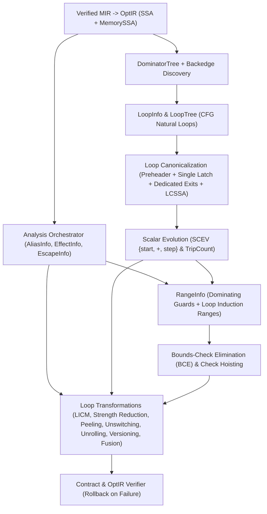

# SPEC-72 — Canonical Loop Analysis (`LoopInfo`), Scalar Evolution (`SCEV`), Bounds-Check Elimination (`BCE`), `LICM` & Loop Transformations

## Tóm tắt
Tài liệu chuẩn hóa hạ tầng phát hiện và chuẩn hóa vòng lặp trên đồ thị luồng điều khiển (`CFG` / `LoopInfo`), tiến hóa vô hướng tuân thủ tràn số (`SCEV`), phân tích khoảng giá trị (`RangeInfo`), loại bỏ kiểm tra biên (`Bounds-Check Elimination` — `BCE`), di chuyển mã bất biến vòng lặp (`LICM`), các phép biến đổi vòng lặp (`peeling`, `unswitching`, `unrolling`, `versioning`, `fusion`), và hợp nhất chuỗi bộ lặp lười (`Iterator Pipeline Fusion`) cho trình biên dịch `axiomc` (Epic `E15.3`, Phase 15 `P15-optimizer-2-0`):
- **Phát hiện vòng lặp tự nhiên trên `CFG`, chuẩn hóa `LoopSimplify` + `LCSSA` và biến quy nạp (`AXS-LOOP-001..005`)**: Nhận diện vòng lặp tự nhiên từ cạnh quay lui (`backedge`) và cây thống trị (`DominatorTree`) không phụ thuộc cú pháp bề mặt (`for`/`while`/`loop` — `REQ-OPT-126`). Chuẩn hóa `preheader`, `latch` đơn, khối thoát chuyên biệt (`dedicated exit`) và dạng `LCSSA` bảo toàn tuyệt đối ngữ nghĩa sở hữu, năng lực (`view`/`mut_view`), thứ tự `Drop`, địa chỉ ổn định, điểm tạm dừng `await`, miền GPU và FFI (`REQ-OPT-125`, `REQ-OPT-127`, `REQ-OPT-155..162`). Nhận diện biến quy nạp sơ cấp và dẫn xuất như các sự kiện nội bộ của trình biên dịch (`REQ-OPT-128`, `REQ-OPT-174`).
- **Tiến hóa vô hướng (`SCEV`) tôn trọng ngữ nghĩa tràn số và chứng minh số vòng lặp (`AXS-LOOP-006`)**: Biểu diễn truy hồi cộng tuyến tính `{start, +, step}<mode>` phân biệt nghiêm ngặt số học có kiểm tra (`Checked`), số học quay vòng modulo $2^N$ (`Wrapping`), và số học bão hòa (`Saturating` — `REQ-OPT-129`). Cấm tuyệt đối giả định số học quay vòng là số học toán học không giới hạn hoặc suy diễn kiểu UB tràn số của C/C++ khi chưa có chứng minh không tràn (`REQ-OPT-130`, `REQ-OPT-368`). Số vòng lặp (`TripCount`) đòi hỏi chứng minh hợp lệ (`Certainty.Proven`); mọi trường hợp không chứng minh được phải giữ bảo thủ `TripCount.Unknown` (`REQ-OPT-131`, `REQ-OPT-132`).
- **Phân tích khoảng (`RangeInfo`) và loại bỏ kiểm tra biên (`BCE`) (`AXS-BCE-001..006`)**: Tách biệt hoàn toàn `RangeInfo` khỏi bộ kiểm định sở hữu/năng lực (`REQ-OPT-133`, `REQ-OPT-134`). Chỉ cho phép xóa nhánh kiểm tra biên của mảng `[N]T`, `view<[T]>`, `mut_view<[T]>`, và `Vec<T>` khi chứng minh được `0 <= idx < len` (`Certainty.Proven`) từ điều kiện thống trị (`dominating guard` — `REQ-OPT-138`), biến quy nạp vòng lặp (`REQ-OPT-139`), độ dài ngữ nghĩa (`REQ-OPT-140`), hoặc chia tách khoảng nửa mở liền kề `[0..mid)` / `[mid..len)` (`REQ-OPT-141`). Mọi trường hợp chứng minh thất bại hoặc `Unknown` bắt buộc giữ nguyên kiểm tra biên tại thời điểm chạy (`REQ-OPT-001`, `REQ-OPT-026`, `REQ-OPT-135..137`, `REQ-OPT-142`, `REQ-OPT-189..190`, `REQ-OPT-311`, `REQ-OPT-342`).
- **Quy tắc hợp lệ cho `LICM`, giảm cường độ, biến đổi vòng lặp và hợp nhất bộ lặp (`AXS-LOOP-010..017`)**: Tận dụng các chứng minh sẵn có từ `AliasInfo`, `EffectInfo`, `EscapeInfo`, `RangeInfo`, và `MemorySSA` (`REQ-OPT-367`). Quy định điều kiện nâng lệnh bất biến và đọc bộ nhớ ra `preheader` (`LICM` — `REQ-OPT-143..147`), giảm cường độ biến quy nạp bảo toàn tràn số (`REQ-OPT-173..174`), bóc tách vòng đầu (`peeling` — `REQ-OPT-170`), tách nhánh bất biến (`unswitching` — `REQ-OPT-171`), trải vòng lặp theo ngân sách kích thước mã (`unrolling` — `REQ-OPT-169`), đa phiên bản hóa có nhánh dự phòng an toàn (`versioning` — `REQ-OPT-163..165`), gộp/tách/đảo vòng lặp (`fusion`/`distribution`/`interchange` — `REQ-OPT-166..168`, `REQ-OPT-354`), và xóa cấp phát trung gian cho chuỗi bộ lặp lười (`map`/`filter`/`take`/`fold` — `REQ-OPT-344`).

Status: draft (T609, 2026-11-03). Owner: axiom-architect.
Rule IDs `AXS-LOOP-NNN` and `AXS-BCE-NNN` are stable and never renumbered.
Consolidates: `0113 §122` (`AOPT-20`), `0165 §2, §21–25, §29–30`, `tasks/0366` (`BOOTSTRAP-107`, `AOPT-35`), `tasks/0402` (`BOOTSTRAP-143`, `ALOOP-20..70`, `ABCE-20..27`, `ALICM-20..24`), `tasks/0416` (`BOOTSTRAP-157`, `ACOLLECT-44..47`), `tasks/0426` (`BOOTSTRAP-167`, `AITER-20..75`), `tasks/0470` (`BOOTSTRAP-211`, `APAR-25..26`), `tasks/0549` (`BOOTSTRAP-290`, `ALOOP-20..90`), `spec/SPEC-03-core-semantics.md`, `spec/SPEC-70-optir-ssa-memoryssa.md`, and `spec/SPEC-71-alias-escape-promotion.md`.
Covers: `REQ-OPT-001`, `REQ-OPT-026`, `REQ-OPT-125`, `REQ-OPT-126`, `REQ-OPT-127`, `REQ-OPT-128`, `REQ-OPT-129`, `REQ-OPT-130`, `REQ-OPT-131`, `REQ-OPT-132`, `REQ-OPT-133`, `REQ-OPT-134`, `REQ-OPT-135`, `REQ-OPT-136`, `REQ-OPT-137`, `REQ-OPT-138`, `REQ-OPT-139`, `REQ-OPT-140`, `REQ-OPT-141`, `REQ-OPT-142`, `REQ-OPT-311`, `REQ-OPT-367`, `REQ-OPT-368` (and governs implementation/QA tasks `T610`–`T612` covering `REQ-OPT-143..147`, `REQ-OPT-155..190`, `REQ-OPT-192..196`, `REQ-OPT-342`, `REQ-OPT-344`, `REQ-OPT-354`).
Consumers: `T610` (`compiler/opt/loops`, `compiler/opt/bce`, `tests/run/opt_bce`), `T611` (`compiler/opt/loop_xform`, `tests/run/opt_loops`), `T612` (`tests/conformance/p15/e15_3_loops_bce`), and Epic `E15.5` (`T616`–`T619`, auto-vectorization).

---

## 1. CFG Natural Loop Discovery, Canonicalization & Scalar Evolution (`SCEV`)

**AXS-LOOP-001 — Unified Semantic Proof Foundation and Non-UB Loop Optimization Principle (`REQ-OPT-125`, `REQ-OPT-176`, `REQ-OPT-177`, `REQ-OPT-178`, `REQ-OPT-179`, `REQ-OPT-180`, `REQ-OPT-181`, `REQ-OPT-188`, `REQ-OPT-196`, `REQ-OPT-367`, `REQ-OPT-368`).**
1. **Verified MIR authority and unified analysis consumption (`REQ-OPT-178`, `REQ-OPT-196`, `REQ-OPT-367`, `tasks/0402 §1, §80 ALOOP-52/70`, `tasks/0549 §1–2, §47 ALOOP-20`):**
   - `Verified MIR` remains the sole semantic and safety authority (`SPEC-70 AXS-OPT-001`, `REQ-OPT-196`).
   - Rather than constructing a detached loop-only proof system, the loop optimization engine (`compiler/opt/loops`, `compiler/opt/bce`, `compiler/opt/loop_xform`) directly consumes the existing verified facts produced by the `AnalysisOrchestrator` (`SPEC-70 AXS-OPT-005`): ownership facts (`SPEC-10`), capability disjointness and read-only facts (`SPEC-11`, `SPEC-71`), `AliasInfo`, `EffectInfo`, `EscapeInfo`, `RangeInfo`, `MemorySSA`, and scalar `OptIR` SSA definitions (`REQ-OPT-178`, `REQ-OPT-367`).
2. **Semantic proofs, never C/C++ UB assumptions (`REQ-OPT-125`, `REQ-OPT-368`, `tasks/0402 §10–11, §80 ALOOP-20`, `tasks/0549 §3, §10, §47 ALOOP-34..37, ALOOP-90`):**
   - Loop analysis and transformation MUST preserve all observable program semantics (`SPEC-03 AXS-SEM-003`, `REQ-OPT-125`).
   - Every loop transformation MUST be justified by an explicit compile-time semantic proof (`Certainty.Proven`), and MUST NEVER rely on C/C++-style undefined-behavior assumptions such as assuming signed integer increments cannot overflow, assuming infinite side-effect-free loops must terminate, or assuming dereferenced pointers cannot alias (`REQ-OPT-368`).
3. **Safety boundary invariance and fail-closed fallback (`REQ-OPT-176`, `REQ-OPT-177`, `REQ-OPT-179`, `REQ-OPT-180`, `REQ-OPT-181`, `REQ-OPT-188`, `tasks/0402 §80 ALOOP-50..55, ALOOP-62`):**
   - Loop optimization cannot create safety proofs (`REQ-OPT-179`) and cannot weaken existing ownership, capability, or bounds safety proofs (`REQ-OPT-180`).
   - Debug (`-O0`) and release (`-O1`, `-O2`, `-O3`, `-Os`, `-Oz`) builds obey identical language semantics (`REQ-OPT-176`, `REQ-OPT-177`).
   - When a loop or bounds proof evaluates to `Certainty.Possible` or `Certainty.Unknown`, the compiler fails closed: it retains the unoptimized loop structure or runtime bounds check, reducing optimization opportunity without ever rejecting valid code or relaxing safety (`REQ-OPT-181`).
   - No loop optimization may introduce mandatory runtime ownership machinery, garbage collection, or hidden reference counting (`REQ-OPT-188`).
[0165 §1–3, §21–25; tasks/0402 §1, §10, §65–68, §80 ALOOP-20, ALOOP-50..55, ALOOP-62, ALOOP-70; tasks/0549 §1–3, §10, §47 ALOOP-20, ALOOP-34..37, ALOOP-78..80, ALOOP-90]



**AXS-LOOP-002 — CFG-Based Natural Loop Discovery and Loop Nesting Tree (`LoopInfo`, `LoopTree`) (`REQ-OPT-126`, `REQ-OPT-182`, `REQ-OPT-183`, `REQ-OPT-184`).**
1. **Surface-syntax independence (`REQ-OPT-126`, `tasks/0402 §2–3, §80 ALOOP-21`, `tasks/0549 §4–5, §47 ALOOP-21..25`):**
   - Loop discovery operates exclusively on the `OptIR` control-flow graph (`CFG`) and `DominatorTree` (`SPEC-70 AXS-OPT-011`), never on surface AST/HIR loop constructs (`REQ-OPT-126`). Surface `for`, `while`, `loop`, and tail-recursive control-flow cycles that lower to equivalent CFG backedges produce identical `LoopInfo` structures.
2. **Backedges and natural loop construction (`tasks/0402 §2–3`, `tasks/0549 §4–5, ALOOP-23..24`):**
   - A directed CFG edge $L \to H$ is a **backedge** if and only if target block $H$ dominates source block $L$ ($\mathrm{dom\_ates}(H, L) = \mathrm{true}$ in `DominatorTree`). $H$ is the **loop header** and $L$ is a **latch block**.
   - All backedges targeting the same header $H$ are merged into a single natural loop $\mathcal{L}(H)$ whose block set $\mathrm{Blocks}(\mathcal{L}(H))$ is the minimal set containing $H$ and every block $B$ from which a backward CFG walk from any latch $L_k$ reaches $B$ without passing through $H$:
     $$\mathrm{Blocks}(\mathcal{L}(H)) = \{H\} \cup \{ B \mid H \text{ dominates } B \text{ and } B \text{ can reach some latch } L_k \text{ without traversing } H \}$$
   - Block membership and block lists inside $\mathcal{L}(H)$ are sorted in deterministic Reverse Post-Order (`rpo_idx`, `SPEC-70 AXS-OPT-011`). Irreducible multi-entry cycles (where a cycle edge $u \to v$ is a retreat edge in RPO but $v$ does not dominate $u$) are marked `is_irreducible = true` and skipped by canonical loop transformations without error (`Certainty.Unknown`).
3. **Loop nesting forest (`LoopTree`) and data model (`tasks/0402 §2`, `tasks/0549 §4, ALOOP-22/25`):**
   - Given two distinct natural loops $\mathcal{L}(H_1)$ and $\mathcal{L}(H_2)$, either their block sets are disjoint or one is a strict subset of the other. If $\mathrm{Blocks}(\mathcal{L}(H_2)) \subsetneq \mathrm{Blocks}(\mathcal{L}(H_1))$, then $H_1$ strictly dominates $H_2$ and $\mathcal{L}(H_2)$ is nested inside $\mathcal{L}(H_1)$.
   - `LoopTree` organizes all natural loops of an `OptBody` into a deterministic forest ordered by header RPO index:
     ```text
     LoopId { v: u32 }   // 1-based loop ID in RPO header order; 0 = LOOP_NONE

     LoopDesc {
         id: LoopId,
         header: OptBbId,
         preheader: OptBbId,             // OPT_BB_NONE if not yet canonicalized
         latch: OptBbId,                 // single canonical latch block (OPT_BB_NONE if multiple)
         parent: LoopId,                 // enclosing loop or LOOP_NONE
         depth: u32,                     // 1 for top-level loop, parent.depth + 1 for nested
         children: [LoopId],             // immediate inner loops in deterministic RPO order
         blocks: [OptBbId],              // all blocks in loop (header first, RPO order)
         backedges: [OptBbId],           // latch predecessors of header inside blocks[]
         exiting_blocks: [OptBbId],      // blocks inside loop with >= 1 successor outside loop
         exit_blocks: [OptBbId],         // blocks outside loop with >= 1 predecessor inside loop
         trip_count: ScevTripCount,
         induction_vars: [InductionVar],
         has_observable_barriers: u32,   // bitmask: BARRIER_VOLATILE | BARRIER_ATOMIC | BARRIER_IO | BARRIER_AWAIT | BARRIER_FFI | BARRIER_DROP
     }
     ```
4. **Determinism, parallel safety, and incremental cacheability (`REQ-OPT-182`, `REQ-OPT-183`, `REQ-OPT-184`, `tasks/0402 §80 ALOOP-56..58`, `tasks/0549 §47 ALOOP-89`):**
   - Loop discovery and analysis are purely deterministic functions of the `OptBody` CFG and `ir_revision` (`REQ-OPT-182`).
   - Because each `OptBody` owns its arena and `LoopTree` without mutable global state (`INV-LAYER-006`), loop analyses on independent functions may execute in parallel without data races (`REQ-OPT-183`) and are cached per `(FnId, ir_revision)` in `PassManager` (`ANALYSIS_LOOP_INFO`, `REQ-OPT-184`, `SPEC-70 AXS-OPT-030`).
[tasks/0402 §2–3, §80 ALOOP-21, ALOOP-56..58; tasks/0549 §4–5, §47 ALOOP-21..25, ALOOP-89]

**AXS-LOOP-003 — Loop Canonicalization: Preheaders, Single Latches, Dedicated Exits (`LoopSimplify`) and `LCSSA` Form (`REQ-OPT-127`, `REQ-OPT-185`, `REQ-OPT-187`).**
Before running `SCEV`, `LICM`, `BCE`, or structural loop transforms, `opt_loop_simplify` brings natural loops into canonical form while strictly preserving observable semantics (`REQ-OPT-127`, `tasks/0402 §4–5, ALOOP-22`, `tasks/0549 §6, ALOOP-26..29`):
1. **Unique Preheader (`preheader`) (`tasks/0402 §4`, `tasks/0549 §6, ALOOP-27`):**
   - Every canonical loop $\mathcal{L}$ has a single non-loop predecessor block `preheader` that branches unconditionally (`OPT_TERM_GOTO`) to `header`.
   - If `header` initially has multiple outside-loop predecessors $E_1, \dots, E_k$ (or an outside predecessor ending in a conditional branch), `opt_loop_simplify` inserts a fresh `preheader` block, redirects edges $E_i \to \mathrm{header}$ to $E_i \to \mathrm{preheader}$, splits `header` `OptPhi` and `MemoryPhi` nodes into preheader entry phis and a two-category header phi (from `preheader` vs. `backedges`), and updates `DominatorTree` (`idom(preheader) = idom_outside`, `idom(header) = preheader`).
2. **Single Latch (`latch`) (`tasks/0402 §5`, `tasks/0549 §6, ALOOP-28`):**
   - If `header` has multiple backedge predecessors $L_1, \dots, L_m$ ($m \ge 2$, e.g., from `continue` statements), `opt_loop_simplify` merges them through a single canonical `latch` block inside $\mathcal{L}$ that forwards merged `OptPhi` and `MemoryPhi` values along the unique backedge $\mathrm{latch} \to \mathrm{header}$.
3. **Dedicated Exit Blocks (`exit_blocks`) (`tasks/0549 §6, §29, ALOOP-29`):**
   - Every block $X \in \mathrm{exit\_blocks}(\mathcal{L})$ outside $\mathcal{L}$ that receives control from an `exiting_block` inside $\mathcal{L}$ MUST have all of its predecessors inside $\mathcal{L}$ (no critical edge from outside $\mathcal{L}$ directly into $X$). If $X$ has non-loop predecessors, a dedicated landing pad block $X_{\mathrm{ded}}$ is split onto the exiting edges so exit-time phis, `Drop` cleanup, and post-loop values are isolated to $\mathcal{L}$ exits.
4. **Loop-Closed SSA (`LCSSA`) Form (`tasks/0549 §42–43`):**
   - For every SSA value `%v` (and `MemSsaId` version) defined inside $\mathcal{L}$ that is used outside $\mathcal{L}$, a dedicated single-incoming (or multi-exiting-edge) `OptPhi` (or `MemoryPhi`) is placed at the header of each dominated dedicated exit block $X \in \mathrm{exit\_blocks}(\mathcal{L})$, and all outside-loop uses of `%v` are rewritten to reference the exit phi.
   - `LCSSA` isolates inner-loop SSA mutations from outer loops and post-loop code, enabling safe loop unrolling, peeling, versioning, and final-value replacement (`SCEV` exit value rewriting).
5. **Provenance and verifiability preservation (`REQ-OPT-185`, `REQ-OPT-187`, `tasks/0402 §80 ALOOP-59/61`):**
   - Every synthetic block (`preheader`, `latch`, `dedicated_exit`) and LCSSA `OptPhi` inherits the `OptOrigin` span of the loop header (`REQ-OPT-185`, `SPEC-70 AXS-OPT-004`).
   - Canonicalized `OptIR` MUST pass `verify_optir_contract` (`POST_CFG_VALID | POST_DOM_VALID | POST_SSA_VALID | POST_MEMSSA_VALID`, `REQ-OPT-187`, `SPEC-70 AXS-OPT-034`).
[tasks/0402 §4–5, §80 ALOOP-22, ALOOP-59, ALOOP-61; tasks/0549 §6, §29–30, §47 ALOOP-26..29, ALOOP-86..87]

**AXS-LOOP-004 — Semantic Barriers Under Loop Restructuring: Ownership, Capability, `Drop`, Stable-Address, Synchronization, Async, GPU, and FFI (`REQ-OPT-155`, `REQ-OPT-156`, `REQ-OPT-157`, `REQ-OPT-158`, `REQ-OPT-159`, `REQ-OPT-160`, `REQ-OPT-161`, `REQ-OPT-162`, `REQ-OPT-193`, `REQ-OPT-194`, `REQ-OPT-195`).**
All loop canonicalizations and transformations are subject to eight mandatory semantic preservation barriers:
1. **`Drop` semantics and per-iteration cleanup order (`REQ-OPT-155`, `REQ-OPT-195`, `0113 §94`, `tasks/0402 §59–60, ALOOP-29, ALOOP-69`, `tasks/0549 §15, ALOOP-52, ALOOP-81`):**
   - Values owned inside a loop body whose scope ends at iteration exit (including early `continue` or `break` paths, `0113 §94`) MUST be dropped exactly once per iteration in reverse declaration order (`INV-SEM-003`).
   - Loop transformations MUST NOT hoist, sink, coalesce, or reorder `OPT_TERM_DROP` operations if the destructor has observable effects (`!is_trivial_drop(ty)`), and MUST NOT extend the lifetime of a per-iteration resource across iterations (`REQ-OPT-155`, `REQ-OPT-195`).
2. **Ownership and move preservation (`REQ-OPT-156`, `tasks/0402 §78, ALOOP-30`, `tasks/0549 ALOOP-79`):**
   - A loop that consumes an owned non-`Copy` value (`Move(x)`) MUST NOT be transformed in a way that duplicates the move across iterations or silently turns `Move` into `Copy`.
3. **Capability validity and container relocation prevention (`REQ-OPT-157`, `tasks/0402 §79, ALOOP-31`, `tasks/0549 §33, ALOOP-53, ALOOP-80`):**
   - Loop transformations MUST NOT extend the live range of a `view<T>` or `mut_view<T>` capability beyond its owner's lifetime or across a conflicting mutation, and MUST NOT relocate or reallocate a container while an active capability derived from that container is live inside the loop.
4. **Stable-address contracts (`REQ-OPT-158`, `tasks/0402 ALOOP-32`, `SPEC-71 AXS-ESC-015`):**
   - Any object inside a loop with `stable_address == true` or `address_observable == true` (`address_of`, `@at` MMIO, pinned DMA/FFI buffer) MUST NOT have its storage merged across iterations, promoted to registers, or relocated by loop transformations.
5. **Synchronization, `Atomic`, and `Volatile` barriers (`REQ-OPT-147`, `REQ-OPT-159`, `REQ-OPT-193`, `REQ-OPT-194`, `tasks/0402 §62–64, ALICM-24, ALOOP-33, ALOOP-67..68`, `tasks/0549 §31, ALOOP-54..57, ALOOP-77`):**
   - Atomic operations (`OPT_INST_ATOMIC`) inside a loop MUST retain their exact memory ordering (`Relaxed`, `Acquire`, `Release`, `AcqRel`, `SeqCst`) and atomicity; they MUST NEVER be converted into ordinary non-atomic register reductions or hoisted/sunk across synchronization fences (`REQ-OPT-159`, `REQ-OPT-193`).
   - Volatile operations (`OPT_INST_VOLATILE_LOAD`, `OPT_INST_VOLATILE_STORE`, `@at` accesses) MUST execute the exact number of times and in the exact iteration order specified by the abstract machine (`REQ-OPT-147`, `REQ-OPT-194`).
   - Loop transformations MUST NEVER introduce data races on shared memory (`ALOOP-77`).
6. **Async suspension (`await`) boundaries (`REQ-OPT-160`, `tasks/0402 §57, ALOOP-34`, `tasks/0549 §32, ALOOP-59..60`):**
   - A loop containing an async `.await` suspension point lowers to a state-machine transition across resumption invocations. Synchronous loop transformations (unrolling, vectorization, unswitching across suspension states, or hoisting values whose capability/alias validity does not survive suspension) MUST NOT cross `.await` boundaries (`REQ-OPT-160`).
7. **GPU execution and storage domain boundaries (`REQ-OPT-161`, `tasks/0402 §56, ALOOP-35`):**
   - Loops inside `@kernel` GPU functions or accessing `DeviceSpace` (`StorageDomain.DeviceSpace`) MUST respect SIMT workgroup barrier convergence (`workgroup_barrier`) and device address-space separation (`REQ-OPT-161`).
8. **Foreign function (`FFI`) effect barriers (`REQ-OPT-162`, `tasks/0402 §25, ALOOP-36`, `tasks/0549 §31, ALOOP-58`):**
   - Calls to `extern` functions without an explicit verified purity/alias contract are treated as opaque read/write/I/O barriers (`EFFECT_FFI | EFFECT_UNKNOWN`), blocking code motion, fusion, or reordering across the foreign call (`REQ-OPT-162`).
[0113 §94; tasks/0402 §25, §56–64, §78–80 ALICM-24, ALOOP-29..36, ALOOP-67..69; tasks/0549 §14–15, §31–33, §47 ALOOP-52..60, ALOOP-77..83]

**AXS-LOOP-005 — Primary and Derived Induction Variable Recognition (`InductionVariable`) (`REQ-OPT-128`, `REQ-OPT-174`).**
1. **Induction variables are compiler facts, not ownership constructs (`REQ-OPT-128`, `tasks/0402 §6–7, §80 ALOOP-23`, `tasks/0549 §7–8, ALOOP-30..31`):**
   - An induction variable (`InductionVar`) is an internal `OptIR` SSA dataflow fact discovered from header `OptPhi` cycles. It introduces zero surface-language ownership rules and requires no programmer annotations (`REQ-OPT-128`).
2. **Primary (basic) induction variable (`tasks/0402 §6`, `tasks/0549 §7`):**
   An `OptPhi` node `%iv = phi [preheader: %start, latch: %next]` at the header of canonical loop $\mathcal{L}$ is a **primary induction variable** if:
   - `%start` is loop-invariant in $\mathcal{L}$ (defined outside $\mathcal{L}$, so its definition block strictly dominates `header`), and
   - `%next` is defined inside $\mathcal{L}$ by a single recurrence step instruction:
     $$\%\text{next} = \mathrm{op}(\%\text{iv}, \%\text{step})$$
     where `%step` is loop-invariant in $\mathcal{L}$ and $\mathrm{op} \in \{ \text{Add}_{\text{checked}}, \text{Sub}_{\text{checked}}, \text{Add}_{\text{wrapping}}, \text{Sub}_{\text{wrapping}} \}$ (or geometric $\text{Mul}$ for geometric recurrences), with no other cyclic dependencies in $\mathcal{L}$.
   - A primary induction variable is **canonical** when `ty == usize` (or signed index integer), `%start == Const(0)`, `%step == Const(1)`, and the loop latch/header exit test compares `%iv < %upper` (`tasks/0402 §6`).
3. **Derived induction variable and internal address evolution (`REQ-OPT-174`, `tasks/0402 §7, §48–51, ALOOP-48`, `tasks/0549 §8, ALOOP-31`):**
   - Any SSA value `%d` inside $\mathcal{L}$ defined as an affine function of a primary induction variable `%iv`:
     $$\%d = \%\text{base} + (\%\text{iv} \times \%\text{scale})$$
     where `%base` and `%scale` are loop-invariant in $\mathcal{L}$ and arithmetic mode compatibility holds (`AXS-LOOP-006`), is recognized as a **derived induction variable** with initial value $\%\text{base} + (\%\text{start} \times \%\text{scale})$ and per-iteration stride $\%\text{step} \times \%\text{scale}$.
   - **Internal address evolution (`REQ-OPT-174`, `tasks/0402 §48–51, ALOOP-48`):** Lowering array/slice indexing `a[i]` into an internal address induction recurrence (`addr_0 = base_ptr`, `addr_next = addr + elem_size`) during strength reduction or LIR lowering is strictly an internal optimizer/backend representation; it NEVER exposes raw-pointer semantics, bypasses bounds-check proof requirements, or weakens capability provenance at the language level (`REQ-OPT-174`).
[tasks/0402 §6–7, §48–51, §80 ALOOP-23, ALOOP-48; tasks/0549 §7–8, §47 ALOOP-30..31]

**AXS-LOOP-006 — Scalar Evolution (`SCEV`), Overflow-Faithful Arithmetic Modes, and Trip-Count Proofs (`REQ-OPT-129`, `REQ-OPT-130`, `REQ-OPT-131`, `REQ-OPT-132`).**
1. **Scalar Evolution (`ScevExpr`) domain and explicit arithmetic mode (`REQ-OPT-129`, `tasks/0402 §8–11, §80 ALOOP-24`, `tasks/0549 §10, §47 ALOOP-34..37`):**
   `compiler/opt/loops` models scalar values across loop iterations using a closed algebraic `ScevExpr` tree tagged with Axiom's exact integer overflow mode (`SPEC-03 AXS-SEM-030..031`):
   ```text
   ArithMode =
       ARITH_CHECKED           // Standard Axiom +, -, * (panics on overflow; SPEC-03 AXS-SEM-030)
     | ARITH_WRAPPING          // Explicit wrapping_add, wrapping_sub, wrapping_mul (mod 2^N; AXS-SEM-031)
     | ARITH_SATURATING        // Explicit saturating arithmetic (clamps to [MIN, MAX])
     | ARITH_PROVEN_NSW_NUW    // Checked or wrapping op proven by RangeInfo never to overflow/wrap in loop

   ScevKind =
       SCEV_CONST              // Compile-time integer constant c
     | SCEV_INVARIANT          // Loop-invariant SSA value %v (defined outside loop)
     | SCEV_ADD_REC            // Affine add recurrence {start, +, step}<loop_id, arith_mode>
     | SCEV_ADD                // Sum of ScevExprs under arith_mode
     | SCEV_MUL                // Product of ScevExpr and invariant scale under arith_mode
     | SCEV_MAX                // max(a, b) for trip-count clamping
     | SCEV_UNKNOWN            // Unanalyzable / non-affine / multi-exit / wrapping-uncertain value

   ScevExpr {
       kind: ScevKind,
       ty: TypeId,
       loop_id: LoopId,
       arith_mode: ArithMode,
       no_wrap_proven: bool,   // True iff Certainty.Proven that recurrence never wraps/panics across all iterations
       start: ScevExprId,
       step: ScevExprId,
       const_val: i64,
       ssa_val: OptValueId,
   }
   ```
   - Under `ARITH_CHECKED` (`SPEC-03 AXS-SEM-030`), executing `i + step` either produces the exact mathematical integer $i + \text{step} \in [\mathrm{MIN}_T, \mathrm{MAX}_T]$ or panics immediately (`exit 101`, `SPEC-03 AXS-SEM-071`) before any subsequent instruction in that iteration can observe a wrapped value (`REQ-OPT-129`).
2. **Prohibition on treating wrapping arithmetic as unbounded mathematical arithmetic (`REQ-OPT-130`, `tasks/0402 §10–11, §80 ALOOP-25`, `tasks/0549 §10, §47 ALOOP-35`):**
   - Under `ARITH_WRAPPING` (`wrapping_add(i, 1u32)` or narrower unsigned/signed modular casts), `i` wraps modulo $2^N$ upon reaching $\mathrm{MAX}_T$ (`255u8 + 1u8 == 0u8`).
   - `SCEV` and `RangeInfo` MUST NEVER assume $\text{wrapping\_add}(i, c) > i$ (for $c > 0$), monotonic progression, or non-aliasing stride disjointness for an `ARITH_WRAPPING` recurrence unless `RangeInfo` + trip-count analysis first proves (`Certainty.Proven`) that $\mathrm{start} + k \cdot \mathrm{step} \in [\mathrm{MIN}_T, \mathrm{MAX}_T]$ for every reachable iteration $0 \le k \le \mathrm{trip\_count}$, promoting `no_wrap_proven = true` (`REQ-OPT-130`).
   - If a wrapping recurrence may cross the $2^N$ boundary (`no_wrap_proven == false`), any downstream optimization requiring monotonicity or affine non-overflow (such as `BCE` upper-bound inference, strength reduction across widths, or dependence distance analysis) MUST treat the recurrence as `SCEV_UNKNOWN` (`Certainty.Unknown`).
3. **Trip-count representation and proof obligations (`REQ-OPT-131`, `REQ-OPT-132`, `tasks/0402 §9, §80 ALOOP-26..27`, `tasks/0549 §7, §29–30, §47 ALOOP-32..33`):**
   ```text
   TripCountKind =
       TRIP_CONST              // Exact proven constant iteration count N >= 0
     | TRIP_SYMBOLIC           // Proven symbolic formula max(0, ceil((upper - start) / step))
     | TRIP_UPPER_BOUNDED      // Early break possible, but proven never to exceed max_bound iterations
     | TRIP_INFINITE           // Proven never-exiting loop (diverges -> never)
     | TRIP_UNKNOWN            // Unproven / dynamic condition / wrapping cycle

   ScevTripCount {
       kind: TripCountKind,
       certainty: Certainty,   // Proven (for CONST / SYMBOLIC / UPPER_BOUNDED) | Unknown
       const_count: u64,
       symbolic_expr: ScevExprId,
       max_bound: u64,
   }
   ```
   - **Valid proof requirement (`REQ-OPT-131`, `ALOOP-26`, `ALOOP-32`):** A loop $\mathcal{L}$ is assigned `TRIP_CONST` or `TRIP_SYMBOLIC` (`Certainty.Proven`) if and only if:
     1. $\mathcal{L}$ has a single latch and a single dominating latch/header exit condition comparing a primary induction variable `%iv = {start, +, step}` against a loop-invariant bound `%upper` (`<`, `<=`, `!=`, `>`, `>=`),
     2. `step != 0` has a known sign matching the comparison direction,
     3. For `!=` or `<=` comparisons, or `ARITH_WRAPPING` increments, `SCEV` proves that `(upper - start)` is evenly divisible by `step` (for `!=`) and that `%iv` cannot wrap past `%upper` without triggering the exit condition (`no_wrap_proven == true`), AND
     4. No other interior exit (`break`, `return`, `panic`) can increase the iteration count (interior early exits downgrade `TRIP_CONST`/`TRIP_SYMBOLIC` to `TRIP_UPPER_BOUNDED`).
   - **Conservative `Unknown` trip count (`REQ-OPT-132`, `ALOOP-27`, `ALOOP-33`):** Whenever the exit condition depends on memory mutated inside the loop, a function call, a non-affine recurrence, a step whose sign is unknown, or an unproven wrapping comparison, `trip_count` MUST remain `TRIP_UNKNOWN` (`Certainty.Unknown`) and MUST NEVER be treated as a constant (`ALOOP-33`).
[SPEC-03 AXS-SEM-030..031; tasks/0402 §8–11, §80 ALOOP-24..27; tasks/0549 §7, §10, §29–30, §47 ALOOP-32..37]

---

## 2. Range Analysis (`RangeInfo`) & Bounds-Check Elimination (`BCE`)

**AXS-BCE-001 — Role Separation: Range Analysis (`RangeInfo`) vs. Ownership/Capability Safety Verification (`REQ-OPT-133`, `REQ-OPT-134`, `REQ-OPT-137`, `REQ-OPT-190`).**
1. **Distinctness from ownership and capability verification (`REQ-OPT-133`, `tasks/0402 §12, §14, §65, §80 ALOOP-28, ABCE-22`):**
   - Ownership and capability verification (`compiler/own`, `verify_mir`, `SPEC-10..12`) determines whether a program's memory ownership transfers, `view`/`mut_view` accesses, and lifetimes are type- and capability-safe at compile time.
   - Range analysis (`RangeInfo` in `compiler/opt/bce`) is an internal `OptIR` value-domain analysis that computes integer interval bounds $[l, u]$, signedness, known bits, and symbolic relational inequalities ($x < y$, $x = y + c$, $0 \le i < \mathrm{len}(a)$) over SSA values (`REQ-OPT-133`).
2. **Post-verification consumption and preservation of safe semantics (`REQ-OPT-134`, `REQ-OPT-137`, `REQ-OPT-190`, `tasks/0402 §14, §65–66, §80 ALOOP-29, ABCE-22, ALOOP-64`):**
   - `RangeInfo` facts may be consumed by optimization passes only after `Verified MIR` validity has been established (`REQ-OPT-134`, `ALOOP-29`).
   - Optimization NEVER converts an `unsafe` raw-pointer dereference (`*p`) into a safe access by assumption, and NEVER relaxes language-level bounds semantics (`REQ-OPT-137`, `ABCE-22`, `0113 §122 AUNSAFE-13`).
   - Eliminating a redundant runtime bounds check in safe code (`a[i]`) is strictly an execution-time optimization consequence of a formal compile-time proof, never a relaxation of safe Axiom semantics (`REQ-OPT-190`, `ALOOP-64`).
[0113 §122; 0165 §21–22; tasks/0402 §12, §14, §65–66, §80 ALOOP-28..29, ABCE-22, ALOOP-64]

**AXS-BCE-002 — Bounds-Check Elimination (`BCE`) Proof Gate and Mandatory Check Retention on `Unknown` (`REQ-OPT-001`, `REQ-OPT-026`, `REQ-OPT-135`, `REQ-OPT-136`, `REQ-OPT-189`, `REQ-OPT-190`, `REQ-OPT-311`, `REQ-OPT-342`).**
1. **Semantic indexing contract (`SPEC-03 AXS-SEM-042, AXS-SEM-070`):**
   Every safe indexing operation `base[idx]` (or sub-slice `base[lo..hi]`) on a fixed array `[N]T`, slice view `view<[T]>` / `mut_view<[T]>`, or contiguous standard collection `Vec<T>` / `ArrayVec<T, N>` requires:
   - For element access `base[idx]`: $0 \le \mathrm{idx} < \mathrm{len}(\mathrm{base})$ (where `idx: usize` is unsigned, so $0 \le \mathrm{idx}$ holds by type and the check is $\mathrm{idx} < \mathrm{len}(\mathrm{base})$).
   - For half-open sub-range `base[lo..hi]`: $0 \le \mathrm{lo} \le \mathrm{hi} \le \mathrm{len}(\mathrm{base})$.
   If the condition is violated at runtime, execution MUST panic immediately with `index out of bounds` (`exit 101`, `SPEC-03 AXS-SEM-070..071`).
2. **Formal proof precondition for `BCE` (`REQ-OPT-001`, `REQ-OPT-026`, `REQ-OPT-135`, `REQ-OPT-189`, `REQ-OPT-311`, `REQ-OPT-342`, `0113 §122 AOPT-20`, `0165 §21–22`, `tasks/0366 AOPT-35`, `tasks/0402 §13, §80 ABCE-20, ALOOP-63`, `tasks/0416 ACOLLECT-44`, `tasks/0426 AITER-69`):**
   - `compiler/opt/bce` (`opt_bce`) is permitted to remove the `OPT_TERM_ASSERT` / bounds check guarding `base[idx]` and lower the access directly to unchecked machine addressing (`base_ptr + idx * sizeof(T)`, `REQ-OPT-189`) **if and only if** `RangeInfo` + `SCEV` produces a `ProofProvenance` record (`SPEC-70 AXS-OPT-005`) with:
     ```text
     proposition == PropositionKind.InBounds
     certainty   == Certainty.Proven
     ```
     establishing that $0 \le \mathrm{idx} < \mathrm{len}(\mathrm{base})$ holds on **every** reachable execution path leading to the access (`REQ-OPT-001`, `REQ-OPT-026`, `REQ-OPT-135`, `REQ-OPT-311`, `REQ-OPT-342`).
   - Profile-guided execution counts (`PGO`) or heuristic likelihood NEVER constitute a bounds proof (`tasks/0426 §85 AITER-69`).
3. **Mandatory check retention on `Possible` or `Unknown` (`REQ-OPT-136`, `tasks/0402 §14, §66, §80 ABCE-21`, `tasks/0549 §47 ALOOP-40`):**
   - Whenever the bounds proof evaluates to `Certainty.Possible` or `Certainty.Unknown` (e.g., unguarded dynamic index, potential arithmetic wrap on `idx + c`, or container length potentially mutated between the guard and the access), `opt_bce` MUST retain the runtime bounds check (`REQ-OPT-136`, `ABCE-21`, `ALOOP-40`), guaranteeing identical `index out of bounds` panic behavior across `--interp`, `-O0`, `-O1`, `-O2`, and `-O3`.
[0113 §122 AOPT-20; 0165 §21–22; tasks/0366 §71 AOPT-35; tasks/0402 §13–14, §65–66, §80 ABCE-20..21, ALOOP-63..64; tasks/0416 §62–63, §71 ACOLLECT-44; tasks/0426 §85 AITER-69; tasks/0549 §9, §47 ALOOP-38..40]

**AXS-BCE-003 — Dominating Guard Facts and Path-Sensitive Relational Range Propagation (`REQ-OPT-138`).**
1. **`RangeInfo` value and relational domain (`tasks/0402 §12, §15`):**
   At each CFG basic block edge $B \to S$, `RangeInfo` tracks for each integer `OptValueId` `%v` of type $T$:
   ```text
   ValueRange {
       lo: i128,                       // Proven inclusive lower bound >= MIN_T
       hi: i128,                       // Proven inclusive upper bound <= MAX_T
       known_zeros: u64,               // Bitmask of bits proven to be 0
       known_ones: u64,                // Bitmask of bits proven to be 1
       certainty: Certainty,           // Proven | Unknown
   }

   SymbolicBound {
       lhs: OptValueId,                // Subject SSA value (e.g., %idx)
       rhs_base: OptValueId,           // Symbolic upper/lower anchor (e.g., %len)
       rhs_offset: i64,                // Constant affine offset c (lhs < rhs_base + c)
       rel: BoundRel,                  // LT (<) | LE (<=) | EQ (==) | GE (>=) | GT (>)
       defining_edge_src: OptBbId,     // Dominating branch block establishing the fact
       defining_edge_dst: OptBbId,     // Target branch successor block
   }
   ```
2. **Dominating branch and assertion refinement (`REQ-OPT-138`, `tasks/0402 §12, §17, §80 ABCE-23`):**
   - When a block $G$ ends in a conditional branch `OPT_TERM_BRANCH(%cond, bb_true, bb_false)` where `%cond` is `idx < len(a)` (or `idx < n` where `n <= len(a)` is already proven), the edge $G \to \mathrm{bb\_true}$ generates the relational fact $\mathrm{idx} < \mathrm{len}(a)$ (`Certainty.Proven`).
   - For every block $U$ dominated by the edge $G \to \mathrm{bb\_true}$ (i.e., `bb_true` dominates $U$ and every path from `bb0` to $U$ traverses $G \to \mathrm{bb\_true}$), `RangeInfo` propagates $\mathrm{idx} < \mathrm{len}(a)$ into $U$, establishing `PropositionKind.InBounds` (`Certainty.Proven`) for `a[idx]` inside $U$ (`REQ-OPT-138`, `ABCE-23`).
   - Similarly, an earlier executed bounds check or `assert(idx < len(a))` in block $D$ that dominates $U$ establishes $\mathrm{idx} < \mathrm{len}(a)$ for all subsequent accesses to `a[idx]` dominated by $D$, eliminating redundant duplicate bounds checks on the same index and base length.
3. **Affine offset refinement (`idx + c`) (`tasks/0402 §15, §47`):**
   - If `%k` is defined by `%k = idx + c` ($c \ge 0$) with proven non-overflow (`ARITH_CHECKED` or `no_wrap_proven == true`), and a dominating guard proves `%idx + c < len(a)` (or `%idx < len(a) - c` with $\mathrm{len}(a) \ge c$), `RangeInfo` derives $0 \le \%k < \mathrm{len}(a)$ (`Certainty.Proven`).
   - Conversely, if `%idx < len(a)` is proven but `%k = idx + 1` has no proof that `%idx + 1 < len(a)` (since `%idx` could equal $\mathrm{len}(a) - 1$), the bounds check on `a[idx + 1]` evaluates to `Certainty.Possible` and MUST be retained (`AXS-BCE-002`).
[tasks/0402 §12, §15, §17, §47, §80 ABCE-23]

**AXS-BCE-004 — Loop Induction Bounds Proofs (`0 <= i < len(a)`) and Array/View/Container Length Semantics (`REQ-OPT-139`, `REQ-OPT-140`, `REQ-OPT-342`).**
1. **Array, view, and container lengths as semantic facts (`REQ-OPT-140`, `tasks/0402 §13, §46, §80 ABCE-25`, `tasks/0416 §62–63, ACOLLECT-42..44`):**
   - For a fixed-size array `a: [N]T` (or `view<[N]T>` / `mut_view<[N]T>`), $\mathrm{len}(a) = N$ is a compile-time constant fact (`ValueRange [N, N]`, `Certainty.Proven`).
   - For an unsized slice capability `v: view<[T]>` or `m: mut_view<[T]>`, the slice length `%len = OPT_INST_LEN(v)` is an immutable semantic property of that capability descriptor for its entire lifetime (`SPEC-11`, `REQ-OPT-140`, `ABCE-25`).
   - For a growable container `vec: Vec<T>`, `%len = vec.len()` is invariant across any CFG region or loop body $\mathcal{L}$ in which:
     - `vec` is accessed only via shared read-only `view` (`AXS-ALIAS-003`), OR
     - `EffectInfo` and `MemorySSA` prove that no mutating container operation (`Vec.push`, `Vec.pop`, `Vec.clear`, `Vec.truncate`, `Vec.resize`, or `mut_view<Vec<T>>` call) clobbers `vec`'s length field inside $\mathcal{L}$ (`tasks/0416 §62–63, ACOLLECT-43..44`, `REQ-OPT-342`).
     If any operation inside $\mathcal{L}$ may mutate `vec`'s length (`MayAlias` / `EFFECT_WRITES_MEM` on `vec` header), `vec.len()` is NOT loop-invariant and pre-loop length facts are invalidated at that `MemoryDef`.
2. **Canonical loop induction bounds proof (`REQ-OPT-139`, `tasks/0402 §13, §16, §80 ABCE-24`, `tasks/0549 §9, ALOOP-38..39`):**
   Given a natural loop $\mathcal{L}$ with primary induction variable `%i = {start, +, step}<L, mode>`:
   - **Ascending loop (`step > 0`):** If `RangeInfo` proves:
     1. $\mathrm{start} \ge 0$,
     2. Every path from `header` into the loop body is dominated by the loop entry guard `%i < %upper` (or `%i <= %upper - 1` with `%upper >= 1`),
     3. `%i` is updated only in `latch` after the body access, or `%i` does not wrap before reaching `%upper` (`no_wrap_proven == true`, `AXS-LOOP-006`), and
     4. `%upper <= len(a)` is proven in `preheader` (e.g., `%upper == OPT_INST_LEN(a)` in `for i in 0..len(a)`, or guarded by a dominating `if n <= len(a)` check),
     then inside the loop body `RangeInfo` establishes:
     $$0 \le \%i < \%\text{upper} \le \mathrm{len}(a) \implies \mathrm{PropositionKind.InBounds}(a[\%i]) = \mathrm{Certainty.Proven}$$
     and `opt_bce` eliminates the bounds check on `a[%i]` (`REQ-OPT-139`, `ABCE-24`).
   - **Descending loop (`step < 0`, e.g., `(0..n).rev()`):** If `%i` starts at `%n - 1` (guarded by `%n <= len(a)` and `%n > 0`), steps by `-1` under checked or proven non-wrapping arithmetic, and exits when `%i == 0` after the body, `RangeInfo` establishes $0 \le \%i < \%n \le \mathrm{len}(a)$ (`Certainty.Proven`) and eliminates the bounds check (`tasks/0426 §7, AITER-26`).
[0165 §21; tasks/0402 §13, §16, §46, §80 ABCE-24..25; tasks/0416 §62–63, §71 ACOLLECT-42..44; tasks/0426 §7, §85 AITER-26, AITER-69; tasks/0549 §9, §47 ALOOP-38..39]

**AXS-BCE-005 — Half-Open Sub-Range Splitting (`[0..mid)` and `[mid..len)`) and Dynamic Index Disjointness Rules (`REQ-OPT-141`, `REQ-OPT-142`).**
1. **Adjacent half-open sub-ranges are provably disjoint and in-bounds (`REQ-OPT-141`, `tasks/0402 §80 ABCE-26`, `tasks/0426 §27, AITER-33`, `SPEC-71 AXS-ALIAS-003..004`):**
   - When a slice or array `a` of length $L = \mathrm{len}(a)$ is partitioned at index $\mathrm{mid}$ where `RangeInfo` proves $0 \le \mathrm{mid} \le L$ (via a dominating `if mid <= len(a)` check or `split_at` / `split_at_mut(mid)`):
     - Both sub-slice creations `left = a[0..mid]` (domain $[0, \mathrm{mid})$, length $\mathrm{mid}$) and `right = a[mid..L]` (domain $[\mathrm{mid}, L)$, length $L - \mathrm{mid}$) have `PropositionKind.InBounds == Certainty.Proven`, so their sub-slice bounds checks are eliminated.
     - Because the half-open intervals $[0, \mathrm{mid})$ and $[\mathrm{mid}, L)$ satisfy $\mathrm{hi}_{\mathrm{left}} = \mathrm{mid} \le \mathrm{mid} = \mathrm{lo}_{\mathrm{right}}$, `RangeInfo` and `AliasInfo` prove `REGION_DISJOINT` (`AliasResult.NoAlias`, `Certainty.Proven`, `REQ-OPT-141`, `ABCE-26`).
     - Consequently, two loops (or two accesses in the same loop) indexing `left[i]` ($0 \le i < \mathrm{mid}$) and `right[j]` ($0 \le j < L - \mathrm{mid}$, or `a[mid + j]`) are proven both in-bounds (`BCE`) and non-aliasing (`NoAlias`).
2. **Unknown dynamic index relations are never assumed disjoint or in-bounds (`REQ-OPT-142`, `tasks/0402 §80 ABCE-27`, `SPEC-71 AXS-ALIAS-004`):**
   - Given two dynamic index expressions `a[i]` and `a[j]` (such as indirect gather/scatter `a[idx[k]]` or unanalyzed offsets `a[i + offset]` where `offset` is unknown), if `RangeInfo` cannot prove $i < j$ or $j < i$ (`Certainty.Unknown` / `Certainty.Possible`), the compiler MUST NEVER assume `a[i]` and `a[j]` are disjoint (`AliasResult.MayAlias`, `REQ-OPT-142`, `ABCE-27`) and MUST retain bounds checks on any index not independently proven to lie in $[0, \mathrm{len}(a))$.
[tasks/0402 §80 ABCE-26..27; tasks/0426 §27, §85 AITER-33; SPEC-71 AXS-ALIAS-003..004]

**AXS-BCE-006 — Bounds-Check Hoisting, Sinking, and Loop Peeling Integration.**
1. **Loop bounds-check hoisting (`tasks/0402 §18`):**
   When a loop $\mathcal{L}$ with proven non-wrapping induction variable `%i = {0, +, 1}` and loop-invariant upper bound `%n` accesses `a[%i]`, but `RangeInfo` cannot statically prove `%n <= len(a)` at compile time:
   - A per-iteration bounds check inside $\mathcal{L}$ may be hoisted to a single `preheader` check `if n <= len(a)` (or used as a loop-versioning guard, `AXS-LOOP-014`) **if and only if** $\mathcal{L}$ executes no observable side effects (`EFFECT_IO`, `EFFECT_VOLATILE`, `EFFECT_ATOMIC`, `EFFECT_FFI`, `Drop`, or earlier panic) before `a[0]` and no early exit (`break`/`return`) can prevent iteration `%i` from reaching the out-of-bounds index when `%n > len(a)`.
   - If the loop body may exit early or perform observable side effects before the out-of-bounds iteration $k = \mathrm{len}(a)$ is reached, hoisting an unconditional trap to `preheader` is **illegal** (as it would panic too early before iterations $0 \dots \mathrm{len}(a)-1$ run their side effects or early `break`!). Instead, the compiler MUST use **loop versioning** (`AXS-LOOP-014`): if `n <= len(a)` in `preheader`, branch to the check-free fast loop; otherwise, run the original checked fallback loop so side effects and exact panic iteration are preserved identically.
2. **Check sinking (`tasks/0402 §19`):**
   A bounds check may be sunk into the conditional branch where `a[i]` is actually accessed so long as no observable effect or memory write occurs between the original check point and the sunk position.
[tasks/0402 §18–19, §28–30]

---

## 3. Loop Dependence Analysis, `LICM` & Loop Transformations

**AXS-LOOP-010 — Loop-Carried Memory Dependence Analysis (`LoopDependence`) with `MemorySSA`, `AliasInfo`, and Capability Disjointness (`REQ-OPT-146`).**
1. **Explicit dependence classification (`tasks/0549 §34–35, §47 ALOOP-41..47`):**
   For any pair of memory accesses $(M_1, M_2)$ inside loop $\mathcal{L}$ where at least one writes memory (`EFFECT_WRITES_MEM`), `compiler/opt/loops` computes their dependence relation using `MemorySSA` (`SPEC-70 AXS-OPT-020..024`), `AliasInfo` (`SPEC-71 AXS-ALIAS-002..004`), and `SCEV`:
   ```text
   DepKind =
       DEP_NONE                // Proven NoAlias across all iterations (Certainty.Proven)
     | DEP_LOOP_INDEPENDENT    // Same iteration i == i' only (distance == 0)
     | DEP_RAW_FLOW            // Read-after-write across iterations (true flow dependence)
     | DEP_WAR_ANTI            // Write-after-read across iterations (anti-dependence)
     | DEP_WAW_OUTPUT          // Write-after-write across iterations (output dependence)
     | DEP_UNKNOWN             // Unproven / dynamic / non-affine / MayAlias (conservative barrier)

   LoopDependence {
       src_inst: OptInstId,
       dst_inst: OptInstId,
       kind: DepKind,
       certainty: Certainty,   // Proven (for DEP_NONE / known distance) | Unknown
       has_known_distance: bool,
       distance: i64,          // Iteration distance d = i_dst - i_src when constant
   }
   ```
2. **Capability and `MemorySSA` proofs (`REQ-OPT-146`, `tasks/0402 §22–25, §34–35, ALICM-23`, `tasks/0549 §33–35, ALOOP-44..47`):**
   - `MemorySSA` `MemoryDef`/`MemoryUse`/`MemoryPhi` chains MUST validate all intra-loop and loop-carried load/store dependencies (`REQ-OPT-146`, `ALICM-23`, `ALOOP-44`).
   - When `AliasInfo` proves `NoAlias` (`Certainty.Proven`) between the base regions of $M_1$ and $M_2$ — for example, because $M_1$ writes through an exclusive `mut_view<[T]>` `out` and $M_2$ reads through a disjoint `view<[T]>` `a` (`SPEC-71 AXS-ALIAS-003`), or because they access distinct struct fields (`SPEC-71 AXS-ALIAS-004`) — their dependence across all iterations is `DEP_NONE` (`ALOOP-45..46`).
   - For affine accesses `a[c * i + d1]` and `a[c * i + d2]` on the same base object with proven non-wrapping induction variable `i` (`step == 1`), if $(d_1 - d_2) \bmod c \ne 0$, the accesses never collide (`DEP_NONE`, `Certainty.Proven`); if $d_2 - d_1 = k \cdot c$ with $k \ne 0$, they have a constant loop-carried dependence distance $d = k$ (`tasks/0549 §34–35`).
   - **Strict conservative fallback (`ALOOP-43`, `ALOOP-47`):** Whenever `AliasInfo` returns `MayAlias`, `PartialAlias`, or `UnknownAlias` and `SCEV` cannot prove disjoint index equations, the dependence MUST be classified as `DEP_UNKNOWN` (`Certainty.Unknown`) and MUST NEVER be treated as iteration-independent (`ALOOP-43`, `ALOOP-47`).
[tasks/0402 §22–25, §34–35, §80 ALICM-23; tasks/0549 §33–35, §47 ALOOP-41..47]

**AXS-LOOP-011 — Loop-Invariant Code Motion (`LICM`): Pure Hoisting, `MemorySSA` Load Hoisting, and Speculative Trap Guarding (`REQ-OPT-143`, `REQ-OPT-144`, `REQ-OPT-145`, `REQ-OPT-146`, `REQ-OPT-147`).**
Given a canonical loop $\mathcal{L}$ with unique `preheader`, `opt_licm` (`compiler/opt/loop_xform`) hoists loop-invariant computations from $\mathcal{L}$ into `preheader` if and only if all of the following legality proofs succeed (`REQ-OPT-143`, `tasks/0402 §20–25, §80 ALICM-20..24`, `tasks/0549 §11–15, §47 ALOOP-48..60`):
1. **Operand invariance (`ALOOP-48`):** Every SSA operand `%arg` of instruction $I$ is either a constant (`OPT_DEF_CONST`), defined outside $\mathcal{L}$ (its `def_bb` strictly dominates `header`), or has already been legally hoisted to `preheader`.
2. **Pure scalar instruction hoisting and speculative panic protection (`REQ-OPT-143`, `REQ-OPT-144`, `tasks/0402 §20–21, §58, ALICM-20..21`, `tasks/0549 §11–12, §46 Test 8, ALOOP-50..51`):**
   - If $I$ is a completely pure, non-trapping scalar instruction (`effects == EFFECT_PURE`, e.g., `OPT_INST_WRAPPING_BINOP`, bitwise `&`/`|`/`^`, `OPT_INST_CAST` without check, or `OPT_INST_CHECKED_BINOP` whose `NoOverflow` proposition is `Certainty.Proven`), $I$ may be hoisted to `preheader` unconditionally.
   - **Trapping / panicking instructions (`EFFECT_MAY_PANIC`):** If $I$ may panic (`OPT_INST_CHECKED_BINOP` without `NoOverflow` proof, division/remainder `a / b` or `a % b` without `NonZero(b)` and `!(a == MIN && b == -1)` proof, checked shift `x << n` without `0 <= n < bits` proof, or a bounds check), hoisting $I$ into `preheader` is legal **if and only if**:
     1. Loop $\mathcal{L}$ is proven to execute at least one iteration (`trip_count >= 1`, `Certainty.Proven`, or the loop header test occurs at the bottom of the loop),
     2. $I$'s basic block $B_I$ dominates all `exiting_blocks` of $\mathcal{L}$ (so $I$ is guaranteed to execute on the first iteration before any loop exit), AND
     3. No instruction or call with observable side effects (`EFFECT_IO`, `EFFECT_VOLATILE`, `EFFECT_ATOMIC`, `EFFECT_FFI`, `Drop`, or another `EFFECT_MAY_PANIC` instruction) executes on any path from `header` to $B_I$ prior to $I$ (`ALOOP-51`, `tasks/0549 §46 Test 8`).
     If $\mathcal{L}$ may execute zero times (e.g., `while i < n` when `n == 0`) and $I$ may panic, hoisting $I$ into an unguarded `preheader` is **strictly forbidden** because it would introduce a panic on a zero-trip execution (`ALOOP-51`, `ALOOP-83`)!
   - **External state and I/O calls (`REQ-OPT-144`, `tasks/0402 §21, ALICM-21`, `tasks/0549 §31, ALOOP-50`):** Any instruction or call with `EFFECT_IO` (such as `host.monotonic_ns`, `read_clock`, `print`, file/network I/O), `EFFECT_VOLATILE`, `EFFECT_ATOMIC`, `EFFECT_FFI`, `OPT_INST_BLACK_BOX`, `OPT_INST_ZEROIZE`, or `OPT_TERM_DROP` (with non-trivial drop glue) MUST NEVER be hoisted or sunk out of $\mathcal{L}$ (`REQ-OPT-144`, `REQ-OPT-147`).
3. **Memory load hoisting via `MemorySSA` and `AliasInfo` (`REQ-OPT-145`, `REQ-OPT-146`, `REQ-OPT-147`, `tasks/0402 §22–25, ALICM-22..24`, `tasks/0549 §13, ALOOP-49`):**
   A non-volatile, non-atomic memory load $L$ (`OPT_INST_LOAD` or `OPT_INST_LEN`) reading region $R_L$ with invariant address operands may be hoisted to `preheader` if and only if:
   - $L$'s memory access is guaranteed in-bounds and valid in `preheader` (either $R_L$ is a dereference of a valid `view<T>`/`mut_view<T>` parameter or stack/static local, or `trip_count >= 1` with $L$ dominating all exits and no preceding observable effect), AND
   - Either:
     1. $R_L$ is accessed through an active read-only `view<T>` capability (`ALIAS_REASON_CAP_VIEW_READONLY`, `SPEC-71 AXS-ALIAS-003`) and no raw-pointer write, container relocation, volatile/atomic barrier, or unannotated `extern` FFI call occurs inside $\mathcal{L}$; OR
     2. Walking every `MemoryDef` $D$ inside $\mathcal{L}$ in `MemorySSA` (`REQ-OPT-146`) confirms `memssa_does_clobber(D, R_L) == false` (`AliasResult.NoAlias`, `Certainty.Proven`, `SPEC-70 AXS-OPT-022`, `SPEC-71 AXS-ALIAS-002`).
   - **Alias uncertainty blocks hoisting (`REQ-OPT-145`, `ALICM-22`):** If any store or call inside $\mathcal{L}$ has `MayAlias`, `PartialAlias`, or `UnknownAlias` with $R_L$, `opt_licm` MUST NOT hoist $L$ (`REQ-OPT-145`).
4. **Allocation and `Drop` hoisting prohibition (`tasks/0549 §14–15, §46 Test 9, ALOOP-52`):**
   - Dynamic allocations (`Box.new`, `Vec.new`) and `Drop` operations inside a loop body MUST NOT be hoisted out of $\mathcal{L}$ unless per-iteration ownership, `Drop` count/order, escape status (`NoEscape`), and address non-observability (`address_observable == false`) are proven equivalent (`tasks/0549 §14–15`).
[0165 §29; tasks/0402 §20–25, §57–64, §80 ALICM-20..24; tasks/0549 §11–15, §31–32, §46 Tests 4–11, §47 ALOOP-48..60]

**AXS-LOOP-012 — Induction Variable Strength Reduction and Internal Address Evolution (`REQ-OPT-173`, `REQ-OPT-174`).**
1. **Overflow-preserving integer strength reduction (`REQ-OPT-173`, `0165 §30`, `tasks/0402 §50–51, §80 ALOOP-47`, `tasks/0549 §8, ALOOP-34..36`):**
   Given a derived induction variable `%j = %base + (%iv * %scale)` inside loop $\mathcal{L}$ where `%iv = {start, +, step}<L, mode>`:
   - Replacing the per-iteration multiplication `%iv * %scale` with an additive accumulator `OptPhi` `%j_acc = phi [preheader: %j_init, latch: %j_next]` updated by `%j_next = %j_acc + (%step * %scale)` is legal **if and only if**:
     - Either the original operations are `ARITH_WRAPPING` (where modular ring identities $(a + s) \cdot c \equiv a \cdot c + s \cdot c \pmod{2^N}$ hold unconditionally), OR
     - Under `ARITH_CHECKED`, `RangeInfo` + `SCEV` proves (`PropositionKind.NoOverflow`, `Certainty.Proven`) that neither `%j_init = %base + (%start * %scale)` nor any iteration's `%j_acc + (%step * %scale)` can overflow type $T$, ensuring no checked-overflow panic is either suppressed or spuriously introduced (`REQ-OPT-173`, `ALOOP-47`).
2. **Internal address evolution vs. surface pointer semantics (`REQ-OPT-174`, `tasks/0402 §48–51, §80 ALOOP-48`):**
   - When all uses of an induction variable `%i` inside $\mathcal{L}$ are proven in-bounds element addresses `base[i]` (after `BCE`, `AXS-BCE-002`) or the exit comparison, the backend / LIR lowering (`SPEC-77 AXS-MCOPT-001`) may use x86-64 scaled-index addressing `[base + i * scale]` (`scale ∈ {1, 2, 4, 8}`) or strength-reduce the index into an internal pointer recurrence `ptr_next = ptr + sizeof(T)`.
   - This transformation is strictly internal to `OptIR`/`LIR` (`REQ-OPT-174`): it does not alter surface ownership or capability types and does not require the programmer to write pointer arithmetic (`*(base + i)`).
[0165 §30; tasks/0402 §7, §48–51, §80 ALOOP-47..48; tasks/0549 §8, §47 ALOOP-31, ALOOP-34..36]

**AXS-LOOP-013 — Loop Peeling, Loop Unswitching, and Cost-Bounded Full/Partial Loop Unrolling (`REQ-OPT-169`, `REQ-OPT-170`, `REQ-OPT-171`).**
1. **Loop Peeling (`REQ-OPT-170`, `tasks/0402 §28, §80 ALOOP-44`, `tasks/0549 §17, §47 ALOOP-63`):**
   - Peeling $k$ initial iterations ($k \ge 1$, typically $k = 1$) splits loop $\mathcal{L}$ into a guarded prologue executing iterations $0 \dots k-1$ followed by the main loop starting at iteration $k$.
   - **Legality (`REQ-OPT-170`, `ALOOP-44`, `ALOOP-63`):** Peeling MUST guard the peeled iteration(s) with the exact loop entry condition (unless `trip_count >= k` is `Certainty.Proven`), connect any early `break`/`return` inside the peeled body to the dedicated loop exits, and update `LCSSA` phis and `RangeInfo` so the remaining loop body inherits the tightened induction bound `%i >= k` (enabling `BCE` on `a[i - 1]` in the main loop).
2. **Loop Unswitching (`REQ-OPT-171`, `tasks/0402 §26–27, §80 ALOOP-45`, `tasks/0549 §16, §28, §47 ALOOP-61..62`):**
   - When a loop $\mathcal{L}$ contains an interior branch `if %cond { B_then } else { B_else }` where `%cond` is proven loop-invariant in $\mathcal{L}$ (`ALOOP-61`), `opt_loop_unswitch` may hoist `if %cond` into `preheader` and clone $\mathcal{L}$ into $\mathcal{L}_{\mathrm{true}}$ (with `%cond` folded to `true`) and $\mathcal{L}_{\mathrm{false}}$ (with `%cond` folded to `false`).
   - **Branch effect preservation (`REQ-OPT-171`, `ALOOP-45`):**
     - Evaluating `%cond` in `preheader` MUST NOT introduce a new panic or side effect when $\mathcal{L}$ executes zero times (`AXS-LOOP-011` rule 2; if `%cond` is not already evaluated before $\mathcal{L}$, unswitching is guarded by the loop's first-iteration entry condition).
     - Dead branch arms inside $\mathcal{L}_{\mathrm{true}}$ and $\mathcal{L}_{\mathrm{false}}$ are pruned, so side effects, panics, and `Drop` operations inside the unchosen arm are never executed, while the chosen arm executes with identical iteration order (`REQ-OPT-171`).
     - Loops containing `.await` suspension points (`BARRIER_AWAIT`) or irreducible control flow are never unswitched (`AXS-LOOP-004`).
     - Code-size growth from cloning $\mathcal{L}$ MUST stay within the active optimization profile's `LoopCost` budget (`ALOOP-62`; disabled under `-Os`/`-Oz`).
3. **Full and Partial Loop Unrolling (`REQ-OPT-169`, `tasks/0402 §43–47, §80 ALOOP-43`, `tasks/0549 §18–20, §47 ALOOP-64..66`):**
   - **Full unrolling (`ALOOP-66`):** A loop $\mathcal{L}$ may be completely unrolled into straight-line code **only** when `trip_count.kind == TRIP_CONST` (`Certainty.Proven`, `const_count == N`) and $N \times \mathrm{body\_inst\_count} \le \mathrm{max\_full\_unroll\_cost}$ (default: $N \le 16$ and total unrolled instructions $\le 64$ at `-O2`/`-O3`; disabled at `-O0`/`-Os`/`-Oz`, `REQ-OPT-169`). After full unrolling, `opt_sccp`, `opt_inst_combine`, `opt_bce`, and `opt_dce` simplify constant indices `a[0]..a[N-1]`.
   - **Partial unrolling (`ALOOP-64..65`):** For loops with large constant or `TRIP_SYMBOLIC` trip counts where body cost and register pressure fit within the `LoopCost` budget (`REQ-OPT-169`), partial unrolling by factor $U \in \{2, 4, 8\}$ replicates the body $U$ times (`i`, `i + 1`, …, `i + U - 1`) in the main loop (running while $i + U \le N$ with proven non-wrapping step $U$) and emits a semantically exact **remainder (epilogue) loop** covering the final $N \bmod U$ iterations (`ALOOP-65`).
   - Every unrolled lane retains its exact `RangeInfo` offset (`%i + k`), `MemorySSA` version chain, and `Drop`/panic ordering (`tasks/0402 §47`, `ALOOP-64`).
[tasks/0402 §26–28, §43–47, §80 ALOOP-43..45; tasks/0549 §16–20, §28, §36, §47 ALOOP-61..66, ALOOP-88]

**AXS-LOOP-014 — Loop Versioning and Runtime Optimization Guards (`REQ-OPT-163`, `REQ-OPT-164`, `REQ-OPT-165`).**
1. **Runtime optimization guards are NOT safety proofs (`REQ-OPT-163`, `tasks/0402 §29–30, §80 ALOOP-37`, `tasks/0549 §21–22, §47 ALOOP-69..70`):**
   - Static safety verification (`verify_mir`) has already proven that the input program is memory- and capability-safe before loop optimization runs.
   - When a static optimization precondition (such as slice non-overlapping between two raw/shared buffers, `n <= len(a)` for hoisting a bounds check, or non-wrapping trip count `n < MAX - step`) evaluates to `Certainty.Possible` or `Certainty.Unknown`, the optimizer may emit a **loop versioning guard**:
     ```text
     if runtime_opt_guard {
         fast_loop      // specialized under the guard fact (e.g., BCE / vector-ready)
     } else {
         fallback_loop  // original unspecialized safe loop
     }
     ```
   - The runtime guard only selects between two semantically valid implementations; it NEVER replaces compile-time safety verification (`REQ-OPT-163`, `ALOOP-37`).
2. **Mandatory semantically equivalent fallback and unchanged observable behavior (`REQ-OPT-164`, `REQ-OPT-165`, `tasks/0402 §30–31, §80 ALOOP-38..39`, `tasks/0549 §22, §47 ALOOP-69..70`):**
   - The `fallback_loop` arm MUST remain present, verifiable, and semantically exact for all inputs where `runtime_opt_guard` evaluates to `false` (`REQ-OPT-164`, `ALOOP-38`, `ALOOP-70`).
   - Evaluating `runtime_opt_guard` itself MUST be pure (`EFFECT_PURE`: pointer/range comparisons and non-panicking arithmetic) and MUST NOT fault, panic, dereference unvalidated memory, or alter observable program behavior (`REQ-OPT-165`, `ALOOP-39`, `ALOOP-69`).
[tasks/0402 §29–31, §35, §80 ALOOP-37..39; tasks/0549 §21–22, §47 ALOOP-69..70]

**AXS-LOOP-015 — Loop Fusion, Loop Distribution, Loop Interchange, Reduction Legality, and Explicit Parallelism Rules (`REQ-OPT-166`, `REQ-OPT-167`, `REQ-OPT-168`, `REQ-OPT-172`, `REQ-OPT-175`, `REQ-OPT-192`, `REQ-OPT-354`).**
1. **Adjacent Loop Fusion (`REQ-OPT-166`, `tasks/0402 §41, §80 ALOOP-40`, `tasks/0549 §23, §47 ALOOP-67`):**
   Two adjacent canonical loops $\mathcal{L}_1$ and $\mathcal{L}_2$ at the same nesting level may be fused into a single loop $\mathcal{L}_{12}$ if and only if:
   - $\mathcal{L}_1$ and $\mathcal{L}_2$ have proven identical trip counts (`trip_count_1 == trip_count_2`, `Certainty.Proven`, `kind ∈ {TRIP_CONST, TRIP_SYMBOLIC}` with identical bounds and step) and neither loop has interior early exits (`break`/`return`),
   - No intervening instructions with observable effects or clobbering stores exist between $\mathcal{L}_1$'s exit and $\mathcal{L}_2$'s preheader,
   - **Absence of fusion-preventing dependencies (`REQ-OPT-166`, `ALOOP-40`, `ALOOP-67`):** `LoopDependence` + `AliasInfo` proves (`Certainty.Proven`) that no memory access in $\mathcal{L}_2$ at iteration $i$ depends on a value written or mutated by $\mathcal{L}_1$ at a **later** iteration $j > i$ (no negative-distance dependence $d < 0$), AND
   - Neither $\mathcal{L}_1$ nor $\mathcal{L}_2$ contains observable ordering barriers (`EFFECT_IO`, `EFFECT_VOLATILE`, `EFFECT_ATOMIC`, `EFFECT_FFI`, `EFFECT_MAY_PANIC`, or observable `Drop`) whose relative sequence across iterations would change when interleaved (`0 <= i < n` executing $A(i); B(i)$ instead of all $A(0..n)$ before $B(0..n)$).
2. **Loop Distribution (Fission) and Loop Interchange (`REQ-OPT-167`, `REQ-OPT-168`, `tasks/0402 §40, §42, §80 ALOOP-41..42`, `tasks/0549 §24, §39–41, §47 ALOOP-68, ALOOP-71..72`):**
   - **Distribution (`REQ-OPT-167`, `ALOOP-41`, `ALOOP-68`):** Splitting a loop body `{ S1(i); S2(i); }` into two sequential loops is legal only when the dependence graph between $S_1$ and $S_2$ has no cycle (no backward dependence from $S_2(i)$ to $S_1(j)$ for $j > i$), no early exits, and no observable effect/panic/`Drop` reordering.
   - **Interchange and Tiling (`REQ-OPT-168`, `ALOOP-42`, `ALOOP-71..72`):** Exchanging or tiling perfectly nested loops `for i { for j { body(i, j) } }` is legal only when dependence direction vector analysis proves no `( < , > )` loop-carried dependence vector (which would become an illegal `( > , < )` dependence after interchange) and the body is free of order-sensitive effects (`EFFECT_IO`, `EFFECT_VOLATILE`, `EFFECT_ATOMIC`, `EFFECT_MAY_PANIC`, `Drop`, or strict floating-point reductions).
3. **Reduction Recognition and Reassociation Legality (`REQ-OPT-172`, `tasks/0402 §36–39, §80 ALOOP-46`, `tasks/0549 §26–27, §47 ALOOP-73..76`):**
   - A loop-carried accumulator `%acc = phi [preheader: %init, latch: %acc_next]` where `%acc_next = op(%acc, %elem)` and `%acc` has no other uses inside $\mathcal{L}$ (only its LCSSA exit value is read after $\mathcal{L}$) is recognized as a `LoopReduction { op, arith_mode, identity }`.
   - **Strict operator and FP legality (`REQ-OPT-172`, `ALOOP-46`, `ALOOP-73..76`):**
     - **Floating-point reductions (`f32`, `f64`):** Because IEEE-754 floating-point addition and multiplication are not associative (`(a + b) + c != a + (b + c)` in general), the optimizer MUST NOT reassociate, interleave across unrolled accumulators, or parallelize floating-point reductions under default strict FP semantics unless an explicit relaxed/fast-math contract is enabled on the function or operation (`ALOOP-74..76`).
     - **Integer reductions:** Under `ARITH_WRAPPING`, addition, multiplication, bitwise `&`, `|`, `^`, `min`, and `max` are associative and commutative, permitting multi-accumulator unrolling and SIMD reduction (`E15.5`). Under `ARITH_CHECKED`, reassociating `%acc + %elem` across multiple accumulators is legal **only** when `RangeInfo` proves (`PropositionKind.NoOverflow`, `Certainty.Proven`) that no intermediate partial sum or sequential step can overflow (`tasks/0402 §38`, `tasks/0549 §27`).
4. **Target Feature Respect and Explicit Parallelism Contract (`REQ-OPT-175`, `REQ-OPT-192`, `REQ-OPT-354`, `tasks/0402 §39, §52–55, §80 ALOOP-49, ALOOP-66`, `tasks/0470 §211.100 APAR-25..26`, `tasks/0549 §25`):**
   - Target-aware loop cost modeling (`TargetDesc` register count, cache line size, SIMD width) MUST respect target feature availability and never emit instructions unsupported by the selected target (`REQ-OPT-175`, `ALOOP-49`).
   - **No silent multi-threaded auto-parallelization of sequential `for` loops (`REQ-OPT-192`, `REQ-OPT-354`, `tasks/0402 ALOOP-66`, `tasks/0470 APAR-25..26`, `tasks/0549 §25`):** Sequential `for`/`while`/`loop` constructs execute on a single thread by default. Multi-threaded parallel execution requires both an explicit parallel semantic contract (such as a parallel iterator/scope API) when ordering is observable (`REQ-OPT-192`) AND a formal compiler dependence proof (`DEP_NONE`, `Send`/`Share` verification, and reduction legality) preserving observable program semantics (`REQ-OPT-354`, `APAR-25..26`).
[tasks/0402 §36–42, §52–56, §80 ALOOP-40..42, ALOOP-46, ALOOP-49, ALOOP-66; tasks/0470 §211.100 APAR-25..26; tasks/0549 §23–27, §36–41, §47 ALOOP-67..68, ALOOP-71..76]

**AXS-LOOP-016 — Zero-Cost Iterator Protocol Lowering and Lazy Adapter Pipeline Fusion (`REQ-OPT-344`).**
1. **Iterator is a compile-time generic protocol, not a mandatory heap object (`tasks/0416 ACOLLECT-45..47`, `tasks/0426 §1–16, §80–85 AITER-20..30, AITER-59, AITER-64`):**
   - In Axiom, `Iterator` (`fn next(self: mut_view<Self>) -> Option<Item>`) and iterator adapters (`map`, `filter`, `filter_map`, `enumerate`, `zip`, `take`, `skip`, `step_by`, `rev`, `fold`, `sum`) are value-typed generic state machines (`AITER-20..22`).
   - Adapters such as `map` and `filter` are strictly **lazy** (`REQ-OPT-344`, `AITER-27..28`): constructing `xs.iter().map(f).filter(p)` allocates no intermediate `Vec` or heap buffer.
2. **Cooperative pipeline fusion via inlining, `SROA`, `EscapeInfo`, and `opt_loop_fuse` (`REQ-OPT-344`, `tasks/0426 §13–14, §81–83, §85 AITER-29..30, AITER-59, AITER-64, AITER-67`):**
   - Rather than hard-coding library type names (`AITER-67`), `axiomc` fuses iterator pipelines through two cooperating mechanisms:
     1. **Adapter state-machine fusion:** Monomorphization + inlining (`E15.4`) + `SROA` (`SPEC-70 AXS-OPT-014`) + `EscapeInfo` (`SPEC-71 AXS-ESC-011..012`) inline nested `next()` calls (`fold` → `Filter.next` → `Map.next` → `SliceIter.next`), scalarize the adapter structs and `Option<Item>` discriminants into SSA registers, and collapse the entire chain into a single canonical loop with zero intermediate allocations (`tasks/0426 §2, §13–14`).
     2. **Materialized consumer-producer loop fusion (`REQ-OPT-344`, `ACOLLECT-46..47`, `AITER-29..30, AITER-64`):** When a producer loop writes into a temporary `NoEscape` buffer `tmp` (`address_observable == false`) that is immediately consumed by an adjacent loop and then dropped at scope exit, `opt_loop_fuse` (`AXS-LOOP-015` rule 1) + `DSE` (`SPEC-71 AXS-ALIAS-006`) + `EscapeInfo` (`SPEC-71 AXS-ESC-013`) fuse the two loops, forward the produced element directly in an SSA register from producer body to consumer body, and eliminate the intermediate buffer allocation completely **if and only if** all observable side effects, panics, and `Drop` orderings are preserved (`REQ-OPT-344`, `AITER-30`).
   - If the intermediate buffer escapes (`EscapeClass != NoEscape`), has its address observed, or the first loop may panic/perform I/O on a later iteration $j > i$ before the second loop's observable side effect at iteration $i$ runs, fusion and buffer elimination fail closed and retain the intermediate buffer (`tasks/0426 §82, AITER-30, AITER-65`).
[tasks/0416 §71 ACOLLECT-45..47; tasks/0426 §1–27, §80–85 AITER-20..42, AITER-59..75]

**AXS-LOOP-017 — `PassManager` Contracts, Transaction Rollback, and Deterministic Inspection (`inspect --emit=loops` / `--emit=bce`) (`REQ-OPT-182`, `REQ-OPT-185`, `REQ-OPT-186`, `REQ-OPT-187`).**
1. **Standard E15.3 pass contracts in `PassManager` (`SPEC-70 AXS-OPT-030..034`, `tasks/0549 §42–43, ALOOP-84..88`):**
   | Pass | `required_analyses` | `required_proofs` | `preserved_analyses` | `invalidated_analyses` |
   |---|---|---|---|---|
   | `opt_loop_simplify` | `CFG`, `DOMINATORS`, `SSA`, `MEMORY_SSA`, `LOOP_INFO` | `Reachable` | `CFG`, `DOMINATORS`, `SSA`, `MEMORY_SSA`, `LOOP_INFO`, `EFFECT_INFO`, `ALIAS_INFO` | `RANGE_INFO` |
   | `opt_bce` | `CFG`, `DOMINATORS`, `SSA`, `LOOP_INFO`, `RANGE_INFO`, `EFFECT_INFO`, `ALIAS_INFO` | `InBounds`, `NoOverflow` | `SSA`, `EFFECT_INFO`, `ALIAS_INFO`, `ESCAPE_INFO` | `CFG`, `DOMINATORS`, `MEMORY_SSA`, `LOOP_INFO` (when check blocks pruned) |
   | `opt_licm` | `CFG`, `DOMINATORS`, `SSA`, `MEMORY_SSA`, `LOOP_INFO`, `EFFECT_INFO`, `ALIAS_INFO`, `RANGE_INFO` | `NoAlias`, `PureCall`, `NoOverflow`, `NonZero` | `CFG`, `DOMINATORS`, `SSA`, `MEMORY_SSA`, `LOOP_INFO`, `ALIAS_INFO`, `EFFECT_INFO` | `RANGE_INFO` |
   | `opt_iv_strength_reduce` | `CFG`, `DOMINATORS`, `SSA`, `LOOP_INFO`, `RANGE_INFO` | `NoOverflow` | `CFG`, `DOMINATORS`, `SSA`, `MEMORY_SSA`, `LOOP_INFO`, `ALIAS_INFO`, `EFFECT_INFO` | `RANGE_INFO` |
   | `opt_loop_unswitch` | `CFG`, `DOMINATORS`, `SSA`, `MEMORY_SSA`, `LOOP_INFO`, `EFFECT_INFO` | `Reachable` | none | `CFG`, `DOMINATORS`, `SSA`, `MEMORY_SSA`, `LOOP_INFO`, `RANGE_INFO` |
   | `opt_loop_peel_unroll` | `CFG`, `DOMINATORS`, `SSA`, `MEMORY_SSA`, `LOOP_INFO`, `RANGE_INFO`, `EFFECT_INFO` | `NoOverflow`, `Reachable` | none | `CFG`, `DOMINATORS`, `SSA`, `MEMORY_SSA`, `LOOP_INFO`, `RANGE_INFO` |
   | `opt_loop_fuse` | `CFG`, `DOMINATORS`, `SSA`, `MEMORY_SSA`, `LOOP_INFO`, `ALIAS_INFO`, `ESCAPE_INFO`, `EFFECT_INFO`, `RANGE_INFO` | `NoAlias`, `NoEscape`, `NoOverflow` | none | `CFG`, `DOMINATORS`, `SSA`, `MEMORY_SSA`, `LOOP_INFO`, `RANGE_INFO` |

2. **Transactional snapshot and rollback (`tasks/0549 §42, ALOOP-85..87`):**
   - Stale loop or range proofs (`proof.ir_revision != body.ir_revision`) MUST NEVER authorize a transformation (`ALOOP-85`).
   - Every structural loop transformation (`opt_loop_simplify`, `opt_licm`, `opt_loop_unswitch`, `opt_loop_peel_unroll`, `opt_loop_fuse`) executes inside a `PassManager` transaction (`Snapshot -> Plan -> Check Proof -> Transform -> Rebuild CFG/SSA/MemorySSA -> Verify Contract -> Commit / Rollback`, `SPEC-70 AXS-OPT-032`).
   - If post-pass verification detects a broken CFG, dominance, SSA, `MemorySSA`, or effect invariant in compiler-transformed `OptIR`, the compiler reports `AX_ICE_MIR_VERIFY` / `AX_ICE_INTERNAL` (`data.stage = "optir_verify"`, `AXD-042`), whereas any unproven legality check (`Certainty.Possible` / `Certainty.Unknown`) cleanly rolls back to the prior valid `OptBody` snapshot without emitting a user diagnostic (`ALOOP-87`).
3. **Deterministic inspection (`REQ-OPT-186`, `tasks/0402 §69–70, ALOOP-60`, `tasks/0426 §84, AITER-68`):**
   - `axiomc inspect --emit=loops <file.ax>` outputs the deterministic `LoopTree` and `SCEV`/`LICM`/transform summary for each function: `LoopId`, `header`, `preheader`, `latch`, `depth`, `trip_count` (`CONST`/`SYMBOLIC`/`UNKNOWN`), induction variables `{start, +, step}<mode>`, hoisted `LICM` instructions, and applied/rejected loop transforms with reason codes.
   - `axiomc inspect --emit=bce <file.ax>` outputs every array/slice/container bounds check site in deterministic order with its `RangeInfo` interval, dominating guard or induction proof provenance, and verdict (`ELIMINATED [Proven]` vs. `RETAINED [Possible/Unknown]`).
[tasks/0402 §69–70, §80 ALOOP-56..61; tasks/0426 §84, §85 AITER-68; tasks/0549 §42–43, §47 ALOOP-84..90; SPEC-70 AXS-OPT-030..034]

---

## 4. Canonical Examples (Positive & Negative)

All examples use canonical Axiom syntax (`=` for binding/assignment, `.` for paths; no `:=`, no `var`, no `::`).

### 4.1 Positive — Canonical Induction Variable, `SCEV`, `BCE`, and Capability `NoAlias` (`AXS-LOOP-005`, `AXS-LOOP-006`, `AXS-BCE-002`, `AXS-BCE-004`)
```axiom
module examples.loop_bce_canonical

pub fn saxpy_in_bounds(
    a: view<[i64]>,
    b: view<[i64]>,
    out: mut_view<[i64]>,
    scale: i64
) {
    let n = len(out)
    if len(a) < n {
        return
    }
    if len(b) < n {
        return
    }

    // 1. Dominating guards (`AXS-BCE-003`) establish `n == len(out)`, `n <= len(a)`, and `n <= len(b)`
    //    in the loop preheader (`Certainty.Proven`).
    // 2. `opt_loop_simplify` (`AXS-LOOP-003`) canonicalizes the `while` loop with a unique preheader,
    //    header phi `%i = phi [preheader: 0, latch: %i_next]`, and single latch.
    // 3. `SCEV` (`AXS-LOOP-006`) derives `%i = {0, +, 1}<loop1, ARITH_CHECKED>` with
    //    `no_wrap_proven = true` (since `%i < %n` exits before `%i` can exceed `usize.MAX`)
    //    and `trip_count = TRIP_SYMBOLIC(n)` (`Certainty.Proven`).
    // 4. `RangeInfo` (`AXS-BCE-004`) proves `0 <= %i < %n <= len(a), len(b), len(out)`.
    //    `opt_bce` (`AXS-BCE-002`) eliminates all three runtime bounds checks on `a[i]`, `b[i]`, and `out[i]`!
    // 5. Capability verification (`SPEC-71 AXS-ALIAS-003`) exports `NoAlias(out, a)` and `NoAlias(out, b)`,
    //    proving `DEP_NONE` (`AXS-LOOP-010`) across iterations with zero programmer `restrict` annotations.
    let mut i: usize = 0
    while i < n {
        out[i] = wrapping_add(wrapping_mul(a[i], scale), b[i])
        i = i + 1
    }
}
```

### 4.2 Positive — `LICM` Hoisting of Pure Invariants and `view<T>` Read-Only Loads, Plus Disjoint Half-Open Range Split (`AXS-BCE-005`, `AXS-LOOP-011`)
```axiom
module examples.loop_licm_and_split

struct Config {
    weight: i64
    bias: i64
}

pub fn process_split_halves(
    buf: mut_view<[i64]>,
    cfg: view<Config>,
    mid: usize
) -> i64 {
    let total = len(buf)
    if mid > total {
        return 0
    }

    // 1. Dominating guard `mid <= total` (`AXS-BCE-003`, `AXS-BCE-005`) proves that half-open
    //    sub-ranges `[0..mid)` and `[mid..total)` are both in-bounds (`PropositionKind.InBounds == Proven`)
    //    and spatially disjoint (`REGION_DISJOINT` -> `AliasResult.NoAlias`, `Certainty.Proven`, `REQ-OPT-141`).
    // 2. Inside the loop:
    //    - `cfg` is a read-only `view<Config>` (`ALIAS_REASON_CAP_VIEW_READONLY`) and `buf` is a
    //      disjoint `mut_view<[i64]>`: `MemorySSA` + `AliasInfo` prove `Store(buf[i])` never clobbers
    //      `cfg.weight` or `cfg.bias` (`AXS-LOOP-011` rule 3).
    //    - `wrapping_mul(cfg.weight, 3i64)` is `EFFECT_PURE` and loop-invariant.
    //    - `opt_licm` hoists both field loads (`cfg.weight`, `cfg.bias`) and `wrapping_mul` into `preheader`!
    let mut i: usize = 0
    while i < mid {
        let factor = wrapping_mul(cfg.weight, 3i64)
        buf[i] = wrapping_add(buf[i], wrapping_add(factor, cfg.bias))
        i = i + 1
    }
    buf[0]
}
```

### 4.3 Positive — Lazy Iterator Pipeline Fusion and Full Unrolling of Small Constant Trip Count (`AXS-LOOP-013`, `AXS-LOOP-016`)
```axiom
module examples.loop_unroll_and_fusion

pub fn dot4_unrolled(a: view<[4]i64>, b: view<[4]i64>) -> i64 {
    // `trip_count` is `TRIP_CONST(4)` (`Certainty.Proven`) and `len(a) == len(b) == 4`.
    // By `AXS-LOOP-013` rule 3 (`REQ-OPT-169`) and `AXS-BCE-004`:
    //   - `opt_bce` eliminates all bounds checks on `a[i]` and `b[i]`.
    //   - `opt_loop_peel_unroll` fully unrolls the 4 iterations into straight-line scalar SSA additions.
    let mut acc: i64 = 0
    let mut i: usize = 0
    while i < 4 {
        acc = wrapping_add(acc, wrapping_mul(a[i], b[i]))
        i = i + 1
    }
    acc
}
```

### 4.4 Negative (Elimination Rejected) — Wrapping Induction Variable and Unproven Dynamic Index Retain Bounds Check (`AXS-LOOP-006`, `AXS-BCE-002`, `AXS-BCE-005`)
```axiom
module examples.loop_negative_bce

pub fn wrapping_step_retains_check(a: view<[i32]>, stride: usize) -> i32 {
    // NEGATIVE SCEV / BCE CASE (`AXS-LOOP-006`, `REQ-OPT-129`, `REQ-OPT-130`, `REQ-OPT-136`):
    // 1. `%idx` is updated via `wrapping_add(idx, stride)` (`ARITH_WRAPPING`), where `stride` is
    //    an unconstrained runtime parameter.
    // 2. Because `wrapping_add(idx, stride)` can wrap modulo 2^64 and jump above `len(a)`
    //    while the loop condition tests a separate counter `step_count < 8`, `SCEV` sets
    //    `no_wrap_proven = false` (`Certainty.Unknown`).
    // 3. By `AXS-BCE-002` (`REQ-OPT-135`, `REQ-OPT-136`), `opt_bce` MUST fail closed and
    //    RETAIN the runtime bounds check on `a[idx]` so out-of-bounds access panics with exit 101!
    let mut idx: usize = 0
    let mut step_count: usize = 0
    let mut sum: i32 = 0
    while step_count < 8 {
        sum = wrapping_add(sum, a[idx])
        idx = wrapping_add(idx, stride)
        step_count = step_count + 1
    }
    sum
}
```

### 4.5 Negative (Hoisting & Fusion Rejected) — Zero-Trip Trapping Expression, `MayAlias` Clobber, `Volatile`, and Order-Sensitive Side Effects (`AXS-LOOP-004`, `AXS-LOOP-011`, `AXS-LOOP-015`)
```axiom
module examples.loop_negative_licm

@intrinsic unsafe fn volatile_read_u32(src: *const u32) -> u32

pub unsafe fn forbidden_licm_and_fusion(
    n: usize,
    denom: i32,
    p: *mut i32,
    q: *const i32,
    mmio_status: *const u32
) -> i32 {
    let mut total: i32 = 0
    let mut i: usize = 0
    while i < n {
        // 1. NEGATIVE LICM CASE — Trapping Division in Potentially Zero-Trip Loop (`AXS-LOOP-011` rule 2):
        //    `100 / denom` is loop-invariant in its operands, but carries `EFFECT_MAY_PANIC`
        //    (panics with `division by zero` if `denom == 0`).
        //    Because `n` may be `0` (`trip_count` is NOT proven `>= 1`), hoisting `100 / denom`
        //    into `preheader` would cause `forbidden_licm_and_fusion(0, 0, ...)` to panic
        //    when the unoptimized program returns `0` without entering the loop!
        //    `opt_licm` MUST NOT hoist `100 / denom` into an unguarded preheader.
        let ratio = 100 / denom

        // 2. NEGATIVE LICM CASE — Raw Pointer `UnknownAlias` / `MayAlias` (`AXS-LOOP-011` rule 3, `REQ-OPT-145`):
        //    `*p = i as i32` has `UnknownAlias` with `*q`. `MemorySSA` records that the store to `*p`
        //    conservatively clobbers `*q`, so `opt_licm` MUST NOT hoist the load `*q` out of the loop!
        *p = i as i32
        let aliased_val = *q

        // 3. NEGATIVE LICM CASE — `Volatile` Hardware Read (`AXS-LOOP-004` rule 5, `REQ-OPT-147`, `REQ-OPT-194`):
        //    `volatile_read_u32(mmio_status)` carries `EFFECT_VOLATILE` and MUST execute on every
        //    single iteration in exact order; it MUST NEVER be hoisted or CSE'd across iterations.
        let hw = volatile_read_u32(mmio_status) as i32

        total = wrapping_add(total, wrapping_add(ratio, wrapping_add(aliased_val, hw)))
        i = i + 1
    }
    total
}
```

---

## 5. Requirement & Conformance Traceability Matrix

| Requirement | Summary | Canonical Rule(s) in SPEC-72 | Delivering / Verifying Tasks |
|---|---|---|---|
| `REQ-OPT-001` | Proven bounds checks may be eliminated (`0113 §122 AOPT-20`) | `AXS-BCE-002`, `AXS-BCE-003`, `AXS-BCE-004` | `T609`, `T610`, `T612` |
| `REQ-OPT-026` | `optimizer.bounds_check.elimination = allowed if verifier proves safety` (`0165 §21`) | `AXS-BCE-001`, `AXS-BCE-002` | `T609`, `T610`, `T612` |
| `REQ-OPT-125` | Loop transformations preserve observable semantics (`ALOOP-20`) | `AXS-LOOP-001`, `AXS-LOOP-003`, `AXS-LOOP-004` | `T609`, `T610`, `T611`, `T612` |
| `REQ-OPT-126` | Loop discovery is CFG-based (`ALOOP-21`) | `AXS-LOOP-002` | `T609`, `T610`, `T612` |
| `REQ-OPT-127` | Loop canonicalization preserves semantics (`ALOOP-22`) | `AXS-LOOP-003` | `T609`, `T610`, `T612` |
| `REQ-OPT-128` | Induction variables are compiler facts, not source-level ownership constructs (`ALOOP-23`) | `AXS-LOOP-005` | `T609`, `T610`, `T612` |
| `REQ-OPT-129` | Scalar Evolution respects Axiom integer overflow semantics (`ALOOP-24`) | `AXS-LOOP-006` | `T609`, `T610`, `T612` |
| `REQ-OPT-130` | Wrapping arithmetic cannot be treated as mathematical unbounded arithmetic without proof (`ALOOP-25`) | `AXS-LOOP-006` | `T609`, `T610`, `T612` |
| `REQ-OPT-131` | Trip counts require valid proofs (`ALOOP-26`) | `AXS-LOOP-006` | `T609`, `T610`, `T612` |
| `REQ-OPT-132` | Unknown trip counts remain conservative (`ALOOP-27`) | `AXS-LOOP-006` | `T609`, `T610`, `T612` |
| `REQ-OPT-133` | Range analysis is distinct from ownership verification (`ALOOP-28`) | `AXS-BCE-001` | `T609`, `T610`, `T612` |
| `REQ-OPT-134` | Range facts may be consumed by optimization only after validity is established (`ALOOP-29`) | `AXS-BCE-001` | `T609`, `T610`, `T612` |
| `REQ-OPT-135` | Bounds-check elimination requires proof of bounds validity (`ABCE-20`) | `AXS-BCE-002` | `T609`, `T610`, `T612` |
| `REQ-OPT-136` | Failure to prove bounds validity retains the required check (`ABCE-21`) | `AXS-BCE-002` | `T609`, `T610`, `T612` |
| `REQ-OPT-137` | Optimization never converts an unsafe access into a safe access by assumption (`ABCE-22`) | `AXS-BCE-001` | `T609`, `T610`, `T612` |
| `REQ-OPT-138` | Dominating range facts may establish bounds validity (`ABCE-23`) | `AXS-BCE-003` | `T609`, `T610`, `T612` |
| `REQ-OPT-139` | Loop induction facts may establish bounds validity (`ABCE-24`) | `AXS-BCE-004` | `T609`, `T610`, `T612` |
| `REQ-OPT-140` | Array/view lengths are semantic facts (`ABCE-25`) | `AXS-BCE-004` | `T609`, `T610`, `T612` |
| `REQ-OPT-141` | Adjacent half-open ranges are disjoint (`ABCE-26`) | `AXS-BCE-005` | `T609`, `T610`, `T612` |
| `REQ-OPT-142` | Unknown dynamic index relations are never assumed disjoint (`ABCE-27`) | `AXS-BCE-005` | `T609`, `T610`, `T612` |
| `REQ-OPT-143..147` | `LICM` requires effect, alias, and `MemorySSA` dependency proofs and preserves external/atomic/volatile state (`ALICM-20..24`) | `AXS-LOOP-004`, `AXS-LOOP-010`, `AXS-LOOP-011` | `T610`, `T611`, `T612` |
| `REQ-OPT-155..162` | Loop transformations preserve `Drop`, ownership, capability, stable-address, synchronization, async `await`, GPU domain, and FFI semantics (`ALOOP-29..36`) | `AXS-LOOP-004` | `T610`, `T611`, `T612` |
| `REQ-OPT-163..165` | Runtime optimization guards are not safety proofs, retain a semantically valid fallback, and preserve observable behavior (`ALOOP-37..39`) | `AXS-LOOP-006`, `AXS-BCE-006`, `AXS-LOOP-014` | `T611`, `T612` |
| `REQ-OPT-166..168` | Loop fusion, distribution, and interchange require dependency legality (`ALOOP-40..42`) | `AXS-LOOP-010`, `AXS-LOOP-015` | `T611`, `T612` |
| `REQ-OPT-169..171` | Bounded loop unrolling, iteration-preserving loop peeling, and effect-preserving loop unswitching (`ALOOP-43..45`) | `AXS-LOOP-013` | `T611`, `T612` |
| `REQ-OPT-172` | Reduction reassociation requires operator/FP legality (`ALOOP-46`) | `AXS-LOOP-015` | `T611`, `T612` |
| `REQ-OPT-173..175` | Overflow-preserving integer strength reduction, internal address evolution, and target-feature respect (`ALOOP-47..49`) | `AXS-LOOP-005`, `AXS-LOOP-012`, `AXS-LOOP-015` | `T611`, `T612` |
| `REQ-OPT-176..188` | Optimization level equivalence, proof consumption without safety fabrication, deterministic/parallel/cacheable analysis, provenance/explainability/verifiability, and zero runtime ownership machinery (`ALOOP-50..62`) | `AXS-LOOP-001`, `AXS-LOOP-002`, `AXS-LOOP-003`, `AXS-LOOP-017` | `T612` |
| `REQ-OPT-189..190` | Proven in-bounds safe indexing compiles to unchecked machine addressing as an optimization consequence (`ALOOP-63..64`) | `AXS-BCE-001`, `AXS-BCE-002` | `T610`, `T612` |
| `REQ-OPT-192..196` | Explicit parallelism permission, atomic/volatile/`Drop` preservation, and `Verified MIR` authority (`ALOOP-66..70`) | `AXS-LOOP-001`, `AXS-LOOP-004`, `AXS-LOOP-015` | `T612` |
| `REQ-OPT-311` | Bounds checks may be removed only when range facts prove their conditions (`tasks/0366 AOPT-35`) | `AXS-BCE-002`, `AXS-BCE-003`, `AXS-BCE-004` | `T609`, `T610`, `T612` |
| `REQ-OPT-342` | Container bounds checks eliminated only when out-of-bounds indexing is formally proven unreachable (`ACOLLECT-44`, `AITER-69`) | `AXS-BCE-002`, `AXS-BCE-004` | `T610`, `T612` |
| `REQ-OPT-344` | Lazy iterator adapters (`map`, `filter`) and side-effect-preserving pipeline fusion eliminating intermediate buffers (`AITER-27..30`) | `AXS-LOOP-016` | `T611`, `T612` |
| `REQ-OPT-354` | Compiler-derived parallelism and loop parallelization require dependency analysis and preserve observable semantics (`APAR-25..26`) | `AXS-LOOP-010`, `AXS-LOOP-015` | `T611`, `T612` |
| `REQ-OPT-367` | Loop optimization utilizes existing ownership, capability, alias, range, effect, escape, `MemorySSA`, and scalar facts (`0549 §1`) | `AXS-LOOP-001`, `AXS-LOOP-010`, `AXS-LOOP-011` | `T609`, `T610`, `T611`, `T612` |
| `REQ-OPT-368` | Loop optimization is based on semantic proofs, never C/C++-style undefined behavior assumptions (`0549 §3`) | `AXS-LOOP-001`, `AXS-LOOP-006` | `T609`, `T610`, `T611`, `T612` |

---

## 6. Sources
- `docs/base/specs/0113 - 90. if là expression.md` (§94 `break`/`continue` per-iteration `Drop` cleanup, §122 `AOPT-20` proven bounds-check elimination, `AUNSAFE-13`)
- `docs/base/specs/0165 - AXIOM SEMANTIC OPTIMIZER v0.1.md` (§2, §21–25 bounds-check elimination and capability `NoAlias`, §29–30 loop optimization and strength reduction)
- `docs/base/tasks/0366 - BOOTSTRAP-107 — Axiom Semantic Optimization & OptIR.md` (§15–18, §71 `AOPT-35` bounds-check elimination via range facts)
- `docs/base/tasks/0402 - BOOTSTRAP-143 — Loop Optimization, Scalar Evolution & Bounds-Check Elimination.md` (§1–80, `ALOOP-20..70`, `ABCE-20..27`, `ALICM-20..24`, `AVEC-20..26`)
- `docs/base/tasks/0416 - BOOTSTRAP-157 — stdcollections, Strings, Containers & Zero-Cost Data Structures.md` (§62–63 container bounds-check elimination, §71 `ACOLLECT-42..47`)
- `docs/base/tasks/0426 - BOOTSTRAP-167 — Iterator, Range, Algorithms & Zero-Cost Generic Programming.md` (§1–28, §80–85 `AITER-20..75` lazy iterator protocol, range iteration, disjoint slices, pipeline fusion)
- `docs/base/tasks/0470 - BOOTSTRAP-211 — Parallel Computing, HPC, NUMA, SIMDSIMT & Distributed Compute.md` (§211.25–26, §211.100 `APAR-25..26` dependence-verified parallelism)
- `docs/base/tasks/0549 - BOOTSTRAP-290 — AXIOM LOOP ANALYSIS & LOOP OPTIMIZATION ENGINE.md` (§1–48, `ALOOP-20..90` unified proof reuse, non-UB loop semantics, transaction rollback, invalidation)
- `spec/SPEC-03-core-semantics.md` (`AXS-SEM-001..003`, `AXS-SEM-030..035`, `AXS-SEM-042`, `AXS-SEM-070..073`), `spec/SPEC-70-optir-ssa-memoryssa.md` (`AXS-OPT-001..047`), `spec/SPEC-71-alias-escape-promotion.md` (`AXS-ALIAS-001..006`, `AXS-ESC-001..017`)
