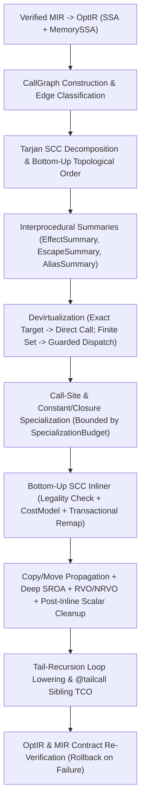

# SPEC-73 — Canonical Interprocedural Call Graph, Inlining, Scalar Replacement of Aggregates (`SROA`), Call-Site Specialization, Devirtualization & Tail-Call Optimization

## Tóm tắt
Tài liệu chuẩn hóa hạ tầng phân tích liên thủ tục trên đồ thị lời gọi (`CallGraph` / `SCC`), truyền bản sao và di chuyển bảo toàn sở hữu (`Copy/Move Propagation`), phân rã vô hướng các kiểu tổng hợp (`Scalar Replacement of Aggregates` — `SROA`), khởi tạo trực tiếp tại khe trả về của hàm gọi (`RVO` / `NRVO`), nội tuyến hàm và bao đóng (`Function & Closure Inlining`), chuyên biệt hóa tại điểm gọi (`Call-Site & Generic Specialization`), khử ảo hóa lời gọi động (`Devirtualization`), và tối ưu hóa lời gọi đuôi (`Tail-Call Optimization` — `TCO`) cho trình biên dịch `axiomc` (Epic `E15.4`, Phase 15 `P15-optimizer-2-0`):
- **Xóa bỏ trừu tượng có chứng minh và phân tích đồ thị lời gọi liên thủ tục (`AXS-INL-001..005`)**: Trình biên dịch được phép xóa hoàn toàn các ranh giới trừu tượng ở mức mã nguồn (hàm, phương thức, bao đóng, kiểu tổng hợp, bộ lặp) khi chứng minh được ranh giới đó không quan sát được (`Certainty.Proven`), và bắt buộc giữ nguyên ranh giới khi định danh, địa chỉ ổn định, chữ ký FFI/ABI, nạp động hoặc phản xạ (`reflection`) có thể quan sát được (`REQ-OPT-066`, `REQ-OPT-108..111`, `REQ-OPT-114..122`, `REQ-TYP-001..003`). Phân rã đồ thị lời gọi theo thành phần liên thông mạnh (`Tarjan SCC`) và lan truyền tóm tắt hiệu ứng/thoát/bí danh từ dưới lên (`REQ-OPT-067..069`, `REQ-OPT-074..075`); phân biệt rõ hàm thuần khiết (`Pure`), giá trị trả về `Result<T, E>` (không phải `Panic` — `REQ-OPT-068`), và hiệu ứng `Panic`.
- **Truyền bản sao/di chuyển, `SROA`, `RVO`/`NRVO` và xóa bao đóng (`AXS-INL-010..013`)**: Loại bỏ các phép gán `Copy`/`Move` trung gian mà không làm mất cờ hủy (`drop flag`) hoặc biến `Move` thành `Copy` (`REQ-OPT-023`, `0165 §13–14`). Phân rã đệ quy các `struct`, `tuple`, `Option`/`Result` và môi trường bao đóng không thoát thành các thanh ghi SSA vô hướng (`SROA`), đồng thời xây dựng giá trị trả về lớn trực tiếp trong khe nhớ do hàm gọi cấp phát (`RVO`/`NRVO` — `0152 §74`). Nội tuyến bao đóng bảo toàn ngữ nghĩa bắt giữ (`READ`/`MUTATE`/`MOVE` — `REQ-OPT-084`), xóa môi trường bao đóng khi định danh không bị quan sát (`REQ-OPT-085`), và bảo toàn định danh con trỏ hàm (`REQ-OPT-086`).
- **Nội tuyến hàm: tách biệt tính hợp lệ khỏi mô hình chi phí, thuộc tính `@inline` và bảo toàn ngữ nghĩa (`AXS-INL-020..026`)**: Trình biên dịch được phép tự động nội tuyến mọi hàm thỏa điều kiện hợp lệ mà không cần từ khóa bề mặt (`REQ-OPT-004`, `REQ-OPT-318`). Tách biệt tuyệt đối tính hợp lệ (`InlineLegality`) khỏi tính sinh lời (`CostModel` — `REQ-OPT-071`, `REQ-OPT-072`). Quy định ngữ nghĩa `@inline` (gợi ý tối ưu — `REQ-OPT-005`), `@inline(always)` (ưu tiên tối đa nhưng không bao giờ vượt qua tính hợp lệ — `REQ-OPT-006`, `REQ-OPT-082`), và `@inline(never)` (ràng buộc cấm nội tuyến nhưng không tạo khác biệt ngữ nghĩa — `REQ-OPT-006`, `REQ-OPT-083`). Giới hạn độ sâu mở rộng đệ quy và đệ quy tương hỗ trên `SCC` (`REQ-OPT-074`, `REQ-OPT-075`), đồng thời bảo toàn tuyệt đối `Drop`, sở hữu, năng lực (`view`/`mut_view`), `atomic`, `volatile`, FFI/ABI, `.await` và miền GPU (`REQ-OPT-009`, `REQ-OPT-070`, `REQ-OPT-073`, `REQ-OPT-076..081`).
- **Chuyên biệt hóa điểm gọi, khử ảo hóa `dyn Trait` và tối ưu lời gọi đuôi (`AXS-INL-030..035`)**: Tách biệt đa hình hóa tĩnh với chuyên biệt hóa theo đối số hằng/bao đóng/hồ sơ thực thi có kiểm soát ngân sách kích thước mã và chia sẻ mã tương đương biểu diễn (`REQ-OPT-087..102`, `REQ-OPT-316..317`, `REQ-TYP-004`). Chuyển lời gọi động `dyn Trait` hoặc con trỏ hàm thành lời gọi trực tiếp (hoặc rẽ nhánh có bảo vệ cho tập đích hữu hạn) chỉ khi chứng minh được kiểu cụ thể (`REQ-OPT-007`, `REQ-OPT-103..107`, `REQ-OPT-112..113`, `REQ-OPT-315`, `REQ-TYP-005..006`). Quy định hạ tầng tối ưu hóa đệ quy đuôi và thuộc tính mức thấp `@tailcall` khi ABI và nghĩa vụ `Drop` cho phép (`REQ-OPT-002`, `REQ-OPT-003`).

Status: draft (T613, 2026-11-03). Owner: axiom-architect.
Rule IDs `AXS-INL-NNN` are stable and never renumbered.
Consolidates: `0131 §28–29, §73–76, §86, §88` (`AFN-58`), `0152 §73–75`, `0165 §13–16`, `tasks/0366` (`BOOTSTRAP-107`, `AOPT-27..38, AOPT-60..62`), `tasks/0400` (`BOOTSTRAP-141`, `AIP-20..70`), `tasks/0401` (`BOOTSTRAP-142`, `AINLINE-20..36`, `ASPEC-20..35`, `ADEvirt-20..30`, `AABST-20..30`), `tasks/0551` (`BOOTSTRAP-292`, `AINLINE-20..95`), `spec/SPEC-03-core-semantics.md`, `spec/SPEC-04-core-extensibility.md`, `spec/SPEC-70-optir-ssa-memoryssa.md`, and `spec/SPEC-71-alias-escape-promotion.md`.
Covers: `REQ-OPT-002`, `REQ-OPT-003`, `REQ-OPT-004`, `REQ-OPT-005`, `REQ-OPT-006`, `REQ-OPT-007`, `REQ-OPT-009`, `REQ-OPT-066`, `REQ-OPT-067`, `REQ-OPT-068`, `REQ-OPT-069`, `REQ-OPT-070`, `REQ-OPT-071`, `REQ-OPT-072`, `REQ-OPT-073`, `REQ-OPT-074`, `REQ-OPT-075`, `REQ-OPT-076`, `REQ-OPT-077`, `REQ-OPT-078`, `REQ-OPT-079`, `REQ-OPT-080`, `REQ-OPT-081`, `REQ-OPT-082`, `REQ-OPT-083`, `REQ-OPT-084`, `REQ-OPT-085`, `REQ-OPT-086` (and governs implementation/QA tasks `T064`, `T614`, `T615` covering `REQ-TYP-001..006`, `REQ-OPT-087..124`, `REQ-OPT-315..318`).
Consumers: `T064` (`compiler/opt`, `tests/opt2`), `T614` (`compiler/opt/ipa`, `compiler/opt/devirt`, `tests/run/opt_ipa_devirt`), `T615` (`tests/conformance/p15/e15_4_inline_specialize_devirt`), Epic `E15.5` (`T616`–`T619`, auto-vectorization), and Epic `E15.6` (`T620`–`T623`, LTO/PGO).

---

## 1. Abstraction Erasure Foundation & Interprocedural Call-Graph Analysis (`CallGraph`, `SCC`, Summaries)

**AXS-INL-001 — Abstraction Erasure Principle and Boundary Observability (`REQ-OPT-066`, `REQ-OPT-114`, `REQ-OPT-115`, `REQ-OPT-116`, `REQ-OPT-117`, `REQ-OPT-118`, `REQ-OPT-119`, `REQ-OPT-122`, `REQ-TYP-001`, `REQ-TYP-002`, `REQ-TYP-003`).**
1. **Unique semantic typing and non-mandatory physical storage (`REQ-TYP-001`, `REQ-TYP-002`, `REQ-TYP-003`, `0001`, `0009 §1`, `0042 §4`, `0165 §15–16`):**
   - Every Axiom expression resolves to exactly one semantic type in typed HIR/MIR (`REQ-TYP-001`).
   - A semantic value (`struct`, `tuple`, `enum`, closure environment, capability `view<T>` / `mut_view<T>`, or iterator adapter) does **not** inherently mandate a distinct physical memory location or runtime call frame (`REQ-TYP-003`). Physical storage identity and call boundaries are maintained at machine level only when required by observable language semantics or external ABI contracts (`REQ-TYP-002`).
2. **Formal Abstraction Erasure Law (`REQ-OPT-066`, `REQ-OPT-114`, `REQ-OPT-115`, `tasks/0400 §1`, `tasks/0401 §3, §71–73, §74 AABST-20..21`, `tasks/0551 §1, §53 AINLINE-21, AINLINE-94..95`):**
   - The compiler is permitted to look through and completely erase any source-level abstraction boundary (function call, method syntax, generic wrapper, closure object, aggregate temporary, or non-escaping allocation) if and only if it holds a compile-time proof (`Certainty.Proven`) that erasing the boundary preserves all observable semantics (`SPEC-03 AXS-SEM-003`, `REQ-OPT-066`, `REQ-OPT-114`, `REQ-OPT-115`).
   - Conversely, whenever a boundary's identity, address, calling convention, or dynamic reachability is part of observable program semantics or an external ABI contract (`REQ-OPT-066`, `REQ-OPT-118`, `REQ-OPT-119`, `REQ-OPT-120`, `REQ-OPT-121`), the compiler MUST preserve the externally observable contract:
     - **Observable object/function identity (`REQ-OPT-085`, `REQ-OPT-086`, `REQ-OPT-099`, `REQ-OPT-118`, `AABST-24`):** Two functions or closures whose runtime addresses or identities are compared or inspected cannot be collapsed into a single indistinguishable identity if language semantics distinguish them.
     - **Observable storage address (`REQ-OPT-119`, `AABST-25`, `SPEC-71 AXS-ESC-015`):** Any object with `address_observable == true` or `stable_address == true` (`address_of`, `@at` MMIO, pinned DMA/FFI buffer) cannot be scalarized (`SROA`) or relocated while its address is observable.
3. **Optimization independence and zero runtime metadata overhead (`REQ-OPT-116`, `REQ-OPT-117`, `REQ-OPT-122`, `tasks/0401 §69, §74 AABST-22..23, AABST-28`):**
   - Compiler optimizations (inlining, `SROA`, specialization, devirtualization, `TCO`) are never part of surface language validity: a valid program has identical observable meaning across `--interp`, `-O0`, `-O1`, `-O2`, `-O3`, `-Os`, and `-Oz` (`REQ-OPT-116`, `REQ-OPT-117`).
   - Interprocedural summaries, inline provenance, and specialization metadata are purely compile-time structures and MUST NOT introduce mandatory runtime object headers, hidden vtables on ordinary structs, garbage collection, or runtime reference counting (`REQ-OPT-122`, `INV-SEM-005`, `tasks/0551 §16`).
[0131 §73–75; 0165 §1–3, §15–16; tasks/0400 §1, §70 AIP-49..50, AIP-65; tasks/0401 §1–3, §69–74 AABST-20..28; tasks/0551 §1–2, §16, §53 AINLINE-20..21, AINLINE-93..95]



**AXS-INL-002 — Semantic Call Graph Construction (`CallGraph`) and Edge Classification (`REQ-OPT-007`, `REQ-OPT-086`, `tasks/0400 §2–7, §59–62, §70 AIP-20..24`).**
1. **Explicit multi-kind call graph representation (`REQ-OPT-007`, `0131 §75`, `tasks/0400 §2–7, AIP-20..24`):**
   The interprocedural analyzer (`compiler/opt/ipa`) constructs a deterministic `CallGraph` over all `OptBody` functions in the compilation unit (or LTO universe), preserving the distinct call semantics established in typed MIR (`REQ-OPT-007`):
   ```text
   CallDispatchKind =
       | DISPATCH_DIRECT          // statically resolved FnId (ordinary fn, static trait method, monomorphized generic)
       | DISPATCH_CLOSURE         // call to known ClosureTypeId (direct body + captured environment)
       | DISPATCH_FN_PTR          // indirect call through fn(...) -> R value
       | DISPATCH_DYN_TRAIT       // virtual call through dyn Trait (data ptr + vtable)
       | DISPATCH_FFI_EXTERN      // foreign call across extern ABI boundary
       | DISPATCH_ASYNC_SPAWN     // async task/future creation or resumption boundary
       | DISPATCH_GPU_LAUNCH      // host-to-device @kernel launch boundary

   CallEdge {
       edge_id: u32,
       caller: FnId,
       callsite_bb: OptBbId,
       dispatch_kind: CallDispatchKind,
       known_callee: FnId,            // non-zero for DISPATCH_DIRECT / DISPATCH_CLOSURE / devirtualized exact target
       possible_targets: [FnId],      // sorted candidate set for finite indirect / dyn dispatch
       targets_complete: bool,        // true only if closed-world / dataflow proof guarantees no other target can reach
       is_inlined: bool,              // set true when callsite is inlined (retained for provenance/diagnostics)
       is_tail_position: bool,        // call result is returned directly without intervening operations
       origin: OptOrigin,
   }
   ```
2. **Indirect and `dyn Trait` target sets (`tasks/0400 §4, §6, AIP-22..23`):**
   - A `DISPATCH_DIRECT` edge resolves to a single stable `FnId` (`AIP-21`).
   - A `DISPATCH_FN_PTR` or `DISPATCH_DYN_TRAIT` edge records `possible_targets` only from proven dataflow or verified closed-world type/trait tables (`AIP-22`, `AIP-23`). Whenever external code, FFI, or unanalyzed paths can supply additional targets, `targets_complete` MUST be `false` (`UnknownTargetSet`).
3. **Function-pointer address taking (`REQ-OPT-086`, `0131 §29`, `tasks/0401 §35, AINLINE-36`):**
   - Any function whose value is coerced to a function pointer (`fn(...) -> R`), stored in a vtable, or passed across FFI has `address_taken_fn = true` on its `CallGraphNode`.
   - Even if all direct calls to such a function are inlined, the function body MUST NOT be eliminated by dead-function elimination while any indirect reference or function-pointer identity check remains reachable (`REQ-OPT-086`, `AINLINE-36`).
[0131 §29, §75; tasks/0400 §2–7, §59–62, §70 AIP-20..24; tasks/0401 §35, §74 AINLINE-36]

**AXS-INL-003 — Tarjan Strongly Connected Components (`SCC`) and Bottom-Up Fixed-Point Traversal (`REQ-OPT-074`, `REQ-OPT-075`, `tasks/0400 §10–11, §43–46, §70 AIP-27, AIP-60..64`).**
1. **Deterministic Tarjan `SCC` decomposition (`tasks/0400 §10, AIP-27, AIP-60`):**
   - `CallGraph` nodes are visited in deterministic `FnId` order using Tarjan's algorithm to partition the call graph into a DAG of Strongly Connected Components (`CallSccId`).
   - A component $S = \{f\}$ with no self-edge $f \to f$ is marked `is_recursive = false` (non-recursive leaf/internal node).
   - A component $S = \{f\}$ with a self-edge $f \to f$ (direct recursion) or $|S| \ge 2$ with a cycle $f_1 \to f_2 \to \dots \to f_1$ (mutual recursion) is marked `is_recursive = true` (`REQ-OPT-074`, `REQ-OPT-075`).
2. **Bottom-up topological order and parallel SCC independence (`tasks/0400 §44–45, §70 AIP-27, AIP-61..62`):**
   - Interprocedural summary inference and bottom-up inlining traverse the `SCC` condensation DAG in **reverse topological order** (callees before callers), so when analyzing caller $C$, all non-recursive callees $D$ of $C$ have already been simplified, inlined into, and summarized.
   - Independent `SCC`s at the same topological level have no shared mutable state and may be analyzed in parallel while producing byte-identical summaries (`AIP-60..61`, `INV-DET-001`).
3. **Monotone fixed-point iteration with guaranteed termination (`tasks/0400 §11, §43–45, AIP-27, AIP-62..64`):**
   - For a recursive `SCC` $S$, summary computation initializes every member $f \in S$ to the optimistic internal baseline derived from its non-call instructions and iterates over all edges within $S$ over the finite product lattice (`EffectSummary × EscapeSummary × AliasSummary`) until fixed-point convergence or `MAX_SCC_ITERATIONS` (default `8`).
   - If the iteration limit is reached before stabilization, summaries widen monotonically toward the conservative top (`UnknownEffect`, `GlobalEscape`, `UnknownAlias`, `AIP-63`). Summary widening MUST NEVER narrow a conservative fact into a stronger optimization fact without proof (`AIP-64`).
[tasks/0400 §10–11, §43–46, §70 AIP-27, AIP-60..64; tasks/0401 §30–31, §74 AINLINE-24..25]

**AXS-INL-004 — Compiler-Derived Interprocedural Summaries (`EffectSummary`, `EscapeSummary`, `AliasSummary`) and Purity vs. `Result` vs. `Panic` (`REQ-OPT-067`, `REQ-OPT-068`, `REQ-OPT-069`).**
1. **Summaries are compiler-derived, never trusted user annotations (`REQ-OPT-069`, `tasks/0400 §12–14, §53, §70 AIP-28..30`):**
   - Every function's `InterprocSummary` (`EffectSummary`, `EscapeSummary`, `AliasSummary`) is computed directly from its `Verified MIR` / `OptIR` instructions and the summaries of its callees (`REQ-OPT-069`, `AIP-28`).
   - Function summaries are an optimization accelerant and MUST NEVER weaken `Verified MIR` semantics or replace semantic verification (`REQ-OPT-069`, `AIP-30, AIP-70`). Safe Axiom code cannot attach an unchecked `@pure` or `@noalias` attribute to fabricate optimization proofs (`tasks/0400 §27, §53`, `AIP-36..37`).
2. **Region-sensitive `EffectSummary` and the definition of `Pure` (`REQ-OPT-067`, `tasks/0400 §12–17, §70 AIP-29`):**
   - A function's `EffectSummary` records its aggregated `EffectFlags` bitset (`SPEC-70 AXS-OPT-023`: `EFFECT_PURE`, `EFFECT_READS_MEM`, `EFFECT_WRITES_MEM`, `EFFECT_ALLOCATES`, `EFFECT_DROPS`, `EFFECT_MAY_PANIC`, `EFFECT_IO`, `EFFECT_VOLATILE`, `EFFECT_ATOMIC`, `EFFECT_FFI`, `EFFECT_SUSPENDS`, `EFFECT_GPU`, `EFFECT_NONTERM`, `EFFECT_UNKNOWN`) together with per-parameter memory read/write bitmasks (`param_reads_mask`, `param_writes_mask`, `AIP-29`).
   - **`Pure` does not mean "contains no code" or "zero cost" (`REQ-OPT-067`, `tasks/0400 §15–16`):** A function is `Pure` (`effects == EFFECT_PURE`) when it has **no observable external side effects** (no memory writes visible to the caller, no I/O, no `volatile` or `atomic` synchronization, no FFI side effects, and no `Panic` or non-termination) beyond computing its return value from its arguments (`REQ-OPT-067`). An arbitrarily expensive mathematical computation may be `Pure` and is eligible for `GVN`/`CSE`, `DCE` (when its result is unused), `LICM` hoisting, and constant folding.
   - A function that reads only through `view<T>` parameters without writing memory (`effects == EFFECT_READS_MEM`) is `ReadOnly` and may be CSE'd or hoisted across loop iterations when `MemorySSA` and `AliasInfo` prove the viewed regions are not clobbered (`SPEC-70 AXS-OPT-046`, `SPEC-72 AXS-LOOP-011`).
3. **`Result<T, E>` is a normal return value, never a `Panic` effect (`REQ-OPT-068`, `tasks/0400 §17–18`):**
   - Returning `Result.Err(e)` or `Option.None` is ordinary value dataflow (`OPT_TERM_RETURN`) and MUST NOT set `EFFECT_MAY_PANIC` in `EffectSummary` (`REQ-OPT-068`).
   - Conversely, a function that can execute an unproven `OPT_TERM_ASSERT` (checked arithmetic overflow, division by zero, out-of-bounds index) or explicit `panic(...)` carries `EFFECT_MAY_PANIC` (`tasks/0400 §17`). Calls carrying `EFFECT_MAY_PANIC` MUST NOT be deleted by `DCE` if reachable, and MUST NOT be reordered across `EFFECT_IO`, `EFFECT_VOLATILE`, `EFFECT_ATOMIC`, or other `EFFECT_MAY_PANIC` operations (`SPEC-70 AXS-OPT-023`).
4. **Interprocedural `EscapeSummary`, `AliasSummary`, and `.axmeta` fingerprinting (`tasks/0400 §19–29, §40–42, §67, AIP-31..39, AIP-59, AIP-67..68`):**
   - Each function exports its `FunctionEscapeSummary` (`SPEC-71 AXS-ESC-003`: `param_escape[i]`, `return_aliases_param_mask`, `param_address_observed_mask`) and `AliasSummary` (proven disjoint/read-only parameter capabilities) keyed by `(FnId, SemanticSummaryFingerprint)` in `.axmeta` (`AIP-67..68`).
   - When a callee's implementation changes during incremental compilation, downstream callers are invalidated only if the callee's `SemanticSummaryFingerprint` (or inlined body hash for inlined edges) changes (`tasks/0400 §41–42, AIP-59`).
[tasks/0400 §12–29, §40–44, §53–55, §67, §70 AIP-28..39, AIP-59, AIP-67..70; SPEC-70 AXS-OPT-023; SPEC-71 AXS-ESC-003]

**AXS-INL-005 — Closed-World vs. Open-World Reachability, Exports, Dynamic Loading, and Reflection Roots (`REQ-OPT-080`, `REQ-OPT-081`, `REQ-OPT-108`, `REQ-OPT-109`, `REQ-OPT-110`, `REQ-OPT-111`, `REQ-OPT-120`, `REQ-OPT-121`).**
1. **Explicit compilation-universe reachability modes (`REQ-OPT-108`, `tasks/0400 §33–39, §64–65, AIP-25..26, AIP-43..44, AIP-58`, `tasks/0401 §20, §23, §62–63, ADEvirt-25`):**
   - Whole-program closed-world optimizations (dead-function elimination, dead generic instance elimination, closed-world devirtualization, and internal signature scalarization) are legal **only** when the closed-world assumption is explicitly valid for the target entity (`REQ-OPT-108`, `AIP-58`, `ADEvirt-25`).
   - `pub fn` visibility controls module-level name resolution and does **not** by itself make a function an external binary ABI root in a closed-world executable build (`tasks/0400 §9, AIP-26`).
2. **Mandatory reachability roots and open-world barriers (`REQ-OPT-080`, `REQ-OPT-081`, `REQ-OPT-109`, `REQ-OPT-110`, `REQ-OPT-111`, `REQ-OPT-120`, `REQ-OPT-121`, `tasks/0400 §8, §33, §64–66, AIP-25, AIP-45..46, AIP-56..57`, `tasks/0401 §21, §62–65, ADEvirt-26..28, AABST-26..27`):**
   - **Exports and public C/system ABI (`REQ-OPT-081`, `REQ-OPT-109`, `REQ-OPT-120`, `AIP-25, AIP-46`, `ADEvirt-26`, `AABST-26`):** Functions marked `@export`, `extern "C"` definitions exposed to foreign callers, program entry points (`main`), interrupt/init/fini handlers, and public symbols of a shared library (`.dll` / `.so`) are **external reachability roots**. Their bodies may be optimized internally and cloned/inlined into internal callers, but their externally visible symbol, calling convention, parameter layout, and return ABI MUST remain intact (`REQ-OPT-081`, `REQ-OPT-109`, `REQ-OPT-120`, `tasks/0551 §30–31, AINLINE-27/80`).
   - **FFI boundaries (`REQ-OPT-080`, `REQ-OPT-120`, `AIP-24, AIP-38`, `AINLINE-30`):** Calls to `extern` foreign functions without a verified Axiom body cannot be inlined, and their parameter/return ABI layouts MUST NOT be altered by cross-call scalarization (`REQ-OPT-080`, `REQ-OPT-120`).
   - **Dynamic loading (`REQ-OPT-110`, `AIP-57`, `ADEvirt-27`):** When a compilation unit or trait hierarchy participates in dynamic plugin loading (`dlopen` / `LoadLibrary` or open trait registry), `targets_complete` is `false` for affected traits and indirect calls, forbidding closed-world single-target assumptions (`REQ-OPT-110`).
   - **Reflection roots (`REQ-OPT-111`, `REQ-OPT-121`, `AIP-56`, `ADEvirt-28`, `AABST-27`):** Any function, method, or type registered for runtime reflection is added to the `CallGraph` root set and MUST NOT be dead-stripped or have its reflected layout/identity erased (`REQ-OPT-111`, `REQ-OPT-121`). Conversely, `comptime` reflection that finishes during HIR/THIR expansion leaves ordinary static code that may be freely erased at `OptIR` level (`tasks/0400 §66`, `tasks/0401 §66`).
[tasks/0400 §8–9, §33–39, §64–66, §70 AIP-24..26, AIP-38, AIP-43..46, AIP-56..58; tasks/0401 §20–23, §62–66, §74 AINLINE-30..31, ADEvirt-25..28, AABST-26..27; tasks/0551 §30–32, §53 AINLINE-26..27, AINLINE-80]

---

## 2. Ownership-Aware Copy/Move Propagation, `SROA`, and Return-Slot Construction (`RVO` / `NRVO`)

**AXS-INL-010 — Ownership- and Capability-Aware Copy and Move Propagation (`REQ-OPT-023`, `REQ-OPT-114`, `REQ-OPT-115`, `REQ-OPT-118`, `REQ-OPT-119`).**
1. **Copy propagation on `Copy` types (`0165 §7, §13`, `SPEC-70 AXS-OPT-013`):**
   - Given an assignment `b = Copy(a)` (or SSA equivalence `%b = %a`) where `a` is a scalar or aggregate `Copy` value, `opt_copy_move_prop` rewrites dominated uses of `b` to read `a` directly provided neither `a` nor `b` is modified along any path from the copy to the use (`MemorySSA` reaching version unchanged and no field store intervenes) and `b` does not require a distinct observable address (`address_observable(b) == false`, `REQ-OPT-119`).
   - Once all uses of `b` are rewritten and `b` is not address-observable, the dead temporary `b` is eliminated by `DCE` (`REQ-OPT-114`, `REQ-OPT-115`).
2. **Move propagation and move-chain coalescing (`REQ-OPT-023`, `0152 §74`, `0165 §13–14`, `SPEC-70 AXS-OPT-013`):**
   - For a non-`Copy` owned value `x`, a chain of unobservable ownership transfers `t1 = Move(x); t2 = Move(t1); dst = Move(t2)` represents a single logical resource handover (`REQ-OPT-023`).
   - When intermediate locals `t1`, `t2` have `address_observable == false`, `stable_address == false`, and no intervening conflicting access to `dst`, `opt_copy_move_prop` coalesces the move chain so the value is constructed in or moved directly into `dst`:
     - All drop flags associated with elided temporaries `t1`, `t2` are folded (`MIR_DROP_FLAG_NONE` / constant `false`), while the active drop obligation on `dst` (and deactivation of `x`'s drop flag upon move) is preserved identically (`REQ-OPT-023`, `INV-SEM-003`).
     - Move propagation MUST NEVER duplicate a non-`Copy` value (`Move(x)` cannot be propagated to two live uses without an ownership verifier ICE) and MUST NEVER extend or alter the lifetime of any active `view<T>` or `mut_view<T>` capability (`INV-SEM-001`, `INV-SEM-002`).
[0152 §74; 0165 §7, §13–14; tasks/0366 §71 AOPT-28..30, AOPT-61..62; SPEC-70 AXS-OPT-013]

**AXS-INL-011 — Deep Scalar Replacement of Aggregates (`SROA`) for Nested Structs, Tuples, Enums (`Option`/`Result`), and Closure Environments (`REQ-OPT-050`, `REQ-OPT-055`, `REQ-OPT-114`, `REQ-OPT-115`, `REQ-OPT-118`, `REQ-OPT-119`, `REQ-TYP-002`, `REQ-TYP-003`).**
Building on `SPEC-70 AXS-OPT-014`, `opt_sroa` (`T064`) performs recursive, multi-level Scalar Replacement of Aggregates across `OptBody` functions both before and after inlining:
1. **Eligibility criteria (`Certainty.Proven`) (`0165 §15–16`, `tasks/0398 §9–11`, `SPEC-70 AXS-OPT-014`, `SPEC-71 AXS-ESC-015`):**
   An aggregate local $A$ of type `Struct`, `Tuple`, `ClosureEnv`, fixed small array `[N]T` ($N \le 8$ with exclusively constant-index projections), or tagged union (`Enum` / `Option<T>` / `Result<T, E>`) is eligible for `SROA` if and only if all of the following hold (`Certainty.Proven`):
   - `EscapeClass(A) == NoEscape` (`SPEC-71 AXS-ESC-002`),
   - `address_observable(A) == false` and `stable_address(A) == false` (`REQ-OPT-118`, `REQ-OPT-119`, `SPEC-71 AXS-ESC-015`),
   - $A$ is not accessed via `volatile` or `atomic` instructions (`OPT_INST_VOLATILE_*`, `OPT_INST_ATOMIC`),
   - Every read or write to $A$ is either a whole-aggregate construction/copy/move (`Aggregate`, `Copy`, `Move`), a constant-field projection (`MIR_PROJ_FIELD`), a constant-index projection (`MIR_PROJ_INDEX` with constant index), or an enum discriminant/variant-payload projection (`OPT_INST_DISCRIMINANT`, `MIR_PROJ_DOWNCAST`),
   - Total leaf scalar fields of $A$ do not exceed `MAX_SROA_LEAVES` (default `32`).
2. **Recursive field tree replacement and `OptPhi` splitting:**
   - `opt_sroa` expands $A$ into its leaf scalar components $(A.\pi_1, \dots, A.\pi_k)$:
     - For `Struct`, `Tuple`, and `ClosureEnv`: one scalar SSA stream per leaf field.
     - For `Option<T>` / `Result<T, E>` / `Enum`: an explicit scalar discriminant SSA value `%A.disc` plus scalarized payload leaf values `%A.payload_j` (reading a payload leaf is valid only in blocks dominated by the corresponding variant check, where `SCCP` frequently folds `%A.disc` to a constant and prunes dead `Err`/`None` branches).
   - Every whole-aggregate copy/move `B = Copy(A)` or `B = Move(A)` between SROA-eligible locals is rewritten into component-wise scalar SSA assignments `%B.\pi_i = %A.\pi_i`, and `OptPhi` nodes on $A$ at control-flow joins are split into per-leaf `OptPhi` nodes (`SPEC-70 AXS-OPT-012`).
3. **`Drop` and partial-move fidelity (`REQ-OPT-055`, `SPEC-70 AXS-OPT-014` rule 2):**
   - If $A$'s type implements a custom `Drop.drop(mut_view<Self>)` method, `opt_sroa` either:
     1. Inlines `Drop.drop` first (during the bottom-up inlining + `SROA` cycle) so `A` is only accessed field-by-field and then scalarizes $A$ completely, OR
     2. Materializes $A$ only immediately prior to the un-inlined `OPT_TERM_DROP` call.
   - If $A$ has no custom `impl Drop` but contains fields $f_i$ with non-trivial `Drop`, `OPT_TERM_DROP(A)` is replaced by individual `OPT_TERM_DROP(A.f_i)` terminators in canonical field declaration order (`SPEC-12`, `INV-SEM-003`), respecting per-field partial-move drop flags (`tasks/0551 §52 Test 5`, `AINLINE-49`).
4. **Cross-call internal scalarization (`tasks/0400 §57–58, AIP-47`):**
   - For an internal non-exported function whose callers are all known (`ClosedWorld`) or when a function is inlined into its caller, aggregate parameters and aggregate return values (such as `fn make_point() -> Point` where the caller reads only `.x`) are decomposed by `SROA` + `DCE` so unused fields are never computed or materialized in memory (`tasks/0400 §57`).
[0165 §15–16; tasks/0366 §19, §71 AOPT-27; tasks/0398 §9–11, §81 AOPTIR-26..27, AOPTIR-52..53; tasks/0400 §57–58, §70 AIP-47; tasks/0401 §71–73, §74 AABST-20..25; SPEC-70 AXS-OPT-014]

**AXS-INL-012 — Caller-Allocated Return-Slot Construction (`RVO` / `NRVO`) and Cross-Call Aggregate Elision (`REQ-OPT-012`, `REQ-OPT-310`, `0152 §74`, `0165 §14`).**
1. **Unnamed Return Value Optimization (`RVO`) (`0152 §74`, `0165 §14`, `SPEC-71 AXS-ESC-014`):**
   - When a function returns an aggregate expression directly (`return BigStruct { ... }` or `return helper_make()`), the MIR/OptIR return place `_0` represents ownership transfer into the caller's destination slot (`0152 §74`).
   - For aggregates larger than the register-return threshold (`> 16` bytes on x86-64 per `SPEC-04` / `ADR-0003`) or when the caller destination requires in-place construction, the callee constructs the aggregate directly inside the caller-provided return slot (`STORAGE_CALLER_RET_SLOT` / `sret`), emitting zero temporary stack allocation and zero `memcpy` on return (`0152 §74`, `0165 §14`).
2. **Named Return Value Optimization (`NRVO`) legality conditions (`0152 §74`, `0165 §14`, `tasks/0397 §26–27, AESCAPE-51..53`, `tasks/0400 §19–20, AIP-48`, `SPEC-71 AXS-ESC-014`):**
   - When a callee constructs a named local aggregate `let mut res = BigStruct { ... }` and returns `res` by ownership transfer (`return res`), `opt_rvo_nrvo` coalesces `res` with the caller return slot `_0` if and only if all of the following are `Proven`:
     1. Every normal `OPT_TERM_RETURN` path in the callee returns `Move(res)` (or returns a direct rvalue constructed in `_0` on paths where `res` is never live),
     2. `res` has `EscapeClass == ReturnEscape` and its address is not observed independently of the returned value (`address_observable(res) == false`),
     3. No capability (`view` / `mut_view`) or pointer aliasing the caller's destination place `dst` in the caller can be read or written by the callee while `res` is being constructed (`AliasInfo` proves `dst` is disjoint from all other arguments and globals accessed by the callee),
     4. If the callee can exit early (e.g., via `return Err(...)` or panic) after partially initializing `res`, `Drop` cleanup for `res` executes before exiting so the caller never observes partially constructed state in `dst`.
3. **Chained return-slot forwarding across calls (`tasks/0400 §19–20, AIP-48`):**
   - When `caller` executes `let out = outer_make()` and `outer_make()` returns `inner_make()` in tail/return position, `RVO`/`NRVO` forwards `caller`'s destination slot directly through `outer_make` to `inner_make`, constructing `out` in a single allocation slot across the entire call chain (`AIP-48`).
[0152 §74; 0165 §14; tasks/0366 §24, §71 AOPT-34; tasks/0397 §26–27, §77 AESCAPE-51..53; tasks/0400 §19–20, §70 AIP-48; SPEC-71 AXS-ESC-014]

**AXS-INL-013 — Closure Capture Inlining, Environment Scalarize-and-Erase, and Function-Pointer Identity Preservation (`REQ-OPT-084`, `REQ-OPT-085`, `REQ-OPT-086`, `REQ-OPT-118`).**
1. **Capture-mode preservation during closure inlining (`REQ-OPT-084`, `tasks/0401 §32–33, §74 AINLINE-34`, `tasks/0551 §18–19, §53 AINLINE-70`, `SPEC-71 AXS-ESC-012`):**
   - When a call to a closure `c(args...)` (`DISPATCH_CLOSURE` or specialized generic parameter `F: Fn/FnMut/FnOnce`) is inlined into its caller, each captured field `c.env.cap_i` is remapped according to its verified capture mode (`SPEC-71 AXS-ESC-012`):
     - **`READ` capture (`view<T>`):** Remapped to a read-only `view<T>` capability or direct SSA value of the captured variable/field in the caller; no mutation of the captured place is permitted.
     - **`MUTATE` capture (`mut_view<T>`):** Remapped to the exclusive `mut_view<T>` capability over the captured variable/field in the caller; `MemorySSA` `MemoryDef`/`MemoryUse` versions on the caller's variable are threaded directly through the inlined closure body so mutations are immediately visible to subsequent caller instructions (`REQ-OPT-084`).
     - **`MOVE` capture (owned `T`):** Ownership of the captured variable/field is transferred into the closure environment upon closure creation, and consumed or dropped exactly once according to the inlined closure body's move and `Drop` scopes (`REQ-OPT-084`, `INV-SEM-001`, `INV-SEM-003`).
2. **Closure environment elimination requires non-observable identity (`REQ-OPT-085`, `tasks/0401 §32–34, §74 AINLINE-35`, `tasks/0551 §19, §53 AINLINE-71`):**
   - After all calls to a closure local `c` are inlined, `opt_sroa` and `opt_escape_promote` (`SPEC-71 AXS-ESC-012`) scalarize `c`'s capture environment into SSA registers and erase the `ClosureObject` completely **if and only if** `EscapeClass(c) == NoEscape` and `address_observable(c) == false` (`REQ-OPT-085`, `AINLINE-35`, `AINLINE-71`).
   - If the program observes the closure's storage address or identity (`address_of(c)` escaped or compared), the physical closure environment struct MUST be retained (`REQ-OPT-085`, `REQ-OPT-118`).
3. **Function-pointer coercion and identity preservation (`REQ-OPT-086`, `0131 §29`, `tasks/0401 §34–35, §74 AINLINE-36`):**
   - A non-capturing closure (`|x: i32| -> i32 { x + 1 }`) may coerce to a function pointer `fn(i32) -> i32`.
   - Whenever a function or non-capturing closure is converted to a function pointer whose address/identity is observable (`p == q`, cast to `usize`, stored in a data structure, or passed to FFI), the compiler MUST preserve a valid callable machine symbol for it (`REQ-OPT-086`, `AINLINE-36`) and MUST NOT merge two distinct functions whose pointer equality is observed (`REQ-OPT-099`, `REQ-OPT-118`).
[0131 §29, §86; tasks/0401 §32–35, §74 AINLINE-34..36; tasks/0551 §18–19, §53 AINLINE-70..71; tasks/0615 §1–39 ACLOS-01..30; SPEC-71 AXS-ESC-012]

---

## 3. Function Inlining: Legality vs. Cost-Model Profitability, Attributes, and Semantic Remapping

**AXS-INL-020 — Strict Separation of Inlining Legality from Cost-Model Profitability (`REQ-OPT-004`, `REQ-OPT-009`, `REQ-OPT-070`, `REQ-OPT-071`, `REQ-OPT-072`, `REQ-OPT-073`, `REQ-OPT-318`).**
1. **Inlining is an automatic optimization, never a surface semantic requirement (`REQ-OPT-004`, `REQ-OPT-009`, `REQ-OPT-070`, `REQ-OPT-318`, `0131 §73, §88 AFN-58`, `tasks/0366 AOPT-38`, `tasks/0401 §13–14, §69, §74 AINLINE-20`, `tasks/0551 §1–3, §53 AINLINE-21, AINLINE-94..95`):**
   - The compiler is permitted to inline any function or method call whose semantic preconditions (`InlineLegality == Legal`) are proven, without requiring the programmer to write an `inline` keyword (`REQ-OPT-004`).
   - Function inlining MUST preserve all observable function semantics and behavior (`REQ-OPT-009`, `REQ-OPT-070`, `AFN-58`, `AINLINE-20`). Whether a call is inlined or kept as a `call` instruction is purely an optimization decision and never changes language validity or observable program results (`REQ-OPT-318`).
2. **Orthogonality of `InlineLegality` and `CostModel` (`REQ-OPT-071`, `REQ-OPT-072`, `tasks/0401 §2, §74 AINLINE-21..22`, `tasks/0551 §3–4, §53 AINLINE-22..24`):**
   - Every candidate callsite $E: \mathrm{caller} \to \mathrm{callee}$ is evaluated by two strictly separated stages:
     1. **`check_inline_legality(E) -> InlineLegality`:** Returns `INLINE_LEGAL` (`Certainty.Proven`) only when all semantic, ABI, domain, verification, and recursion-bound preconditions hold; otherwise returns `INLINE_ILLEGAL(InlineBlockReason)`. `Certainty.Unknown` or `Possible` is always treated as `INLINE_ILLEGAL` (`AINLINE-24`).
     2. **`evaluate_inline_cost(E) -> InlineCostDecision`:** Runs **only** when `check_inline_legality(E) == INLINE_LEGAL`. Computes net instruction growth, call-overhead savings, and downstream optimization bonuses against `InlineBudget`.
   - `InlineLegality` is completely independent of profitability (`REQ-OPT-071`), and `CostModel`, PGO hotness, or user hints (`@inline`, `@inline(always)`) MUST NEVER override `INLINE_ILLEGAL` (`REQ-OPT-072`, `REQ-OPT-082`, `AINLINE-22`, `AINLINE-23`).
3. **Mandatory verification boundary (`REQ-OPT-073`, `tasks/0401 §74 AINLINE-23`, `tasks/0551 §53 AINLINE-20`):**
   - Inlining operates exclusively on `OptIR` derived from `Verified MIR` (`AINLINE-20`) and every inlined `OptBody` MUST pass post-pass `OptIR` verification (`verify_optir_contract`, `REQ-OPT-073`, `SPEC-70 AXS-OPT-034`). Inlining can never bypass ownership, capability, initialization, or type verification (`REQ-OPT-073`).
[0131 §73, §88 AFN-58; tasks/0366 §71 AOPT-38; tasks/0401 §2, §13–15, §69, §74 AINLINE-20..23; tasks/0551 §1–5, §45, §53 AINLINE-20..25, AINLINE-94..95]

**AXS-INL-021 — Surface and System Inlining Attributes: `@inline`, `@inline(always)`, and `@inline(never)` (`REQ-OPT-004`, `REQ-OPT-005`, `REQ-OPT-006`, `REQ-OPT-082`, `REQ-OPT-083`, `REQ-OPT-318`).**
1. **Supported attribute forms (`REQ-OPT-005`, `REQ-OPT-006`, `0131 §74`, `tasks/0401 §24–25, §70`):**
   Axiom supports three canonical function/method inlining attribute forms at the surface and system/compiler layers:
   ```text
   InlineAttr =
       | INLINE_ATTR_NONE        // default: compiler CostModel decides freely (REQ-OPT-004)
       | INLINE_ATTR_HINT        // @inline: positive profitability hint (REQ-OPT-005)
       | INLINE_ATTR_ALWAYS      // @inline(always): force inlining whenever legal (REQ-OPT-006, REQ-OPT-082)
       | INLINE_ATTR_NEVER       // @inline(never): forbid inlining of this callee (REQ-OPT-006, REQ-OPT-083)
   ```
2. **`@inline` is an optimization hint, never a semantic mandate (`REQ-OPT-005`, `REQ-OPT-318`, `0131 §74`, `tasks/0401 §70`):**
   - `@inline` (`INLINE_ATTR_HINT`) increases the callee's inline threshold bonus in `CostModel` (`+inline_hint_bonus`), making the compiler more willing to inline the function across module boundaries and at moderate sizes, but `CostModel` may still decline to inline if code-size growth exceeds the hard budget or the callsite is cold (`0131 §74`, `REQ-OPT-005`).
3. **`@inline(always)` cannot force an illegal transformation (`REQ-OPT-006`, `REQ-OPT-082`, `0131 §74`, `tasks/0401 §24, §74 AINLINE-32`):**
   - When `check_inline_legality(E) == INLINE_LEGAL` and the recursion depth bound (`AXS-INL-022`) is not exceeded, `@inline(always)` bypasses the heuristic `CostModel` size threshold and inlines the call at `-O1`, `-O2`, `-O3`, `-Os`, and `-Oz` (`REQ-OPT-006`).
   - If `check_inline_legality(E) == INLINE_ILLEGAL` (for example: an un-devirtualized indirect call, an external FFI declaration without a body, an unbounded recursive cycle exceeding `MAX_ALWAYS_INLINE_RECURSION_DEPTH`, or a cross-domain CPU↔GPU call), `@inline(always)` MUST NOT force an illegal inline transformation (`REQ-OPT-082`, `AINLINE-32`). The compiler retains the valid call instruction (failing closed per `tasks/0551 §45`) and records `InlineBlockReason` in the optimization inspection trace (`AXS-INL-035`).
4. **`@inline(never)` is an optimization constraint, not a semantic distinction (`REQ-OPT-006`, `REQ-OPT-083`, `0131 §74`, `tasks/0401 §25, §70, §74 AINLINE-33`):**
   - `@inline(never)` sets `check_inline_legality(E) = INLINE_ILLEGAL(REASON_ATTR_INLINE_NEVER)`, preventing the inliner from expanding the callee into any caller (useful for profiling, debugging, cold error handlers, stack-frame isolation, and ABI/hot-patching boundaries, `tasks/0401 §25`).
   - `@inline(never)` does **not** alter the function's language semantics, type, ownership rules, or interprocedural `EffectSummary`/`EscapeSummary` (`REQ-OPT-083`, `AINLINE-33`).
[0131 §73–74; tasks/0401 §24–25, §70, §74 AINLINE-32..33; tasks/0551 §3–4, §45]

**AXS-INL-022 — Bounded Recursive and Mutually Recursive (`SCC`) Inlining (`REQ-OPT-074`, `REQ-OPT-075`).**
1. **Mandatory termination and bounded expansion for direct recursion (`REQ-OPT-074`, `tasks/0400 §46–47`, `tasks/0401 §30, §61, §74 AINLINE-24`, `tasks/0551 §12, §53 AINLINE-37, AINLINE-39`):**
   - Every inlining transaction maintains an active `InlineHistoryChain = [(FnId, unroll_depth)]` along the current expansion stack from the root caller.
   - Direct self-recursive calls ($f \to f$) are never inlined unconditionally (`REQ-OPT-074`, `AINLINE-24`). At `-O2`/`-O3`, self-recursion may be unrolled at most `MAX_SELF_INLINE_DEPTH = 1` (or `0` when tail-recursion loop lowering `AXS-INL-033` applies directly, which is strictly preferred over recursive inline expansion) and only when constant folding or base-case specialization proves profitable within `InlineBudget`.
2. **Mutual recursion `SCC` cycle breaker (`REQ-OPT-075`, `tasks/0400 §46`, `tasks/0401 §31, §74 AINLINE-25`, `tasks/0551 §13, §53 AINLINE-38..40`):**
   - For a mutually recursive `SCC` $S$ with $|S| \ge 2$ (e.g., $A \to B \to A$), `opt_inline` tracks `scc_expansion_count[CallSccId]` and the set of functions already present on the active `InlineHistoryChain`.
   - Any call edge $u \to v$ where $u, v \in S$ and $v$ already appears in `InlineHistoryChain` at depth $\ge \mathrm{MAX\_SCC\_CYCLE\_INLINE\_DEPTH}$ (default `1`) is immediately marked `INLINE_ILLEGAL(REASON_RECURSIVE_SCC_LIMIT)`.
   - Consequently, mutually recursive `SCC`s can at most inline non-cycle internal helpers (e.g., inlining $B$ into $A$ once so $A \to B \to A$ becomes direct self-recursion $A \to A$), and can **never** cause unbounded inline expansion (`REQ-OPT-075`, `AINLINE-25`, `AINLINE-38`).
[tasks/0400 §46–47; tasks/0401 §30–31, §61, §74 AINLINE-24..25; tasks/0551 §12–13, §53 AINLINE-37..40]

**AXS-INL-023 — Deterministic Inlining `CostModel` and `InlineBudget` (Hotness, Loop Depth, Vectorization/Allocation Enablers) (`REQ-OPT-071`, `REQ-OPT-072`).**
1. **Parameterized `InlineBudget` per optimization level (`0165 §5`, `tasks/0401 §26–29, §48–49`, `tasks/0551 §8–11, §20–21, §39, §53 AINLINE-40..44, AINLINE-91..92`):**
   - At `-O0`, general heuristic inlining is disabled; only correctness-required lowerings execute.
   - At `-O1`, `-O2`, `-O3`, `-Os`, and `-Oz`, `CostModel` evaluates each legal `InlineCandidate` deterministically against `InlineBudget`:
     ```text
     InlineBudget {
         base_threshold_insts: u32,      // e.g., 25 (-O1), 75 (-O2), 180 (-O3), 15 (-Os), 8 (-Oz)
         max_callee_insts: u32,          // hard cap for non-@inline(always) callees
         max_caller_growth_pct: u32,     // cap on total caller instruction expansion
         max_inline_depth: u32,          // maximum nested call-chain expansion depth (default 6)
         inline_hint_bonus: i32,         // bonus for @inline attribute
         single_callsite_bonus: i32,     // bonus for private/internal callee with total_callers == 1
         constant_arg_bonus: i32,        // bonus per constant/known-range/closure argument that folds branches
         loop_depth_bonus: i32,          // bonus per enclosing loop nesting level (tasks/0401 §29)
         vectorization_enabler_bonus: i32, // bonus when inlining inside a loop exposes vectorizable body (tasks/0551 §39)
         escape_elim_bonus: i32,         // bonus when inlining exposes a NoEscape allocation/closure for elimination (tasks/0551 §20)
         cold_callsite_penalty: i32,     // penalty for @cold or PGO-cold error paths (tasks/0401 §28, tasks/0551 §11)
     }
     ```
2. **Context-sensitive cost evaluation (`tasks/0551 §8, §21, AINLINE-43..44`):**
   - When evaluating a callsite `callee(arg_0, ..., arg_{k-1})`, `CostModel` simulates the caller's **proven** context facts (`KnownConstants`, `KnownRanges`, `KnownTypes`, `KnownClosures`, `KnownAliases`, `AINLINE-43..44`) on the callee's CFG:
     - Any callee basic block guarded by a branch on a constant caller argument that evaluates to `false` (`Certainty.Proven`) is excluded from `estimated_callee_cost`.
     - If inlining folds away an allocation (`Box<T>` or `ClosureEnv` becoming `NoEscape`, `tasks/0551 §20`) or eliminates an indirect closure/trait call inside a loop (`tasks/0551 §39`), `CostModel` credits the corresponding enabler bonus.
   - Profile-Guided Optimization (`PGO`) counts may adjust `hotness` and `cold_callsite_penalty`, but MUST NEVER override `InlineLegality` or alter program semantics (`tasks/0401 §38, §57`, `tasks/0551 AINLINE-41..42`).
[0165 §5; tasks/0401 §26–29, §38, §48–49, §57; tasks/0551 §8–11, §20–21, §39, §53 AINLINE-40..44, AINLINE-91..92]

**AXS-INL-024 — Transactional Callee Cloning and Remapping of Locals, Ownership, Capabilities, `Drop` Scopes, `MemorySSA`, and Source Provenance (`REQ-OPT-073`, `REQ-OPT-076`, `REQ-OPT-077`, `REQ-OPT-078`, `REQ-OPT-124`).**
When `opt_inline` decides to inline a callsite $E: \mathrm{caller} \to \mathrm{callee}$ in block $B_{\mathrm{call}}$, it executes a transactional transformation (`tasks/0551 §33–38, §46–48, §53 AINLINE-45..60, AINLINE-81..88`):
1. **Evaluation order and panic ordering preservation (`REQ-OPT-070`, `tasks/0551 §33, AINLINE-45..46`):**
   - Argument expressions at the callsite are evaluated in exact left-to-right source order before entering the inlined callee body (`AINLINE-45`).
   - Any potential panic inside an argument or inside the callee body retains its exact relative execution order with respect to preceding and succeeding caller statements (`AINLINE-46`).
2. **CFG splitting and return merging (`tasks/0551 §46, §50`):**
   - Block $B_{\mathrm{call}}$ is split at the `OPT_TERM_CALL` terminator into `B_before` (which jumps unconditionally to the cloned callee entry block `B_callee_entry`) and `B_cont` (the post-call continuation block in the caller).
   - Every `OPT_TERM_RETURN(v_ret)` block inside the cloned callee body is rewritten to jump (`OPT_TERM_GOTO`) to `B_cont`, and an `OptPhi` (plus `MemoryPhi` if multiple return paths modify memory) in `B_cont` merges the returned `v_ret` values into the original `call_result` `OptValueId`.
3. **Ownership, `Move`, `PartialMove`, and `Drop` remapping (`REQ-OPT-076`, `REQ-OPT-078`, `tasks/0401 §74 AINLINE-26, AINLINE-28`, `tasks/0551 §34, §36, §52 Test 4–5, §53 AINLINE-47..51`):**
   - Every local, `MirPlace`, `MovePath`, and conditional drop flag of the callee is cloned into fresh typed IDs in the caller's `OptBody` arena (`AINLINE-48..51`).
   - Partial moves of struct fields inside the callee remain field-granular in the caller (`AINLINE-49`, `tasks/0551 §52 Test 5`).
   - Every owned parameter and local of the callee that requires `Drop` retains its exact `DropScope` exit cleanup at the end of the inlined region (`B_cont` and any early-return merge paths), guaranteeing that owned resources are dropped **exactly once** in reverse declaration order (`REQ-OPT-076`, `INV-SEM-003`).
4. **Capability (`view<T>` / `mut_view<T>`) and provenance remapping (`REQ-OPT-077`, `tasks/0401 §74 AINLINE-27`, `tasks/0551 §35, §52 Test 6, §53 AINLINE-52..56`):**
   - When the caller passes `view(x)` or `mut_view(x)` as an argument, the callee parameter's `CapabilityId` and `MemoryRegion.provenance_id` are remapped directly to the caller's underlying `MirLocalId` / `MemoryRegion` while preserving the capability's read-only (`VIEW_READ`) or exclusive-mutable (`MUT_VIEW_WRITE`) discipline (`REQ-OPT-077`, `AINLINE-52..53`).
   - Inlining MUST NOT turn a bounded capability into an unrestricted raw pointer, MUST NOT fabricate new safe mutable aliasing, and MUST NOT extend a capability's lifetime beyond the lifetime of its owning binding (`AINLINE-54..56`).
5. **`MemorySSA` reconstruction and analysis invalidation (`tasks/0551 §37–38, §52 Test 7, §53 AINLINE-57..60, AINLINE-84..85`):**
   - Inlined memory reads, writes, drops, and calls are spliced into the caller's `MemorySSA` graph beginning from the callsite's reaching `mem_use` version (`AINLINE-58..59`). Stale pre-inline `MemorySSA` links or invalidated alias/range facts MUST NEVER be reused without recomputation (`AINLINE-60`, `AINLINE-84..85`).
6. **Inlined call-stack source provenance (`tasks/0551 §47–48, §53 AINLINE-81..83`):**
   - Every cloned instruction in the inlined body retains its callee `OptOrigin` span paired with an `inlined_at` link to the caller's callsite `OptOrigin` (`InlineSiteId`), preserving full `callee -> caller` source-map stack traces for diagnostics and debugging (`AINLINE-81..82`), and the `CallGraph` marks the edge `is_inlined = true` (`AINLINE-83`).
7. **Transactional commit and verification (`REQ-OPT-073`, `REQ-OPT-124`, `tasks/0551 §46, §53 AINLINE-86..88`):**
   - Before committing the inline expansion, the caller's updated `OptBody` is validated against `verify_optir_contract` (`REQ-OPT-073`, `REQ-OPT-124`). If validation fails for any reason, the transaction rolls back to the pre-inline snapshot (`AINLINE-87..88`).
[tasks/0401 §74 AINLINE-23, AINLINE-26..28, AABST-30; tasks/0551 §33–38, §46–48, §52–53 AINLINE-45..60, AINLINE-81..88]

**AXS-INL-025 — Semantic Barriers Across Inlined Boundaries: Atomics, `Volatile`, FFI/ABI, Async `.await`, GPU Domains, and `comptime` (`REQ-OPT-079`, `REQ-OPT-080`, `REQ-OPT-081`, `REQ-OPT-120`).**
1. **Atomic ordering and synchronization preservation (`REQ-OPT-079`, `tasks/0400 §62–63, AIP-54..55`, `tasks/0401 §74 AINLINE-29`, `tasks/0551 §53 AINLINE-61..63`):**
   - Inlining a function containing `OPT_INST_ATOMIC` (`Load`, `Store`, `Rmw`, `CmpXchg`, `Fence`) or synchronization primitives (`Mutex`, channels, `Send`/`Share` boundaries) MUST preserve the exact `MemoryOrder` (`Relaxed`, `Acquire`, `Release`, `AcqRel`, `SeqCst`) and happens-before synchronization barriers (`REQ-OPT-079`, `AIP-54..55`).
   - Subsequent passes in the caller MUST NOT reorder surrounding memory reads or writes across an inlined `Acquire`/`Release`/`AcqRel`/`SeqCst` operation in violation of `SPEC-70 AXS-OPT-043` (`tasks/0400 §63`).
   - Inlining a callee that accesses a `volatile` or `@at(addr)` place MUST preserve every volatile machine access in exact program order (`AINLINE-62`, `AINLINE-65`).
2. **FFI and external ABI contracts (`REQ-OPT-080`, `REQ-OPT-081`, `REQ-OPT-120`, `tasks/0400 §37–38, §54–55, AIP-45..46`, `tasks/0401 §21, §74 AINLINE-30..31, AABST-26`, `tasks/0551 §30–32, §53 AINLINE-26..27, AINLINE-64, AINLINE-80`):**
   - Calls to foreign `extern` functions without a verified body are `INLINE_ILLEGAL(REASON_EXTERN_NO_BODY)` (`REQ-OPT-080`, `AINLINE-26`).
   - When an Axiom function is declared `@export` or `extern "C"` with a body, internal callers within the Axiom module may inline a clone of its body (provided no target-specific ABI side effect is lost), **while** the exported symbol and its exact external calling convention / parameter / return ABI remain emitted for external callers (`REQ-OPT-081`, `REQ-OPT-120`, `AINLINE-27`, `AINLINE-80`).
3. **Async `.await` suspension boundaries (`tasks/0400 §59, AIP-52`, `tasks/0551 §41–42, §53 AINLINE-73..75`):**
   - An ordinary synchronous function may be inlined into an `async fn` segment between `.await` points, provided its locals and capabilities are tracked by `AsyncLoweringInfo` (`tasks/0551 §42`).
   - Inlining an `async fn` callee that contains `.await` suspension points is permitted **only** before `Future` state-machine lowering (or when `AsyncLoweringInfo` can validly merge the child `Future` suspension states, `SuspensionPointId`s, cross-await drop flags, and `Send` bounds into the caller's `Future` state machine); it MUST NEVER turn an asynchronous `.await` suspension point into synchronous blocking execution (`AINLINE-73..75`).
4. **GPU `@kernel` and host/device domain separation (`tasks/0400 §60–61, AIP-53`, `tasks/0551 §40, §53 AINLINE-76..77`):**
   - A host-to-device kernel launch (`DISPATCH_GPU_LAUNCH`) is an execution-domain transfer and is **never** inlined into host CPU code (`INLINE_ILLEGAL(REASON_DOMAIN_MISMATCH)`, `AIP-53`, `AINLINE-77`).
   - Conversely, device helper functions called inside a `@kernel` function are aggressively inlined inside the device domain so long as the callee satisfies all GPU legality constraints (no host-only OS/FFI/heap operations, `AINLINE-76..77`).
5. **`comptime` evaluation vs. runtime inlining (`tasks/0551 §43–44, §53 AINLINE-78..79`):**
   - `comptime` calls and `comptime if` blocks are evaluated by the compile-time evaluator before `OptIR` optimization; the runtime inliner MUST NOT emit dead runtime code for `comptime`-only constructs (`AINLINE-78..79`).
[tasks/0400 §37–38, §54–55, §59–63, §70 AIP-45..46, AIP-52..55; tasks/0401 §21, §74 AINLINE-29..31, AABST-26; tasks/0551 §30–32, §40–44, §53 AINLINE-26..27, AINLINE-61..65, AINLINE-73..80]

**AXS-INL-026 — Post-Inlining Cleanup Cascade (`SCCP` + `SROA` + `EscapePromote` + `GVN` + `DCE`) (`REQ-OPT-114`, `REQ-OPT-115`).**
Inlining is primarily an enabler for downstream intraprocedural optimizations (`tasks/0401 §1, §13, §36–38`, `tasks/0551 §8, §20, §39`):
1. Immediately after inlining callees into caller $C$ during bottom-up `SCC` traversal, `PassManager` runs a local cleanup micro-pipeline on $C$:
   $$\text{Inlining} \;\longrightarrow\; \text{Copy/Move Prop + Deep SROA} \;\longrightarrow\; \text{Escape Promotion} \;\longrightarrow\; \text{SCCP + SimplifyCFG} \;\longrightarrow\; \text{GVN/CSE + DCE}$$
2. This cascade ensures that:
   - Structs, tuples, `Option`/`Result` values, and closure environments constructed in the callee and consumed in the caller are scalarized into SSA registers (`AXS-INL-011`),
   - Dynamic allocations (`Box<T>`) returned by an inlined helper (`let b = make_box(); *b`) whose lifetime is now confined to $C$ (`EscapeClass == NoEscape`) are promoted and eliminated (`SPEC-71 AXS-ESC-011`, `tasks/0551 §20, AINLINE-72`),
   - Constant caller arguments fold callee branches via `SCCP` (`SPEC-70 AXS-OPT-045`), and the resulting simplified body of $C$ is summarized accurately before $C$ itself is considered for inlining into its own callers.
[tasks/0401 §1, §13, §36–38, §71; tasks/0551 §8, §20, §39, §53 AINLINE-72]

---

## 4. Call-Site & Generic Specialization, Devirtualization, and Tail-Call Optimization

**AXS-INL-030 — Generic Monomorphization vs. Call-Site Specialization (`GenericInstanceId`, Constant/Closure/Partial Specialization) (`REQ-OPT-007`, `REQ-OPT-087`, `REQ-OPT-088`, `REQ-OPT-089`, `REQ-OPT-090`, `REQ-OPT-091`, `REQ-OPT-092`, `REQ-OPT-093`, `REQ-OPT-094`, `REQ-OPT-095`, `REQ-OPT-096`, `REQ-OPT-100`, `REQ-OPT-101`, `REQ-OPT-102`, `REQ-OPT-124`, `REQ-OPT-316`, `REQ-TYP-004`).**
1. **Semantic generic resolution precedes specialization (`REQ-OPT-087`, `REQ-OPT-088`, `REQ-OPT-090`, `REQ-OPT-091`, `REQ-OPT-092`, `REQ-OPT-124`, `REQ-OPT-316`, `REQ-TYP-004`, `tasks/0366 AOPT-37`, `tasks/0400 §28, AIP-40`, `tasks/0401 §4–5, §41–47, §74 ASPEC-20..25, AABST-30`):**
   - Public generic definitions are exported as typed generic IR/metadata in `.axmeta` (`REQ-TYP-004`).
   - Specialization runs **only after** full type checking, trait obligation resolution, and ownership/capability verification (`REQ-OPT-088`, `ASPEC-21`).
   - Generic and call-site specialization MUST preserve generic semantics (`REQ-OPT-087`, `REQ-OPT-316`, `ASPEC-20`), MUST NOT bypass ownership verification (`REQ-OPT-090`, `ASPEC-23`), MUST NOT fabricate unsatisfied trait obligations (`REQ-OPT-091`, `ASPEC-24`), MUST NOT weaken capability, `Drop`, `Send`/`Share`, GPU, or FFI safety (`REQ-OPT-092`, `ASPEC-25`), and every newly generated or specialized `OptBody` re-enters the `OptIR`/`MIR` verification boundary (`REQ-OPT-124`, `AABST-30`).
2. **Canonical `GenericInstanceId` and `SpecializationKey` (`REQ-OPT-089`, `tasks/0400 §29`, `tasks/0401 §5, §8–9, §11, §74 ASPEC-22`, `tasks/0551 §6–7, §22–26, §53 AINLINE-28..31`):**
   - Monomorphization (instantiating type/const parameters) and call-site value specialization (cloning a function for constant runtime arguments or known closure types) are distinct from inlining: a specialized instance may be emitted as a standalone direct-call target without being inlined, or subsequently inlined (`AINLINE-28..31`).
   - Every specialized function clone receives a deterministic, canonical `SpecializationId` (`REQ-OPT-089`, `ASPEC-22`):
     ```text
     SpecializationKey {
         base_fn: FnId,
         type_args: [TypeId],              // normalized concrete types (including associated types, tasks/0401 §41)
         const_generic_args: [ConstVal],   // compile-time const generic arguments (REQ-OPT-096, ASPEC-29)
         trait_impl_resolutions: [ImplId], // resolved static trait implementations
         specialized_value_args: [(u16, SpecArgValue)], // partial call-site constant / closure / enum-tag bindings (REQ-OPT-100)
         target_feature_mask: u64,
     }
     ```
   - Symbol mangling for specialized clones is a deterministic pure function of `SpecializationKey` (`INV-DET-001`, `REQ-OPT-089`).
3. **Refinement of representation, effects, and proven alias facts (`REQ-OPT-093`, `REQ-OPT-094`, `REQ-OPT-095`, `REQ-OPT-096`, `tasks/0400 §28`, `tasks/0401 §8–9, §41–43, §53, §74 ASPEC-26..29`):**
   - Once specialized for concrete types `T` and constant generic or call-site arguments (`REQ-OPT-096`, `ASPEC-29`), the specialized body:
     - Refines physical layout (`size_of(T)`, `align_of(T)`), `Copy`/`Drop` triviality, associated types/constants (`tasks/0401 §41–42`), operator trait lowerings (`a + b` -> direct scalar instruction, `tasks/0401 §43`), and internal parameter passing ABI (`REQ-OPT-093`, `ASPEC-26`),
     - Recomputes a tighter `EffectSummary` (e.g., when a generic `Drop` or trait call resolves to a `Pure` concrete method, `REQ-OPT-094`, `ASPEC-27`),
     - Refines `AliasInfo` and `RangeInfo` **only** when the concrete types, non-aliasing capabilities, or constant arguments provide a valid proof (`Certainty.Proven`, `REQ-OPT-095`, `ASPEC-28`).
4. **Partial call-site specialization and PGO guidance (`REQ-OPT-100`, `REQ-OPT-101`, `REQ-OPT-102`, `tasks/0400 §50–51`, `tasks/0401 §11–12, §57–60, §74 ASPEC-33..35`, `tasks/0551 §22–24, §53 AINLINE-35..36`):**
   - When a function `f(x, mode, closure)` is called at hot callsites with a proven constant `mode == Const(c)` or known `ClosureTypeId` while `x` remains dynamic, `opt_ipa_specialize` (`T614`) may perform **partial specialization** (`REQ-OPT-100`, `ASPEC-33`, `AINLINE-36`), cloning `f` with `mode` bound to `c` while keeping `x` as a runtime parameter (`AINLINE-35`).
   - Profile information (`PGO` or static loop-depth hotness) may guide which call-site arguments are profitable to specialize or guard (`REQ-OPT-101`, `ASPEC-34`), but PGO MUST NEVER alter specialization legality or remove unguarded fallback paths (`REQ-OPT-102`, `ASPEC-35`).
[0131 §75; tasks/0366 §71 AOPT-37; tasks/0400 §28–29, §50–52, §70 AIP-39..40; tasks/0401 §4–12, §39–47, §53, §57–60, §74 ASPEC-20..30, ASPEC-33..35, AABST-30; tasks/0551 §6–7, §22–26, §53 AINLINE-28..36]

**AXS-INL-031 — Specialization Budgets and Representation-Equivalent Code Sharing Without Identity Merging (`REQ-OPT-097`, `REQ-OPT-098`, `REQ-OPT-099`, `REQ-OPT-317`).**
1. **Bounded specialization (`SpecializationBudget`) (`REQ-OPT-097`, `tasks/0401 §6, §10, §48–49, §74 ASPEC-30`, `tasks/0551 §27, §53 AINLINE-32`):**
   - To prevent template-style code bloat and compile-time explosion (`tasks/0401 §6, §10, §50`, `tasks/0551 §27`), `opt_ipa_specialize` enforces a deterministic `SpecializationBudget`:
     - `max_clones_per_fn` (default `8` at `-O2`, `16` at `-O3`, `0` at `-Os`/`-Oz` for value clones),
     - `max_module_specialization_growth_pct` (default `25%` of baseline module instruction count),
     - `min_benefit_score` (requiring that a value-specialized clone either eliminates at least one branch/loop/indirect call or enables `SROA`/vectorization saving more than the clone's weighted size cost, `tasks/0401 §12`).
   - Once a function's `SpecializationBudget` is exhausted, remaining callsites call the unspecialized generic/base implementation (`REQ-OPT-097`).
2. **Polymorphic representation sharing and Identical Code Folding (`REQ-OPT-098`, `REQ-OPT-099`, `REQ-OPT-317`, `tasks/0366 AOPT-37`, `tasks/0401 §5–7, §50–52, §74 ASPEC-31..32`, `tasks/0551 §28–29, §53 AINLINE-33..34`):**
   - Two generic instantiations `foo<TypeA>` and `foo<TypeB>` may share a single compiled machine implementation (`REQ-OPT-098`, `REQ-OPT-317`, `ASPEC-31`, `AINLINE-33`) if and only if all of the following hold (`Certainty.Proven`):
     1. `TypeA` and `TypeB` have identical size, alignment, field offsets, and ABI passing/return classification,
     2. Every operation inside `foo` has identical machine semantics on `TypeA` and `TypeB` (identical signedness/overflow rules, identical trait method targets, and identical `Drop` glue, `tasks/0401 §52`),
     3. **Non-observable function identity (`REQ-OPT-099`, `ASPEC-32`, `AINLINE-34`):** Neither instantiation has its function-pointer address compared for distinct identity (`address_taken_fn == false`), OR a tiny distinct thunk is retained if pointer inequality is observable (`REQ-OPT-099`). Semantic type identity in the type system is never merged by machine-code sharing (`AINLINE-34`).
[tasks/0366 §71 AOPT-37; tasks/0401 §5–7, §10, §48–52, §74 ASPEC-30..32; tasks/0551 §27–29, §53 AINLINE-32..34]

**AXS-INL-032 — Static Trait Dispatch vs. `dyn Trait` Dynamic Dispatch and Proven Concrete-Target Devirtualization (`REQ-OPT-007`, `REQ-OPT-103`, `REQ-OPT-104`, `REQ-OPT-105`, `REQ-OPT-106`, `REQ-OPT-107`, `REQ-OPT-112`, `REQ-OPT-113`, `REQ-OPT-315`, `REQ-TYP-005`, `REQ-TYP-006`).**
1. **Static trait dispatch by default vs. explicit `dyn Trait` (`REQ-OPT-007`, `REQ-OPT-103`, `REQ-OPT-104`, `REQ-TYP-005`, `REQ-TYP-006`, `0042 §39`, `0083 §5`, `0131 §75–76`, `tasks/0401 §15–17, §44–45, §74 ADEvirt-20..21`, `tasks/0551 §16–17`):**
   - Traits define compile-time behavioral contracts, whereas runtime polymorphism is requested explicitly via `dyn Trait` (`REQ-TYP-005`, `REQ-OPT-104`, `ADEvirt-21`).
   - By coherence (`REQ-TYP-006`), a pair `(Trait, ConcreteType)` has at most one applicable implementation in a compilation universe. Therefore, generic trait bounds (`fn draw<T: Drawable>(x: T)`) and inherent/trait method calls on concrete types resolve statically to direct calls (`DISPATCH_DIRECT`) with **zero** vtable, object header, or runtime lookup overhead (`REQ-OPT-103`, `ADEvirt-20`).
2. **Three-tier devirtualization of `dyn Trait` and indirect calls (`REQ-OPT-105`, `REQ-OPT-106`, `REQ-OPT-107`, `REQ-OPT-112`, `REQ-OPT-113`, `REQ-OPT-315`, `tasks/0366 AOPT-36`, `tasks/0400 §6, §30–32, AIP-41..42`, `tasks/0401 §18–20, §55–56, §58, §74 ADEvirt-22..24, ADEvirt-29..30`, `tasks/0551 §14–15, §53 AINLINE-67..69`):**
   For every `DISPATCH_DYN_TRAIT` or `DISPATCH_FN_PTR` callsite, `opt_devirt` (`T614`) queries SSA value/type propagation, `MemorySSA` vtable store-to-load forwarding, and `CallGraph` target analysis:
   - **Tier 1 — Proven Single Concrete Target (`ExactTarget`, `Certainty.Proven`) (`REQ-OPT-105`, `REQ-OPT-112`, `REQ-OPT-315`, `ADEvirt-22, ADEvirt-29`):**
     - When dataflow/SSA provenance (e.g., `dyn Trait` constructed from a known `ConcreteType` in the same function or via an inlined/summarized constructor) or a valid closed-world proof (`targets_complete == true` and `possible_targets == [f_concrete]`, `AXS-INL-005`) proves that **only** `f_concrete` can reach the callsite, `opt_devirt` rewrites the indirect/virtual call into a `DISPATCH_DIRECT` call to `f_concrete` (passing the underlying concrete receiver projection).
     - The newly direct call is immediately fed back into `opt_inline` and `opt_sroa`, allowing the `dyn Trait` fat pointer (data pointer + vtable pointer) and the call boundary to be completely erased (`REQ-OPT-112`, `ADEvirt-29`).
   - **Tier 2 — Proven Small Finite Target Set (`FiniteTargetSet`) (`REQ-OPT-106`, `tasks/0400 §30`, `tasks/0401 §19, §58, ADEvirt-23`):**
     - When `possible_targets` is a small finite set $\{f_1, \dots, f_m\}$ ($2 \le m \le 4$) (or PGO identifies 1–2 dominant targets), `opt_devirt` may emit **guarded speculative dispatch**: comparing the runtime vtable pointer or function pointer against `&vtable(Type_i)` / `f_i` to dispatch directly (and optionally inline `f_i` on the fast branch) while retaining either the exhaustive remaining branches (if `targets_complete == true`) or the original dynamic vtable/indirect call as the mandatory fallback branch (if `targets_complete == false`, `REQ-OPT-106`, `REQ-OPT-113`, `ADEvirt-23, ADEvirt-30`).
   - **Tier 3 — Unknown Target Set (`UnknownTarget`, Fail-Closed) (`REQ-OPT-107`, `REQ-OPT-113`, `ADEvirt-24, ADEvirt-30`, `AINLINE-68`):**
     - Whenever a concrete target is not proven (`Certainty.Unknown` / `Possible`, or open-world/export/dynamic-load/FFI boundaries apply per `AXS-INL-005`), dynamic dispatch MUST be retained unchanged (`REQ-OPT-107`, `REQ-OPT-113`). Devirtualization MUST NEVER guess a target or alter externally observable dispatch semantics (`REQ-OPT-113`, `REQ-OPT-315`, `AINLINE-67..69`).
[0042 §39; 0083 §5; 0131 §75–76; tasks/0366 §71 AOPT-36; tasks/0400 §6, §30–32, §70 AIP-23, AIP-41..42; tasks/0401 §15–20, §44–45, §55–56, §58, §74 ADEvirt-20..30; tasks/0551 §14–17, §53 AINLINE-67..69]

**AXS-INL-033 — Tail-Recursion Loop Lowering and Sibling Tail-Call Optimization (`@tailcall` vs. Opportunistic TCO) (`REQ-OPT-002`, `REQ-OPT-003`, `0131 §28`, `tasks/0400 §47–48, AIP-51`).**
1. **Opportunistic tail-recursion and sibling tail-call optimization (`REQ-OPT-002`, `0131 §28`, `tasks/0400 §47–48, AIP-51`):**
   - A call `res = callee(args...)` in block $B$ is in **semantic tail position** (`is_tail_position == true`) if and only if along all paths from the call to `OPT_TERM_RETURN`, the caller performs **no** operations after the call returns other than trivial SSA value forwarding `return res` (`tasks/0400 §48`, `AIP-51`).
   - **Preconditions for any Tail-Call Optimization (`TCO_LEGAL`, `Certainty.Proven`) (`AIP-51`):**
     1. **Zero post-call `Drop` or cleanup obligations:** No local variable in the caller (including parameters owned by the caller) has a non-trivial `OPT_TERM_DROP` that executes after `callee` returns (`tasks/0400 §48, AIP-51`).
     2. **Zero stack-referencing capabilities or pointers passed to `callee`:** No argument passed to `callee` (and no global/thread state) holds a `view<T>`, `mut_view<T>`, or raw pointer referencing a `STORAGE_LOCAL_STACK` slot of the caller's stack frame (`EscapeInfo` proves no caller stack address is live inside `callee`).
     3. **No active `volatile`, `atomic` release fence, or special frame guard after the call.**
   - **Direct tail-recursion loop lowering (`0131 §28`, `T614`):**
     - When `callee == caller` (self-tail-recursion) and Preconditions 1–3 hold (`TCO_LEGAL`), `opt_tailcall` lowers the tail-recursive call directly at `OptIR` level into a loop backedge (`OPT_TERM_GOTO` to a loop header block immediately after entry setup, updating parameter `OptPhi` nodes with the new argument values). This transformation is target-ABI-independent and executes in $O(1)$ stack space at `-O1`/`-O2`/`-O3` (`0131 §28`, `REQ-OPT-002`).
   - **Opportunistic sibling tail-call (`jmp` instead of `call`) (`REQ-OPT-002`, `0131 §28`):**
     - For non-self tail calls (`callee != caller`), the backend may emit a sibling tail jump Reuse-Caller-Frame (`jmp callee`) when Preconditions 1–3 hold **and** target ABI constraints hold (caller and callee share compatible calling conventions, callee requires zero stack-passed argument bytes beyond the caller's own incoming argument area, and Windows x64 unwind/frame epilogue rules permit epilogue-before-jmp). As specified in `0131 §28`, opportunistic TCO across arbitrary targets/signatures is permitted when legal but not guaranteed for every call signature in v0.1 (`REQ-OPT-002`).
2. **Explicit `@tailcall` low-level attribute (`REQ-OPT-003`, `0131 §28`):**
   - For systems, interpreter-loop, and state-machine code that requires guaranteed constant-stack tail dispatch (`REQ-OPT-003`), Axiom provides the explicit low-level attribute `@tailcall` on a `return callee(args...)` statement or function declaration (`0131 §28`).
   - When `@tailcall` is present, the compiler verifies `TCO_LEGAL` (Preconditions 1–3 plus ABI frame compatibility) and guarantees that the call is lowered either to a loop backedge (for self/mutual SCC tail calls) or to a frame-popping tail jump (`jmp`). If a `@tailcall`-annotated call violates Preconditions 1–3 (e.g., a live local with `Drop` or a stack-borrowed `view` spans the tail call) or has an incompatible ABI signature, the compiler rejects it with a deterministic diagnostic rather than silently emitting a stack-growing `call` (`REQ-OPT-003`, `0131 §28`).
[0131 §28; tasks/0400 §47–48, §70 AIP-51]

**AXS-INL-034 — `PassManager` Transformation Contracts and Verification Boundaries for `E15.4` Passes (`T064`, `T614`) (`REQ-OPT-073`, `REQ-OPT-124`).**
Per `SPEC-70 AXS-OPT-030..034`, the `E15.4` passes register the following formal `TransformationContract` declarations in `PassManager`:

| Pass | `required_analyses` | `required_proofs` (`Certainty.Proven`) | `preserved_analyses` | `invalidated_analyses` |
|---|---|---|---|---|
| `opt_copy_move_sroa` (`T064`: Copy/Move Prop, Deep `SROA`, `RVO`/`NRVO`) | `CFG`, `DOMINATORS`, `SSA`, `MEMORY_SSA`, `ALIAS_INFO`, `EFFECT_INFO`, `ESCAPE_INFO` | `NoEscape`, `!address_observable`, `NoAlias` (for `NRVO`) | `CFG`, `DOMINATORS` | `SSA`, `MEMORY_SSA`, `ALIAS_INFO`, `ESCAPE_INFO`, `RANGE_INFO` |
| `opt_inline` (`T064`: Bottom-Up `SCC` Function & Closure Inlining) | `CALL_GRAPH`, `CFG`, `DOMINATORS`, `SSA`, `MEMORY_SSA`, `ALIAS_INFO`, `EFFECT_INFO`, `ESCAPE_INFO` | `InlineLegality == INLINE_LEGAL`, bounded `SCC` depth | `CALL_GRAPH` (updated in-place with `is_inlined`) | `CFG`, `DOMINATORS`, `SSA`, `MEMORY_SSA`, `ALIAS_INFO`, `EFFECT_INFO`, `ESCAPE_INFO`, `LOOP_INFO`, `RANGE_INFO` |
| `opt_ipa_specialize` (`T614`: Call-Site Constant/Closure Specialization & Code Sharing) | `CALL_GRAPH`, `SSA`, `EFFECT_INFO`, `ESCAPE_INFO`, `ALIAS_INFO` | Proven constant/closure args, `SpecializationBudget` | `CFG`, `DOMINATORS`, `SSA`, `MEMORY_SSA` (on uncloned fns) | `CALL_GRAPH` (new specialized `FnId` nodes/edges added) |
| `opt_devirt` (`T614`: `dyn Trait` & Indirect Call Devirtualization) | `CALL_GRAPH`, `CFG`, `DOMINATORS`, `SSA`, `MEMORY_SSA`, `ALIAS_INFO` | `ExactTarget` or `FiniteTargetSet` (`Certainty.Proven`) | `DOMINATORS` (for direct rewrite) | `CALL_GRAPH`, `CFG` (when guarded dispatch is inserted), `EFFECT_INFO`, `ESCAPE_INFO` |
| `opt_tailcall` (`T614`: Tail-Recursion Loop Lowering & `@tailcall` TCO) | `CALL_GRAPH`, `CFG`, `DOMINATORS`, `SSA`, `MEMORY_SSA`, `ESCAPE_INFO` | `TCO_LEGAL` (zero post-call `Drop`, zero stack-view escape, ABI match) | — | `CFG`, `DOMINATORS`, `SSA`, `MEMORY_SSA`, `LOOP_INFO` |

When any candidate transformation lacks `Certainty.Proven` (e.g., `INLINE_ILLEGAL`, `UnknownTarget`, `address_observable == true`, or exceeded `InlineBudget`/`SpecializationBudget`), the pass fails closed (`SPEC-70 AXS-OPT-032`), retains the original call or aggregate storage, and emits zero user diagnostics (`tasks/0551 §45`). If post-pass verification (`verify_optir_contract`, `--verify-each`) detects any broken SSA, `MemorySSA`, ownership, capability, or CFG invariant on compiler-transformed IR, the compiler rolls back or reports `AX_ICE_MIR_VERIFY` / `AX_ICE_INTERNAL` (`data.stage = "optir_verify"`, `AXD-042`).
[SPEC-70 AXS-OPT-030..034; tasks/0401 §74 AINLINE-23, AABST-30; tasks/0551 §45–46, §53 AINLINE-84..88]

**AXS-INL-035 — Deterministic Inspection (`inspect --emit=callgraph`, `--emit=inline`, `--emit=specialize`, `--emit=devirt`) (`REQ-OPT-123`).**
To support deterministic testing (`T064`, `T614`, `T615`) and explainable AI/compiler inspection (`REQ-OPT-123`, `tasks/0400 §68, AIP-69`, `tasks/0401 §67–68, §74 AABST-29`, `tasks/0551 §49, §53 AINLINE-89..90`):
1. `axiomc inspect --emit=callgraph <file.ax>` outputs in deterministic `FnId` / `CallSccId` order:
   - Each `CallSccId` component (`is_recursive`, member `FnId`s in topological order),
   - Each function's derived `EffectSummary` (`Pure`, `ReadOnly`, `ReadsMem`, `WritesMem`, `MayPanic`, etc.), `EscapeSummary`, and reachability status (`Root`, `InternalReachable`, `DeadEliminated`),
   - Each `CallEdge` with `dispatch_kind`, `known_callee` / `possible_targets`, `targets_complete`, `is_inlined`, and `is_tail_position`.
2. `axiomc inspect --emit=inline <file.ax>` outputs for each function and callsite in deterministic order:
   - `InlineDecision { caller, callee, callsite_span, attr, legality, block_reason, profitable, estimated_growth, estimated_benefit, decision: INLINED | REJECTED }`,
   - `SROA` and `RVO`/`NRVO` decisions (`SROA_SCALARIZED(local, [leaf_fields...])`, `SROA_BLOCKED(local, reason)`, `RVO_APPLIED`, `NRVO_APPLIED(local)`),
   - Tail-call optimization decisions (`TCO_LOOP_LOWERED`, `TCO_SIBLING_JMP`, `TCO_REJECTED(reason)`).
3. `axiomc inspect --emit=specialize <file.ax>` and `axiomc inspect --emit=devirt <file.ax>` output:
   - Each `SpecializationId` created from `SpecializationKey`, its bound constant/closure arguments, budget consumption, and any representation-shared instances (`SHARED_WITH(SpecializationId)`),
   - Each indirect / `dyn Trait` callsite with its devirtualization tier (`DEVIRT_EXACT(target_fn)`, `DEVIRT_GUARDED([target_fns...])`, or `DEVIRT_RETAINED_DYNAMIC(reason)`).
[tasks/0400 §68, §70 AIP-69; tasks/0401 §67–68, §74 AABST-29; tasks/0551 §49, §53 AINLINE-89..90]

---

## 5. Canonical Axiom Examples (Positive & Negative Cases)

All examples use canonical Axiom surface syntax (`=` for bindings and assignment, `.` for module/type paths; no `:=`, no `var`, no `::`).

### 5.1 Positive — Complete Abstraction Erasure: Method Inlining + Closure Inlining + Deep `SROA` + `RVO` (`AXS-INL-001`, `AXS-INL-011`, `AXS-INL-012`, `AXS-INL-013`, `AXS-INL-020`)
```axiom
module examples.inline_sroa_erasure

struct Vec2 {
    x: i64
    y: i64
}

@inline
fn translate(v: Vec2, dx: i64, dy: i64) -> Vec2 {
    // RVO (`AXS-INL-012`): returned aggregate transfers ownership directly to caller slot.
    Vec2 {
        x: wrapping_add(v.x, dx),
        y: wrapping_add(v.y, dy),
    }
}

fn apply_with<F: Fn(Vec2) -> i64>(v: Vec2, f: F) -> i64 {
    f(v)
}

pub fn compute_erased(a: i64, b: i64) -> i64 {
    let scale: i64 = 3
    let start = Vec2 { x: a, y: b }
    let shifted = translate(start, 10i64, 20i64)

    // Capturing closure `weight_sum` captures `scale` by `READ` (`EscapeClass.NoEscape`).
    // 1. `translate` and `apply_with<Closure>` are inlined (`AXS-INL-020`, `AXS-INL-013`).
    // 2. Closure environment `weight_sum.env` and structs `start`, `shifted` have
    //    `EscapeClass == NoEscape` and `address_observable == false`.
    // 3. `opt_sroa` (`AXS-INL-011`) decomposes `start`, `shifted`, and `weight_sum.env`
    //    completely into scalar SSA registers:
    //      %x1 = wrapping_add(%a, 10)
    //      %y1 = wrapping_add(%b, 20)
    //      %res = wrapping_add(wrapping_mul(%x1, 3), %y1)
    //    Zero struct stack slots, zero closure allocations, and zero `call` instructions remain!
    let weight_sum = |p: Vec2| -> i64 {
        wrapping_add(wrapping_mul(p.x, scale), p.y)
    }
    apply_with(shifted, weight_sum)
}
```

### 5.2 Positive — Call-Site Constant Specialization, `dyn Trait` Devirtualization into Inlining, and Tail-Recursion Loop Lowering (`AXS-INL-030`, `AXS-INL-032`, `AXS-INL-033`)
```axiom
module examples.specialize_devirt_tco

trait Metric {
    fn eval(self: view<Self>, x: i64) -> i64
}

struct LinearMetric {
    slope: i64
    offset: i64
}

impl Metric for LinearMetric {
    fn eval(self: view<LinearMetric>, x: i64) -> i64 {
        wrapping_add(wrapping_mul(self.slope, x), self.offset)
    }
}

fn invoke_dyn(m: view<dyn Metric>, val: i64) -> i64 {
    m.eval(val)
}

@tailcall
fn sum_countdown(n: i64, acc: i64) -> i64 {
    if n <= 0 {
        return acc
    }
    // `sum_countdown` is in tail position with zero post-call `Drop` obligations
    // and zero stack-borrowed capabilities (`TCO_LEGAL`, `AXS-INL-033`).
    // Lowered to a loop backedge executing in O(1) stack space!
    return sum_countdown(n - 1, wrapping_add(acc, n))
}

pub fn run_devirt_and_tco(seed: i64) -> i64 {
    let lin = LinearMetric { slope: 2i64, offset: 5i64 }
    // `lin` is coerced to `view<dyn Metric>` and passed to `invoke_dyn`.
    // After inlining/interprocedural propagation, `opt_devirt` (`AXS-INL-032` Tier 1)
    // proves the concrete receiver type is `LinearMetric` (`ExactTarget`, `Certainty.Proven`),
    // rewrites `m.eval(seed)` to direct `LinearMetric.eval(view(lin), seed)`,
    // inlines `LinearMetric.eval`, and `SROA` erases `lin` completely!
    let v = invoke_dyn(view(lin), seed)
    sum_countdown(v, 0i64)
}
```

### 5.3 Negative (Transformation Rejected) — `@inline(always)` Cannot Override Illegal Unbounded Mutual Recursion or External FFI (`AXS-INL-021`, `AXS-INL-022`, `AXS-INL-025`)
```axiom
module examples.inline_negative_legality

extern "C" {
    fn os_tick_counter() -> i64
}

// NEGATIVE CASE 1 — Mutual Recursion SCC (`AXS-INL-021` rule 3, `AXS-INL-022` rule 2, `REQ-OPT-075`, `REQ-OPT-082`):
// `even_step` and `odd_step` form a 2-node mutually recursive SCC (`even_step <-> odd_step`).
// Even though both carry `@inline(always)`, `CostModel` and `@inline(always)` MUST NEVER
// override `InlineLegality` (`REQ-OPT-072`, `REQ-OPT-082`).
// Once `odd_step` is inlined into `even_step` at depth 1, the recursive back-call to `even_step`
// hits `REASON_RECURSIVE_SCC_LIMIT` (`INLINE_ILLEGAL`) and is retained as a normal call,
// guaranteeing termination of compilation!
@inline(always)
pub fn even_step(n: i64) -> i64 {
    if n <= 0 {
        return 0
    }
    odd_step(n - 1) + 1
}

@inline(always)
pub fn odd_step(n: i64) -> i64 {
    if n <= 0 {
        return 1
    }
    even_step(n - 1) + 1
}

// NEGATIVE CASE 2 — `@inline(never)` and FFI Boundary (`AXS-INL-021` rule 4, `AXS-INL-025` rule 2, `REQ-OPT-080`, `REQ-OPT-083`):
// `cold_audit_boundary` is marked `@inline(never)` (`REASON_ATTR_INLINE_NEVER`) and calls
// foreign `os_tick_counter()` (`REASON_EXTERN_NO_BODY`). Neither call is inlined, while
// observable behavior matches `-O0` identically.
@inline(never)
pub fn cold_audit_boundary() -> i64 {
    unsafe { os_tick_counter() }
}
```

### 5.4 Negative (Erasure & TCO Rejected) — Observable Address Blocks `SROA`, Open-World `dyn Trait` Retains Dynamic Dispatch, and Post-Call `Drop` Blocks TCO (`AXS-INL-005`, `AXS-INL-011`, `AXS-INL-024`, `AXS-INL-032`, `AXS-INL-033`)
```axiom
module examples.negative_barriers

extern "C" {
    fn inspect_raw_pair(ptr: *const i64) -> i64
}

pub trait Handler {
    fn handle(self: view<Self>, code: i32) -> i32
}

struct Pair {
    a: i64
    b: i64
}

struct ScopedGuard {
    id: i32
}

impl Drop for ScopedGuard {
    fn drop(self: mut_view<ScopedGuard>) {
        // Observable destructor effect
        print("drop guard\n")
    }
}

// 1. NEGATIVE SROA CASE — Observable Address (`AXS-INL-001`, `AXS-INL-011`, `REQ-OPT-119`):
//    Because `address_of(p.a)` is passed to foreign function `inspect_raw_pair`,
//    `p` has `address_observable == true`. `opt_sroa` MUST NOT scalarize `p` into
//    disjoint registers; `p` must retain its contiguous stack memory layout!
pub unsafe fn sroa_blocked_by_address(x: i64, y: i64) -> i64 {
    let p = Pair { a: x, b: y }
    let raw = address_of(p.a)
    inspect_raw_pair(raw) + p.b
}

// 2. NEGATIVE DEVIRTUALIZATION CASE — Unknown Target Set (`AXS-INL-005`, `AXS-INL-032` Tier 3, `REQ-OPT-107`, `REQ-OPT-109`):
//    `@export` public entry point receives `h: view<dyn Handler>` from arbitrary external callers.
//    `targets_complete` is `false` (`UnknownTarget`). `opt_devirt` MUST fail closed and retain
//    the dynamic vtable call `h.handle(code)`!
@export
pub fn exported_open_world_dispatch(h: view<dyn Handler>, code: i32) -> i32 {
    h.handle(code)
}

// 3. NEGATIVE TAIL-CALL CASE — Live `Drop` Obligation After Call (`AXS-INL-024` rule 3, `AXS-INL-033` rule 1):
//    Local `g: ScopedGuard` is live across the recursive call `non_tail_with_drop(n - 1)`
//    and its `Drop.drop` executes AFTER the recursive call returns.
//    `opt_tailcall` MUST NOT convert `non_tail_with_drop(n - 1)` into a tail jump or loop
//    that drops `g` before the recursive call!
pub fn non_tail_with_drop(n: i32) -> i32 {
    let g = ScopedGuard { id: n }
    if n <= 0 {
        return g.id
    }
    return non_tail_with_drop(n - 1)
}
```

---

## 6. Requirement & Conformance Traceability Matrix

| Requirement | Summary | Canonical Rule(s) in SPEC-73 | Delivering / Verifying Tasks |
|---|---|---|---|
| `REQ-OPT-002` | Permitted to optimize tail recursion into jumps when ABI and control-flow semantics allow; not guaranteed across all targets in v0.1 (`0131 §28`) | `AXS-INL-033` | `T613`, `T614`, `T615` |
| `REQ-OPT-003` | Explicit low-level `@tailcall` attribute guarantees tail-call optimization when required by ABI (`0131 §28`) | `AXS-INL-033` | `T613`, `T614`, `T615` |
| `REQ-OPT-004` | Permitted to inline any function whose semantic preconditions permit inlining without requiring an explicit keyword (`0131 §73`) | `AXS-INL-020`, `AXS-INL-021` | `T613`, `T064`, `T615` |
| `REQ-OPT-005` | `@inline` attribute treated as an optimization hint rather than a semantic mandate (`0131 §74`) | `AXS-INL-021` | `T613`, `T064`, `T615` |
| `REQ-OPT-006` | `@inline(always)` and `@inline(never)` supported at the system/compiler layer (`0131 §74`) | `AXS-INL-021` | `T613`, `T064`, `T615` |
| `REQ-OPT-007` | Call optimizations (inlining, devirtualization, monomorphization) preserve distinct semantics established in typed IR (`0131 §75`) | `AXS-INL-002`, `AXS-INL-030`, `AXS-INL-032` | `T613`, `T064`, `T614`, `T615` |
| `REQ-OPT-009` | Function inlining preserves all observable function semantics and behavior (`0131 §88 AFN-58`) | `AXS-INL-020`, `AXS-INL-024`, `AXS-INL-025` | `T613`, `T064`, `T615` |
| `REQ-OPT-066` | Compiler may look through unobservable abstraction boundaries and must respect observable semantic/ABI boundaries (`tasks/0400`) | `AXS-INL-001`, `AXS-INL-005` | `T613`, `T064`, `T614`, `T615` |
| `REQ-OPT-067` | `Pure` means no observable external effect beyond modeled value/termination semantics (`tasks/0400 §16`) | `AXS-INL-004` | `T613`, `T064`, `T614` |
| `REQ-OPT-068` | `Result` is a normal returned value, not a `Panic` effect (`tasks/0400 §18`) | `AXS-INL-004` | `T613`, `T064`, `T614` |
| `REQ-OPT-069` | Function summaries are compiler-derived and must not replace or weaken semantics (`tasks/0400 §53`) | `AXS-INL-004` | `T613`, `T064`, `T614` |
| `REQ-OPT-070` | Inlining preserves observable semantics (`tasks/0401 §74 AINLINE-20`) | `AXS-INL-020`, `AXS-INL-024` | `T613`, `T064`, `T615` |
| `REQ-OPT-071` | Inlining legality is independent from profitability (`tasks/0401 §74 AINLINE-21`) | `AXS-INL-020`, `AXS-INL-023` | `T613`, `T064`, `T615` |
| `REQ-OPT-072` | `CostModel` cannot override legality (`tasks/0401 §74 AINLINE-22`) | `AXS-INL-020`, `AXS-INL-023` | `T613`, `T064`, `T615` |
| `REQ-OPT-073` | Inlining cannot bypass verification (`tasks/0401 §74 AINLINE-23`) | `AXS-INL-020`, `AXS-INL-024`, `AXS-INL-034` | `T613`, `T064`, `T615` |
| `REQ-OPT-074` | Recursive inlining has bounded expansion (`tasks/0401 §74 AINLINE-24`) | `AXS-INL-003`, `AXS-INL-022` | `T613`, `T064`, `T615` |
| `REQ-OPT-075` | Mutually recursive SCCs cannot cause unbounded inline expansion (`tasks/0401 §74 AINLINE-25`) | `AXS-INL-003`, `AXS-INL-022` | `T613`, `T064`, `T615` |
| `REQ-OPT-076` | Inlining preserves `Drop` semantics (`tasks/0401 §74 AINLINE-26`) | `AXS-INL-024` | `T613`, `T064`, `T615` |
| `REQ-OPT-077` | Inlining preserves capability semantics (`tasks/0401 §74 AINLINE-27`) | `AXS-INL-024` | `T613`, `T064`, `T615` |
| `REQ-OPT-078` | Inlining preserves ownership semantics (`tasks/0401 §74 AINLINE-28`) | `AXS-INL-024` | `T613`, `T064`, `T615` |
| `REQ-OPT-079` | Inlining preserves atomic and synchronization semantics (`tasks/0401 §74 AINLINE-29`) | `AXS-INL-025` | `T613`, `T064`, `T615` |
| `REQ-OPT-080` | Inlining preserves FFI-visible behavior (`tasks/0401 §74 AINLINE-30`) | `AXS-INL-005`, `AXS-INL-025` | `T613`, `T064`, `T615` |
| `REQ-OPT-081` | Inlining preserves ABI contracts at externally visible boundaries (`tasks/0401 §74 AINLINE-31`) | `AXS-INL-005`, `AXS-INL-025` | `T613`, `T064`, `T615` |
| `REQ-OPT-082` | `@inline(always)` cannot force an illegal transformation (`tasks/0401 §74 AINLINE-32`) | `AXS-INL-021` | `T613`, `T064`, `T615` |
| `REQ-OPT-083` | `@inline(never)` is an optimization constraint, not a semantic distinction (`tasks/0401 §74 AINLINE-33`) | `AXS-INL-021` | `T613`, `T064`, `T615` |
| `REQ-OPT-084` | Closure inlining preserves capture semantics (`tasks/0401 §74 AINLINE-34`) | `AXS-INL-013` | `T613`, `T064`, `T615` |
| `REQ-OPT-085` | Closure elimination requires non-observable closure identity (`tasks/0401 §74 AINLINE-35`) | `AXS-INL-001`, `AXS-INL-013` | `T613`, `T064`, `T615` |
| `REQ-OPT-086` | Function-pointer identity prevents invalid function elimination (`tasks/0401 §74 AINLINE-36`) | `AXS-INL-001`, `AXS-INL-002`, `AXS-INL-013` | `T613`, `T064`, `T614`, `T615` |
| `REQ-OPT-087..102` | Generic and call-site specialization legality, canonical identities, safety preservation, representation/effect/alias refinement, constant args, budgets, code sharing without identity merging, partial & PGO specialization (`ASPEC-20..35`) | `AXS-INL-030`, `AXS-INL-031` | `T614`, `T615` |
| `REQ-OPT-103..107` | Static trait dispatch vs. `dyn Trait` and 3-tier devirtualization (`ExactTarget`, `FiniteTargetSet`, `UnknownTarget`, `ADEvirt-20..24`) | `AXS-INL-032` | `T614`, `T615` |
| `REQ-OPT-108..113` | Closed-world validity, export/dynamic-load/reflection barriers, devirtualization-enabled inlining, and dispatch equivalence (`ADEvirt-25..30`) | `AXS-INL-005`, `AXS-INL-032` | `T615` |
| `REQ-OPT-114..124` | Proven abstraction erasure, level equivalence, identity/address/FFI/reflection barriers, zero runtime metadata, explainability, and verification re-entry (`AABST-20..30`) | `AXS-INL-001`, `AXS-INL-005`, `AXS-INL-010`, `AXS-INL-011`, `AXS-INL-024`, `AXS-INL-026`, `AXS-INL-034`, `AXS-INL-035` | `T064`, `T615` |
| `REQ-OPT-315..318` | Proven devirtualization, generic-preserving specialization, equivalent-only code sharing, and non-mandatory inlining (`tasks/0366 AOPT-36..38`) | `AXS-INL-020`, `AXS-INL-030`, `AXS-INL-031`, `AXS-INL-032` | `T064`, `T614`, `T615` |
| `REQ-TYP-001..006` | Single semantic type per expression, non-mandatory storage identity, generic IR export, static traits vs. `dyn`, and trait coherence | `AXS-INL-001`, `AXS-INL-011`, `AXS-INL-030`, `AXS-INL-032` | `T006`, `T042`, `T064` |

---

## 7. Sources
- `docs/base/specs/0131 - AXIOM LANGUAGE SPECIFICATION v0.1.md` (§28 tail calls and `@tailcall`, §29 function identity, §73–75 inlining, `@inline`, `@inline(always)`, `@inline(never)`, call optimizations, §76 dynamic dispatch, §86 closure escape, §88 `AFN-58` inlining preserves function semantics)
- `docs/base/specs/0152 - AXIOM IMPLEMENTATION BLUEPRINT — TỪ SPEC ĐẾN COMPILER TỰ CHẠY.md` (§73–75 optimizer ladder, ownership optimization, caller return-slot construction `RVO`/`NRVO`, capability erasure)
- `docs/base/specs/0165 - AXIOM SEMANTIC OPTIMIZER v0.1.md` (§5 optimization levels, §13–14 copy propagation and move elimination / `NRVO`, §15–16 `SROA` and abstraction erasure)
- `docs/base/tasks/0366 - BOOTSTRAP-107 — Axiom Semantic Optimization & OptIR.md` (§19–27 `SROA`, `RVO`, closure promotion, §71 `AOPT-27..38, AOPT-60..62`)
- `docs/base/tasks/0400 - BOOTSTRAP-141 — Interprocedural Analysis, Call Graph & Whole-Program Optimization.md` (§1–70, `AIP-20..70` call graph, Tarjan `SCC`, derived `EffectSummary`/`EscapeSummary`/`AliasSummary`, `Pure` vs. `Result` vs. `Panic`, tail calls, closed-world vs. open-world roots)
- `docs/base/tasks/0401 - BOOTSTRAP-142 — Inlining, Specialization & Devirtualization Engine.md` (§1–74, `AINLINE-20..36`, `ASPEC-20..35`, `ADEvirt-20..30`, `AABST-20..30`)
- `docs/base/tasks/0551 - BOOTSTRAP-292 — AXIOM INLINING & CALL-SITE SPECIALIZATION ENGINE.md` (§1–54, `AINLINE-20..95` inline candidates, legality vs. cost model, transactional remapping, `MemorySSA`/capability/ownership/drop remapping, source provenance, specialization, devirtualization)
- `spec/SPEC-03-core-semantics.md`, `spec/SPEC-04-core-extensibility.md`, `spec/SPEC-70-optir-ssa-memoryssa.md` (`AXS-OPT-001..047`), `spec/SPEC-71-alias-escape-promotion.md` (`AXS-ALIAS-001..006`, `AXS-ESC-001..017`)
