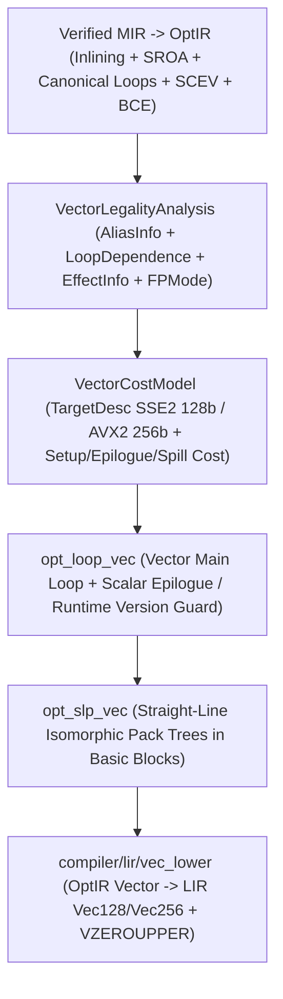

# SPEC-74 — Canonical Loop & Superword-Level Parallelism (`SLP`) Auto-Vectorization, Capability-Disjoint Dependence Proving & Target SIMD Cost Model Specification

Status: draft (T616, 2026-11-03)
Owner: axiom-architect
Rule IDs `AXS-VEC-NNN` (`AXS-VEC-001`..`AXS-VEC-053`) are stable and never renumbered.
Consolidates: `specs/0095 §1–43 (ASIMD-01..20)`; `specs/0162 §30–31, §34–35, §40`; `tasks/0402 §29–39, §48–56, §80 (AVEC-20..26, ALOOP-37..39, 46..49, 63..70)`; `tasks/0403 §1–82 (ASIMD-20..80)`; `tasks/0406 §14–30 (AMICRO-20..45)`; `tasks/0407 §1–35 (AVEC-20..47)`; `spec/SPEC-03-core-semantics.md`; `spec/SPEC-40-integers.md`; `spec/SPEC-41-floating-point.md`; `spec/SPEC-42-simd.md`; `spec/SPEC-43-simd-backend.md`; `spec/SPEC-44-cpu-features-multiversioning.md`; `spec/SPEC-70-optir-ssa-memoryssa.md`; `spec/SPEC-71-alias-escape-promotion.md`; `spec/SPEC-72-loops-scev-bce.md`; `spec/SPEC-73-inlining-specialization-devirt.md`.
Covers: `REQ-OPT-013`, `REQ-OPT-148`, `REQ-OPT-149`, `REQ-OPT-150`, `REQ-OPT-151`, `REQ-OPT-152`, `REQ-OPT-153`, `REQ-OPT-154`, `REQ-OPT-191` (and governs implementation/QA tasks `T617`–`T619` covering `REQ-OPT-206`, `REQ-OPT-209`, `REQ-OPT-210`, `REQ-OPT-211`, `REQ-OPT-213`, `REQ-OPT-214`, `REQ-OPT-215`, `REQ-OPT-216`, `REQ-OPT-217`, `REQ-OPT-219`, `REQ-OPT-220`, `REQ-OPT-221`, `REQ-OPT-222`).
Consumers: `T617` (`compiler/opt/vectorize`, `tests/run/opt_loop_vec`), `T618` (`compiler/opt/slp`, `compiler/lir/vec_lower`, `tests/run/opt_slp_vec`), `T619` (`tests/conformance/p15/e15_5_autovec`), and Epic `E15.6`–`E15.7` (`T620`–`T626`).

## Tóm tắt
Tài liệu chuẩn hóa phân hệ tự động vector hóa vòng lặp (`Loop Auto-Vectorization`) và vector hóa khối lệnh thẳng (`Superword-Level Parallelism` — `SLP`) cho trình biên dịch `axiomc` (Epic `E15.5`, Phase 15 `P15-optimizer-2-0`):
- **Vị trí trước hạ tầng LIR và tương đương ngữ nghĩa vô hướng tuyệt đối (`AXS-VEC-001..009`)**: Quá trình tự động vector hóa được thực thi trên `OptIR` sau khi kiểm định `Verified MIR`, nội tuyến/`SROA`, `SCEV`, và `BCE`, nhưng **trước khi hạ xuống LIR** mà không đòi hỏi bất kỳ chú thích mã nguồn bắt buộc nào như `@vectorize`, `restrict` hay `unsafe` (`0162 §31`, `REQ-OPT-013`). Mã được vector hóa phải bảo toàn tuyệt đối ngữ nghĩa quan sát được của dạng vô hướng (`REQ-OPT-191`, `INV-ORACLE-002`), không bao giờ tự bịa bằng chứng an toàn hay làm yếu kiểm định sở hữu/năng lực (`REQ-OPT-216`, `REQ-OPT-217`).
- **Chứng minh độc lập phụ thuộc bộ nhớ dựa trên năng lực (`view`/`mut_view`) và `SCEV` (`AXS-VEC-010..018`)**: Tận dụng tính độc quyền của `mut_view<[T]>` so với `view<[T]>` (`SPEC-71 AXS-ALIAS-003`) và khoảng `SCEV` tách rời (`SPEC-72 AXS-LOOP-010`) để chứng minh không có phụ thuộc mang qua vòng lặp (`DEP_NONE`, `Certainty.Proven`) mà không cần kiểm tra chồng lấn lúc chạy (`REQ-OPT-148`, `REQ-OPT-149`). Mọi trường hợp bí danh `Unknown`/`MayAlias` tuyệt đối không bao giờ được giả định là `NoAlias` (`REQ-OPT-150`, `REQ-OPT-215`); trình biên dịch hoặc giữ nguyên vòng lặp vô hướng, hoặc phát nhánh kiểm tra không chồng lấn lúc chạy kèm vòng lặp vô hướng dự phòng tương đương ngữ nghĩa.
- **Rào cản cứng cho `atomic`/`volatile`, dấu phẩy động IEEE-754 nghiêm ngặt và bảo toàn bẫy số học (`AXS-VEC-019..027`)**: Cấm vector hóa làm thay đổi ngữ nghĩa `Atomic<T>` (`REQ-OPT-151`) và `Volatile<T>` / `@at` MMIO (`REQ-OPT-152`). Bảo toàn thứ tự phép toán dấu phẩy động IEEE-754 mặc định (`REQ-OPT-153`, `REQ-OPT-206`), chỉ cho phép tái kết hợp phép thu gọn (`reduction`) khi toán tử có tính kết hợp toán học (`wrapping_*`, phép toán bit, `min`/`max`, số học có kiểm tra đã chứng minh `NoOverflow`, hoặc thu gọn kết hợp tường minh — `REQ-OPT-154`), và bảo toàn chính xác bẫy tràn số/chia cho 0 trên từng làn.
- **Khung biến đổi vòng lặp có vòng lặp phần dư (`peel`/`epilogue`), cây đóng gói `SLP` và mô hình chi phí độ rộng đích (`AXS-VEC-028..053`)**: Chọn độ rộng làn hợp lệ theo tập tính năng đích (`128`-bit `SSE2` mặc định trên `x86_64-windows` và `256`-bit `AVX2` khi bật `@target_feature("avx2")` / `--target-feature=+avx2` — `REQ-OPT-209..214`), sinh vòng lặp chính vector kèm vòng lặp vô hướng phần dư (`N % VF`) xử lý mọi độ dài mảng bất kỳ, đóng gói các phép toán đẳng cấu liền kề bằng `SLP`, hạ xuống thanh ghi `Vec128`/`Vec256` của LIR, và xuất giải thích vết `Source → MIR → OptIR → LIR → Machine` tất định (`REQ-OPT-219..222`).

---

## 1. Auto-Vectorization Pipeline Position, Semantic Authority & Equivalence Contract (`AXS-VEC-001`..`AXS-VEC-009`)



- **AXS-VEC-001 — Pre-LIR Optimizer Position & Zero Mandatory Source Annotations (`REQ-OPT-013`, `0162 §31`, `tasks/0403 §74 ASIMD-65, ASIMD-79`, `tasks/0407 §1, §32, §35 AVEC-40`)**: Loop auto-vectorization (`opt_loop_vec` in `compiler/opt/vectorize`) and straight-line Superword-Level Parallelism (`opt_slp_vec` in `compiler/opt/slp`) operate in the middle-end `OptIR` optimization pipeline after `Verified MIR` validation, inlining, `SROA`, loop canonicalization (`LoopSimplify` + `LCSSA`), `SCEV`, `RangeInfo`, `BCE`, and `LICM`, and ** strictly before ABI/LIR lowering** (`compiler/lir/vec_lower`). The optimizer discovers and vectorizes eligible scalar loops and basic-block chains automatically without requiring source attributes (`@vectorize`), `restrict` qualifiers, manual pointer arithmetic, or `unsafe` blocks (`REQ-OPT-013`).
- **AXS-VEC-002 — Exact Scalar-to-Vector Semantic Equivalence (`REQ-OPT-191`, `tasks/0402 §80 ALOOP-65`, `tasks/0403 §82 ASIMD-26, ASIMD-66`, `tasks/0407 §64, §35 AVEC-20`)**: Every auto-vectorized loop or `SLP` pack MUST produce observable memory states, return values, I/O traces, and panic exit codes (`exit 101`) identical to sequential scalar execution (`INV-ORACLE-002`, `REQ-OPT-191`).
- **AXS-VEC-003 — Verified MIR Authority & Non-Fabrication of Safety Proofs (`REQ-OPT-216`, `REQ-OPT-217`, `tasks/0402 §80 ALOOP-53..54, 70`, `tasks/0403 §82 ASIMD-42, 73, 80`, `tasks/0406 §25, §30 AMICRO-39..40`, `tasks/0407 §35 AVEC-21, 24, 36`)**: `Verified MIR` is the sole semantic and safety authority. Auto-vectorization consumes existing verified ownership, capability, bounds, and alias proofs (`Certainty.Proven`) and MUST NEVER fabricate a safety proof (`REQ-OPT-217`) or weaken ownership, capability, or bounds verification (`REQ-OPT-216`).
- **AXS-VEC-004 — Typed `OptIR` Vector Vocabulary (`tasks/0407 §9, §33`, `SPEC-42 AXS-SIMD-001..005`, `SPEC-43 AXS-SBE-002`)**: Within `OptIR`, vectorized values use `TypeKind.Vector { elem, lanes }` and `TypeKind.Mask { lanes }` (`elem` $\in \{\text{i8..i64}, \text{u8..u64}, \text{isize}, \text{usize}, \text{f32}, \text{f64}\}$, `lanes` $\in \{2, 4, 8, 16, 32\}$) with canonical `OptIR` instructions: `OPT_INST_VLOAD` (aligned/unaligned), `OPT_INST_VSTORE`, `OPT_INST_VLOAD_MASKED`, `OPT_INST_VSTORE_MASKED`, `OPT_INST_VSPLAT`, `OPT_INST_VSTEP` (`[0, 1, ..., VF-1]`), `OPT_INST_VEXTRACT`, `OPT_INST_VINSERT`, `OPT_INST_VSHUFFLE`, `OPT_INST_VBINOP` (`ArithMode`: `Checked | Wrapping | Saturating | ProvenNswNuw`), `OPT_INST_VFMA`, `OPT_INST_VCMP`, `OPT_INST_VSELECT`, `OPT_INST_VCAST`, and `OPT_INST_VREDUCE`.
- **AXS-VEC-005 — Separation of Legality Proofs from Cost-Model Profitability (`REQ-OPT-212`, `REQ-OPT-220`, `tasks/0403 §57–60, ASIMD-57..58`, `tasks/0406 §30 AMICRO-22, 35, 43`, `tasks/0407 §3, §59–60, AVEC-21, 28, 44`)**: Vectorization is partitioned into two strictly ordered gates: (1) `VectorLegalityAnalysis`, which requires formal compile-time semantic proofs (`Certainty.Proven`), and (2) `VectorCostModel`, which estimates latency/throughput profitability. Cost heuristics or PGO execution counts (`REQ-OPT-212`) influence profitability only and NEVER override a failed legality proof (`REQ-OPT-220`).
- **AXS-VEC-006 — Isolation of Target-Specific Vectorization from Core Language Semantics (`REQ-OPT-213`, `REQ-OPT-214`, `REQ-OPT-219`, `tasks/0403 §75, ASIMD-59..61`, `tasks/0406 §21, §24, §30 AMICRO-36..37, 42`)**: Physical vector register widths, CPU microarchitectural cost profiles, and scalar-vs-vector lowering choices are backend/optimizer details that never alter Core language semantics (`REQ-OPT-213`, `REQ-OPT-219`) and must remain valid on the declared target profile (`REQ-OPT-214`).
- **AXS-VEC-007 — Fail-Closed Fallback on Unproven Preconditions (`REQ-OPT-220`, `tasks/0403 §82 ASIMD-72`, `tasks/0407 §35 AVEC-47`)**: Whenever any legality proof returns `Certainty.Possible` or `Certainty.Unknown`, or the cost model judges vectorization unprofitable, the pass cleanly retains the scalar `OptIR` code without emitting a user diagnostic error.
- **AXS-VEC-008 — Ownership, Non-`Copy` Move, and `Drop` Preservation (`tasks/0402 §78, §80 ALOOP-29..30, 69`, `tasks/0403 §82 ASIMD-43..44`, `tasks/0407 §28–29, §35 AVEC-34`)**: Vectorization applies only to `Copy` scalar `SimdElement` values (`SPEC-42 AXS-SIMD-002`). Loops or basic blocks that move non-`Copy` values, invoke non-trivial `Drop` destructors (`!is_trivial_drop(ty)`), or mutate `stable_address == true` places cannot coalesce or reorder those operations across lanes.
- **AXS-VEC-009 — CPU SIMD vs GPU SIMT Execution Domain Separation (`tasks/0402 §56, ALOOP-35`, `tasks/0403 §72, ASIMD-67`, `tasks/0407 §27, §35 AVEC-41`)**: CPU SIMD vectorization executes synchronous lanes within a single CPU thread and host address space; it is never conflated with GPU `@kernel` SIMT thread/workgroup execution or `DeviceSpace` memory lowering.

---

## 2. Memory-Dependence Legality, Capability Disjointness & Runtime Versioning (`AXS-VEC-010`..`AXS-VEC-018`)

- **AXS-VEC-010 — Memory-Dependence Legality Gate (`REQ-OPT-148`, `tasks/0402 §33, §80 AVEC-20`, `tasks/0403 §35, §82 ASIMD-38..39, 56`, `tasks/0407 §3–4, §35 AVEC-23`)**: Vectorizing a loop by factor $VF \ge 2$ executes iterations $i, i+1, \dots, i+VF-1$ in lockstep per vector instruction. Therefore, `opt_loop_vec` requires `LoopDependence` (`SPEC-72 AXS-LOOP-010`) and `MemorySSA` (`SPEC-70 AXS-OPT-020..024`) to prove that grouping $VF$ consecutive iterations does not violate any read-after-write (`DEP_RAW_FLOW`), write-after-read (`DEP_WAR_ANTI`), or write-after-write (`DEP_WAW_OUTPUT`) dependency (`REQ-OPT-148`).
- **AXS-VEC-011 — Capability-Driven Disjointness Proofs (`mut_view<[T]>` vs `view<[T]>`) (`REQ-OPT-149`, `tasks/0402 §34, §80 AVEC-21`, `tasks/0403 §42, §45, §82 ASIMD-41`, `tasks/0407 §5, §14, §35 AVEC-35`, `SPEC-71 AXS-ALIAS-003`)**:
  1. When a loop writes through an active exclusive capability `out: mut_view<[T]>` (or `mut_view<[N]T>`, `mut_view<Vec<T>>`) and reads through shared capabilities `a: view<[T]>`, `b: view<[T]>` (or distinct `mut_view` parameters), `AliasInfo` exports `AliasResult.NoAlias` (`Certainty.Proven`, `ALIAS_REASON_CAP_MUT_EXCLUSIVE`) between `out` and every other live capability without requiring C-style `restrict` annotations (`REQ-OPT-149`).
  2. Combined with a unit-stride injective index `%i = {0, +, 1}` on `out[%i]`, capability disjointness proves `DepKind.DEP_NONE` (`Certainty.Proven`) across all iterations, authorizing direct vectorization without runtime alias checks.
- **AXS-VEC-012 — Disjoint `SCEV` Affine Strides, Half-Open Sub-Slices & Fixed-Array Bounds Proofs (`SPEC-72 AXS-LOOP-006, AXS-BCE-004..005, AXS-LOOP-010`, `tasks/0407 §4, §25, AVEC-23..24`)**:
  1. Adjacent half-open slice partitions `left = s[0..mid]` and `right = s[mid..len]` (`0 <= mid <= len`, `SPEC-72 AXS-BCE-005`) and distinct struct fields (`s.x[i]` vs `s.y[i]`, `SPEC-71 AXS-ALIAS-004`) are statically proven `NoAlias` (`DEP_NONE`, `Certainty.Proven`).
  2. Every vector load/store in the vectorized main loop MUST have `PropositionKind.InBounds == Certainty.Proven` across all $VF$ lanes `[i .. i + VF - 1]` established by `RangeInfo` + `BCE` (`0 <= i` and `i + VF <= len(slice)` under `no_wrap_proven == true`, `AVEC-24`).
- **AXS-VEC-013 — Prohibition on Assuming `NoAlias` from `Unknown` or Cost Heuristics (`REQ-OPT-150`, `REQ-OPT-215`, `tasks/0402 §35, §80 AVEC-22`, `tasks/0403 §43, §82 ASIMD-40`, `tasks/0406 §25, §30 AMICRO-38`, `tasks/0407 §5, §35 AVEC-22`)**: Whenever `AliasInfo` returns `MayAlias`, `PartialAlias`, or `UnknownAlias` (e.g., raw pointers `*mut T` and `*const T` in `unsafe` code, or unindexed dynamic offsets `a[idx[i]]`), the vectorizer MUST NEVER assume `NoAlias` (`REQ-OPT-150`) and cost optimization MUST NEVER convert `Unknown` aliasing into `NoAlias` (`REQ-OPT-215`).
- **AXS-VEC-014 — Loop-Carried Dependence Distance vs Vector Factor (`VF`) Legality (`tasks/0403 §35, ASIMD-56`, `tasks/0407 §4, AVEC-23`, `SPEC-72 AXS-LOOP-010`)**:
  For accesses `a[i + d_w]` (write) and `a[i + d_r]` (read/write) on the same base object with constant dependence distance $d = i_{\text{dst}} - i_{\text{src}}$:
  1. If $d = 0$ (`DEP_LOOP_INDEPENDENT`): legal if statement topological order inside the vector body preserves the scalar intra-iteration order (`store` before `load` forwards the vector register; `load` before `store` reads the old vector value before storing).
  2. If $d > 0$ (`forward loop-carried recurrence`, e.g., `a[i] = a[i - 1] + 1` where $d = 1$): iteration $i+1$ depends on the store from iteration $i$. Vectorizing with width $VF$ is **illegal** whenever $0 < d < VF$ (`AVEC-23`); it is legal only if the recurrence distance satisfies $d \ge VF$ (`Certainty.Proven`), so all $VF$ lanes read values written in prior vector iterations.
  3. If $d < 0$ (`backward anti/flow dependence`, e.g., `a[i] = a[i + 1] + 1` where $d = -1$): reading `v_load = a[i+1 .. i+VF]` before storing `a[i .. i+VF-1]` within each vector iteration is legal because all $VF$ reads occur before the $VF$ writes clobber `a[i+1 .. i+VF-1]`.
  4. If `has_known_distance == false` (`DEP_UNKNOWN`): loop vectorization is rejected (`Certainty.Unknown`).
- **AXS-VEC-015 — Runtime Alias & Trip-Count Versioning Guards with Mandatory Scalar Fallback (`tasks/0402 §29–31, §35, §80 ALOOP-37..39`, `tasks/0403 §44, §82 ASIMD-51..52`, `tasks/0407 §6, §20, §62, §35 AVEC-25, AVEC-43`, `SPEC-72 AXS-LOOP-014`)**:
  When two accesses have `MayAlias` on raw pointers or sub-slices whose base pointers and byte lengths `[ptr_w, ptr_w + bytes_w)` and `[ptr_r, ptr_r + bytes_r)` are loop-invariant, `opt_loop_vec` may emit a pure runtime optimization guard `(ptr_w + bytes_w <= ptr_r) || (ptr_r + bytes_r <= ptr_w)` (bounded to $\le 4$ range pairs) branching to the vectorized loop when `true` and retaining the exact scalar fallback loop when `false`. Runtime guards are optimization selectors only and NEVER replace static safety verification (`AVEC-25`).
- **AXS-VEC-016 — Alignment Classification & Unaligned-Safe Vector Access (`tasks/0403 §55–57, ASIMD-63..64`, `tasks/0407 §13, §63`, `SPEC-43 AXS-SBE-003`)**: Each vector memory access is classified as `AlignStatus = KnownAligned(align >= vec_bytes) | KnownUnaligned | RuntimeAligned | Unknown`. Only `KnownAligned` sets `LIR_MEM_FLAG_ALIGNED` (`MOVDQA`/`MOVAPS`/`VMOVDQA`); `KnownUnaligned` and `Unknown` emit unaligned-safe instructions (`MOVDQU`/`MOVUPS`/`VMOVDQU`) without ever assuming alignment by heuristic (`tasks/0407 §13`).
- **AXS-VEC-017 — Contiguous Unit-Stride vs Strided/Gather/Scatter Access (`tasks/0403 §27–28, ASIMD-37`, `tasks/0407 §18`)**: Contiguous unit-stride accesses (`stride == sizeof(T)`) lower directly to `OPT_INST_VLOAD`/`OPT_INST_VSTORE`. Non-unit constant strides (`stride == k * sizeof(T)`, $k \in \{2, 4\}$) may use interleaved loads + `deinterleave` shuffles when profitable; indirect indexed accesses `table[idx[i]]` may lower to `OPT_INST_VGATHER` only when `idx[i]` bounds are proven or checked on all active lanes and `VectorCostModel` confirms gather is cheaper than scalar loads (`tasks/0403 §27`, `tasks/0407 §18`).
- **AXS-VEC-018 — Interior Function Calls, Generic Specialization & Foreign Barriers (`tasks/0403 §48–51, ASIMD-37`, `tasks/0407 §23–24, AVEC-33, AVEC-39`, `SPEC-73`)**: Generic specialization (`E15.4`) and inlining run prior to `opt_loop_vec`, exposing concrete primitive types (`f32`, `i32`, etc., `AVEC-39`) and inlining pure helper calls (`tasks/0407 §23`). Any remaining uninlined callInside a loop blocks vectorization unless it is a compiler-known pure vectorizable math intrinsic (`sqrt`, `abs`, `min`, `max`, `fma`, `floor`, `ceil`, `trunc`, `round`, `SPEC-42 AXS-SIMD-024`); calls carrying `EFFECT_IO`, `EFFECT_FFI`, `EFFECT_ATOMIC`, or `EFFECT_UNKNOWN` are hard barriers (`AVEC-33`).

---

## 3. Hard Semantic Barriers, Floating-Point & Reduction Legality, and Checked-Arithmetic Trap Preservation (`AXS-VEC-019`..`AXS-VEC-027`)

- **AXS-VEC-019 — Hard Barrier for `Atomic<T>` Operations and Memory Synchronization (`REQ-OPT-151`, `tasks/0402 §80 AVEC-23, ALOOP-67`, `tasks/0403 §46, §82 ASIMD-45, ASIMD-47`, `tasks/0407 §30, §35 AVEC-31`)**: Any loop or basic block region containing an `Atomic<T>` load, store, RMW (`fetch_add`, `compare_exchange`, etc.), or synchronization fence (`OPT_INST_ATOMIC`, `EFFECT_ATOMIC`) MUST NOT have its atomic operations widened, coalesced across iterations (`atomic_add(c, 1)` in a loop is NEVER collapsed into `atomic_add(c, VF)`), reordered across fences, or converted into non-atomic vector loads/stores (`REQ-OPT-151`).
- **AXS-VEC-020 — Hard Barrier for `Volatile<T>` and `@at` / `Mmio*<T>` Hardware Accesses (`REQ-OPT-152`, `tasks/0402 §80 AVEC-24, ALOOP-68`, `tasks/0403 §47, §82 ASIMD-46`, `tasks/0407 §31, §35 AVEC-32`)**: Any `volatile` load/store (`OPT_INST_VOLATILE_LOAD`, `OPT_INST_VOLATILE_STORE`, `Volatile<T>`, `Mmio<T>`, `MmioRO<T>`, `MmioWO<T>`, or `@at` fixed-address device access carrying `EFFECT_VOLATILE`) is an observable hardware interaction whose exact access count, width, and sequential order MUST be preserved; it is a hard barrier to both loop and `SLP` vectorization (`REQ-OPT-152`).
- **AXS-VEC-021 — Strict IEEE-754 Floating-Point Ordering by Default (`REQ-OPT-153`, `REQ-OPT-206`, `tasks/0402 §37, §80 AVEC-25`, `tasks/0403 §38–39, §82 ASIMD-48`, `tasks/0406 §30 AMICRO-29`, `tasks/0407 §16, §65, §35 AVEC-30`, `SPEC-41 AXS-FLT-014`)**:
  1. Lane-wise independent floating-point operations (`out[i] = (a[i] * b[i]) + c[i]`) evaluate each index $i$ with the exact same IEEE-754 `roundTiesToEven` rounding tree in vector lanes (`VMULPS` followed by `VADDPS`) as in scalar execution, so they are always legal under default `FPMode.Strict` without silent FMA contraction (`SPEC-42 AXS-SIMD-022`).
  2. Because IEEE-754 floating-point addition and multiplication are not associative (`(a + b) + c != a + (b + c)` in general due to rounding, signed zero, and `±inf`/`NaN`), vectorizing a loop-carried scalar floating-point reduction (`acc = acc + a[i]`) changes the parenthesization order from sequential left-to-right `(((init + a[0]) + a[1]) + ...)` to multi-lane tree accumulation. Therefore, under default `FPMode.Strict`, `opt_loop_vec` and `opt_slp_vec` MUST NOT reassociate scalar `f32`/`f64` `+` or `*` reductions (`REQ-OPT-153`, `REQ-OPT-206`).
  3. Floating-point reduction reassociation is legal **if and only if** the programmer explicitly opts into associative reduction semantics (via `std.simd` `reduce_add` / iterator `sum_associative` or an explicit `@fp_reassoc` / `FPMode.Relaxed` contract) OR the reduction operator is lane-order-insensitive (`min`/`max` under `minimumNumber`/`maximumNumber`, `REQ-OPT-153`, `REQ-OPT-154`, `REQ-OPT-206`).
- **AXS-VEC-022 — Reduction Operator Recognition & Semantic Preservation (`REQ-OPT-154`, `tasks/0402 §36–39, §80 AVEC-26, ALOOP-46`, `tasks/0403 §36–37, §52, ASIMD-50`, `tasks/0407 §15–17`)**: A loop-carried `OptPhi` `%acc = phi [preheader: %init, latch: %next]` updated by `%next = op(%acc, %val)` with no interior uses outside the reduction cycle is vectorized using a vector accumulator `%v_acc` initialized to `[%init, id, ..., id]` (or `[id, ..., id]` with `%init` combined at reduction exit, where `id` is the operator identity: `0` for `+`/`|`/`^`, `1` for `*`, `~0` for `&`, `T.MAX` for `min`, `T.MIN` for `max`) if and only if `op` satisfies operator reassociation legality (`REQ-OPT-154`).
- **AXS-VEC-023 — Integer Reduction Overflow Legality (`tasks/0402 §38`, `tasks/0403 §40–41, ASIMD-49`, `SPEC-40 AXS-INT-020..025`, `SPEC-72 AXS-LOOP-015`)**:
  1. **Wrapping & Bitwise/Min/Max Integer Reductions (`ARITH_WRAPPING`)**: `wrapping_add`, `wrapping_mul`, `&`, `|`, `^`, `min`, and `max` on `i8..i64` / `u8..u64` / `isize` / `usize` form commutative, associative algebraic monoids, so vector accumulation + horizontal `OPT_INST_VREDUCE` is unconditionally legal (`REQ-OPT-154`).
  2. **Default Checked Integer Reductions (`ARITH_CHECKED`)**: Because reassociating checked addition `(a + b) + c` into partial vector lanes could either mask an intermediate overflow or trigger a spurious overflow in a lane accumulator, a checked integer reduction is vectorized **only** when `RangeInfo` proves (`PropositionKind.NoOverflow == Certainty.Proven`, `ARITH_PROVEN_NSW_NUW`) that neither the sequential sum nor any partial lane sum can overflow `[T.MIN, T.MAX]`.
  3. **Saturating Operations (`ARITH_SATURATING`)**: Elementwise `saturating_add`/`saturating_sub` (`out[i] = saturating_add(a[i], b[i])`) is lane-independent and directly vectorizable (`PADDS*`/`PADDUS*`); loop-carried saturating reductions (`acc = saturating_add(acc, a[i])`) are not associative in general and remain scalar unless monotonic non-crossing sign is proven.
- **AXS-VEC-024 — Checked-Arithmetic Trap Preservation & Non-Speculation Across Vector Lanes (`tasks/0403 §40, ASIMD-49`, `tasks/0407 §66`, `SPEC-42 AXS-SIMD-021`, `SPEC-43 AXS-SBE-013`)**:
  1. For elementwise checked integer arithmetic (`out[i] = a[i] + b[i]`) inside a loop without interior early exits or prior observable I/O effects per iteration, if `RangeInfo` proves `NoOverflow` (`Certainty.Proven`), `opt_loop_vec` lowers the operation to unchecked wrapping SIMD instructions (`VPADDD`/`PADDD`).
  2. If `NoOverflow` is not statically proven (`Certainty.Possible` / `Certainty.Unknown`), vectorization is permitted only if no observable side effect (`EFFECT_IO`, `EFFECT_VOLATILE`, `EFFECT_ATOMIC`, `EFFECT_FFI`, `Drop`) is reordered across the vector bundle and the vector checked-arithmetic lowering traps with exit `101` (`"integer overflow"` / `"division by zero"` / `"shift count out of range"`) in ascending lane order `0 .. VF - 1` before writing subsequent iterations (`SPEC-42 AXS-SIMD-021`); otherwise the loop remains scalar.
- **AXS-VEC-025 — Predicated Branch (`If-Conversion` / `VSelect`) Legality & Speculative Fault Ban (`tasks/0403 §25, §29, ASIMD-35..36`, `tasks/0406 §30 AMICRO-30..31`, `tasks/0407 §22, §35 AVEC-38`)**: An interior conditional `if cond[i] { v_true } else { v_false }` inside a loop body may be flattened into a lane mask `%m = OPT_INST_VCMP(...)` and `OPT_INST_VSELECT(%m, %v_true, %v_false)` **if and only if** every instruction evaluated unconditionally in `v_true` and `v_false` is pure and non-trapping (`effects == EFFECT_PURE`, `NoOverflow`/`NonZero`/`InBounds` proven), or memory loads/stores under `%m` use `OPT_INST_VLOAD_MASKED` / `OPT_INST_VSTORE_MASKED` where inactive lanes (`mask[lane] == false`) never fault or touch out-of-bounds memory (`AVEC-38`).
- **AXS-VEC-026 — Loop-Invariant Broadcast (`VSplat`) & Affine Induction Step Widening (`VStep`) (`tasks/0407 §9–10`)**: Any loop-invariant scalar operand `%k` used in a vectorized instruction is widened via `OPT_INST_VSPLAT(%k)` in `preheader`. Any primary or derived affine induction variable `%iv = {start, +, step}` used as a value inside the loop body is widened to `%v_iv = OPT_INST_VSPLAT(%iv) + [0, step, 2*step, ..., (VF-1)*step]` advanced by `OPT_INST_VSPLAT(VF * step)` per vector iteration.
- **AXS-VEC-027 — Multi-Accumulator & Interleaved Unroll Factor (`UF in {1, 2, 4}`) (`tasks/0403 §37`, `tasks/0407 §15, §19`)**: When `TripCount` is large and register pressure permits (`live_vec_regs * UF + 2 <= avail_vec_regs`), `opt_loop_vec` may interleave $UF \in \{2, 4\}$ independent vector accumulators (`%v_acc0 .. %v_acc{UF-1}`) across $VF \times UF$ elements per loop body to hide FMA/addition pipeline latency (`tasks/0407 §15, §19`), folding them via associative vector addition at loop exit.

---

## 4. Loop Vectorization Transformation, Peel/Epilogue Remainder Loops & Masked Tails (`AXS-VEC-028`..`AXS-VEC-035`)

- **AXS-VEC-028 — Counted Canonical Loop Preconditions for `opt_loop_vec` (`compiler/opt/vectorize`, `T617`, `SPEC-72 AXS-LOOP-002..006`)**: A candidate loop $\mathcal{L}$ is eligible for `opt_loop_vec` if and only if: (1) $\mathcal{L}$ is an innermost natural loop (`children.is_empty()`, `is_irreducible == false`) in `LoopSimplify` + `LCSSA` form with unique `preheader`, single `latch`, and single `DedicatedExit`, (2) `trip_count.kind` $\in \{\text{TRIP\_CONST}, \text{TRIP\_SYMBOLIC}\}$ with `Certainty.Proven`, (3) $\mathcal{L}$ has a canonical primary induction variable `%i = {start, +, step}` with `no_wrap_proven == true`, and (4) `has_observable_barriers == 0` (`BARRIER_VOLATILE | BARRIER_ATOMIC | BARRIER_IO | BARRIER_AWAIT | BARRIER_FFI | BARRIER_DROP == 0`).
- **AXS-VEC-029 — Vector Trip-Count Partitioning (`N_vec` vs `N_rem`) (`tasks/0403 §30`, `tasks/0407 §10–11`)**: Given total proven iteration count $N \ge 0$, vector factor $VF \in \{2, 4, 8, 16, 32\}$, and interleave factor $UF \in \{1, 2, 4\}$ with stride $S = VF \times UF$ (a power of two), `opt_loop_vec` partitions $[0, N)$ into:
  $$N_{\text{vec}} = (N \text{ div } S) \cdot S = N \mathbin{\&} \sim(S - 1), \qquad N_{\text{rem}} = N - N_{\text{vec}} = N \bmod S \in [0, S - 1]$$
  The vectorized main loop executes $N / S$ vector iterations covering indices $[0, N_{\text{vec}})$ with step $S$, and the remainder covers indices $[N_{\text{vec}}, N)$.
- **AXS-VEC-030 — Scalar Remainder (Epilogue) Loop Generation & Exact Tail Semantics (`tasks/0403 §30, §82 ASIMD-54`, `tasks/0407 §11, §35 AVEC-37`)**:
  1. When `N` is not a compile-time multiple of $S$ (`N % S != 0` or `TRIP_SYMBOLIC`), `opt_loop_vec` emits a dedicated **scalar remainder (epilogue) loop** starting at `%i_rem = phi [vec_exit: %N_vec, bypass: 0]` and stepping by `1` while `%i_rem < %N`.
  2. The scalar epilogue loop executes the exact original scalar loop body (preserving `BCE` proofs `0 <= %i_rem < %N <= len`, overflow checks, and reduction updates), guaranteeing bit-identical results for all trip counts (`0`, `1`, prime lengths, and arbitrary runtime slice lengths, `AVEC-37`).
  3. When `trip_count.kind == TRIP_CONST` and $N \bmod S == 0$, the epilogue loop is statically unreachable (`N_rem == 0`) and omitted completely.
- **AXS-VEC-031 — Short-Trip Bypass Edge (`N < VF * UF`) (`tasks/0407 §11, §21, §61`)**: In `preheader`, before entering the vectorized main loop, `opt_loop_vec` emits a short-trip guard `if %N < S { goto epilogue_preheader } else { goto vec_preheader }` (folded away at compile time when `TRIP_CONST` satisfies $N \ge S$), ensuring inputs with $0 \le N < S$ never execute an out-of-bounds vector iteration.
- **AXS-VEC-032 — Alignment-Prologue Peeling (`Peel -> Vector Main -> Scalar Epilogue`) (`tasks/0402 §28`, `tasks/0407 §13`, `SPEC-72 AXS-LOOP-013`)**: When a primary `mut_view<[T]>` destination has known alignment modulo `sizeof(T)` but unknown `vec_bytes` alignment (`16` or `32` bytes), and `TripCount` exceeds `min_peel_trip_count` ($\ge 4 \cdot VF$), the optimizer may optionally peel $P = ((-\text{addr}) / \text{sizeof}(T)) \bmod VF$ scalar prologue iterations so the vector loop body enters with `KnownAligned` destination stores; on baseline `x86_64` where `MOVDQU`/`VMOVDQU` has near-zero penalty on cache-line-interior accesses, unaligned vector loads/stores + scalar epilogue is the default without peeling overhead.
- **AXS-VEC-033 — Masked Tail Vectorization & Non-Faulting Inactive Lanes (`tasks/0403 §29–31, ASIMD-36, ASIMD-54`, `tasks/0407 §12, §35 AVEC-38, §67`)**: As an alternative to a scalar epilogue loop on targets/constructs supporting masked memory operations (`OPT_INST_VLOAD_MASKED`, `OPT_INST_VSTORE_MASKED`), the final $N_{\text{rem}} \in (0, VF)$ elements may be executed in a single predicated tail iteration with lane mask `mask[k] = (N_vec + k < N)` **if and only if** inactive lanes (`mask[k] == false`) perform zero memory accesses (never faulting on page boundaries or out-of-bounds indices) and cannot trigger arithmetic traps (`AVEC-38`).
- **AXS-VEC-034 — Horizontal Reduction Epilogue Merge (`VReduce` + Scalar Tail Accumulation) (`tasks/0403 §36, §52`, `tasks/0407 §15, §17`)**: At the exit of the vectorized main loop, the vector accumulator `%v_acc` is collapsed to a scalar `%s_vec = OPT_INST_VREDUCE(op, %v_acc)` (combined with `%init` via `op(%init, %s_vec)` when `%v_acc` was identity-initialized) and passed as the incoming initial value of the scalar epilogue loop's reduction `OptPhi` `%acc_rem = phi [vec_exit: %s_merged, bypass: %init]`, so the final `LCSSA` exit value combines both vector and remainder iterations seamlessly.
- **AXS-VEC-035 — CFG, `DominatorTree`, `LCSSA`, `MemorySSA` & `RangeInfo` Reconstruction (`SPEC-70 AXS-OPT-032..034`, `SPEC-72 AXS-LOOP-003, AXS-LOOP-017`)**: After `opt_loop_vec` rewrites $\mathcal{L}$ into `(bypass_guard, vec_loop, epilogue_loop)`, it rebuilds `DominatorTree`, updates `LoopTree` (`vec_loop` marked `is_vectorized = true` so it is not re-vectorized), links `MemorySSA` `MemoryPhi`/`MemoryDef` versions across `vec_loop` and `epilogue_loop`, and preserves `LCSSA` exit phis for all post-loop uses.

---

## 5. Superword-Level Parallelism (`SLP`) Straight-Line Vectorization (`AXS-VEC-036`..`AXS-VEC-043`)

- **AXS-VEC-036 — Basic-Block `SLP` Scope & Seed Discovery (`compiler/opt/slp`, `T618`, `tasks/0403 §32–33, ASIMD-55`)**: `opt_slp_vec` discovers straight-line data parallelism within single basic blocks (including unrolled loop bodies and struct/tuple/array constructors) by collecting **seed bundles** of $L \in \{2, 4, 8\}$ scalar instructions of identical `SimdElement` type $T$:
  1. **Adjacent Store Seeds**: Scalar stores writing to provably contiguous memory offsets $\text{base} + 0 \cdot \text{sizeof}(T),\; \text{base} + 1 \cdot \text{sizeof}(T),\; \dots,\; \text{base} + (L-1) \cdot \text{sizeof}(T)$ (such as adjacent struct fields `p.x, p.y, p.z, p.w: f32` or array elements `a[0], a[1], a[2], a[3]`).
  2. **Associative Horizontal Reduction Seeds**: Straight-line associative reduction trees `(s0 + s1) + (s2 + s3)` where each leaf $s_k$ is computed by isomorphic arithmetic chains.
- **AXS-VEC-037 — Isomorphic Pack-Tree Construction (`SlpTree`, `SlpNode`) (`tasks/0403 §32–33`, `T618`)**: Starting from a seed bundle $S = (I_0, I_1, \dots, I_{L-1})$, `opt_slp_vec` recursively builds a bounded `SlpTree` (max depth `16`) where each `SlpNode` is classified as:
  1. `SLP_NODE_VECTORIZABLE`: All $L$ scalar instructions in the bundle belong to the same basic block, have the exact same opcode, overflow `ArithMode`, and element type $T$, and are pairwise independent, OR are `L` contiguous loads from $\text{base} + k \cdot \text{sizeof}(T)$.
  2. `SLP_NODE_BROADCAST`: All $L$ lanes reference the identical scalar SSA value `%v` (lowered to a single `OPT_INST_VSPLAT(%v)`).
  3. `SLP_NODE_GATHER_PACK`: The $L$ values are non-isomorphic, defined in different blocks, or loaded from non-contiguous addresses (materialized via `OPT_INST_VINSERT` pack sequence if the overall tree remains profitable).
- **AXS-VEC-038 — Intra-Block Scheduling Legality, DAG Acyclicity & `MemorySSA` Independence (`tasks/0403 §82 ASIMD-55`, `REQ-OPT-215`, `REQ-OPT-216`, `REQ-OPT-217`, `T618`)**:
  A candidate `SlpNode` bundle $(I_0, \dots, I_{L-1})$ is legal to pack into a single vector instruction if and only if:
  1. **SSA DAG Acyclicity**: No instruction $I_a$ in the bundle transitively depends on another instruction $I_b$ ($a \ne b$) in the same bundle, and packing the bundle introduces no dependency cycle in the basic block's instruction DAG (`ASIMD-55`).
  2. **`MemorySSA` & `AliasInfo` Store/Load Independence**: All $L$ loads (or stores) in a memory bundle can be scheduled together at the position of the first load (or last store) in the bundle without crossing any intervening `MemoryDef` (or `MemoryUse`/`MemoryDef`) that `memssa_does_clobber` (`MayAlias` / `UnknownAlias` is never treated as `NoAlias`, `REQ-OPT-215`).
- **AXS-VEC-039 — `SLP` Pack Width Selection (`L in {2, 4, 8}`) & Contiguous Offset Sorting (`T618`)**: `opt_slp_vec` sorts adjacent stores by ascending byte offset $\text{offset}_0 < \text{offset}_1 < \dots < \text{offset}_{L-1}$ with $\text{offset}_k - \text{offset}_0 == k \cdot \text{sizeof}(T)$ (`Certainty.Proven`) and attempts power-of-two pack widths $L \in \{8, 4, 2\}$ whose total bit width $L \cdot \text{bits}(T) \in \{64, 128, 256\}$ does not exceed the function's active target vector width (`128` bits on baseline `SSE2`, `256` bits when `avx2` is enabled).
- **AXS-VEC-040 — `SLP` Profitability Gate (`NetBenefit > 0`) (`tasks/0403 §57–60`, `tasks/0407 §59–60`, `T618`)**: For each legal `SlpTree`, `VectorCostModel` computes:
  $$\text{Cost}_{\text{vec}}(\mathcal{T}) = \sum_{u \in \mathcal{T}} \text{VecInstCost}(u) + \sum_{g \in \text{Gather}} \text{PackCost}(g) + \sum_{e \in \text{ExtUses}} \text{ExtractCost}(e)$$
  and compares it against $\text{Cost}_{\text{scalar}}(\mathcal{T}) = \sum_{u \in \mathcal{T}} \sum_{k=0}^{L-1} \text{ScalarInstCost}(u_k)$. The `SlpTree` is committed **if and only if** $\text{Cost}_{\text{vec}}(\mathcal{T}) < \text{Cost}_{\text{scalar}}(\mathcal{T})$ (rejecting unprofitable scatter/gather-heavy packs, `T618`).
- **AXS-VEC-041 — External Scalar Use Extraction (`VExtract`) & In-Tree Value Reuse (`T618`)**: If a packed scalar instruction $I_k$ at lane $k \in [0, L-1)$ is also used by an instruction outside the `SlpTree`, `opt_slp_vec` emits `%ext_k = OPT_INST_VEXTRACT(%vec_def, k)` to satisfy the external use and accounts for `ExtractCost` in `AXS-VEC-040`.
- **AXS-VEC-042 — Post-Unroll `SLP` Cooperation (`SPEC-72 AXS-LOOP-013`, `T618`)**: Small constant-trip-count loops fully unrolled by `opt_loop_peel_unroll` (`SPEC-72 AXS-LOOP-013`) expose straight-line adjacent array accesses `a[0]..a[3]` in a single basic block, which `opt_slp_vec` subsequently packs into 128-bit or 256-bit vector instructions.
- **AXS-VEC-043 — `SLP` Semantic Barriers (`REQ-OPT-151`, `REQ-OPT-152`, `REQ-OPT-216`, `REQ-OPT-217`, `tasks/0403 §82 ASIMD-43..49, 55`)**: `opt_slp_vec` NEVER packs `Atomic<T>` accesses (`REQ-OPT-151`), `Volatile<T>` / `Mmio*<T>` accesses (`REQ-OPT-152`), calls with side effects, non-`Copy` ownership moves, non-trivial `Drop` operations, or potentially trapping instructions (`EFFECT_MAY_PANIC` without `NoOverflow`/`NonZero`/`InBounds` proof) when packing would alter trap order relative to intervening observable effects.

---

## 6. Target SIMD Width Selection, Cost Modeling, LIR Lowering & Diagnostics/Provenance (`AXS-VEC-044`..`AXS-VEC-052`)

- **AXS-VEC-044 — Target ISA Capability Query (`SSE2` 128-Bit Baseline vs `AVX2` 256-Bit) (`REQ-OPT-209`, `REQ-OPT-210`, `REQ-OPT-211`, `REQ-OPT-214`, `tasks/0403 §82 ASIMD-30..31, 74`, `tasks/0406 §21, §30 AMICRO-32..34, 37`, `tasks/0407 §7–8, §35 AVEC-26..27, 42`, `SPEC-44 AXS-CPU-001..004`)**:
  1. `opt_loop_vec`, `opt_slp_vec`, and `VectorCostModel` query the enclosing function's effective `TargetFeatureSet` (`Session.target_features | fn_sig.target_features`, `SPEC-44 AXS-CPU-001`):
     - **Baseline `x86_64-windows` (`sse2` mandatory, `avx2` absent)**: Maximum native vector width is `128` bits (`16` bytes: `i8x16`, `u8x16`, `i16x8`, `u16x8`, `i32x4`, `u32x4`, `i64x2`, `u64x2`, `f32x4`, `f64x2`).
     - **`avx2`-enabled function (`@target_feature("avx2")`, `@multiversion` AVX2 clone, or `--target-feature=+avx2`)**: Candidate vector widths include both `256` bits (`32` bytes: `i8x32`, `u8x32`, `i16x16`, `u16x16`, `i32x8`, `u32x8`, `i64x4`, `u64x4`, `f32x8`, `f64x4`) and `128` bits (`16` bytes).
     - **`avx` without `avx2`**: `256`-bit width is legal for floating-point `f32x8` and `f64x4` (`VADDPS`/`VADDPD`), while integer vectors use `128`-bit width (`REQ-OPT-209`, `REQ-OPT-214`).
  2. ISA feature availability (which instructions are legal to emit) and microarchitectural performance (latency/throughput/register pressure cost) are modeled as separate dimensions (`REQ-OPT-211`, `AMICRO-21, 34`); SSE/AVX domain transitions and `VZEROUPPER` placement are handled entirely by the LIR/x86-64 backend (`REQ-OPT-210`, `AMICRO-33`, `SPEC-43 AXS-SBE-022`).
- **AXS-VEC-045 — Optimal vs Maximum Vector Width & Register-Pressure / Spill Modeling (`tasks/0403 §58`, `tasks/0406 §30 AMICRO-24..25`, `tasks/0407 §8, §58–59, §35 AVEC-27, AVEC-29`)**: Maximum legal ISA width is not assumed to be optimal (`AVEC-27`). For each candidate width $W \in \{256, 128\}$ bits (`VF = W / bits(T)`), `VectorCostModel` estimates peak live vector registers `est_vec_regs` inside the loop or `SLP` region against the target's architectural budget (`16` `XMM`/`YMM` registers on x86-64, reserving `2` scratch registers $\implies \text{budget} = 14$). If $W = 256$ causes estimated spills (`est_vec_regs > 14`) or trip count $N < VF_{256}$ while $W = 128$ fits without spills, `VectorCostModel` selects $W = 128$ (`AVEC-29`).
- **AXS-VEC-046 — `VectorCostModel` Quantitative Formula & Confidence (`REQ-OPT-220`, `tasks/0406 §28, §30 AMICRO-21..25, 43`, `tasks/0407 §21, §59–61, §35 AVEC-28`)**:
  ```text
  VectorCostEstimate {
      width_bits: u32,            // 128 or 256
      vf: u32,                    // lanes per vector (2, 4, 8, 16, 32)
      uf: u32,                    // interleave unroll factor (1, 2, 4)
      scalar_iter_cost: u32,      // reciprocal-throughput cost of 1 scalar iteration
      vector_iter_cost: u32,      // reciprocal-throughput cost of 1 vector (VF * UF) iteration
      setup_cost: u32,            // preheader splat + alias/short-trip guard cost
      reduction_cost: u32,        // horizontal tree reduction cost at loop exit
      epilogue_cost: u32,         // expected remainder iterations * scalar_iter_cost
      spill_penalty: u32,         // explicit penalty per estimated vector spill/reload
      confidence: CostConfidence, // High (TRIP_CONST / PGO) | Medium (TRIP_SYMBOLIC) | Low
  }
  ```
  1. For a loop with estimated trip count $N_{\text{est}}$ (`const_count` for `TRIP_CONST`, PGO average trip count when available, or default symbolic estimate $N_{\text{est}} = 32$ for `TRIP_SYMBOLIC`):
     $$\text{TotalVecCost} = \text{setup\_cost} + \lfloor N_{\text{est}} / (VF \cdot UF) \rfloor \cdot (\text{vector\_iter\_cost} + \text{spill\_penalty}) + \text{reduction\_cost} + (N_{\text{est}} \bmod (VF \cdot UF)) \cdot \text{scalar\_iter\_cost}$$
     $$\text{TotalScalarCost} = N_{\text{est}} \cdot \text{scalar\_iter\_cost}$$
  2. Vectorization is profitable if and only if $N_{\text{est}} \ge VF \cdot UF$ and $\text{TotalVecCost} < \text{TotalScalarCost}$ (`AVEC-28`). Under `CostConfidence.Low`, a stricter speedup margin ($\text{TotalVecCost} \cdot 5 \le \text{TotalScalarCost} \cdot 4$) is required so cost uncertainty reduces aggressiveness without ever risking correctness (`REQ-OPT-220`, `AMICRO-43`).
- **AXS-VEC-047 — Optimization Profile Policy & PGO Profitability Integration (`REQ-OPT-212`, `tasks/0406 §23, §30 AMICRO-35`, `tasks/0407 §21, §35 AVEC-44`, `SPEC-76`)**:
  - `-O0`: Both `opt_loop_vec` and `opt_slp_vec` are disabled.
  - `-O1`: Straight-line `opt_slp_vec` and non-versioned contiguous `opt_loop_vec` (`UF = 1`) are enabled.
  - `-O2` / `-O3`: Full `opt_loop_vec` (including runtime alias versioning `AXS-VEC-015` and multi-accumulator interleaving `UF in {1, 2, 4}`) and `opt_slp_vec` are enabled.
  - `-Os` / `-Oz`: Runtime alias versioning and `UF > 1` are disabled to prevent code-size growth; vectorization runs only when `code_growth == 0` (e.g., `SLP` packing or exact-multiple `TRIP_CONST` loops without scalar epilogue).
  - Profile-Guided Optimization (`PGO`) trip counts and block hotness scale `N_est` and versioning thresholds in `VectorCostModel`, affecting profitability only, never legality (`REQ-OPT-212`, `AVEC-44`).
- **AXS-VEC-048 — `OptIR` Vector → LIR Vector Lowering (`compiler/lir/vec_lower`, `REQ-OPT-013`, `REQ-OPT-210`, `0162 §30–31`, `SPEC-43 AXS-SBE-001..022`, `T618`)**:
  During `OptIR` → LIR lowering (`compiler/lir/vec_lower` invoked before `compiler/lir/builder.ax` instruction selection):
  1. 128-bit `OptIR` vector operations lower directly to `LirType.V128` (`RegClass.Vec128`, `XMM0`–`XMM15`) and `LIR_INST_VLOAD` / `LIR_INST_VSTORE` / `LIR_INST_VADD` / `LIR_INST_VSUB` / `LIR_INST_VMUL` / `LIR_INST_VDIV` / `LIR_INST_VCMP` / `LIR_INST_VSELECT` / `LIR_INST_VSHUFFLE` / `LIR_INST_VREDUCE` (`SPEC-43 AXS-SBE-002`).
  2. 256-bit `OptIR` vector operations emitted under `avx2` / `avx` lower to `LirType.V256` (`RegClass.Vec256`, `YMM0`–`YMM15`), setting `LirFunction.uses_ymm = true` so the x86-64 backend automatically enforces `VZEROUPPER` hygiene before non-AVX calls and `RET` (`REQ-OPT-210`, `SPEC-43 AXS-SBE-022`).
  3. Sub-128-bit `SLP` packs (such as `2 x i32` or `2 x f32`, `64` bits) promote into the low 64 bits of `LirType.V128` using exact 64-bit `MOVQ`/`MOVSD` memory transfers (`SPEC-43 AXS-SBE-012`), never reading or writing past the 8-byte boundary.
- **AXS-VEC-049 — `PassManager` Contracts, Proof Invalidation & Transactional Rollback (`SPEC-25 AXS-PCT-001..015`, `SPEC-70 AXS-OPT-030..034`, `REQ-OPT-216`, `REQ-OPT-217`)**:
  | Pass | `required_analyses` | `required_proofs` | `preserved_analyses` | `invalidated_analyses` |
  |---|---|---|---|---|
  | `opt_loop_vec` | `CFG`, `DOMINATORS`, `SSA`, `MEMORY_SSA`, `LOOP_INFO`, `RANGE_INFO`, `ALIAS_INFO`, `EFFECT_INFO` | `InBounds`, `NoAlias` (or runtime guard), `NoOverflow` | none | `CFG`, `DOMINATORS`, `SSA`, `MEMORY_SSA`, `LOOP_INFO`, `RANGE_INFO` |
  | `opt_slp_vec` | `CFG`, `DOMINATORS`, `SSA`, `MEMORY_SSA`, `ALIAS_INFO`, `EFFECT_INFO`, `RANGE_INFO` | `InBounds`, `NoAlias`, `NoOverflow` | `CFG`, `DOMINATORS`, `LOOP_INFO` | `SSA`, `MEMORY_SSA`, `RANGE_INFO` |

  Both passes execute inside a `PassManager` transaction (`Snapshot -> Legality -> CostModel -> Transform -> Rebuild SSA/MemorySSA -> Verify Contract -> Commit / Rollback`, `SPEC-70 AXS-OPT-032`).
- **AXS-VEC-050 — Diagnostic & Verifier Contract (`spec/diagnostics.md AXD-042`, `tasks/0403 §82 ASIMD-72`, `tasks/0407 §35 AVEC-47`)**: Auto-vectorization introduces **zero new user-facing error codes**: any rejected loop or `SLP` candidate silently retains valid scalar code (`AVEC-47`). If post-pass verification (`verify_optir_contract` or `verify_lir_function`) detects an internal compiler bug in generated vector `OptIR` or LIR (such as lane count mismatch, broken SSA dominance, or illegal target feature emission), the compiler aborts with `AX_ICE_MIR_VERIFY` or `AX_ICE_INTERNAL` (`data.stage = "opt_loop_vec" | "opt_slp_vec" | "vec_lower"`, exit code `3`).
- **AXS-VEC-051 — End-to-End `Source → MIR → OptIR → LIR → Machine` Provenance & AI Explainability (`REQ-OPT-221`, `REQ-OPT-222`, `tasks/0403 §80–81, ASIMD-69, 71`, `tasks/0406 §28–30, AMICRO-44..45`, `tasks/0407 §34, AVEC-46`)**:
  1. Every synthesized vector instruction, `preheader` broadcast, runtime versioning guard, scalar epilogue block, and LIR `Vec128`/`Vec256` instruction preserves the `OptOrigin` (`SourceSpan`, `mir_stmt_id`, `loop_id`, `pass_id`) of the originating scalar statement (`REQ-OPT-221`).
  2. `axiomc inspect --emit=vectorize <file.ax>` and `axiomc inspect --emit=vector-cost <file.ax>` emit deterministic, structured machine- and AI-readable optimization remarks for every loop and `SLP` candidate identifying: `status` (`VECTORIZED` vs `REJECTED`), `kind` (`LOOP` vs `SLP`), `element_type`, `vf`, `uf`, `target_isa` (`SSE2` vs `AVX2`), `alias_proof` (`CAP_DISJOINT` / `SCEV_DISJOINT` / `RUNTIME_GUARD` / `REJECTED_MAY_ALIAS`), `bounds_proof` (`PROVEN`), `epilogue_kind` (`SCALAR_LOOP` / `MASKED` / `NONE_EXACT_MULTIPLE`), `cost_estimate` (`scalar_cost`, `vector_cost`, `confidence`), and the exact rejection constraint (`REASON_LOOP_CARRIED_DEP`, `REASON_UNKNOWN_ALIAS`, `REASON_STRICT_FP_REDUCTION`, `REASON_CHECKED_OVERFLOW_TRAP`, `REASON_ATOMIC_BARRIER`, `REASON_VOLATILE_BARRIER`, `REASON_UNPROFITABLE_COST`, `REQ-OPT-222`).
- **AXS-VEC-052 — Determinism, Parallel Compilation Safety & Incremental Caching (`tasks/0403 §82 ASIMD-70`, `tasks/0406 §30 AMICRO-41`, `tasks/0407 §35 AVEC-45`, `SPEC-22`, `SPEC-23`)**: Loop and `SLP` vectorization traverse loops in canonical `LoopId` RPO order and basic-block stores in deterministic instruction/offset order using per-`OptBody` arenas with zero mutable global state (`INV-LAYER-006`), guaranteeing byte-identical output under `--jobs 1` and `--jobs N` (`SPEC-23`) and invalidated/reused cleanly via `(BodyFingerprint, TargetFingerprint)` in `.axiom-cache` (`SPEC-22`).

---

## 7. Canonical Examples, Requirement Traceability & Sources (`AXS-VEC-053`)

### AXS-VEC-053 — Canonical Positive & Negative Auto-Vectorization Examples (`T617`–`T619`)

All examples use canonical Axiom syntax (`=` for binding/assignment, `.` for paths, `view(x)`/`mut_view(x)`; no `::`, no `:=`, no `var`, no `&T`/`&mut T`).

#### 7.1 Positive — Loop Auto-Vectorization via Capability Disjointness (`mut_view` vs `view`) and Scalar Remainder Epilogue (`AXS-VEC-001`, `AXS-VEC-011`, `AXS-VEC-030`, `AXS-VEC-044`)
```axiom
module examples.autovec_positive_loop

// Baseline SSE2 (`VF = 4` x `f32`) or `@target_feature("avx2")` (`VF = 8` x `f32`):
// 1. Dominating guards (`SPEC-72 AXS-BCE-003`) prove `n == len(out) <= len(a), len(b)`.
// 2. Exclusive `out: mut_view<[f32]>` vs shared `a: view<[f32]>`, `b: view<[f32]>` yields
//    `AliasResult.NoAlias` (`Certainty.Proven`, `AXS-VEC-011`, `REQ-OPT-149`) without `restrict`.
// 3. `a[i] * scale + b[i]` is lane-independent (`DEP_NONE`, `AXS-VEC-021` rule 1).
// 4. `opt_loop_vec` emits a 4-lane (`MOVUPS`/`MULPS`/`ADDPS`) or 8-lane (`VMOVUPS`/`VMULPS`/`VADDPS`)
//    vector main loop for `0 .. (n & ~(VF - 1))` plus a scalar epilogue loop for the final `n % VF`
//    elements (`AXS-VEC-030`), preserving exact results for any `n` (`0`, `1`, `19`, `1024`).
pub fn fma_uncontracted_slice(
    a: view<[f32]>,
    b: view<[f32]>,
    out: mut_view<[f32]>,
    scale: f32
) {
    let n = len(out)
    if len(a) < n {
        return
    }
    if len(b) < n {
        return
    }
    let mut i: usize = 0
    while i < n {
        out[i] = (a[i] * scale) + b[i]
        i = i + 1
    }
}

@target_feature("avx2")
pub fn wrapping_sum_u32_avx2(xs: view<[u32]>) -> u32 {
    // `wrapping_add` is associative and commutative (`AXS-VEC-023` rule 1, `REQ-OPT-154`).
    // Under `@target_feature("avx2")`, `opt_loop_vec` selects `VF = 8` (`u32x8` in `YMM`),
    // accumulates 8 lanes per iteration (`VPADDD`), horizontally reduces at loop exit (`AXS-VEC-034`),
    // and accumulates the `len(xs) % 8` tail in the scalar epilogue loop.
    let n = len(xs)
    let mut acc: u32 = 0
    let mut i: usize = 0
    while i < n {
        acc = wrapping_add(acc, xs[i])
        i = i + 1
    }
    acc
}
```

#### 7.2 Positive — Straight-Line `SLP` Pack Tree on Adjacent Struct Fields and Array Lanes (`AXS-VEC-036`..`AXS-VEC-042`)
```axiom
module examples.autovec_positive_slp

struct Vec4f {
    x: f32
    y: f32
    z: f32
    w: f32
}

pub fn blend_vec4(a: view<Vec4f>, b: view<Vec4f>, out: mut_view<Vec4f>, weight: f32) {
    // 1. `out.x`, `out.y`, `out.z`, `out.w` are 4 contiguous `f32` stores at offsets `0, 4, 8, 12` (`AXS-VEC-036`).
    // 2. `a` (`view<Vec4f>`) and `b` (`view<Vec4f>`) are `NoAlias` with `out` (`mut_view<Vec4f>`).
    // 3. `opt_slp_vec` builds a 4-lane isomorphic `SlpTree` (`SLP_NODE_VECTORIZABLE` for loads, `*`, `+`,
    //    and `SLP_NODE_BROADCAST` for `weight`), lowering all 4 field updates to a single 128-bit
    //    `MOVUPS` load pair + `SHUFPS` broadcast + `MULPS` + `ADDPS` + `MOVUPS` store (`T618`).
    out.x = (a.x * weight) + b.x
    out.y = (a.y * weight) + b.y
    out.z = (a.z * weight) + b.z
    out.w = (a.w * weight) + b.w
}
```

#### 7.3 Negative (Vectorization Rejected, Scalar Retained) — Loop-Carried Recurrence, `UnknownAlias`, Strict FP Reduction, `Atomic`, and `Volatile` (`AXS-VEC-013`, `AXS-VEC-014`, `AXS-VEC-019`..`AXS-VEC-021`)
```axiom
module examples.autovec_negative_rejected

use std.sync.atomic.Atomic
use std.sync.atomic.Ordering

@intrinsic unsafe fn volatile_read_u32(src: *const u32) -> u32

// 1. REJECTED (`REASON_LOOP_CARRIED_DEP`, `AXS-VEC-014`):
//    `buf[i]` reads `buf[i - 1]` written in the immediately preceding iteration (`distance d = 1 < VF`).
//    `opt_loop_vec` MUST reject vectorization and retain sequential scalar execution.
pub fn prefix_sum_recurrence(buf: mut_view<[i64]>) {
    let n = len(buf)
    let mut i: usize = 1
    while i < n {
        buf[i] = wrapping_add(buf[i], buf[i - 1])
        i = i + 1
    }
}

// 2. REJECTED (`REASON_STRICT_FP_REDUCTION`, `AXS-VEC-021` rule 2, `REQ-OPT-153`, `REQ-OPT-206`):
//    Under default strict IEEE-754 semantics, sequential `acc = acc + xs[i]` on `f64` is NOT associative.
//    `opt_loop_vec` MUST NOT reassociate `acc` across SIMD lanes; it retains exact left-to-right scalar `ADDSD`.
pub fn strict_f64_sum_retained(xs: view<[f64]>) -> f64 {
    let n = len(xs)
    let mut acc: f64 = 0.0
    let mut i: usize = 0
    while i < n {
        acc = acc + xs[i]
        i = i + 1
    }
    acc
}

// 3. REJECTED (`REASON_ATOMIC_BARRIER` & `REASON_VOLATILE_BARRIER`, `AXS-VEC-019..020`, `REQ-OPT-151..152`):
//    Atomic RMW (`counter.fetch_add`) and hardware `volatile_read_u32` are hard barriers that MUST NOT
//    be coalesced or widened into SIMD instructions.
pub unsafe fn atomic_and_volatile_barriers(
    counter: view<Atomic<u64>>,
    mmio_reg: *const u32,
    n: usize
) -> u32 {
    let mut last: u32 = 0
    let mut i: usize = 0
    while i < n {
        let prev = counter.fetch_add(1u64, Ordering.SeqCst)
        last = wrapping_add(volatile_read_u32(mmio_reg), prev as u32)
        i = i + 1
    }
    last
}
```

### 7.4 Requirement & Invariant Traceability Matrix

| Requirement / Invariant | Summary | Canonical Rule(s) in SPEC-74 | Delivering / Verifying Tasks |
|---|---|---|---|
| `REQ-OPT-013` | Auto-vectorization runs in the optimizer before LIR lowering without mandatory source annotations (`0162 §31`) | `AXS-VEC-001`, `AXS-VEC-004`, `AXS-VEC-048` | `T616`, `T617`, `T618`, `T619` |
| `REQ-OPT-148` | Vectorization requires memory-dependence legality (`tasks/0402 §80 AVEC-20`) | `AXS-VEC-010`, `AXS-VEC-012`, `AXS-VEC-014` | `T616`, `T617`, `T619` |
| `REQ-OPT-149` | Compiler-proven capability disjointness (`mut_view` vs `view`) enables vectorization (`AVEC-21`) | `AXS-VEC-011`, `AXS-VEC-053` | `T616`, `T617`, `T619` |
| `REQ-OPT-150` | Unknown aliasing is never treated as `NoAlias` (`AVEC-22`, `ASIMD-40`) | `AXS-VEC-013`, `AXS-VEC-015`, `AXS-VEC-038` | `T616`, `T617`, `T618`, `T619` |
| `REQ-OPT-151` | Vectorization preserves atomic semantics (`AVEC-23`, `ASIMD-45`, `AVEC-31`) | `AXS-VEC-019`, `AXS-VEC-043`, `AXS-VEC-053` | `T616`, `T617`, `T618`, `T619` |
| `REQ-OPT-152` | Vectorization preserves `volatile` semantics (`AVEC-24`, `ASIMD-46`, `AVEC-32`) | `AXS-VEC-020`, `AXS-VEC-043`, `AXS-VEC-053` | `T616`, `T617`, `T618`, `T619` |
| `REQ-OPT-153` | Vectorization preserves strict IEEE-754 FP semantics unless relaxed mode is explicitly enabled (`AVEC-25`) | `AXS-VEC-021`, `AXS-VEC-053` | `T616`, `T617`, `T619` |
| `REQ-OPT-154` | Reduction transformations preserve reduction operator semantics (`AVEC-26`, `ASIMD-50`) | `AXS-VEC-021`, `AXS-VEC-022`, `AXS-VEC-023`, `AXS-VEC-034` | `T616`, `T617`, `T619` |
| `REQ-OPT-191` | Vectorized safe code remains semantically equivalent to its scalar form (`ALOOP-65`, `AVEC-20`) | `AXS-VEC-002`, `AXS-VEC-024`, `AXS-VEC-030` | `T616`, `T617`, `T618`, `T619` |
| `REQ-OPT-206`, `REQ-OPT-209..211` | FP reassociation legality, target SIMD capability selection, backend SSE/AVX domain handling, ISA vs microarch separation (`AMICRO-29, 32..34`) | `AXS-VEC-021`, `AXS-VEC-044`, `AXS-VEC-045`, `AXS-VEC-048` | `T617`, `T619` |
| `REQ-OPT-213..217` | Target profile validity, `Unknown != NoAlias` under cost model, ownership/capability & safety proof preservation (`AMICRO-36..40`) | `AXS-VEC-003`, `AXS-VEC-006`, `AXS-VEC-013`, `AXS-VEC-036..043`, `AXS-VEC-049` | `T618`, `T619` |
| `REQ-OPT-219..222` | Core semantics isolation, conservative fallback under cost uncertainty, inspectable `Source→MIR→OptIR→LIR→Machine` provenance & AI explanations (`AMICRO-42..45`) | `AXS-VEC-005..007`, `AXS-VEC-046`, `AXS-VEC-051` | `T619` |
| `INV-VEC-001`..`INV-VEC-003` | Canonical architecture invariants in `spec/invariants.md` §33 | `AXS-VEC-001`..`AXS-VEC-053` | `T617`, `T618`, `T619` |

### 7.5 Sources
- `docs/base/specs/0095 - Axiom — SIMD, Vectorization & Data-Oriented Computing v0.1.md` (§1–43 `ASIMD-01..20`)
- `docs/base/specs/0162 - AXIOM LIR v0.1.md` (§30–31 LIR vector types & annotation-free auto-vectorization before LIR lowering, §34–35 target legalization, §40)
- `docs/base/tasks/0402 - BOOTSTRAP-143 — Loop Optimization, Scalar Evolution & Bounds-Check Elimination.md` (§29–39 loop versioning, vectorization legality, capability disjointness, reductions; §80 `AVEC-20..26`, `ALOOP-37..39, 46..49, 63..70`)
- `docs/base/tasks/0403 - BOOTSTRAP-144 — SIMD, Vector Types & Auto-Vectorization Engine.md` (§25–64 masks, gather/scatter, tail loops, `SLP` basic-block vectorization, loop vectorization, reductions, cost model; §80–82 `ASIMD-20..80`)
- `docs/base/tasks/0406 - BOOTSTRAP-147 — CPU Microarchitecture-Aware Optimization & Instruction-Level Optimization.md` (§14–30 `AMICRO-20..45` target capabilities, register pressure, confidence-tagged cost models, provenance)
- `docs/base/tasks/0407 - BOOTSTRAP-148 — Vectorization, SIMD & Auto-Vectorization Engine.md` (§1–35 `AVEC-20..47` pipeline, capability alias proof, runtime versioning, width selection, epilogue, reductions, atomics/volatiles, AI inspection)
- `spec/SPEC-03-core-semantics.md`, `spec/SPEC-40-integers.md`, `spec/SPEC-41-floating-point.md`, `spec/SPEC-42-simd.md`, `spec/SPEC-43-simd-backend.md`, `spec/SPEC-44-cpu-features-multiversioning.md`, `spec/SPEC-70-optir-ssa-memoryssa.md`, `spec/SPEC-71-alias-escape-promotion.md`, `spec/SPEC-72-loops-scev-bce.md`, `spec/SPEC-73-inlining-specialization-devirt.md`
