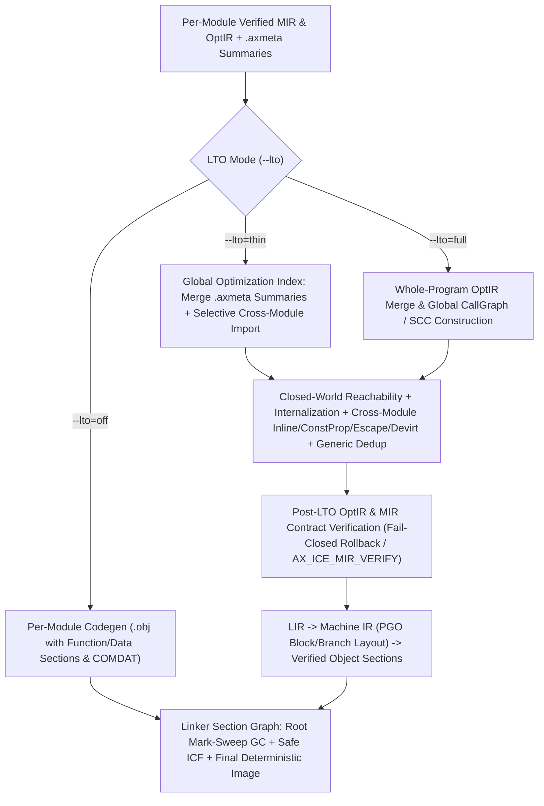

# SPEC-75 — Canonical Link-Time Optimization (`LTO`), Whole-Program Optimization (`WPO`), Section Garbage Collection (`COMDAT` / `ICF`) & Profile-Guided Optimization (`PGO`)

## Tóm tắt
Tài liệu chuẩn hóa hạ tầng tối ưu hóa thời điểm liên kết (`Link-Time Optimization` — `LTO`), tối ưu hóa toàn chương trình theo giả định thế giới đóng có kiểm chứng (`Whole-Program Optimization` — `WPO`), thu gom rác mức section của trình liên kết (`Section Garbage Collection` / `COMDAT` / `Dead Stripping`), gộp mã đồng nhất an toàn định danh (`Identical Code Folding` — `ICF`), và tối ưu hóa dẫn đường bởi hồ sơ thực thi (`Profile-Guided Optimization` — `PGO`) cho trình biên dịch `axiomc` (Epic `E15.6`, Phase 15 `P15-optimizer-2-0`):
- **Kiến trúc `LTO` đa chế độ, phân tách ngữ nghĩa với trình liên kết và hợp đồng thế giới đóng (`AXS-LTO-001..005`)**: `LTO` là tùy chọn (`--lto=off|thin|full`, mặc định tắt ở bản dựng gỡ lỗi và hỗ trợ biên dịch tăng dần qua tóm tắt `.axmeta`) và tuyệt đối không làm thay đổi ngữ nghĩa ngôn ngữ (`REQ-OPT-257`, `REQ-OPT-258`, `REQ-OPT-320`, `REQ-OPT-375..376`, `REQ-OPT-379..380`). Trình liên kết (`compiler/link`) chỉ vận hành trên đồ thị đối tượng/section tường minh (`SPEC-04 AXS-EXT-071..074`) và không bao giờ suy diễn lại ngữ nghĩa sở hữu hay năng lực mức mã nguồn (`REQ-OPT-259`, `REQ-OPT-260`). Mọi phép tối ưu hóa toàn chương trình đòi hỏi hợp đồng thế giới đóng tường minh (`REQ-OPT-261`) xuất phát từ tập gốc khả đạt (`main` / `@entry`, `@export`, tra cứu động, callback FFI, gốc phản xạ runtime, và hàm khởi tạo mô-đun — `REQ-OPT-262..266`).
- **Tối ưu hóa xuyên mô-đun và khử trùng lặp thực thể tổng quát (`AXS-LTO-010..015`)**: Nội bộ hóa các biểu tượng `pub` không mang `@export` trong bản dựng thực thi đóng (`AXS-LTO-010`), thực hiện nội tuyến, truyền hằng, suy diễn hiệu ứng/thoát/bí danh và khử ảo hóa `dyn Trait` xuyên mô-đun khi có chứng minh `Certainty.Proven` (`REQ-OPT-271..276`, `AXS-LTO-011..013`). Khử trùng lặp và chia sẻ mã giữa các thực thể tổng quát (`generic instances`) có cùng biểu diễn máy và ngữ nghĩa mà vẫn bảo toàn ABI cùng định danh địa chỉ quan sát được (`REQ-OPT-267..270`, `AXS-LTO-014`). Bảo toàn tuyệt đối `Drop`, năng lực `view`/`mut_view`, nguyên tử (`atomic`), `volatile`/`@at` MMIO, và ranh giới FFI (`REQ-OPT-277..278`, `AXS-LTO-015`).
- **Thu gom rác mức section (`COMDAT`), gộp mã đồng nhất (`ICF`) và cắt tỉa runtime (`AXS-LTO-020..025`)**: Phát sinh mỗi hàm/dữ liệu vào section độc lập hoặc nhóm `comdat` (`SPEC-04 AXS-EXT-071`), đánh dấu – quét tất định từ tập gốc để loại bỏ hoàn toàn hàm chết, bảng hằng `.rdata`/vtable không tham chiếu, và thành phần runtime không dùng (`REQ-OPT-263`, `REQ-OPT-283..284`, `REQ-OPT-287..288`). Gộp các section hàm/dữ liệu chỉ đọc đồng nhất byte (`Safe ICF`) kèm cơ chế bảo toàn địa chỉ phân biệt hoặc tạo stub nhảy khi địa chỉ hàm bị quan sát (`REQ-OPT-269`, `REQ-OPT-285..286`), đồng thời đảm bảo liên kết song song và tuần tự cho ra nhị phân đồng nhất từng byte (`REQ-OPT-289..294`, `REQ-OPT-381..382`).
- **Tối ưu hóa dẫn đường bởi hồ sơ thực thi (`PGO`) tất định và an toàn ngữ nghĩa (`AXS-PGO-001..016`)**: Thiết lập quy trình AOT `--pgo-gen` → chạy thu thập → `--pgo-use=<profile>` hoàn toàn tất định, không phụ thuộc JIT (`REQ-OPT-279..282`, `REQ-OPT-377..378`, `REQ-OPT-383..384`). Áp đặt bất biến cứng: dữ liệu hồ sơ chỉ là quan sát thực nghiệm (`Observed`) tác động lên mô hình chi phí (`CostModel`), tuyệt đối không phải chứng minh ngữ nghĩa (`Certainty.Proven`), không bao giờ thay đổi ngữ nghĩa chương trình, không thiết lập quyền sở hữu/năng lực/`NoAlias`/an toàn luồng, và không được phép bỏ qua bước kiểm tra của `Verified MIR` (`REQ-OPT-223..227`, `REQ-OPT-246..256`, `REQ-OPT-319`). Ràng buộc định danh hồ sơ theo vân tay CFG/hàm và mục tiêu, hạ độ tin cậy kèm cảnh báo khi hồ sơ cũ (`stale profile` — `REQ-OPT-228..231`), và dẫn đường cho nội tuyến, chuyên biệt hóa, khử ảo hóa có canh gác (`guarded devirtualization`), vector hóa, trải vòng lặp, tách khối nóng/lạnh và bố cục nhánh (`REQ-OPT-232..241`).

Status: draft (T620, 2026-11-03). Owner: axiom-architect.
Rule IDs `AXS-LTO-NNN` and `AXS-PGO-NNN` are stable and never renumbered.
Consolidates: `tasks/0355` (`BOOTSTRAP-096`, `ALTO-20..58`), `tasks/0366` (`BOOTSTRAP-107`, `AOPT-20..65`), `tasks/0408` (`BOOTSTRAP-149`, `APGO-20..53`), `tasks/0409` (`BOOTSTRAP-150`, `ALTO-20..55`), `tasks/0410` (`BOOTSTRAP-151`, `ABINOPT-20..50`), `tasks/0580` (`BOOTSTRAP-321`, `AWPA-01..25`), `tasks/0581` (`BOOTSTRAP-322`, `APGO-20..44`), `tasks/0594` (`BOOTSTRAP-335`, `AWP-01..25`), `tasks/0595` (`BOOTSTRAP-336`, `ALAYOUT-01..25`), `tasks/0597` (`BOOTSTRAP-338`, `APROF-01..25`), `spec/SPEC-03-core-semantics.md`, `spec/SPEC-04-core-extensibility.md` (`AXS-EXT-070..074`), `spec/SPEC-70-optir-ssa-memoryssa.md`, `spec/SPEC-71-alias-escape-promotion.md`, `spec/SPEC-72-loops-scev-bce.md`, `spec/SPEC-73-inlining-specialization-devirt.md`, and `spec/SPEC-77-regalloc-machine-opt.md`.
Covers: `REQ-OPT-223`, `REQ-OPT-224`, `REQ-OPT-225`, `REQ-OPT-226`, `REQ-OPT-227`, `REQ-OPT-228`, `REQ-OPT-229`, `REQ-OPT-230`, `REQ-OPT-231`, `REQ-OPT-232`, `REQ-OPT-233`, `REQ-OPT-234`, `REQ-OPT-235`, `REQ-OPT-257`, `REQ-OPT-258`, `REQ-OPT-259`, `REQ-OPT-260`, `REQ-OPT-261`, `REQ-OPT-262`, `REQ-OPT-263`, `REQ-OPT-264`, `REQ-OPT-265`, `REQ-OPT-266`, `REQ-OPT-267`, `REQ-OPT-268`, `REQ-OPT-269`, `REQ-OPT-270`, `REQ-OPT-319`, `REQ-OPT-320` (and governs implementation/QA/benchmark tasks `T621`–`T626` covering `REQ-OPT-236..256`, `REQ-OPT-271..294`, `REQ-OPT-375..384`).
Consumers: `T621` (`compiler/opt/lto`, `tests/run/opt_lto`), `T622` (`compiler/opt/pgo`, `compiler/link/gc_icf`, `tests/run/opt_pgo_gc`), `T623` (`tests/conformance/p15/e15_6_lto_pgo_gc`), and Epic `E15.7` (`T624`–`T626`, benchmark suite, optimization reports & PGO/LTO cost regression gate).

---

## 1. LTO Architecture, Modes (`Off`, `Thin`, `Full`), and Semantic vs. Linker Boundaries

**AXS-LTO-001 — Three-Tier Optimization Architecture, LTO Optionality, and Semantic Equivalence (`REQ-OPT-257`, `REQ-OPT-258`, `REQ-OPT-320`, `REQ-OPT-375`, `REQ-OPT-376`, `tasks/0355 §1–2, §79–80 ALTO-20..21, ALTO-58`, `tasks/0366 §71 AOPT-20..`, `tasks/0409 §1–2, §40 ALTO-20..21, ALTO-49..50`, `tasks/0580 §321.1–2`).**
1. **Three-tier optimization division (`tasks/0355 §1`, `tasks/0580 §321.1`):**
   The Axiom optimizing pipeline partitions transformations into three cooperating tiers over `Verified MIR` and `OptIR`:
   - **Intra-procedural (Local / Function) tier (`SPEC-70..72`, `SPEC-74`):** `SCCP`, `GVN`/`CSE`, `SROA`, local `EscapeInfo`/`AliasInfo`, `SCEV`/`BCE`, `LICM`, loop transformations, and SIMD auto-vectorization within a single `OptBody`.
   - **Module / Package Interprocedural tier (`SPEC-73`):** `CallGraph` and Tarjan `SCC` decomposition, bottom-up `EffectSummary` / `EscapeSummary` / `AliasSummary` inference, intra-module inlining, call-site specialization, and local devirtualization.
   - **Whole-Program / Link-Time tier (`SPEC-75`, `compiler/opt/lto` and `compiler/link/gc_icf`):** Cross-module summary propagation and `OptIR` merging, closed-world reachability analysis, non-exported symbol internalization, cross-module inlining/constant propagation/escape/alias/devirtualization, generic instance deduplication, section-level dead code/data garbage collection (`COMDAT` GC), and safe Identical Code Folding (`ICF`) (`REQ-OPT-375`).
2. **LTO is strictly optional (`REQ-OPT-257`, `REQ-OPT-376`, `tasks/0355 §2, §6, §80 ALTO-20`, `tasks/0409 §40 ALTO-49`, `tasks/0580 §321.2`):**
   - Every valid Axiom program MUST compile, link, and execute with identical language semantics when Link-Time Optimization is disabled (`--lto=off`, the default for `-O0` and `-O1` incremental development builds) (`REQ-OPT-257`, `ALTO-20`).
   - Expanding analysis to the whole program MUST NOT break separate compilation, incremental rebuild scalability, FFI boundaries, dynamic loading contracts, or build determinism (`REQ-OPT-376`, `tasks/0580 §321.1`).
3. **Strict semantic preservation across LTO and optimization levels (`REQ-OPT-258`, `REQ-OPT-320`, `tasks/0355 §79–80 ALTO-21, ALTO-58`, `tasks/0366 §71`, `tasks/0409 §40 ALTO-20, ALTO-42, ALTO-50`):**
   - Enabling `--lto` (`--lto=thin` or `--lto=full`) at `-O2`, `-O3`, `-Os`, or `-Oz` may eliminate dead code/data, inline or specialize across module boundaries, devirtualize closed-world trait calls, and fold identical read-only sections, but MUST NEVER alter observable program semantics (`SPEC-03 AXS-SEM-003`: return value, process exit code, ordered stdout/stderr I/O, `volatile` / `@at` MMIO side effects, `atomic` synchronization order, deterministic `Drop` sequence, or checked-arithmetic/bounds panic behavior) (`REQ-OPT-258`, `REQ-OPT-320`, `ALTO-21`, `ALTO-58`).
   - Every cross-module transformation operating on `OptIR` MUST maintain `Verified MIR` / `OptIR` structural and semantic contracts (`SPEC-70 AXS-OPT-034`, `INV-PIPE-002`, `INV-PIPE-004`, `tasks/0409 §27, ALTO-42`).
[tasks/0355 §1–2, §6, §79–80 ALTO-20..21, ALTO-58; tasks/0366 §71; tasks/0409 §1–2, §27, §40 ALTO-20..21, ALTO-42, ALTO-49..50; tasks/0580 §321.1–2]



**AXS-LTO-002 — LTO Modes (`Off`, `Thin`, `Full`), `.axmeta` Summary Serialization, and Early vs. Link-Time Pass Division (`REQ-OPT-375`, `REQ-OPT-376`, `REQ-OPT-379`, `REQ-OPT-380`, `tasks/0355 §3–6`, `tasks/0409 §3, §28–30, §40 ALTO-47..48`, `tasks/0594 §1–2, §53–54`).**
1. **Explicit LTO execution modes (`tasks/0355 §5–6`, `tasks/0409 §29`, `tasks/0594 §53`):**
   ```text
   LtoMode =
       | LTO_OFF     // Separate per-module compilation; linker performs section GC and safe ICF only
       | LTO_THIN    // Summary-driven cross-module import + parallel per-partition optimization
       | LTO_FULL    // Monolithic whole-program OptIR merge and global interprocedural optimization
   ```
   - `--lto` without an argument defaults to `LTO_FULL` for single-package release builds and coordinates with `LTO_THIN` when partitioned caching is requested (`tasks/0594 §53`).
   - `LTO_THIN` and `LTO_FULL` MUST produce semantically equivalent programs (`tasks/0409 §40 ALTO-48`).
2. **Per-module `.axmeta` optimization summaries and compact `OptIR` bitcode (`REQ-OPT-375`, `REQ-OPT-379`, `tasks/0355 §3–4`, `tasks/0409 §3, §28–30`, `tasks/0580 §321.32–34`):**
   - Every compiled module emits a deterministic `.axmeta` summary section (`SPEC-04 AXS-EXT-071` `Custom(".axmeta")`) alongside its machine codesections, avoiding the need to re-parse or re-typecheck source files at link time (`tasks/0355 §3–4`, `tasks/0409 §3`).
   - Each module's `.axmeta` payload records:
     ```text
     ModuleLtoSummary {
         module_id: ModuleId,
         module_fingerprint: u64,              // SHA-256 / FNV-1a 64-bit canonical semantic digest
         target_triple: StrId,
         functions: [FnLtoSummary],            // sorted by stable FnId / symbol name
         generic_templates: [GenericTemplateRecord],
         trait_impls: [TraitImplRecord],       // (TraitId, ConcreteTypeId, vtable_symbol, method_fns[])
         statics: [StaticLtoSummary],
     }

     FnLtoSummary {
         fn_id: FnId,
         symbol: StrId,
         visibility: ItemVisibility,           // Private | Pub | Exported(abi)
         signature_hash: u64,
         cfg_fingerprint: u64,                 // structural hash of basic blocks + terminators (for PGO & cache)
         body_fingerprint: u64,                // semantic hash of OptBody instructions
         inst_count: u32,
         effect_summary: EffectSummary,        // SPEC-73 AXS-INL-004
         escape_summary: FunctionEscapeSummary,// SPEC-71 AXS-ESC-003
         alias_summary: AliasSummary,          // SPEC-73 AXS-INL-004
         callees: [CallEdgeSummary],
         address_taken: bool,
         eligible_for_cross_inline: bool,      // true if small/hot/generic/inline-annotated and legal
         compact_optir_offset: u32,            // serialized Verified OptBody for eligible/LTO functions
     }
     ```
3. **Pushing passes ahead of link time vs. link-time semantic optimization (`REQ-OPT-379`, `REQ-OPT-380`, `tasks/0594 §1–2`):**
   - Per `REQ-OPT-380`, any optimization pass whose required facts are already `Certainty.Proven` within a module (local `SCCP`, `GVN`, `SROA`, intra-module inlining, intra-module `BCE`, local stack promotion) MUST run during per-module compilation before link time so that `.axmeta` summaries and object files are already simplified (`tasks/0594 §2`).
   - Per `REQ-OPT-379`, because separate compilation must conservatively preserve unreferenced `pub` functions, generic instantiations, and open-world vtables until the whole-program call graph is known, the LTO/linker boundary (`compiler/opt/lto` + `compiler/link/gc_icf`) acts as a **semantic optimization boundary** that consumes `.axmeta` and section-graph metadata to finalize whole-program dead-code elimination, devirtualization, and cross-module specialization (`tasks/0594 §1–2`).
4. **Incremental LTO invalidation by semantic fingerprint (`REQ-OPT-376`, `tasks/0400 §41–42 AIP-59`, `tasks/0409 §28, §40 ALTO-47`, `tasks/0580 §321.33–34`):**
   - In `LTO_THIN` mode, the global index computes for each module partition $M$ the set of imported `FnLtoSummary` records and cross-module inlined bodies. Partition $M$ is re-optimized only if its own `module_fingerprint` changes or the `EffectSummary`/`EscapeSummary`/`AliasSummary` (or `body_fingerprint` of a function actually inlined into $M$) changes (`ALTO-47`).
[tasks/0355 §3–6; tasks/0400 §41–42 AIP-59; tasks/0409 §3, §28–30, §40 ALTO-47..48; tasks/0580 §321.32–34; tasks/0594 §1–2, §53–54]

**AXS-LTO-003 — Explicit Separation Between `OptIR` Whole-Program Optimizer and Object-Level Linker (`REQ-OPT-259`, `REQ-OPT-260`, `INV-LAYER-002`, `SPEC-04 AXS-EXT-074`, `tasks/0355 §62–64, §80 ALTO-22..23`, `tasks/0409 §34, §40 ALTO-42, ALTO-54`).**
1. **Linker operates exclusively on explicit object contracts (`REQ-OPT-259`, `ALTO-22`, `SPEC-04 AXS-EXT-071..074`):**
   - In compliance with `INV-LAYER-002` and `SPEC-04 AXS-EXT-074`, the object/image linker (`compiler/link`) depends only on `objmodel`, `kernel`, and `diag`. It operates strictly on explicit `Section`, `Symbol`, `Reloc`, `ComdatGroup`, and section-graph metadata emitted into object artifacts (`REQ-OPT-259`, `ALTO-22`, `tasks/0355 §62–64`).
2. **Linker never infers source ownership or capability semantics (`REQ-OPT-260`, `ALTO-23`, `tasks/0355 §63, §80 ALTO-23`, `tasks/0409 §40 ALTO-54`):**
   - All language-semantic whole-program transformations (cross-module inlining, `SROA`, escape-driven allocation promotion, capability `NoAlias` propagation, and `dyn Trait` devirtualization) execute in `compiler/opt/lto` on `Verified MIR` / `OptIR` **before** LIR/Machine IR lowering (`tasks/0409 §40 ALTO-42, ALTO-54`).
   - The linker (`compiler/link/gc_icf`) MUST NEVER attempt to reverse-engineer or infer source-level ownership, move/drop liveness, or capability borrowing from raw machine instructions (`REQ-OPT-260`, `ALTO-23`). At object level, the linker performs only transformations whose legality is fully specified by the object/section graph contract: symbol resolution, `COMDAT` deduplication, mark-sweep section GC, address-safe `ICF`, constant/string tail merging, and relocation relaxation (`tasks/0410 §41–42 ABINOPT-41..42`, `tasks/0595 §65`).
[INV-LAYER-002; SPEC-04 AXS-EXT-071..074; tasks/0355 §62–64, §80 ALTO-22..23; tasks/0409 §34, §40 ALTO-42, ALTO-54; tasks/0410 §42 ABINOPT-41..42]

**AXS-LTO-004 — Closed-World vs. Partial-World vs. Open-World Contracts and Visibility Lattice (`REQ-OPT-261`, `tasks/0355 §13–16, §23, §80 ALTO-24`, `tasks/0409 §4–5, §13–14, §38, §40 ALTO-22..24, ALTO-46`).**
1. **Whole-program optimization requires an explicit closed-world contract (`REQ-OPT-261`, `ALTO-24`, `tasks/0409 §38, ALTO-46`):**
   Every compilation session classifies its linkage universe according to `ArtifactKind` (`SPEC-04 AXS-EXT-070`) and build configuration (`tasks/0409 §38`):
   ```text
   WorldScope =
       | WORLD_CLOSED     // Standalone executable (.exe / freestanding image) with no runtime plugin loading
       | WORLD_PARTIAL    // Executable or shared library (.dll/.so) with closed internal modules + explicit @export/FFI boundary
       | WORLD_OPEN       // Static library (.lib/.a) or dynamic-plugin host where external callers/implementors are unknown
   ```
   - Whole-program closed-world transformations (internalizing `pub` symbols, eliminating unreferenced `pub` functions/generics, assuming `targets_complete == true` for non-exported traits) are legal **only** for entities governed by `WORLD_CLOSED` or the non-exported internal partition of `WORLD_PARTIAL` (`REQ-OPT-261`, `ALTO-24`, `tasks/0409 §40 ALTO-46`).
2. **Visibility lattice: source `pub` is not binary `@export` (`tasks/0355 §13–16`, `tasks/0409 §4–5, §14, §40 ALTO-22..23`, `tasks/0594 §4, §45`):**
   Axiom enforces a strict four-level visibility lattice separating module namespace resolution from binary ABI exposure (`tasks/0409 §14`):
   $$\text{Private (`fn`)} \prec \text{Package-Public (`pub fn`)} \prec \text{Exported ABI (`@export fn`)} \prec \text{Foreign Dynamic/FFI (`extern "C"` / `dlopen`)}$$
   - `pub` controls only compile-time name visibility across Axiom modules (`SPEC-02 AXS-GRM-035`). In a `WORLD_CLOSED` executable or internal `WORLD_PARTIAL` graph, a `pub fn` without `@export` is **not** an external binary ABI boundary: it may be inlined, specialized, have its calling convention scalarized, or be completely dead-stripped if unreachable from the root set (`tasks/0355 §14`, `tasks/0409 §4, ALTO-22`, `tasks/0594 §4`).
   - `@export` (and `extern "C"` definitions exposed across a DLL/shared-library boundary) establishes a hard binary ABI contract whose symbol name, calling convention, parameter layout, and return representation MUST be preserved (`tasks/0409 §5, ALTO-23`).
[SPEC-04 AXS-EXT-070; SPEC-73 AXS-INL-005; tasks/0355 §13–16, §23, §80 ALTO-24; tasks/0409 §4–5, §13–14, §38, §40 ALTO-22..24, ALTO-46; tasks/0594 §4, §45]

**AXS-LTO-005 — Whole-Program Reachability Root Set (`REQ-OPT-262`, `REQ-OPT-263`, `REQ-OPT-264`, `REQ-OPT-265`, `REQ-OPT-266`, `tasks/0355 §8–9, §24–26, §80 ALTO-25..29`, `tasks/0409 §9, §31–33, §40 ALTO-31..33`, `tasks/0594 §3–12`).**
1. **Formal Root Set $R_{\text{root}}$ construction (`REQ-OPT-262`, `ALTO-25`, `tasks/0594 §3`):**
   Whole-program reachability analysis (`compiler/opt/lto` at `OptIR` level and `compiler/link/gc_icf` at section level) initializes its live worklist with the exact union of the following mandatory reachability roots:
   - **Executable entry roots (`REQ-OPT-262`, `ALTO-25`):** The program entry point `fn main` (`SPEC-03 AXS-SEM-080`), any freestanding `@entry` function (`SPEC-04 AXS-EXT-091`), and the linker startup stub (`_start` / `mainCRTStartup` equivalent) that invokes `main`.
   - **Exported ABI symbols (`REQ-OPT-264`, `ALTO-27`):** Every function or static carrying `@export` (`SPEC-04 AXS-EXT-072` `export = true`), every public entry of a `Pe32PlusDll` / `ElfDyn` shared library, and any module initializer (`DllMain` / `@init` table entry, `SPEC-04 AXS-EXT-074`) (`tasks/0594 §12`).
   - **Dynamic lookup and plugin-visible symbols (`REQ-OPT-265`, `ALTO-28`):** Every symbol registered in a dynamic symbol table (`GetProcAddress` / `dlsym` export table or hot-reload component table). Such symbols are conservative roots whose bodies, signatures, and transitive callees MUST be retained (`tasks/0355 §24`, `tasks/0409 §31, ALTO-33`, `tasks/0594 §9`).
   - **FFI boundaries and foreign callbacks (`REQ-OPT-266`, `ALTO-29`):** Every Axiom function whose address is passed to an `extern` foreign function as a callback pointer (`address_taken_fn == true` + escapes to `EFFECT_FFI`), and every foreign import table entry (`@link` / `extern "C"`) referenced by a reachable function (`tasks/0355 §25–26`, `tasks/0409 §33`, `tasks/0594 §47`).
   - **Runtime reflection and fixed-address hardware roots (`tasks/0409 §32, ALTO-32`, `tasks/0594 §10–11`):** Every function, type descriptor, or static registered in a runtime reflection table (`REQ-OPT-111`), and every `@at(...)` fixed-address declaration with hardware/MMIO side effects (`ADR-0001`).
2. **Transitive reachability closure and dead runtime removal (`REQ-OPT-263`, `ALTO-26`, `tasks/0355 §8–9, §46–48`, `tasks/0594 §5–8`):**
   - From $R_{\text{root}}$, reachability propagates along:
     1. Direct call edges (`DISPATCH_DIRECT`, `DISPATCH_CLOSURE`),
     2. Address-taken function references and data/constant relocations (`FnRef`, `StaticRef`, `ConstAlloc`),
     3. Proven `possible_targets` of reachable `DISPATCH_FN_PTR` and `DISPATCH_DYN_TRAIT` edges (for `DISPATCH_DYN_TRAIT` on trait $T$, only implementations `(T, ConcreteType)` where *both* the trait method is called and `ConcreteType` is instantiated/coerced to `dyn T` in reachable code are marked live — **Rapid Type Analysis / RTA**, `tasks/0409 §11`, `tasks/0580 §321.20`, `tasks/0594 §8, §23`).
   - Any function, generic instantiation, vtable, constant table, or runtime support routine not in the transitive closure $R^*$ is proven unreachable (`DeadEliminated`) and MAY be completely removed at link time (`REQ-OPT-263`, `ALTO-26`).
[ADR-0001; SPEC-03 AXS-SEM-080; SPEC-04 AXS-EXT-070..074, AXS-EXT-091; SPEC-73 AXS-INL-005; tasks/0355 §8–9, §24–26, §46–48, §80 ALTO-25..29; tasks/0409 §9, §11, §31–33, §40 ALTO-31..33; tasks/0580 §321.20, §321.28; tasks/0594 §3–12, §23, §47]

---

## 2. Cross-Module Whole-Program Optimization (`WPO`) & Generic Instance Deduplication

**AXS-LTO-010 — Non-Exported Symbol Internalization (`REQ-OPT-261`, `REQ-OPT-264`, `tasks/0355 §13–14`, `tasks/0409 §4–5, §14, §40 ALTO-22..23`, `tasks/0594 §4, §44–46`).**
1. **Internalization rule:**
   In a `WORLD_CLOSED` build (or for modules inside the private link graph of a `WORLD_PARTIAL` build), every `pub` function and `pub` static that is **not** in the external ABI root subset (`@export`, `extern` dynamic export, or FFI-escaping callback) has its linkage downgraded from `Global` to `Local` (`Internalized`) before whole-program optimization passes run (`tasks/0355 §13`, `tasks/0409 §14`).
2. **Optimization consequences of internalization (`tasks/0594 §44–46`):**
   - Once internalized, all call sites of function $f$ in the program are known (`callers_complete == true`).
   - If $f$ has zero callers and `address_taken_fn == false`, $f$ is immediately eliminated (`tasks/0409 §9`).
   - If $f$ has a single non-recursive call site (`call_count == 1`) and `InlineLegality == INLINE_LEGAL`, `opt_lto` inlines $f$ unconditionally into its sole caller and deletes the standalone body of $f$, reducing both call overhead and binary size (`tasks/0355 §20`, `tasks/0594 §18`).
   - If all callers pass the same compile-time constant for parameter $p_i$ and `address_taken_fn == false`, `opt_lto` substitutes the constant directly into $f$'s body and removes $p_i$ (`tasks/0355 §19, §31`, `tasks/0594 §16–17`).
[tasks/0355 §13–14, §19–20, §31; tasks/0409 §4–5, §9, §14, §40 ALTO-22..23; tasks/0594 §4, §16–18, §44–46]

**AXS-LTO-011 — Cross-Module Inlining, Constant Propagation, and Specialization (`REQ-OPT-271`, `REQ-OPT-272`, `REQ-OPT-320`, `REQ-OPT-375`, `tasks/0355 §19–21, §31–32, §80 ALTO-34..35`, `tasks/0409 §6–8, §18, §24–25, §40 ALTO-27..28, ALTO-37`, `tasks/0580 §321.17–18`, `tasks/0594 §16–18`).**
1. **Cross-module inlining (`REQ-OPT-271`, `ALTO-34`, `tasks/0355 §20`, `tasks/0409 §6, ALTO-27`):**
   - Under `--lto`, module boundaries cease to be inlining barriers (`REQ-OPT-271`, `REQ-OPT-320`). `compiler/opt/lto` imports the serialized `Verified OptBody` of eligible cross-module callees and executes the bottom-up `SCC` inliner (`SPEC-73 AXS-INL-020..025`).
   - All legality rules of `SPEC-73 AXS-INL-021..025` apply unchanged across module boundaries: `@inline(never)` blocks cross-module inlining, `@inline(always)` and small/leaf cross-module helpers are inlined when `InlineLegality == INLINE_LEGAL`, and recursive cross-module `SCC` cycles are bounded by `max_inline_depth` (`SPEC-73 AXS-INL-022`).
2. **Cross-module Interprocedural Constant Propagation (`IPCP`) and dead-branch elimination (`REQ-OPT-272`, `ALTO-35`, `tasks/0355 §19, §31–32`, `tasks/0409 §18, §24–25, ALTO-37`, `tasks/0580 §321.18`):**
   - `compiler/opt/lto` propagates `Certainty.Proven` compile-time constants (`ConstValue`: integers, booleans, `char`, enum discriminants, static/function references, and immutable aggregate fields) across module call edges and read-only module statics (`REQ-OPT-272`, `ALTO-35`).
   - When cross-module `IPCP` folds a branch condition in callee $f$ to a constant `true` or `false`, `SCCP`/`DCE` (`SPEC-70 AXS-OPT-041, AXS-OPT-047`) eliminates the unreachable basic blocks and prunes all cross-module calls and data references inside the dead branch **before** final reachability and section GC (`tasks/0355 §32`, `tasks/0409 §24–26`).
   - Cross-module constant propagation MUST strictly distinguish `Certainty.Proven` constants from `PGO` value-profile observations (`tasks/0409 §40 ALTO-37`): a value observed 100% of the time in a profile is **never** folded without a runtime equality guard (`AXS-PGO-011`).
3. **Cross-module call-site specialization (`tasks/0355 §21`, `tasks/0409 §7–8, ALTO-28`, `tasks/0594 §18`):**
   - Cross-module specialization clones and specializes a target function across module boundaries for constant arguments, known closure parameters, or concrete capability layouts subject to the global `SpecializationBudget` of `SPEC-73 AXS-INL-031` (`tasks/0409 §8, ALTO-28`).
[SPEC-70 AXS-OPT-041, AXS-OPT-047; SPEC-73 AXS-INL-020..025, AXS-INL-031; tasks/0355 §19–21, §31–32, §80 ALTO-34..35; tasks/0409 §6–8, §18, §24–26, §40 ALTO-27..28, ALTO-37; tasks/0580 §321.17–18; tasks/0594 §16–18]

**AXS-LTO-012 — Whole-Program Interprocedural Effect, Escape, and Capability/Alias Analysis (`REQ-OPT-274`, `REQ-OPT-275`, `REQ-OPT-276`, `REQ-OPT-375`, `tasks/0355 §27–30, §49–53, §80 ALTO-37..39`, `tasks/0409 §15–17, §40 ALTO-34..36`, `tasks/0580 §321.8–14`).**
1. **Cross-module `EffectSummary` propagation (`tasks/0355 §27–30`, `tasks/0409 §16, ALTO-35`, `tasks/0580 §321.9`):**
   - Under separate compilation without `.axmeta`, a call to an external module function must be treated conservatively. Under `.axmeta` summary import and `--lto`, `EffectSummary` (`SPEC-73 AXS-INL-004`) propagates across module boundaries over the whole-program `CallGraph` `SCC` DAG.
   - Cross-module calls proven `EFFECT_PURE` or `EFFECT_READS_MEM` no longer clobber unrelated `MemorySSA` definitions in the caller, unlocking cross-call `GVN`, `LICM`, and Dead Store Elimination (`DSE`) (`tasks/0409 §16, ALTO-35`).
2. **Cross-module `EscapeSummary` and whole-program allocation promotion (`REQ-OPT-274`, `REQ-OPT-375`, `ALTO-37`, `tasks/0355 §49–50, §52–53`, `tasks/0409 §17, ALTO-36`, `tasks/0580 §321.12–13`):**
   - `compiler/opt/lto` propagates `FunctionEscapeSummary` (`SPEC-71 AXS-ESC-003`) across module boundaries (`REQ-OPT-274`, `ALTO-37`).
   - When an object (`Box<T>`, closure environment, or temporary buffer) is passed to a function in another module whose `FunctionEscapeSummary` proves `param_escape[i] == NoEscape` and `param_address_observed_mask[i] == 0`, the caller's object retains `EscapeClass.NoEscape` (`SPEC-71 AXS-ESC-002`) and may be promoted to stack (`STORAGE_LOCAL_STACK`) or scalar registers (`SROA`) (`tasks/0355 §49–50`, `tasks/0409 §17, ALTO-36`, `tasks/0580 §321.13`).
   - Whole-program lifetime shortening and stack promotion MUST preserve observable `Drop` ordering (`SPEC-71 AXS-ESC-014`, `tasks/0355 §53`).
3. **Cross-module `AliasSummary` and the `UnknownAlias` fail-closed rule (`REQ-OPT-275`, `REQ-OPT-276`, `ALTO-38..39`, `tasks/0355 §51, §80 ALTO-38..39`, `tasks/0409 §15, ALTO-34`, `tasks/0580 §321.14`):**
   - `compiler/opt/lto` propagates verified capability disjointness (`view<T>` vs. `mut_view<T>`, distinct allocation roots, and non-overlapping struct projections per `SPEC-71 AXS-ALIAS-002..004`) across module call boundaries (`REQ-OPT-275`, `ALTO-38`).
   - **Hard fail-closed rule (`REQ-OPT-276`, `ALTO-39`):** Unknown or may-alias relationships across raw pointers (`*const T`, `*mut T`), `unsafe` casts, or opaque FFI calls MUST remain `MayAlias` / `UnknownAlias` and MUST NEVER be promoted to `NoAlias` without a static capability/provenance proof (`REQ-OPT-276`, `ALTO-39`, `SPEC-71 AXS-ALIAS-005`).
[SPEC-71 AXS-ALIAS-001..006, AXS-ESC-001..017; SPEC-73 AXS-INL-004; tasks/0355 §27–30, §49–53, §80 ALTO-37..39; tasks/0409 §15–17, §40 ALTO-34..36; tasks/0580 §321.8–14]

**AXS-LTO-013 — Whole-Program Closed-World Devirtualization and Vtable Elimination (`REQ-OPT-273`, `REQ-OPT-375`, `tasks/0355 §22, §54–55, §80 ALTO-36`, `tasks/0409 §11–12, §40 ALTO-29`, `tasks/0580 §321.19–20`, `tasks/0594 §8, §21–23`).**
1. **Whole-program trait implementation table (`tasks/0409 §11`, `tasks/0580 §321.20`):**
   - In a `WORLD_CLOSED` build (or for a trait $T$ that is not exposed across `@export`, FFI, or dynamic loading boundaries), `compiler/opt/lto` merges all `TraitImplRecord` entries from all linked modules and computes the exact set of concrete types $I_{\text{live}}(T)$ that implement $T$ and are coerced to `dyn T` in reachable code (`tasks/0594 §8`).
2. **Proof-driven cross-module devirtualization (`REQ-OPT-273`, `ALTO-36`, `SPEC-73 AXS-INL-032`, `tasks/0409 §11–12, ALTO-29`):**
   - Cross-module devirtualization requires `Certainty.Proven` (`REQ-OPT-273`, `ALTO-36`):
     1. **Single-implementor / exact-type devirtualization (`|I_{\text{live}}(T)| == 1` or interprocedural dataflow proves unique `ConcreteType`):** The virtual call `receiver.method(args...)` is rewritten directly to `ConcreteType.method(receiver_data, args...)` (`DISPATCH_DIRECT`) and becomes eligible for immediate cross-module inlining (`tasks/0355 §22, §54`, `tasks/0594 §21`).
     2. **Small closed-world target set (`2 <= |I_{\text{live}}(T)| <= MAX_DEVIRT_TARGETS`):** Rewritten to a guarded vtable/type-id switch with direct calls on each arm (`SPEC-73 AXS-INL-032` Tier 2).
     3. **Open-world or large polymorphic set:** Whenever $T$ can receive implementations from a dynamic library (`WORLD_OPEN` / `WORLD_PARTIAL` boundary) or `|I_{\text{live}}(T)| > MAX_DEVIRT_TARGETS` without a PGO dominant target, `dyn T` remains a dynamic vtable call (`tasks/0409 §12`).
3. **Dead vtable and unused trait-method stripping (`tasks/0594 §23`):**
   - If every `dyn T` call site for trait $T$ is devirtualized (or if `dyn T` is never constructed in reachable code) and no vtable pointer escapes to `@export`/FFI/reflection, the vtable symbols and any unreferenced trait method implementations for $T$ have zero remaining references and are eliminated by dead-code/data elimination (`tasks/0594 §23`).
[SPEC-73 AXS-INL-032; tasks/0355 §22, §54–55, §80 ALTO-36; tasks/0409 §11–12, §40 ALTO-29; tasks/0580 §321.19–20; tasks/0594 §8, §21–23]

**AXS-LTO-014 — Cross-Module Generic Instance Deduplication and Representation-Equivalent Code Sharing (`REQ-OPT-267`, `REQ-OPT-268`, `REQ-OPT-269`, `REQ-OPT-270`, `tasks/0355 §11–12, §18, §80 ALTO-30..33`, `tasks/0409 §10, §40 ALTO-30`, `tasks/0410 §7, §42 ABINOPT-24`, `tasks/0594 §19–20`).**
1. **Cross-module generic monomorphization deduplication (`REQ-OPT-267`, `ALTO-30`, `tasks/0355 §11–12`):**
   - When multiple modules independently instantiate the same generic function or method `f<T_1, ..., T_k>` with identical canonical type/const arguments `(GenericDefId, [CanonicalTypeArg])`, each module emits the instantiation with a deterministic canonical mangled symbol name and a `COMDAT` group (`SPEC-04 AXS-EXT-071` `comdat = Some(symbol_id)`) (`tasks/0355 §12`, `tasks/0594 §35`).
   - At LTO or link time, duplicate instantiations of the same `(GenericDefId, [CanonicalTypeArg])` across modules are deduplicated so that at most one definition survives in the linked image, and zero copies survive if the instantiation is unreachable from $R_{\text{root}}$ (`REQ-OPT-267`, `ALTO-30`, `tasks/0409 §10, ALTO-30`, `tasks/0410 §42 ABINOPT-24`).
2. **Cross-module representation-equivalent generic code sharing (`REQ-OPT-268`, `REQ-OPT-270`, `ALTO-31, ALTO-33`, `SPEC-73 AXS-INL-031`, `tasks/0355 §11, §18`, `tasks/0594 §19–20`):**
   - Distinct generic instantiations `f<A>` and `f<B>` across modules MAY share a single compiled machine-code body (`REQ-OPT-270`, `ALTO-33`) if and only if all of the following hold (`REQ-OPT-268`, `ALTO-31`):
     1. **ABI & Layout Equivalence (`ALTO-31`):** `layout_of(A) == layout_of(B)` (`size`, `align`, field offsets, and target `abi_class` register passing in `TargetDesc` are identical, e.g., two thin pointers `*const U` and `*const V`, or two `repr(transparent)`/`u64`-layout handles) (`REQ-OPT-268`).
     2. **Normalized IR & Drop/Trait Equivalence:** After lowering type-dependent operations, the normalized `OptBody` instruction sequence, `DropGlue` targets, checked-arithmetic signedness, and callee targets of `f<A>` and `f<B>` are identical (`SPEC-73 AXS-INL-031` rule 3).
3. **Preservation of observable function identity (`REQ-OPT-269`, `ALTO-32`, `tasks/0355 §18, §80 ALTO-32`):**
   - Deduplicating identical instantiations `f<T>` across modules A and B is always identity-safe because `f<T>` is the same language function (`tasks/0355 §18`).
   - When sharing machine code between *distinct* language functions or distinct instantiations `f<A>` and `f<B>` (`A != B`), if either function has `address_taken_fn == true` and its function-pointer address can be compared or observed (`REQ-OPT-269`, `ALTO-32`), the compiler/linker MUST preserve distinct observable function addresses (e.g., by retaining a minimal 5-byte `jmp shared_body` thunk or keeping the address-taken symbol distinct) (`AXS-LTO-022`).
[SPEC-04 AXS-EXT-071; SPEC-73 AXS-INL-031; tasks/0355 §11–12, §18, §80 ALTO-30..33; tasks/0409 §10, §40 ALTO-30; tasks/0410 §7, §42 ABINOPT-24; tasks/0594 §19–20, §35]

**AXS-LTO-015 — Preservation of Synchronization (`atomic`), `volatile` / `@at` MMIO, Ownership/`Drop`, Async/GPU, and FFI Semantics Under LTO (`REQ-OPT-266`, `REQ-OPT-276`, `REQ-OPT-277`, `REQ-OPT-278`, `tasks/0355 §25–26, §53, §56–61, §80 ALTO-29, ALTO-39..41`, `tasks/0409 §40 ALTO-43..45`).**
1. **Synchronization and `atomic` preservation (`REQ-OPT-277`, `ALTO-40`, `tasks/0355 §57–58`, `tasks/0409 §40 ALTO-44`):**
   - Cross-module inlining, constant propagation, and dead-store elimination MUST preserve all `Atomic` loads, stores, RMWs, and fences (`Ordering = Relaxed | Acquire | Release | AcqRel | SeqCst`, `SPEC-04 AXS-EXT-043/051`) (`REQ-OPT-277`, `ALTO-40`).
   - `compiler/opt/lto` MUST NEVER weaken an atomic memory ordering, hoist/sink memory accesses across an `Acquire`/`Release`/`SeqCst` barrier, or coalesce atomic operations that could be observed by concurrent threads (`tasks/0355 §58`).
2. **`volatile` and `@at` fixed-address MMIO preservation (`REQ-OPT-278`, `ALTO-41`, `ADR-0001`, `tasks/0355 §59`, `tasks/0409 §40 ALTO-44`):**
   - Every `VolatileLoad`, `VolatileStore`, and `@at(...)` MMIO access carries `EFFECT_VOLATILE` (`SPEC-70 AXS-OPT-023`) and is an externally observable hardware effect (`REQ-OPT-278`, `ALTO-41`).
   - Whole-program optimization and section GC MUST NEVER delete a reachable `volatile` access, reorder two `volatile` accesses, merge a `volatile` read/write across module boundaries, or strip a fixed-address `@at` section (`pinned_vma = Some(addr)`, `SPEC-04 AXS-EXT-071`) that is part of the target hardware image contract (`ADR-0001`).
3. **Ownership, capability, `Drop`, async, GPU, and FFI contracts (`REQ-OPT-266`, `ALTO-29`, `tasks/0355 §53, §56, §60–61`, `tasks/0409 §40 ALTO-43, ALTO-45`):**
   - Whole-program transformations preserve exact reverse-declaration `Drop` order (`INV-SEM-003`), capability exclusivity (`INV-SEM-002`), async suspension/cancellation boundaries (`EFFECT_SUSPENDS`), GPU `@kernel` launch boundaries (`EFFECT_GPU`), and conservative FFI calling conventions/aliasing (`REQ-OPT-266`, `ALTO-29`, `ALTO-43`, `ALTO-45`).
[ADR-0001; INV-SEM-002..003; SPEC-04 AXS-EXT-043, AXS-EXT-051, AXS-EXT-071; SPEC-70 AXS-OPT-023; tasks/0355 §25–26, §53, §56–61, §80 ALTO-29, ALTO-39..41; tasks/0409 §40 ALTO-43..45]

---

## 3. Linker Section Garbage Collection (`COMDAT` / Dead Stripping), Safe Identical Code Folding (`ICF`), and Binary Layout

**AXS-LTO-020 — Per-Function and Per-Data Section Graph and `COMDAT` Selection Semantics (`SPEC-04 AXS-EXT-071`, `REQ-OPT-259`, `REQ-OPT-283`, `REQ-OPT-284`, `tasks/0355 §10, §12, §64`, `tasks/0410 §3–6, §42 ABINOPT-23`, `tasks/0594 §32–35`, `tasks/0595 §3`).**
1. **Sub-module section granularity (`tasks/0355 §10`, `tasks/0410 §3, §5–6, ABINOPT-23`, `tasks/0594 §33–34`):**
   - To enable linker section garbage collection even when `--lto=off` (and after `--lto` codegen), the object emitter (`compiler/obj`) emits each function $f$ and each independent constant/static data object $d$ into its own fine-grained section or `COMDAT` subsection (`SPEC-04 AXS-EXT-071`, `ABINOPT-23`):
     - Code sections: `.text$<symbol>` (COFF) / `.text.<symbol>` (ELF), `SectionKind = Text`, `comdat = Some(symbol_id)`.
     - Read-only constant sections: `.rdata$<symbol>` (COFF) / `.rodata.<symbol>` (ELF), `SectionKind = RData`, `comdat = Some(symbol_id)`.
     - Initialized mutable data: `.data$<symbol>`, `SectionKind = Data`, `comdat = Some(symbol_id)`.
     - Zero-initialized data: `.bss$<symbol>`, `SectionKind = Bss`, `comdat = Some(symbol_id)`.
2. **Explicit `SectionGraph` representation in `compiler/link/gc_icf` (`tasks/0355 §64`, `tasks/0595 §3`):**
   ```text
   ComdatSelectionKind =
       | COMDAT_NODUPLICATES     // Ordinary non-generic global: duplicate definition is AX_LINK_DUPLICATE_SYMBOL
       | COMDAT_ANY              // Monomorphized generic / inline / constant pool: pick canonical first in deterministic input order
       | COMDAT_EXACT_MATCH      // Pick first; require byte-identical section payload across objects
       | COMDAT_ASSOC            // Associated unwind (.pdata/.xdata) or debug section kept iff leader section is live

   SectionNode {
       sec_id: SectionId,
       object_index: u32,
       name: StrId,
       kind: SectionKind,
       align: u32,
       bytes: [u8],
       relocs: [Reloc],                  // outgoing reference edges to target SymbolId / SectionId
       defined_symbols: [SymbolId],
       comdat_leader: Option<SymbolId>,
       comdat_selection: ComdatSelectionKind,
       associated_sections: [SectionId], // e.g. .pdata / .xdata tied to .text$fn
       pinned_vma: Option<u64>,          // Some(addr) for @at fixed-address sections
       address_taken: bool,              // true if any non-call relocation takes symbol's pointer identity
       is_mutable: bool,                 // true for Data / Bss / volatile / @at
       is_live: bool,                    // computed by mark-sweep GC
       retention_reason: RetentionReason,// Root(kind) | ReferencedBy(sec_id, sym_id) | DeadStripped
   }
   ```
3. **`COMDAT` resolution before section GC (`tasks/0355 §12`, `tasks/0594 §35`):**
   - When multiple input objects define a `COMDAT_ANY` or `COMDAT_EXACT_MATCH` section with the same `comdat_leader` symbol name, the linker deterministically selects the section from the lowest `(object_index, sec_id)` in command-line/module-graph order and marks duplicate COMDAT sections as `DiscardedComdat` before running mark-sweep reachability (`INV-DET-001`).
   - Non-COMDAT global symbol collisions continue to report `AX_LINK_DUPLICATE_SYMBOL` (`SPEC-04 AXS-EXT-072`, `spec/diagnostics.md §10.8`).
[INV-DET-001; SPEC-04 AXS-EXT-071..074; tasks/0355 §10, §12, §64; tasks/0410 §3–6, §42 ABINOPT-23; tasks/0594 §32–35; tasks/0595 §3]

**AXS-LTO-021 — Deterministic Mark-Sweep Section Garbage Collection (Dead Code & Dead Data Stripping) (`REQ-OPT-262`, `REQ-OPT-263`, `REQ-OPT-283`, `REQ-OPT-284`, `tasks/0355 §9–10, §43, §80 ALTO-25..26, ALTO-46..47`, `tasks/0410 §3–6, §28, §42 ABINOPT-21..24, ABINOPT-32..34, ABINOPT-38, ABINOPT-49`, `tasks/0594 §5–6, §13, §32`, `tasks/0595 §46–47, §65 ALAYOUT-01`).**
1. **Mark phase from root sections (`REQ-OPT-262`, `REQ-OPT-283`, `REQ-OPT-284`, `ALTO-25, ALTO-46..47`):**
   - `compiler/link/gc_icf` initializes a deterministic FIFO worklist of `SectionId`s containing:
     1. The section defining the entry symbol (`main` / `@entry` / startup stub),
     2. Every section defining an `@export` symbol (`export == true`),
     3. Every section defining a dynamic-lookup, reflection-root, or module-initializer symbol (`AXS-LTO-005`),
     4. Every section carrying `pinned_vma = Some(addr)` (`@at` hardware placement, `ADR-0001`).
   - Each root section is marked `is_live = true` with `retention_reason = Root(RootKind)` (`tasks/0410 §42 ABINOPT-49`, `tasks/0594 §61–63`, `tasks/0595 §65 ALAYOUT-01`).
   - While the worklist is non-empty, pop `sec_id` in deterministic order:
     - For every relocation `r` in `sec_id.relocs`, resolve `r.symbol` to its defining `target_sec_id`. If `target_sec_id` is not yet live, set `target_sec_id.is_live = true`, record `retention_reason = ReferencedBy(sec_id, r.symbol)`, and push `target_sec_id`.
     - For every `assoc_id` in `sec_id.associated_sections` (`COMDAT_ASSOC`, e.g., `.pdata`/`.xdata` unwind records for `sec_id`), mark `assoc_id.is_live = true` with `retention_reason = ReferencedBy(sec_id, leader_sym)` and push `assoc_id` (`tasks/0410 §28, ABINOPT-38`, `tasks/0595 §46–47`).
2. **Sweep phase: mandatory dead code and dead data elimination (`REQ-OPT-263`, `REQ-OPT-283`, `REQ-OPT-284`, `ALTO-26, ALTO-46..47`, `ABINOPT-21..22`):**
   - Every section with `is_live == false` after worklist exhaustion is swept (`retention_reason = DeadStripped`) and omitted from the final linked binary image (`REQ-OPT-283`, `REQ-OPT-284`):
     - Unreferenced functions and dead generic instantiations (`REQ-OPT-283`, `ALTO-46`, `ABINOPT-21, ABINOPT-24`),
     - Unreferenced `.rdata` constant tables, dead vtables, unused string literals, and dead panic-location descriptors of eliminated assertions (`REQ-OPT-284`, `ALTO-47`, `ABINOPT-22`, `tasks/0355 §43, §45`),
     - Associated `.pdata`/`.xdata` unwind entries and debug ranges belonging to dead-stripped functions (`tasks/0410 §27–28, ABINOPT-37..38`, `tasks/0595 §47`),
     - Unreferenced DLL import thunks and unused `@link` import table entries (`tasks/0595 §37–38, §41`: if all calls to an imported foreign symbol were in dead functions that got stripped, the import symbol and DLL dependency are also omitted so the executable imports only libraries it actually uses, `INV-SEM-005`).
[ADR-0001; INV-SEM-005; SPEC-04 AXS-EXT-071..074; tasks/0355 §9–10, §43, §45, §80 ALTO-25..26, ALTO-46..47; tasks/0410 §3–6, §27–28, §42 ABINOPT-21..24, ABINOPT-32..34, ABINOPT-37..38, ABINOPT-49; tasks/0594 §5–6, §13, §32, §61–63; tasks/0595 §37–38, §41, §46–47, §65 ALAYOUT-01]

**AXS-LTO-022 — Safe Identical Code Folding (`ICF`), Function Merging, and Observable Function-Pointer Identity (`REQ-OPT-269`, `REQ-OPT-285`, `REQ-OPT-286`, `tasks/0355 §17–18, §42, §80 ALTO-32, ALTO-48..49`, `tasks/0409 §22–23, §40 ALTO-41`, `tasks/0410 §8–9, §42 ABINOPT-25..26`, `tasks/0594 §25–27`, `tasks/0595 §65 ALAYOUT-13`).**
1. **Structural equivalence relation for `ICF` (`REQ-OPT-285`, `ALTO-48`, `ABINOPT-25`, `tasks/0410 §8`, `tasks/0594 §25–26`):**
   Two live `Text` sections $S_1$ and $S_2$ are **ICF-equivalent** ($S_1 \equiv_{\text{ICF}} S_2$) if and only if:
   - `S_1.align == S_2.align`, `S_1.flags == S_2.flags`, `S_1.pinned_vma == None`, and `S_2.pinned_vma == None`;
   - `S_1.bytes == S_2.bytes` (identical machine instruction bytes);
   - `S_1.relocs.len == S_2.relocs.len`, and for every relocation index $k$:
     `S_1.relocs[k].offset == S_2.relocs[k].offset`, `S_1.relocs[k].kind == S_2.relocs[k].kind`, `S_1.relocs[k].addend == S_2.relocs[k].addend`, and the target sections $T_1, T_2$ of `S_1.relocs[k]` and `S_2.relocs[k]` are themselves identical or mutually ICF-equivalent (coinductive equivalence solved by deterministic partition-refinement fixed point, `tasks/0410 §8`).
2. **Safe `ICF` and preservation of observable function-pointer identity (`REQ-OPT-269`, `REQ-OPT-286`, `ALTO-32, ALTO-49`, `ABINOPT-26`, `tasks/0355 §18, §42`, `tasks/0409 §23, ALTO-41`, `tasks/0410 §9`, `tasks/0594 §27`, `tasks/0595 §65 ALAYOUT-13`):**
   - In Axiom, a function's runtime address is observable only when its symbol is coerced to a function pointer (`fn(...) -> R`), stored in a data structure or vtable where pointer equality is compared, or exported across FFI (`address_taken == true` on the section/symbol) (`tasks/0410 §9`, `tasks/0594 §27`).
   - Direct call instructions (`call rel32` / `DISPATCH_DIRECT`) do **not** observe the target function's pointer identity (`tasks/0410 §9`, `tasks/0594 §27`).
   - Therefore, for an equivalence class $C = \{S_1, S_2, \dots, S_m\}$ of ICF-equivalent live `Text` sections ordered deterministically by `(object_index, sec_id)` with canonical leader $S_1$:
     1. **Non-address-taken follower ($S_i$ with `address_taken == false` and not `@export`):** $S_i$ is completely folded into leader $S_1$. All `Rel32` direct-call relocations targeting $S_i$ are redirected to $S_1$, and $S_i$'s bytes are omitted from the binary (`Safe ICF`, `REQ-OPT-285`, `REQ-OPT-286`).
     2. **Address-taken or exported follower ($S_i$ with `address_taken == true` or `export == true`):** To guarantee that `fn_ptr_a == fn_ptr_b` never spuriously evaluates to `true` for two distinct source functions whose addresses are taken (`REQ-OPT-269`, `REQ-OPT-286`, `ALTO-32`, `ALTO-49`, `ABINOPT-26`, `ALAYOUT-13`), $S_i$ MUST NOT be aliased to the exact same virtual address as $S_1$. Instead:
        - If `S_i.bytes.len > THUNK_SIZE` (where `THUNK_SIZE = 5` bytes for `jmp rel32` on x86-64, and `S_i` has no stack-frame unwind obstacle), $S_i$ may be replaced by a distinct 5-byte `jmp S_1` thunk at its own unique address, or
        - $S_i$ is retained unmerged at its own distinct address (`tasks/0355 §18`, `tasks/0594 §27`).
        In both cases, `address_of_fn(f) != address_of_fn(g)` is strictly preserved while direct callers share $S_1$!
[SPEC-73 AXS-INL-001..002; tasks/0355 §17–18, §42, §80 ALTO-32, ALTO-48..49; tasks/0409 §22–23, §40 ALTO-41; tasks/0410 §8–9, §42 ABINOPT-25..26; tasks/0594 §25–27; tasks/0595 §65 ALAYOUT-13]

**AXS-LTO-023 — Read-Only Data Folding, String Pooling, and `BSS` Zero-Data Optimization (`REQ-OPT-284`, `tasks/0355 §43–45`, `tasks/0410 §10–13, §42 ABINOPT-27..29`, `tasks/0594 §28–31`, `tasks/0595 §14–16, §27–28, §52, §65 ALAYOUT-14`).**
1. **Read-only constant merging and string pooling (`ABINOPT-27..28`, `tasks/0355 §44`, `tasks/0410 §10–11`, `tasks/0594 §30–31`, `tasks/0595 §15–16`):**
   - Immutable constant allocations (`ConstAlloc` in `.rdata`, string literal byte slices `Str`, lookup tables, and compiler-generated descriptors) do **not** have distinct storage-address identity in Axiom unless explicitly pinned by `@at` or an address-observable `static` contract (`SPEC-73 AXS-INL-001`, `tasks/0410 §10`, `tasks/0594 §28–30`).
   - `compiler/link/gc_icf` deduplicates byte-identical live `.rdata` constant sections with compatible alignment and no relocations (`ReadOnlyDataMerge`) and pools identical UTF-8 string payloads (`StringPooling`), redirecting all `Rel32` / `Addr64` references to the single canonical `.rdata` entry (`ABINOPT-28`, `tasks/0355 §44`).
2. **Mutable and address-observable data barrier (`ABINOPT-27`, `ALAYOUT-14`, `tasks/0410 §10`, `tasks/0594 §29`, `tasks/0595 §52`):**
   - Mutable `Data` / `Bss` sections, `@at` fixed-address sections, `volatile` / `atomic` statics, and `static` items whose storage address identity is observed (`address_taken == true`) MUST NEVER be merged with another distinct `static` variable, even if their initial byte contents are identical (`ABINOPT-27`, `ALAYOUT-14`, `tasks/0594 §29`).
3. **`BSS` zero-initialized data placement (`ABINOPT-29`, `tasks/0410 §12–13`, `tasks/0595 §27–28`):**
   - Any mutable `Data` section whose initial bytes are all `0x00` and that carries zero relocations and no `@at` raw-binary image requirement is placed in `.bss` (`SectionKind = Bss`), occupying zero on-disk file bytes in the PE/ELF image while being zero-mapped by the OS loader (`ABINOPT-29`, `tasks/0410 §13`, `tasks/0595 §27`).
[ADR-0001; SPEC-04 AXS-EXT-071; SPEC-73 AXS-INL-001; tasks/0355 §43–45; tasks/0410 §10–13, §42 ABINOPT-27..29; tasks/0594 §28–31; tasks/0595 §14–16, §27–28, §52, §65 ALAYOUT-14]

**AXS-LTO-024 — Independent Runtime Component Granularity and Unused Runtime Stripping (`REQ-OPT-263`, `REQ-OPT-287`, `REQ-OPT-288`, `INV-SEM-005`, `tasks/0355 §46–48, §80 ALTO-26, ALTO-50..51`, `tasks/0409 §37, §40 ALTO-53`, `tasks/0410 §29–31, §42 ABINOPT-39..40`, `tasks/0594 §40–42`, `tasks/0595 §48–49`).**
1. **Modular runtime and `std` emission (`REQ-OPT-287`, `ALTO-50`, `INV-SEM-005`):**
   - In accordance with `INV-SEM-005` ("No hidden runtime"), Axiom runtime and `std` support facilities (panic formatting, heap allocator, UTF-8/UTF-16 OS path conversion, file I/O, thread/sync primitives, profiling counters) are compiled as fine-grained per-function/per-table sections with zero monolithic catch-all initialization table (`REQ-OPT-287`, `ALTO-50`, `tasks/0355 §46–48`, `tasks/0409 §37`).
2. **Elimination of unused runtime components (`REQ-OPT-263`, `REQ-OPT-288`, `ALTO-26, ALTO-51`, `ABINOPT-39`, `tasks/0594 §40–41`, `tasks/0595 §49`):**
   - If a program's reachable call graph $R^*$ after `LTO`, `BCE`, and allocation promotion contains:
     - zero heap allocations (all allocations were stack-promoted by `SPEC-71` or never used) → heap allocator routines and `HeapAlloc`/`HeapFree` OS imports are completely stripped;
     - zero reachable `OPT_TERM_ASSERT` / `panic` paths (all bounds and overflow checks were proven safe by `SPEC-70`/`SPEC-72`) → panic formatting routines and panic message strings are completely stripped (`tasks/0355 §45–47`);
     - zero I/O or thread operations → console/file/thread runtime symbols and their OS DLL imports are completely stripped (`REQ-OPT-288`, `ALTO-51`, `INV-SEM-005`).
[INV-SEM-005; SPEC-71 AXS-ESC-010; SPEC-72 AXS-BCE-002; tasks/0355 §45–48, §80 ALTO-26, ALTO-50..51; tasks/0409 §37, §40 ALTO-53; tasks/0410 §29–31, §42 ABINOPT-39..40; tasks/0594 §40–42; tasks/0595 §48–49]

**AXS-LTO-025 — Binary Size Accounting, Optimization Profiles (`Speed`, `Balanced`, `Size`/`Tiny`), Deterministic Parallel Linking, and Cache Identity (`REQ-OPT-289`, `REQ-OPT-290`, `REQ-OPT-291`, `REQ-OPT-292`, `REQ-OPT-293`, `REQ-OPT-294`, `REQ-OPT-381`, `REQ-OPT-382`, `INV-DET-001`, `INV-DET-002`, `tasks/0355 §65–67, §72, §75–78, §80 ALTO-52..57`, `tasks/0410 §2, §19–24, §38, §42 ABINOPT-45..49`, `tasks/0595 §1–2, §53–56, §65 ALAYOUT-06..08`).**
1. **Three-dimensional binary size model (`REQ-OPT-381`, `REQ-OPT-382`, `tasks/0410 §2`, `tasks/0595 §1–2`):**
   `compiler/link` and `E15.7` binary analyzers track and optimize three distinct size metrics (`REQ-OPT-382`):
   - `file_size_bytes`: Total on-disk image size (`.text` + `.rdata` + `.data` + headers + section alignment padding; excludes `.bss`).
   - `mapped_size_bytes`: Virtual memory address-space footprint mapped by the OS loader (including page-aligned section rounding and `.bss`).
   - `working_set_bytes`: Hot instruction and data pages touched during startup and steady-state execution (`REQ-OPT-381`, optimized by clustering startup and PGO-hot sections onto contiguous 4 KiB pages and isolating cold/panic blocks into `.text.cold`, `tasks/0595 §4–10, §30`).
2. **Optimization profiles (`Speed`, `Balanced`, `Size`/`Tiny`) (`REQ-OPT-292`, `REQ-OPT-293`, `REQ-OPT-294`, `ALTO-55..57`, `ABINOPT-45..46`, `tasks/0355 §75–78`, `tasks/0410 §22–24`, `tasks/0594 §38–39`):**
   Optimization profiles trade code size against execution speed while preserving identical language semantics (`REQ-OPT-292`, `ALTO-55`):
   - **Speed profile (`-O2` / `-O3`):** Prefers aggressive cross-module inlining, constant/closure specialization, loop unrolling, vectorization, and 16/32-byte hot-loop/function alignment while still stripping unreachable sections (`REQ-OPT-294`, `ALTO-57`, `ABINOPT-46`).
   - **Balanced profile (default release `-O2` without `--lto-size`):** Balances inline thresholds with `ICF`, dead stripping, and hot/cold splitting (`tasks/0355 §78`, `tasks/0410 §24`).
   - **Size / Tiny profile (`-Os` / `-Oz`):** Tightens `InlineBudget` and `SpecializationBudget` (`SPEC-73 AXS-INL-023/031`: inlines only single-callsite or size-shrinking callees), maximizes cross-module generic code sharing (`AXS-LTO-014`), enables aggressive `ICF` with 5-byte thunks for address-taken functions (`AXS-LTO-022`), minimizes alignment padding (`ALAYOUT-08`), and strips all non-essential symbols and dead metadata (`REQ-OPT-293`, `ALTO-56`, `ABINOPT-45`).
3. **Deterministic parallel optimization, hash-order independence, and cache identity (`REQ-OPT-289`, `REQ-OPT-290`, `REQ-OPT-291`, `ALTO-52..54`, `INV-DET-001..002`, `ALAYOUT-06..07`):**
   - Parallel `LTO_THIN` / `SCC` optimization and parallel section hashing MUST produce outputs byte-identical to serial execution (`REQ-OPT-289`, `ALTO-52`, `ALAYOUT-06`).
   - Final section layout, symbol table ordering, `COMDAT` leader selection, and `ICF` leader selection sort deterministically by `(SectionKind, PgoHotnessBucket, canonical_symbol_name, object_index, sec_id)` and MUST NEVER depend on pointer addresses, thread completion order, or hash-table iteration order (`REQ-OPT-290`, `ALTO-53`, `ABINOPT-47`, `ALAYOUT-07`).
   - Every LTO and linker cache key (`OptimizationCacheIdentity`) incorporates the canonical digest of: compiler version, target triple/features, optimization/size flags, `LtoMode`, sorted input `.axmeta`/section fingerprints, and (when PGO is active) the `PgoProfileDigest` (`REQ-OPT-291`, `ALTO-54`, `tasks/0355 §72`, `tasks/0595 §54, §56`).
[INV-DET-001..002; SPEC-73 AXS-INL-023, AXS-INL-031; tasks/0355 §65–67, §72, §75–78, §80 ALTO-52..57; tasks/0409 §40 ALTO-52; tasks/0410 §2, §19–24, §38, §42 ABINOPT-45..49; tasks/0594 §36–39; tasks/0595 §1–13, §53–56, §65 ALAYOUT-06..08, ALAYOUT-21..22]

---

## 4. Profile-Guided Optimization (`PGO`) Contract, `--pgo-gen` / `--pgo-use`, Stale-Profile Handling & Profitability-Only Law

**AXS-PGO-001 — Fundamental PGO Law: Profile Data Affects Profitability Only and Never Alters Language Semantics (`REQ-OPT-223`, `REQ-OPT-224`, `REQ-OPT-225`, `REQ-OPT-226`, `REQ-OPT-227`, `REQ-OPT-248`, `REQ-OPT-249`, `REQ-OPT-250`, `REQ-OPT-251`, `REQ-OPT-252`, `REQ-OPT-256`, `REQ-OPT-279`, `REQ-OPT-319`, `REQ-OPT-377`, `REQ-OPT-378`, `REQ-OPT-384`, `tasks/0355 §33–34, §80 ALTO-42`, `tasks/0366 §71`, `tasks/0408 §1–2, §7, §38–40 APGO-20..24, APGO-45..53`, `tasks/0581 §322.1–2, §322.42 APGO-20..44`, `tasks/0597 §2, §74 APROF-01, APROF-05, APROF-19..20, APROF-24..25`).**
1. **AOT-first, optional PGO model (`REQ-OPT-251`, `REQ-OPT-252`, `REQ-OPT-377`, `REQ-OPT-378`, `tasks/0408 §1–2, APGO-48..49`, `tasks/0581 §322.1`):**
   - Axiom is an ahead-of-time (AOT) native systems language; PGO does **not** turn Axiom into a JIT-compiled language or require a background runtime VM (`REQ-OPT-377`, `tasks/0581 §322.1`).
   - PGO works across native executables, freestanding/embedded targets, servers, CLI tools, GPU workloads, and offline cross-compilation (`REQ-OPT-378`).
   - PGO is strictly optional (`REQ-OPT-251`, `APGO-48`): every valid Axiom program compiles and executes with full semantic validity without profile data (`REQ-OPT-252`, `APGO-49`, `APROF-24..25`).
2. **Hard semantic invariance under PGO (`REQ-OPT-223`, `REQ-OPT-226`, `REQ-OPT-227`, `REQ-OPT-256`, `REQ-OPT-279`, `REQ-OPT-319`, `REQ-OPT-384`, `APGO-20, APGO-23..24, APGO-53`, `ALTO-42`):**
   - Profile data (`ProfileData`) NEVER changes program semantics (`REQ-OPT-223`, `REQ-OPT-279`, `REQ-OPT-319`, `REQ-OPT-384`, `APGO-20`, `ALTO-42`).
   - Profile data affects **optimization profitability, cost weighting, and code/data layout strategy only** (`REQ-OPT-227`, `APGO-24`).
   - Every PGO-guided transformation MUST remain valid for **all** semantically legal program inputs and executions — not merely the inputs exercised during training runs (`REQ-OPT-226`, `APGO-23`). An unexercised cold branch (`execution_count == 0` in the profile) is **not** dead code; if it is statically reachable, it MUST be compiled faithfully so that if a production input takes that branch, execution is 100% semantically identical to `-O0` (`tasks/0355 §34`, `tasks/0408 §7`).
   - PGO never weakens or bypasses the `Verified MIR` / `OptIR` verification boundary (`REQ-OPT-256`, `APGO-53`, `APROF-19`).

**AXS-PGO-002 — Three-Tier Epistemic Separation (`Proven` vs. `Observed` vs. `Heuristic`) and Prohibition of Fabricated Proofs (`REQ-OPT-224`, `REQ-OPT-225`, `REQ-OPT-248`, `REQ-OPT-249`, `REQ-OPT-250`, `tasks/0408 §7, §38–40 APGO-21..22, APGO-45..47`, `tasks/0409 §40 ALTO-26, ALTO-37`, `tasks/0581 §322.2, §322.42 APGO-20, APGO-27, APGO-36`).**
1. **Strict epistemic classification (`tasks/0408 §38–39`, `tasks/0581 §322.2`):**
   Every optimizer decision in `axiomc` distinguishes three epistemic tiers that MUST NEVER be conflated:
   ```text
   EpistemicKind =
       | EPISTEMIC_PROVEN       // Compiler static proof (Certainty.Proven from Verified MIR / Types / Capabilities / SCEV)
       | EPISTEMIC_OBSERVED     // Empirical runtime measurement from PGO ProfileData (weighted by ProfileConfidence)
       | EPISTEMIC_HEURISTIC    // Static cost estimate when no profile is present (loop nesting depth, instruction count)
   ```
   - **Legality (`TransformationContract.required_proofs`)** depends **exclusively** on `EPISTEMIC_PROVEN` (`Certainty.Proven`) (`REQ-OPT-249`, `APGO-46`, `SPEC-70 AXS-OPT-031`).
   - **Profitability (`CostModel`)** consumes `EPISTEMIC_OBSERVED` when a valid/compatible PGO profile is supplied, falling back to `EPISTEMIC_HEURISTIC` when profile data is absent or stale (`REQ-OPT-227`, `REQ-OPT-249`).
2. **Profile observations are never semantic proofs (`REQ-OPT-224`, `REQ-OPT-225`, `REQ-OPT-248`, `REQ-OPT-250`, `APGO-21..22, APGO-45, APGO-47`):**
   - Profile observations are **never** semantic proofs (`REQ-OPT-224`, `APGO-21`, `ALTO-26`).
   - Unknown or `Possible` static analysis facts (`Certainty.Unknown` / `Certainty.Possible`) MUST NEVER be upgraded to `Certainty.Proven` solely from observed executions, even if a property held in 100% of a billion profiled runs with `confidence == 1.0` (`REQ-OPT-248`, `REQ-OPT-250`, `APGO-45`, `APGO-47`).
   - Specifically, profile data MUST NEVER be used to establish or assume (`REQ-OPT-225`, `APGO-22`):
     1. Ownership validity or absence of moves/drops (`SPEC-10`, `SPEC-12`);
     2. Capability exclusivity or pointer `NoAlias` (`SPEC-11`, `SPEC-71 AXS-ALIAS-002` — observing two pointers never equal at runtime does NOT make them `NoAlias`);
     3. Array bounds safety or arithmetic non-overflow (`SPEC-72 AXS-BCE-002` — observing `idx < len` in 100% of profiled runs does NOT allow removing a bounds check or overflow `Assert`);
     4. Unchecked dynamic dispatch target identity (`REQ-OPT-234`, `APGO-31` — observing only `ConcreteTypeA` at a `dyn Trait` or `fn` pointer site in 100% of profiled runs MUST NOT emit an unguarded direct call to `ConcreteTypeA`; a runtime equality guard is mandatory unless closed-world static analysis proves `ExactTarget` with `Certainty.Proven`);
     5. Thread safety, lock-freedom, or absence of data races (`REQ-OPT-225`, `REQ-OPT-247`).
[SPEC-70 AXS-OPT-031..032; SPEC-71 AXS-ALIAS-002; SPEC-72 AXS-BCE-002; SPEC-73 AXS-INL-032; tasks/0408 §7, §38–40 APGO-21..22, APGO-31, APGO-45..47; tasks/0409 §40 ALTO-26, ALTO-37; tasks/0581 §322.2, §322.42 APGO-20, APGO-27..29, APGO-36]

**AXS-PGO-003 — Independent Profile Representations (`Function`, `Call`, `Branch`, `Loop`, `Value`) and Canonical `.axprof` Schema (`REQ-OPT-230`, `REQ-OPT-231`, `REQ-OPT-253`, `REQ-OPT-254`, `REQ-OPT-383`, `tasks/0408 §3–12, §35, §40 APGO-27..28, APGO-50..51`, `tasks/0581 §322.3–4`, `tasks/0597 §3–15, §61, §74 APROF-06, APROF-21`).**
1. **Independently representable profile dimensions (`REQ-OPT-231`, `APGO-28`, `tasks/0408 §3–10`):**
   `compiler/opt/pgo` represents function, call-edge, basic-block/branch, loop, and value/target profiles as independent, composable records keyed by stable semantic and `OptIR` identifiers (never raw ASLR machine addresses, `tasks/0581 §322.5, APGO-23`, `REQ-OPT-383`):
   ```text
   PgoProfileHeader {
       magic: [4]u8,                      // b"AXPF"
       schema_version: u32,               // 1
       target_triple: StrId,              // e.g. "x86_64-windows"
       program_identity_hash: u64,        // digest of package/module graph
       provenance_kind: ProfileProvenance,// InstrumentedAot | HardwareSampled | Merged(run_count)
       total_runs_merged: u32,
       profile_digest: u64,               // canonical FNV-1a / SHA-256 of the sorted profile payload
   }

   FunctionProfileRecord {
       symbol: StrId,                     // canonical mangled function name
       signature_hash: u64,               // parameter + return type hash
       cfg_fingerprint: u64,              // structural hash of basic-block graph & terminator kinds
       entry_count: u64,                  // number of times function was entered
       hotness_class: HotnessClass,       // HOT | WARM | COLD | NEVER_EXECUTED
       compatibility: ProfileCompat,      // EXACT | COMPATIBLE | STALE | INCOMPATIBLE
       confidence: u32,                   // fixed-point [0..1000] representing 0.000 .. 1.000
       block_counts: [u64],               // indexed by canonical OptBbId
       branch_profiles: [BranchProfile],
       call_profiles: [CallProfile],
       loop_profiles: [LoopProfile],
       value_profiles: [ValueProfile],
   }

   BranchProfile {
       bb_id: OptBbId,
       taken_count: u64,                  // for 2-way condbr (or per-arm counts for SwitchInt)
       not_taken_count: u64,
       taken_prob_bp: u32,                // fixed-point basis points [0..10000] (deterministic integer math!)
   }

   CallProfile {
       callsite_id: u32,                  // ordinal of call instruction in canonical OptBody order
       total_calls: u64,
       target_distribution: [(StrId, u64)], // sorted by (count DESC, target_symbol ASC) for indirect/dyn calls
   }

   LoopProfile {
       header_bb: OptBbId,
       header_entries: u64,               // number of times loop preheader entered
       total_backedge_taken: u64,         // sum of iterations across all entries
       avg_trip_count_x100: u64,          // deterministic fixed-point (total_backedge_taken * 100 / max(1, header_entries))
   }

   ValueProfile {
       site_id: u32,                      // division/memcpy/specialization value site ordinal
       total_observations: u64,
       top_values: [(i64, u64)],          // sorted by (count DESC, value ASC), capped at 4 entries
   }
   ```
2. **Machine-readable, inspectable, and source-traceable format (`REQ-OPT-253`, `REQ-OPT-254`, `REQ-OPT-383`, `APGO-50..51`, `APROF-06`):**
   - Profile artifacts (`.axprof`) have both a canonical little-endian binary encoding and a deterministic text/JSON inspection view (`axiomc inspect --emit=pgo`, `REQ-OPT-253`, `APGO-50`).
   - All fixed-point probabilities (`taken_prob_bp` in $[0, 10000]$, `confidence` in $[0, 1000]$, `avg_trip_count_x100`) are computed with deterministic 64-bit integer arithmetic (`INV-DET-001`), avoiding host floating-point rounding drift across platforms.
   - Every profile record and every PGO-guided transformation preserves `OptOrigin` source spans and `InlineContextId` inline stack provenance (`REQ-OPT-254`, `REQ-OPT-383`, `APGO-51`, `APROF-06..07`).
[INV-DET-001; tasks/0408 §3–12, §35, §40 APGO-27..28, APGO-50..51; tasks/0581 §322.3–5, §322.42 APGO-23..24; tasks/0597 §3–15, §61, §74 APROF-06..07, APROF-21]

**AXS-PGO-004 — Deterministic `--pgo-gen` Instrumentation, Profile Merging, and Reproducible `--pgo-use=<path>` (`REQ-OPT-244`, `REQ-OPT-245`, `REQ-OPT-255`, `REQ-OPT-280`, `REQ-OPT-282`, `REQ-OPT-291`, `REQ-OPT-377`, `REQ-OPT-378`, `tasks/0355 §33, §69, §71–72, §80 ALTO-43, ALTO-45, ALTO-54`, `tasks/0408 §19–20, §27, §36, §40 APGO-41..42, APGO-52`, `tasks/0581 §322.28–30, §322.33, §322.42 APGO-25, APGO-32, APGO-35`, `tasks/0597 §46–48, §59, §70`).**
1. **Stage 1 — `--pgo-gen[=<output_path>]` counter instrumentation (`tasks/0408 §19, §36`, `tasks/0597 §40`):**
   - When compiled with `--pgo-gen`, `compiler/opt/pgo` inserts deterministic 64-bit execution counters at a canonical spanning-tree / basic-block edge set of each `OptBody` **at a fixed pipeline point** (after early module canonicalization and before profile-dependent inlining/loop-unrolling) so that `cfg_fingerprint` is identical between the `--pgo-gen` build and the subsequent `--pgo-use` build (`tasks/0408 §19, §21`).
   - Counter updates use saturating or atomic 64-bit increments (`wrapping_add` / `lock add` in multithreaded profiles) into a dedicated `.data$__ax_pgo_cnt` section and never alter program control flow, variable values, ownership, `Drop` order, or exit code (`APROF-01`).
   - At normal program exit (immediately after `main` returns and before `ExitProcess`), the lightweight PGO writer flushes the canonical `.axprof` file to `<output_path>` (default `default.axprof` or `AXIOM_PGO_FILE` if overridden at runtime). Freestanding programs without OS file I/O expose the `.data$__ax_pgo_cnt` buffer in memory so host debuggers/harnesses can dump it (`REQ-OPT-378`, `APROF-11`).
2. **Deterministic profile merging (`tasks/0408 §20`, `tasks/0581 §322.29–30, APGO-32`, `tasks/0597 §46–47, APROF-14..15`):**
   - Multiple `.axprof` runs from different training workloads are merged deterministically (`axiomc pgo-merge` or comma-separated `--pgo-use=p1.axprof,p2.axprof`) by sorting inputs in canonical order, verifying compatible `target_triple` and `schema_version` (`APROF-14`), summing counter arrays with 64-bit saturating addition (weighted by explicit integer weights $w_i \ge 1$, default `1`, `APROF-15`), and recomputing `profile_digest`.
3. **Stage 2 — `--pgo-use=<path>` consumption as an explicit, deterministic build input (`REQ-OPT-244`, `REQ-OPT-245`, `REQ-OPT-255`, `REQ-OPT-280`, `REQ-OPT-282`, `REQ-OPT-291`, `ALTO-43, ALTO-45, ALTO-54`, `APGO-41..42, APGO-52`):**
   - Under `--pgo-use=<path>`, the `.axprof` file is treated as an explicit, fingerprinted **build input** (`REQ-OPT-280`, `ALTO-43`).
   - Normal reproducible builds NEVER query live wall-clock timers or uncontrolled background hardware noise during compilation (`REQ-OPT-245`, `APGO-42`).
   - Given identical source files, compiler flags, and `.axprof` bytes, `--pgo-use=<path>` is 100% deterministic and produces byte-identical object files and executables (`REQ-OPT-255`, `REQ-OPT-282`, `ALTO-45`, `APGO-52`, `INV-DET-001`).
   - The `profile_digest` is recorded in the build cache key (`OptimizationCacheIdentity`, `REQ-OPT-291`, `ALTO-54`, `APGO-25`) and in the `.axmeta` / build provenance record (`REQ-OPT-244`, `APGO-41`, `APGO-35`).
[INV-DET-001; tasks/0355 §33, §69, §71–72, §80 ALTO-43, ALTO-45, ALTO-54; tasks/0408 §19–20, §27, §36, §40 APGO-41..42, APGO-52; tasks/0581 §322.28–30, §322.33, §322.42 APGO-25, APGO-32, APGO-35; tasks/0597 §40, §46–48, §59, §70, §74 APROF-01, APROF-11, APROF-14..15]

**AXS-PGO-005 — Profile Identity, Provenance, Compatibility Classification, and Stale-Profile Handling (`REQ-OPT-228`, `REQ-OPT-229`, `REQ-OPT-230`, `REQ-OPT-281`, `tasks/0355 §69–70, §80 ALTO-44`, `tasks/0408 §21–24, §40 APGO-25..27`, `tasks/0581 §322.5–8, §322.34, §322.42 APGO-22..26, APGO-44`, `tasks/0597 §4–5, §50–52, §74 APROF-02..04`).**
1. **Program, function, and target identity binding (`REQ-OPT-228`, `REQ-OPT-230`, `APGO-25, APGO-27`, `APROF-02..03`):**
   - Every `.axprof` file binds to `target_triple`, `schema_version`, and per-function `(symbol, signature_hash, cfg_fingerprint)` (`REQ-OPT-228`, `APGO-25`).
   - Every profile record carries explicit `provenance_kind` (`InstrumentedAot`, `HardwareSampled`, `Merged`) and a `confidence` score in $[0, 1000]$ derived from sample/invocation volume and structural match quality (`REQ-OPT-230`, `APGO-27`, `tasks/0408 §23`).
2. **Four-level compatibility classification and stale-profile handling (`REQ-OPT-229`, `REQ-OPT-281`, `ALTO-44`, `APGO-26`, `tasks/0355 §70`, `tasks/0408 §21–24`, `tasks/0581 §322.7–8, APGO-22, APGO-26`, `tasks/0597 §50–52, APROF-04`):**
   When loading a `FunctionProfileRecord` for current function $f$, `compiler/opt/pgo` classifies compatibility as:
   - **`EXACT` (`symbol`, `signature_hash`, and `cfg_fingerprint` all match, and `block_counts.len == f.blocks.len`):**
     Full profile weights (`block_counts`, `branch_profiles`, `call_profiles`, `loop_profiles`, `value_profiles`) are applied with `confidence = min(1000, volume_confidence(entry_count))`.
   - **`COMPATIBLE` (`symbol` and `signature_hash` match; minor local edits inside basic blocks left `cfg_fingerprint` control-flow shape intact):**
     Branch and call weights are mapped across matching basic blocks with reduced confidence (`confidence = confidence * 750 / 1000`).
   - **`STALE` (`symbol` exists in profile, but `cfg_fingerprint` or `signature_hash` changed due to control-flow edits since the profile was collected) (`REQ-OPT-229`, `REQ-OPT-281`, `ALTO-44`, `APGO-26`, `APROF-04`):**
     - A stale function profile MUST NEVER abort compilation and MUST NEVER cause miscompilation or incorrect semantics (`REQ-OPT-281`, `ALTO-44`, `APGO-44`).
     - Fine-grained edge/branch/block counters for the stale function are **rejected** (preventing mismatched basic-block index mapping), function-level `entry_count` is retained only at heavily decayed confidence (`confidence = min(250, confidence / 4)`), and `f` falls back gracefully to static `EPISTEMIC_HEURISTIC` weights (`REQ-OPT-229`, `APGO-26`, `tasks/0408 §24`).
     - The compiler records a stale-profile diagnostic note/warning (`PGO_STALE_FUNCTION` in PGO report / diagnostic sink) identifying the function whose `cfg_fingerprint` drifted (`tasks/0355 §70`, `T622`).
   - **`INCOMPATIBLE` (corrupted file, wrong `magic`/`schema_version`, or mismatched `target_triple`):**
     The incompatible `.axprof` file is rejected before optimization begins (`APGO-22`, `APROF-03`).
[tasks/0355 §69–70, §80 ALTO-44; tasks/0408 §21–24, §40 APGO-25..27; tasks/0581 §322.5–8, §322.34, §322.42 APGO-22..26, APGO-44; tasks/0597 §4–5, §50–52, §74 APROF-02..04]

**AXS-PGO-006 — PGO-Guided Inlining, Call-Site Specialization, and Guarded Speculative Devirtualization (`REQ-OPT-232`, `REQ-OPT-233`, `REQ-OPT-234`, `tasks/0355 §35–38`, `tasks/0408 §5, §9–10, §15, §40 APGO-29..31`, `tasks/0581 §322.14–17, §322.42 APGO-28..29`, `tasks/0594 §22, §55`).**
1. **PGO-guided inlining (`REQ-OPT-232`, `APGO-29`, `SPEC-73 AXS-INL-023`, `tasks/0408 §15`, `tasks/0581 §322.14`):**
   - When `CallProfile` and `FunctionProfileRecord` carry `confidence >= 500`, `opt_inline` adjusts the per-callsite `InlineThreshold` in `CostModel` (`SPEC-73 AXS-INL-023`) while leaving `InlineLegality` completely untouched (`SPEC-73 AXS-INL-020`):
     - **Hot callsite (`call_count` in top hot percentile or inside a hot loop):** `InlineThreshold` is boosted (up to `2.5x` baseline `inline_threshold`), prioritizing inlining along hot execution paths across modules (`REQ-OPT-232`).
     - **Cold or never-executed callsite (`hotness_class == COLD | NEVER_EXECUTED`):** `InlineThreshold` is reduced to the `-Oz` floor (only tiny leaf functions that shrink code size are inlined), preventing cold error/logging helpers from bloating the caller's instruction cache footprint (`tasks/0355 §38`, `tasks/0408 §15`).
2. **PGO-guided specialization (`REQ-OPT-233`, `APGO-30`, `SPEC-73 AXS-INL-030..031`, `tasks/0355 §35, §37`, `tasks/0408 §9`, `tasks/0581 §322.15`):**
   - `ValueProfile` and `CallProfile` guide call-site and generic specialization (`REQ-OPT-233`):
     - Hot call sites receive priority allocation from `SpecializationBudget` (`SPEC-73 AXS-INL-031`), whereas cold call sites are barred from creating specialized clones (`tasks/0355 §37`).
     - When `ValueProfile` observes a dominant constant argument value $v_0$ (e.g., `stride == 1` or `len == 16` with probability $\ge 80\%$ and `confidence >= 600`), the optimizer may emit a **value-guarded specialization**:
       ```axiom
       if arg == v0 {
           callee_specialized_v0(...)
       } else {
           callee_generic(arg, ...)
       }
       ```
       preserving exact semantics for all `arg != v0` (`APGO-28..29`).
3. **PGO-guided guarded devirtualization (`REQ-OPT-234`, `APGO-31`, `SPEC-73 AXS-INL-032`, `tasks/0355 §36`, `tasks/0408 §10`, `tasks/0581 §322.16–17`, `tasks/0594 §22`):**
   - **Hard invariant (`REQ-OPT-234`, `APGO-31`):** PGO MAY guide devirtualization, but CANNOT prove dynamic target identity.
   - If static closed-world analysis (`AXS-LTO-013`) proves a single target (`ExactTarget`, `Certainty.Proven`), no runtime guard is needed regardless of PGO.
   - If static analysis does **not** prove a single target (`FiniteTargetSet` or `UnknownTarget`), and `CallProfile.target_distribution` shows a dominant target $f_{\text{hot}}$ (`prob >= 7500` bp and `confidence >= 600`), `opt_devirt` MAY emit a **speculative guarded direct call** (`APGO-28..29`):
     ```text
     if (callee_fn_ptr == &f_hot) {          // or vtable_ptr == &Vtable_ConcreteHot
         res = f_hot(receiver, args...)      // Direct call eligible for inlining
     } else {
         res = indirect_call(callee, args...)// Mandatory fallback preserving exact semantics!
     }
     ```
   - Emitting an unguarded direct call to $f_{\text{hot}}$ without `Certainty.Proven` is a fatal violation of `REQ-OPT-224`, `REQ-OPT-234`, and `INV-PIPE-004`.
[SPEC-73 AXS-INL-020, AXS-INL-023, AXS-INL-030..032; tasks/0355 §35–38; tasks/0408 §5, §9–10, §15, §40 APGO-29..31; tasks/0581 §322.14–17, §322.42 APGO-28..29; tasks/0594 §22, §55]

**AXS-PGO-007 — PGO-Guided Vectorization, Loop Unrolling/Peeling, Hot/Cold Splitting, Branch Layout, Data/Cache Layout, and CPU Microarchitecture Decisions (`REQ-OPT-235`, `REQ-OPT-236`, `REQ-OPT-237`, `REQ-OPT-238`, `REQ-OPT-239`, `REQ-OPT-240`, `REQ-OPT-241`, `tasks/0355 §39–41`, `tasks/0408 §6, §8, §11–14, §16–17, §30–31, §40 APGO-32..38`, `tasks/0581 §322.9–13`, `tasks/0595 §4–13`).**
1. **Vectorization and SIMD width selection (`REQ-OPT-235`, `APGO-32`, `tasks/0404`, `tasks/0408 §14`):**
   - `LoopProfile.avg_trip_count_x100` guides the SIMD cost model (`tasks/0404`, `tasks/0408 §14`):
     - When `avg_trip_count < VF` (e.g., average trip count $\le 3$), vectorization setup/epilogue overhead exceeds scalar cost, so the loop stays scalar or uses a narrower 128-bit width (`Vec128`) rather than 256-bit `AVX2` (`REQ-OPT-235`).
     - When `avg_trip_count` is large and the loop is `HOT`, wider vectorization (`Vec256` + dual-accumulator unrolling) is selected, subject to all static legality proofs (`tasks/0404`, `SPEC-72`).
2. **Loop unrolling and peeling (`REQ-OPT-236`, `APGO-33`, `SPEC-72 AXS-LOOP-013`, `tasks/0408 §8`):**
   - `LoopProfile` guides loop unroll factors and first-iteration peeling (`REQ-OPT-236`): hot loops with small stable trip counts are unrolled or peeled; cold loops (`hotness_class == COLD | NEVER_EXECUTED`) suppress unrolling to save instruction cache and binary size.
3. **Data-layout and memory/cache optimization (`REQ-OPT-237`, `REQ-OPT-240`, `APGO-34, APGO-37`, `tasks/0408 §11–13, §31`, `tasks/0409 §19, ALTO-38`):**
   - PGO may guide cache-line packing, hot-field grouping, and read-only constant placement (`REQ-OPT-237`, `REQ-OPT-240`) **only** where physical layout is not semantically observable (`!is_repr_c`, `!is_repr_simd`, `address_observable == false`, not exposed across `@export`/FFI, `REQ-OPT-237`, `APGO-34`, `ALTO-38`). `@repr(C)` and `@at` layouts are never altered.
4. **Hot/cold block & function splitting and branch layout (`REQ-OPT-238`, `REQ-OPT-239`, `APGO-35..36`, `tasks/0355 §39–41`, `tasks/0408 §6, §16–17`, `tasks/0581 §322.9, §322.11–13`, `tasks/0595 §4–11`):**
   - **Branch layout (`REQ-OPT-239`, `APGO-36`):** Basic-block emission orders the higher-probability successor of a conditional branch (`taken_prob_bp` vs. `10000 - taken_prob_bp`) as the contiguous fall-through block so the common path executes with zero taken-branch penalty.
   - **Hot/cold code splitting (`REQ-OPT-238`, `APGO-35`):** Basic blocks with `block_counts[bb] == 0` in a `HOT` function (such as panic formatting blocks, `OPT_TERM_ASSERT` failure paths, and rare `Result.Err` recovery blocks) are placed at the cold tail of the function or outlined into `.text.cold`, keeping hot instruction pages dense (`tasks/0355 §39`, `tasks/0595 §7–9`). Hot/cold splitting MUST NOT alter control-flow semantics, unwind metadata, or `Drop` execution (`tasks/0409 §40 ALTO-40`).
5. **CPU microarchitectural decisions (`REQ-OPT-241`, `APGO-38`, `SPEC-77 AXS-MCOPT-011`, `tasks/0408 §30`):**
   - Predictable branches (`taken_prob_bp >= 9500` or `<= 500` with high confidence) prefer conditional jumps (`jcc`) to exploit hardware branch prediction, whereas unpredictable 50/50 branches (`4000 <= taken_prob_bp <= 6000`) prefer branchless `cmovcc` when `SPEC-77 AXS-MCOPT-011` legality holds (`REQ-OPT-241`, `APGO-38`).
   - Only `HOT` functions and loop headers receive 16/32-byte code alignment padding; `COLD` functions use minimal 1/4-byte alignment (`tasks/0355 §41`, `tasks/0595 §12–13`).
[SPEC-72 AXS-LOOP-013; SPEC-77 AXS-MCOPT-011; tasks/0355 §39–41; tasks/0404; tasks/0408 §6, §8, §11–14, §16–17, §30–31, §40 APGO-32..38; tasks/0409 §19, §40 ALTO-38..40; tasks/0581 §322.9–13; tasks/0595 §4–13]

**AXS-PGO-008 — Security, Concurrency (`atomic`), `volatile`, FFI, and Bounded Auto-Tuning Constraints on PGO (`REQ-OPT-242`, `REQ-OPT-243`, `REQ-OPT-244`, `REQ-OPT-245`, `REQ-OPT-246`, `REQ-OPT-247`, `tasks/0408 §25–28, §32–34, §40 APGO-39..44`, `tasks/0581 §322.24–27, §322.31–32, §322.42 APGO-33..36, APGO-42`).**
1. **Security contracts constrain PGO (`REQ-OPT-246`, `APGO-43`, `tasks/0408 §32`, `tasks/0581 §322.31–32, APGO-36`):**
   - Untrusted or adversarially crafted `.axprof` inputs ("profile poisoning") MUST NOT be able to induce memory unsafety, remove bounds/overflow checks, bypass capability checks, elide `secure_zero` memory scrubbing (`SPEC-70 AXS-OPT-047`), or introduce timing side-channel branches into constant-time cryptographic blocks (`REQ-OPT-246`, `APGO-43`, `APGO-36`).
   - In constant-time / secret-independent regions, PGO branch-probability layout and speculative value guarding are disabled so execution control flow remains independent of secret values (`tasks/0408 §32`).
2. **`atomic`, `volatile`, synchronization, and FFI constraints (`REQ-OPT-247`, `APGO-44`, `tasks/0408 §33–34`, `tasks/0581 §322.42 APGO-40..42`):**
   - PGO profitability heuristics MUST NEVER reorder, coalesce, weaken, or elide `atomic` operations, synchronization fences, `volatile` / `@at` MMIO accesses, async cancellation checks, or FFI call boundaries (`REQ-OPT-247`, `APGO-44`, `APGO-41..42`).
3. **Bounded auto-tuning and feedback constraints (`REQ-OPT-242`, `REQ-OPT-243`, `REQ-OPT-244`, `REQ-OPT-245`, `APGO-39..42`, `tasks/0408 §25–28`, `tasks/0581 §322.24–27, APGO-33..35`):**
   - Auto-tuning search results (e.g., tuning inline/unroll/vector-width parameters in `E15.7`) are purely optimization cost-model feedback, never semantic facts (`REQ-OPT-242`, `APGO-39`, `APGO-34`).
   - Any auto-tuning exploration runs only when explicitly invoked, operates strictly inside explicit iteration, time, and binary-size budgets (`REQ-OPT-243`, `APGO-40`, `APGO-33`), and records the resulting parameter/profile fingerprint in the artifact metadata (`REQ-OPT-244`, `REQ-OPT-245`, `APGO-41..42`, `APGO-35`).
[SPEC-70 AXS-OPT-023, AXS-OPT-047; tasks/0408 §25–28, §32–34, §40 APGO-39..44; tasks/0581 §322.24–27, §322.31–32, §322.42 APGO-33..36, APGO-40..42]

---

## 5. `PassManager` Transformation Contracts and Deterministic Inspection (`AXS-LTO-030`, `AXS-PGO-015`)

**AXS-LTO-030 — `PassManager` and Linker Transformation Contracts for `E15.6` (`T621`, `T622`) (`REQ-OPT-256`, `REQ-OPT-258`, `REQ-OPT-259`, `REQ-OPT-260`).**
Per `SPEC-70 AXS-OPT-030..034`, the `E15.6` whole-program, PGO, and linker passes enforce the following formal contracts:

| Pass / Stage | Layer | `required_analyses` / Inputs | `required_proofs` (`Certainty.Proven`) | `preserved_analyses` / Guarantees |
|---|---|---|---|---|
| `opt_pgo_annotate` (`T622`: `--pgo-gen` Instrumentation & `--pgo-use` Weight Attachment) | `compiler/opt/pgo` (`OptIR`) | `CFG`, `DOMINATORS`, `LOOP_INFO`, `.axprof` `ProfileData` | Valid `PgoProfileHeader`; `cfg_fingerprint` match for `EXACT`/`COMPATIBLE` edge weights | Preserves `CFG` (in `--pgo-use` annotation), `SSA`, `MEMORY_SSA`, and all language semantics (`REQ-OPT-223`, `REQ-OPT-256`) |
| `opt_lto_wpo` (`T621`: Whole-Program Reachability, Internalization, Cross-Module Inline/ConstProp/Escape/Devirt & Generic Dedup) | `compiler/opt/lto` (`OptIR`) | Whole-program `.axmeta` + `OptIR` bodies, `CALL_GRAPH`, `SCC`, `EFFECT_INFO`, `ESCAPE_INFO`, `ALIAS_INFO` | `WorldScope` (`WORLD_CLOSED` / `WORLD_PARTIAL` internal), `InlineLegality == INLINE_LEGAL`, `ExactTarget`/`FiniteTargetSet` for devirt, `!address_observable` for identity merge | Re-verifies `OptIR` & `Verified MIR` contracts (`verify_optir_contract`); rolls back or reports `AX_ICE_MIR_VERIFY` on internal invariant violation (`AXD-042`) |
| `link_section_gc_icf` (`T622`: `COMDAT` Resolution, Mark-Sweep Section GC & Safe `ICF`) | `compiler/link/gc_icf` (`objmodel`) | Explicit `SectionGraph` (`SectionNode`, `Reloc`, `ComdatSelectionKind`, root symbols) | Transitive unreachability from $R_{\text{root}}$ for GC; coinductive byte/reloc equality + `!address_taken` (or distinct thunk) for `ICF` | Preserves all reachable code/data, `@export`/FFI/reflection/MMIO roots, and observable function/data pointer identities (`REQ-OPT-269`, `REQ-OPT-286`) |

When any LTO or PGO precondition is not `Certainty.Proven` (e.g., open-world boundary, `address_taken == true`, stale `cfg_fingerprint`, or unproven alias/target), the pass fails closed (`SPEC-70 AXS-OPT-032`), retains the safe conservative representation, and never emits a false user error (`AXD-042`).

**AXS-PGO-015 — Deterministic Inspection (`inspect --emit=lto`, `--emit=section-gc`, `--emit=pgo`) (`REQ-OPT-253`, `tasks/0355 §68`, `tasks/0408 §37, APGO-50`, `tasks/0409 §40 ALTO-51, ALTO-55`, `tasks/0410 §39, §42 ABINOPT-48..49`, `tasks/0594 §60–64`).**
To support deterministic testing (`T621`, `T622`, `T623`) and explainable binary/optimization reporting (`E15.7` `T625`):
1. `axiomc inspect --emit=lto <input>` outputs in deterministic symbol order:
   - `WorldScope` (`WORLD_CLOSED`, `WORLD_PARTIAL`, `WORLD_OPEN`) and the sorted root set $R_{\text{root}}$ with root classifications (`Entry`, `Export`, `DynamicLookup`, `FfiCallback`, `Reflection`, `PinnedAt`);
   - Each symbol's linkage transition (`Global -> Internalized`, `RetainedRoot`, `DeadEliminated`), cross-module inlining/constant-propagation/escape/devirtualization decisions, and generic deduplication pairs (`GENERIC_DEDUP(canonical_sym, merged_sym)`).
2. `axiomc inspect --emit=section-gc <input>` outputs the `SectionGraph` audit trail (`tasks/0594 §61–62` *"Why is this here?" / "Why wasn't this eliminated?"*):
   - Every retained section with its shortest retention chain from $R_{\text{root}}$ (`Root(main) -> .text$foo -> .rdata$const_tbl`),
   - Every `DeadStripped` section and `DiscardedComdat` duplicate with its byte size saved,
   - Every `Safe ICF` decision (`ICF_FOLDED(leader, follower)`, `ICF_THUNKED_ADDRESS_TAKEN(leader, follower)`, or `ICF_KEPT_DISTINCT_ADDRESS(sec, reason)`),
   - Summary of `file_size_bytes`, `mapped_size_bytes`, and `working_set_bytes`.
3. `axiomc inspect --emit=pgo --pgo-use=<prof> <input>` outputs in deterministic function order:
   - `PgoProfileHeader` digest, provenance, and total merged runs,
   - Each `FunctionProfileRecord` with `cfg_fingerprint`, `compatibility` (`EXACT`, `COMPATIBLE`, `STALE`, `INCOMPATIBLE`), `confidence`, `hotness_class`, branch probabilities (`taken_prob_bp`), loop average trip counts (`avg_trip_count_x100`), and PGO-guided threshold adjustments (`PGO_INLINE_BOOST`, `PGO_COLD_SPLIT`, `PGO_GUARDED_DEVIRT`, `PGO_STALE_FALLBACK`).
[tasks/0355 §67–68; tasks/0408 §37, §40 APGO-50; tasks/0409 §40 ALTO-51, ALTO-55; tasks/0410 §39, §42 ABINOPT-48..49; tasks/0594 §60–64]

---

## 6. Canonical Axiom Examples (Positive & Negative Cases)

All examples use canonical Axiom surface syntax (`=` for bindings and assignment, `.` for module/type paths; no `:=`, no `var`, no `::`).

### 6.1 Positive — Whole-Program Closed-World LTO: Internalization, Cross-Module Inlining, Closed-World `dyn Trait` Devirtualization, and Dead Export-Free Stripping (`AXS-LTO-004`, `AXS-LTO-005`, `AXS-LTO-010`, `AXS-LTO-011`, `AXS-LTO-013`, `AXS-LTO-021`)
```axiom
// --- File: math_codec.ax ---
module app.math_codec

pub trait Checksum {
    fn digest(self: view<Self>, x: i64) -> i64
}

pub struct FastCrc {
    pub seed: i64
}

impl Checksum for FastCrc {
    pub fn digest(self: view<FastCrc>, x: i64) -> i64 {
        wrapping_add(wrapping_mul(x, 31i64), self.seed)
    }
}

pub fn compute_frame(c: view<dyn Checksum>, payload: i64) -> i64 {
    c.digest(payload)
}

// `unused_legacy_helper` is `pub`, so separate compilation (`--lto=off` at `.obj` emission)
// emits `.text$app.math_codec.unused_legacy_helper`.
// Under `WORLD_CLOSED` `--lto` and linker section GC (`AXS-LTO-004`, `AXS-LTO-010`, `AXS-LTO-021`),
// `pub` is NOT `@export`: because it is unreachable from `main`, it is internalized and
// completely dead-stripped along with its `.rdata` table!
pub fn unused_legacy_helper(v: i64) -> i64 {
    wrapping_mul(v, 9999i64)
}
```

```axiom
// --- File: main.ax ---
module app.main

use app.math_codec.Checksum
use app.math_codec.FastCrc
use app.math_codec.compute_frame

pub fn main() -> i32 {
    let crc = FastCrc { seed: 7i64 }
    // Under `--lto` (`AXS-LTO-011`, `AXS-LTO-013`):
    // 1. Whole-program RTA proves `FastCrc` is the ONLY live implementor of `Checksum`
    //    in the closed-world executable (`|I_live(Checksum)| == 1`, `Certainty.Proven`).
    // 2. `compute_frame` is inlined across module `app.math_codec -> app.main`.
    // 3. `c.digest(10i64)` is devirtualized to `FastCrc.digest(view(crc), 10i64)` and inlined.
    // 4. Cross-module `SCCP` folds `wrapping_add(wrapping_mul(10, 31), 7)` -> `317`.
    // 5. The `Checksum` vtable and `unused_legacy_helper` are dead-stripped (`AXS-LTO-013`, `AXS-LTO-021`).
    let res = compute_frame(view(crc), 10i64)
    if res == 317i64 {
        return 0
    }
    return 1
}
```

### 6.2 Positive — Generic Instance Deduplication and Safe `ICF` Preserving Observable Function-Pointer Identity (`AXS-LTO-014`, `AXS-LTO-022`)
```axiom
module examples.generic_dedup_and_icf

pub fn id_val<T>(x: T) -> T {
    x
}

fn clamp_zero_a(x: i64) -> i64 {
    if x < 0i64 {
        return 0i64
    }
    return x
}

fn clamp_zero_b(x: i64) -> i64 {
    if x < 0i64 {
        return 0i64
    }
    return x
}

fn addr_taken_left(x: i64) -> i64 {
    wrapping_add(x, 1i64)
}

fn addr_taken_right(x: i64) -> i64 {
    wrapping_add(x, 1i64)
}

pub fn verify_icf_identity(v: i64) -> i64 {
    // 1. `id_val<i64>` instantiated across multiple modules emits `COMDAT_ANY`
    //    (`.text$examples.generic_dedup_and_icf.id_val$i64`) and deduplicates to a single copy (`AXS-LTO-014`).
    // 2. `clamp_zero_a` and `clamp_zero_b` have identical machine code and `address_taken == false`.
    //    Safe ICF (`AXS-LTO-022` rule 2.1) folds `clamp_zero_b` completely into `clamp_zero_a`.
    let s = wrapping_add(id_val(clamp_zero_a(v)), id_val(clamp_zero_b(v)))

    // 3. `addr_taken_left` and `addr_taken_right` also have identical machine instructions,
    //    but their function-pointer values are taken (`address_taken == true`).
    //    Per `AXS-LTO-022` rule 2.2 (`REQ-OPT-269`, `REQ-OPT-286`), Safe ICF MUST preserve
    //    distinct function addresses (or a distinct 5-byte `jmp` thunk) so `fp1 != fp2` holds!
    let fp1: fn(i64) -> i64 = addr_taken_left
    let fp2: fn(i64) -> i64 = addr_taken_right
    if fp1 == fp2 {
        return -1i64
    }
    return wrapping_add(s, wrapping_add(fp1(v), fp2(v)))
}
```

### 6.3 Positive & Negative PGO — Profitability-Guided Guarded Devirtualization vs. Forbidden Unchecked Assumptions (`AXS-PGO-001`, `AXS-PGO-002`, `AXS-PGO-006`, `AXS-PGO-008`)
```axiom
module examples.pgo_safety_boundaries

pub trait Codec {
    fn encode(self: view<Self>, item: i64) -> i64
}

pub struct RawCodec {
    pub factor: i64
}

pub struct XorCodec {
    pub mask: i64
}

impl Codec for RawCodec {
    pub fn encode(self: view<RawCodec>, item: i64) -> i64 {
        wrapping_mul(item, self.factor)
    }
}

impl Codec for XorCodec {
    pub fn encode(self: view<XorCodec>, item: i64) -> i64 {
        item ^ self.mask
    }
}

// POSITIVE PGO CASE (`AXS-PGO-006` rule 3, `REQ-OPT-234`):
// Suppose during `--pgo-gen` training runs, `process_packet` receives `RawCodec` 99.9% of the time
// and `XorCodec` 0.1% of the time (`FiniteTargetSet` = {RawCodec, XorCodec}).
// Under `--pgo-use`, the compiler MAY emit a PGO-guided speculative guard:
//   if (c.vtable == &Vtable_RawCodec) { return item * c.data.factor } // inlined hot path!
//   else { return (c.vtable.encode)(c.data, item) }                   // mandatory fallback!
// Because the fallback is preserved, passing `XorCodec` in production executes with 100%
// identical semantics to `-O0` (`REQ-OPT-223`, `REQ-OPT-226`, `REQ-OPT-234`).
@export
pub fn process_packet(c: view<dyn Codec>, item: i64, table: view<[i64]>, idx: usize) -> i64 {
    let encoded = c.encode(item)

    // NEGATIVE PGO CASE (`AXS-PGO-002` rule 2, `REQ-OPT-224`, `REQ-OPT-225`, `REQ-OPT-248`, `REQ-OPT-250`):
    // Even if `idx < len(table)` held in 100% of 10,000,000 profiled executions (`confidence == 1000`),
    // `idx` is an arbitrary external parameter of an `@export` function (`RangeInfo` = `Unknown`).
    // Profile observations are NEVER semantic proofs (`REQ-OPT-224`): `opt_bce` MUST retain
    // the bounds check on `table[idx]`, and `encoded + table[idx]` MUST retain checked overflow trap!
    return encoded + table[idx]
}
```

### 6.4 Negative (Preserved Roots & Barriers) — `@export`, FFI Callbacks, `atomic`, and `volatile` / `@at` Cannot Be Stripped or Reordered by LTO or PGO (`AXS-LTO-005`, `AXS-LTO-015`, `AXS-PGO-008`)
```axiom
module examples.lto_preserved_roots

extern "C" {
    fn register_irq_callback(cb: fn(u32) -> u32)
}

// 1. `@export` ABI Root (`AXS-LTO-005` rule 1, `REQ-OPT-264`, `ALTO-27`):
//    Even if no Axiom function inside the package calls `plugin_abi_entry`, it is in $R_{root}$
//    and MUST NOT be internalized, have its ABI signature altered, or be dead-stripped by section GC.
@export
pub fn plugin_abi_entry(code: u32) -> u32 {
    wrapping_add(code, 100u32)
}

// 2. FFI Callback Root (`AXS-LTO-005` rule 1, `REQ-OPT-266`, `ALTO-29`):
//    `on_hardware_irq` has its address passed across FFI to `register_irq_callback`.
//    Its body and C/Win64 calling convention MUST be retained in the final binary.
fn on_hardware_irq(status: u32) -> u32 {
    status & 0xFFu32
}

pub unsafe fn init_subsystem() {
    register_irq_callback(on_hardware_irq)
}
```

---

## 7. Requirement & Conformance Traceability Matrix

| Requirement | Summary | Canonical Rule(s) in SPEC-75 | Delivering / Verifying Tasks |
|---|---|---|---|
| `REQ-OPT-223` | Profile data never changes program semantics (`tasks/0408 §40 APGO-20`) | `AXS-PGO-001` | `T620`, `T622`, `T623` |
| `REQ-OPT-224` | Profile observations are not semantic proofs (`tasks/0408 §40 APGO-21`) | `AXS-PGO-001`, `AXS-PGO-002` | `T620`, `T622`, `T623` |
| `REQ-OPT-225` | Profile cannot establish ownership, capability, alias, safety or concurrency guarantees (`tasks/0408 §40 APGO-22`) | `AXS-PGO-002` | `T620`, `T622`, `T623` |
| `REQ-OPT-226` | Profile-guided optimization must remain valid for all semantically legal executions (`tasks/0408 §40 APGO-23`) | `AXS-PGO-001`, `AXS-PGO-006` | `T620`, `T622`, `T623` |
| `REQ-OPT-227` | Profile affects optimization profitability and strategy only (`tasks/0408 §40 APGO-24`) | `AXS-PGO-001`, `AXS-PGO-002` | `T620`, `T622`, `T623` |
| `REQ-OPT-228` | Profile validity is tied to program and target identity (`tasks/0408 §40 APGO-25`) | `AXS-PGO-003`, `AXS-PGO-005` | `T620`, `T622`, `T623` |
| `REQ-OPT-229` | Stale profiles must be rejected or assigned reduced confidence (`tasks/0408 §40 APGO-26`) | `AXS-PGO-005` | `T620`, `T622`, `T623` |
| `REQ-OPT-230` | Profile data has provenance and confidence (`tasks/0408 §40 APGO-27`) | `AXS-PGO-003`, `AXS-PGO-005` | `T620`, `T622`, `T623` |
| `REQ-OPT-231` | Function, call, branch, loop and value profiles are independently representable (`tasks/0408 §40 APGO-28`) | `AXS-PGO-003` | `T620`, `T622`, `T623` |
| `REQ-OPT-232` | PGO may guide inlining (`tasks/0408 §40 APGO-29`) | `AXS-PGO-006` | `T620`, `T622`, `T623` |
| `REQ-OPT-233` | PGO may guide specialization (`tasks/0408 §40 APGO-30`) | `AXS-PGO-006` | `T620`, `T622`, `T623` |
| `REQ-OPT-234` | PGO may guide devirtualization but cannot prove dynamic target identity (`tasks/0408 §40 APGO-31`) | `AXS-PGO-002`, `AXS-PGO-006` | `T620`, `T622`, `T623` |
| `REQ-OPT-235` | PGO may guide vectorization and vector width selection (`tasks/0408 §40 APGO-32`) | `AXS-PGO-007` | `T620`, `T622`, `T623` |
| `REQ-OPT-236..241` | PGO guidance for loop unrolling/peeling, non-observable data layout, hot/cold splitting, branch layout, cache optimization, and CPU microarchitecture (`tasks/0408 §40 APGO-33..38`) | `AXS-PGO-007` | `T622`, `T623` |
| `REQ-OPT-242..245` | Auto-tuning feedback non-semantic status, resource boundaries, profile identity recording, and noise-free reproducible builds (`tasks/0408 §40 APGO-39..42`) | `AXS-PGO-004`, `AXS-PGO-008` | `T625` |
| `REQ-OPT-246..250` | Security, atomic/volatile/FFI constraints, unknown facts never proven from observations, legality vs. profitability, and confidence never overriding legality (`tasks/0408 §40 APGO-43..47`) | `AXS-PGO-002`, `AXS-PGO-008` | `T623` |
| `REQ-OPT-251..256` | PGO optionality, valid compilation without profiles, machine-readable inspectability, source provenance preservation, determinism, and Verified MIR preservation (`tasks/0408 §40 APGO-48..53`) | `AXS-PGO-001`, `AXS-PGO-003`, `AXS-PGO-004`, `AXS-PGO-015` | `T626` |
| `REQ-OPT-257` | `ALTO-20` — Link-Time Optimization Is Optional (`tasks/0355 §80`) | `AXS-LTO-001`, `AXS-LTO-002` | `T620`, `T621`, `T623` |
| `REQ-OPT-258` | `ALTO-21` — Link-Time Optimization Must Preserve Language Semantics (`tasks/0355 §80`) | `AXS-LTO-001`, `AXS-LTO-015`, `AXS-LTO-030` | `T620`, `T621`, `T623` |
| `REQ-OPT-259` | `ALTO-22` — Linker Operates On Explicit Object Contracts (`tasks/0355 §80`) | `AXS-LTO-003`, `AXS-LTO-020` | `T620`, `T622`, `T623` |
| `REQ-OPT-260` | `ALTO-23` — Linker Does Not Infer Source Ownership Semantics (`tasks/0355 §80`) | `AXS-LTO-003`, `AXS-LTO-030` | `T620`, `T622`, `T623` |
| `REQ-OPT-261` | `ALTO-24` — Whole-Program Optimization Requires A Closed-World Contract (`tasks/0355 §80`) | `AXS-LTO-004`, `AXS-LTO-010` | `T620`, `T621`, `T623` |
| `REQ-OPT-262` | `ALTO-25` — Executable Roots Define Initial Reachability (`tasks/0355 §80`) | `AXS-LTO-005`, `AXS-LTO-021` | `T620`, `T621`, `T622`, `T623` |
| `REQ-OPT-263` | `ALTO-26` — Unreachable Runtime Code May Be Removed (`tasks/0355 §80`) | `AXS-LTO-005`, `AXS-LTO-021`, `AXS-LTO-024` | `T620`, `T621`, `T622`, `T623` |
| `REQ-OPT-264` | `ALTO-27` — Exported ABI Symbols Are Reachability Roots (`tasks/0355 §80`) | `AXS-LTO-004`, `AXS-LTO-005`, `AXS-LTO-010` | `T620`, `T621`, `T622`, `T623` |
| `REQ-OPT-265` | `ALTO-28` — Dynamic Lookup Symbols Are Conservative Roots (`tasks/0355 §80`) | `AXS-LTO-005` | `T620`, `T621`, `T622`, `T623` |
| `REQ-OPT-266` | `ALTO-29` — FFI Boundaries Are Conservative By Default (`tasks/0355 §80`) | `AXS-LTO-005`, `AXS-LTO-015` | `T620`, `T621`, `T623` |
| `REQ-OPT-267` | `ALTO-30` — Generic Instances May Be Deduplicated At Link Time (`tasks/0355 §80`) | `AXS-LTO-014`, `AXS-LTO-020` | `T620`, `T621`, `T622`, `T623` |
| `REQ-OPT-268` | `ALTO-31` — Generic Deduplication Must Preserve ABI (`tasks/0355 §80`) | `AXS-LTO-014` | `T620`, `T621`, `T623` |
| `REQ-OPT-269` | `ALTO-32` — Generic Deduplication Must Preserve Observable Identity (`tasks/0355 §80`) | `AXS-LTO-014`, `AXS-LTO-022` | `T620`, `T621`, `T622`, `T623` |
| `REQ-OPT-270` | `ALTO-33` — Generic Code Sharing May Occur Across Modules (`tasks/0355 §80`) | `AXS-LTO-014` | `T620`, `T621`, `T623` |
| `REQ-OPT-271..282` | Cross-module inlining, constant propagation, proven devirtualization, escape/alias analysis, `UnknownAlias` barrier, synchronization/volatile preservation, and PGO build determinism (`tasks/0355 §80 ALTO-34..45`) | `AXS-LTO-011`, `AXS-LTO-012`, `AXS-LTO-013`, `AXS-LTO-015`, `AXS-PGO-001`, `AXS-PGO-004`, `AXS-PGO-005` | `T621`, `T623` |
| `REQ-OPT-283..291` | Mandatory dead-code elimination, dead-data elimination, function merging, identity-safe `ICF`, modular runtime stripping, parallel/reproducible linking, and cache identity (`tasks/0355 §80 ALTO-46..54`) | `AXS-LTO-020`, `AXS-LTO-021`, `AXS-LTO-022`, `AXS-LTO-023`, `AXS-LTO-024`, `AXS-LTO-025`, `AXS-PGO-004` | `T622`, `T623` |
| `REQ-OPT-292..294` | Size vs. speed profiles (`Tiny` vs. `Speed`, `tasks/0355 §80 ALTO-55..57`) | `AXS-LTO-025` | `T624` |
| `REQ-OPT-319` | PGO may influence optimization decisions but never semantic validity (`tasks/0366 §71 AOPT-20..`) | `AXS-PGO-001`, `AXS-PGO-002` | `T620`, `T622`, `T623` |
| `REQ-OPT-320` | LTO may introduce cross-module optimizations without changing language semantics (`tasks/0366 §71 AOPT-20..`) | `AXS-LTO-001`, `AXS-LTO-011` | `T620`, `T621`, `T623` |
| `REQ-OPT-375..384` | Cross-module/package semantic analysis, scalable incremental LTO, AOT-first PGO, semantic linker boundary, early vs. link-time pass placement, file/mapped/working-set size model, and traceable PGO profiles (`0580`, `0581`, `0594`, `0595`, `0597`) | `AXS-LTO-001`, `AXS-LTO-002`, `AXS-LTO-011..013`, `AXS-LTO-025`, `AXS-PGO-001`, `AXS-PGO-003`, `AXS-PGO-004` | `T621`, `T622`, `T624` |

---

## 8. Sources
- `docs/base/tasks/0355 - BOOTSTRAP-096 — Link-Time Optimization, PGO & Whole-Program Optimization.md` (§1–80, `ALTO-20..58` three-tier optimization, `.axmeta` summaries, ThinLTO vs. Full LTO, reachability roots, internalization, cross-module inlining/const-prop/escape/alias/devirtualization, generic dedup, `COMDAT`, `ICF`, dead data/string/runtime stripping, PGO identity and stale profiles, reproducible parallel linking)
- `docs/base/tasks/0366 - BOOTSTRAP-107 — Axiom Semantic Optimization & OptIR.md` (§71 `AOPT-20..65` PGO and LTO semantic preservation invariants)
- `docs/base/tasks/0408 - BOOTSTRAP-149 — Profile-Guided Optimization, Feedback-Directed Compilation & Auto-Tuning.md` (§1–40, `APGO-20..53` profile data representation, `Proven` vs. `Observed` vs. `Heuristic`, profile compatibility/confidence/decay, PGO-guided inlining/specialization/devirtualization/vectorization/layout, security/atomic/FFI constraints, bounded auto-tuning)
- `docs/base/tasks/0409 - BOOTSTRAP-150 — Whole-Program Optimization, LTO & Link-Time Semantic Optimization.md` (§1–40, `ALTO-20..55` `.axmeta`, visibility lattice `pub` vs. `@export`, `ClosedWorld` / `PartialWorld` / `OpenWorld`, cross-module optimizations, incremental LTO invalidation)
- `docs/base/tasks/0410 - BOOTSTRAP-151 — Link-Time Code Generation, Section GC, Binary Size & Post-Link Optimization.md` (§1–42, `ABINOPT-20..50` section reachability graph, function/data sections, mark-sweep section GC, safe `ICF` with function-address identity, read-only data merging, string pooling, `.bss` optimization, runtime trimming)
- `docs/base/tasks/0580 - BOOTSTRAP-321 — AXIOM WHOLE-PROGRAM ANALYSIS, INTERPROCEDURAL OPTIMIZATION & GLOBAL SEMANTIC REASONING.md` (§321.1–321.42, `AWPA-01..25` whole-program call graph, interprocedural summaries, RTA trait reachability, incremental invalidation)
- `docs/base/tasks/0581 - BOOTSTRAP-322 — AXIOM PROFILE-GUIDED OPTIMIZATION, FEEDBACK ENGINE & AUTO-TUNING SYSTEM.md` (§322.1–322.42, `APGO-20..44` AOT-first PGO, profile compatibility classes `Exact`/`Compatible`/`Stale`/`Incompatible`, guarded speculative optimization, profile poisoning defenses)
- `docs/base/tasks/0594 - BOOTSTRAP-335 — AXIOM LINK-TIME WHOLE-PROGRAM OPTIMIZATION, DEAD-CODE ELIMINATION & BINARY SIZE ENGINE.md` (§1–68, `AWP-01..25` early vs. link-time pass placement, root set, effect-aware DCE, vtable elimination, `COMDAT`, binary retention explainability)
- `docs/base/tasks/0595 - BOOTSTRAP-336 — AXIOM LINK-TIME SECTION GRAPH, RELOCATION OPTIMIZATION & FINAL BINARY LAYOUT ENGINE.md` (§1–65, `ALAYOUT-01..25` file size vs. mapped size vs. working set, hot/cold clustering, alignment budgets, deterministic layout)
- `docs/base/tasks/0597 - BOOTSTRAP-338 — AXIOM PROFILING, TELEMETRY & PERFORMANCE ANALYSIS ENGINE.md` (§1–74, `APROF-01..25` instrumentation vs. sampling profiles, source/inline provenance, deterministic profile merging, freestanding profile export)
- `spec/SPEC-03-core-semantics.md`, `spec/SPEC-04-core-extensibility.md` (`AXS-EXT-070..074`), `spec/SPEC-70-optir-ssa-memoryssa.md`, `spec/SPEC-71-alias-escape-promotion.md`, `spec/SPEC-72-loops-scev-bce.md`, `spec/SPEC-73-inlining-specialization-devirt.md`, `spec/SPEC-77-regalloc-machine-opt.md`
