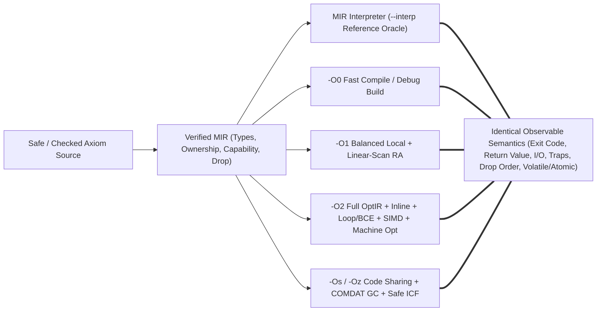

# SPEC-76 — Canonical Runtime Performance Contract, Optimization Profiles (`-O0`..`-Oz`), Binary Footprint Model (`FileSize` / `MappedSize` / `WorkingSet`), Benchmark Suite & CI Regression Budgets

## Tóm tắt
Tài liệu chuẩn hóa hợp đồng hiệu năng thực thi (`Execution Semantics & Performance Contract`), các cấu hình tối ưu hóa chuẩn (`-O0`, `-O1`, `-O2`, `-Os`, `-Oz`), mô hình kích thước nhị phân ba chiều (`FileSize`, `MappedSize`, `WorkingSet`), hệ thống đo đếm thời gian pha biên dịch và kích thước mã (`--time-passes`, `--size-report`), bộ benchmark chuẩn (`tools/bench`), và cổng kiểm soát hồi quy CI (`tools/perf.py --check-budgets`) cho trình biên dịch `axiomc` (Epic `E15.7`, Phase 15 `P15-optimizer-2-0`):
- **Hợp đồng ngữ nghĩa thực thi và bất biến tương đương xuyên cấu hình (`AXS-PERF-001..005`)**: Phân biệt rành mạch 3 trạng thái chương trình (`Defined`, `Panic`/`Trap`, `InvalidUnsafe`) và cấm tuyệt đối hành vi bất định (`UB`) trong mã Axiom an toàn (`0074 §1–3, §61, §65 ASEM-01..15`). Thiết lập nguyên tắc **bảo đảm an toàn không đồng nghĩa chi phí thời gian chạy bắt buộc** (`Safety cost != runtime cost`): bộ tối ưu được tự do loại bỏ kiểm tra cận/tràn số, xóa cấp phát không thoát, đổi thứ tự biểu thức thuần khiết và chuyên biệt hóa biểu diễn khi chứng minh được hành vi quan sát được không đổi (`0074 §3, §6–9, §42–48, §66`). Mọi cấu hình (`--interp`, `-O0`, `-O1`, `-O2`, `-Os`, `-Oz`, `--lto`, `--pgo-use`) bắt buộc bảo toàn ngữ nghĩa cốt lõi đồng nhất (`REQ-OPT-295`, `REQ-OPT-251..256`, `ALTO-58`). Kết quả tự tinh chỉnh (`auto-tuning`) chỉ là phản hồi tối ưu hóa có giới hạn tài nguyên tường minh và định danh hồ sơ ghi nhận trong siêu dữ liệu, không bao giờ làm nhiễu bản dựng tất định thông thường (`REQ-OPT-242..245`).
- **Hợp đồng các mức tối ưu hóa `-O0`, `-O1`, `-O2`, `-Os`/`-Oz` (`AXS-PERF-010..014`)**: Chuẩn hóa sự đánh đổi đa mục tiêu giữa tốc độ thực thi, kích thước mã và thời gian biên dịch (`REQ-OPT-292`, `ALTO-55`): `-O0` ưu tiên biên dịch tức thời và gỡ lỗi chính xác; `-O1` cân bằng tối ưu hóa cục bộ cùng phân bổ thanh ghi quét tuyến tính (`linear-scan regalloc`) cho tự biên dịch `axiomc`; `-O2` kích hoạt toàn bộ đường ống `OptIR` (`SCCP`, `GVN`/`CSE`, `AliasInfo`/`EscapeInfo`, `SCEV`/`BCE`/`LICM`, nội tuyến/chuyên biệt hóa/khử ảo hóa `SROA`, tự động vector hóa `SIMD`, bố cục máy) ưu tiên tốc độ (`REQ-OPT-294`, `ALTO-57`); `-Os` và `-Oz` (`Tiny profile`) ưu tiên chia sẻ mã tổng quát, ngưỡng nội tuyến chặt, thu gom rác section (`COMDAT` GC), `Safe ICF` và cắt tỉa chết mà không bao giờ đòi hỏi một runtime nguyên khối (`REQ-OPT-293`, `REQ-OPT-334`, `ALTO-56`, `AOPT-58`).
- **Mô hình dung lượng nhị phân 3 chiều và bố cục khởi động nhanh (`AXS-PERF-020..023`)**: Đánh giá nhị phân trên cả 3 chỉ số độc lập: kích thước tệp trên đĩa (`FileSize`), không gian địa chỉ ánh xạ (`MappedSize`), và tập trang làm việc thực tế khi khởi động/chạy (`WorkingSet`) (`REQ-OPT-382`, `tasks/0595 §1`). Tối ưu hóa bố cục đồ thị section (`SectionGraph`) theo cụm nóng/lạnh (`Hot`/`Warm`/`Cold`), tập khả đạt khởi động (`StartupReachability`), ngân sách căn chỉnh (`AlignmentBudget`), giảm thiểu relocation, và tách `.bss` không chiếm byte tệp để tối ưu hóa độ trễ khởi động, bộ nhớ đệm lệnh (`I-cache`/`I-TLB`) và chi phí nạp (`REQ-OPT-381`, `tasks/0595 §2–65`).
- **Đo đếm `--time-passes` / `--size-report`, bộ benchmark `tools/bench` và ngân sách CI (`AXS-PERF-030..044`)**: Định nghĩa lược đồ JSON máy đọc được cho `--time-passes` và `--size-report` hoàn toàn trực giao với tính tất định của nhị phân xuất ra, danh mục benchmark chuẩn (`micro`, `algorithm`, `memory`, `iter_devirt`, `simd`, `startup`, `compile`), quy tắc bắt buộc kiểm chứng tính đúng đắn trước khi nhận kết quả đo, không trộn thành điểm số tổng hợp ẩn (`tasks/0706 §450.77–80, §450.114–115`), và ngân sách hồi quy cứng trong CI (`tools/perf.py --check-budgets`).

Status: draft (T624, 2026-11-03). Owner: axiom-architect.
Rule IDs `AXS-PERF-NNN` are stable and never renumbered.
Consolidates: `0074` (`Axiom Execution Semantics & Optimization Contract v0.1`, `ASEM-01..15`), `tasks/0355` (`BOOTSTRAP-096`, `ALTO-55..58`), `tasks/0366` (`BOOTSTRAP-107`, `AOPT-20..65`), `tasks/0408` (`BOOTSTRAP-149`, `APGO-39..53`), `tasks/0595` (`BOOTSTRAP-336`, `ALAYOUT-01..25`), `tasks/0706` (`BOOTSTRAP-450`, §450.1–450.150), `spec/SPEC-20-selfhost.md` (`AXS-SELF-010..012`), `spec/SPEC-70-optir-ssa-memoryssa.md`, `spec/SPEC-71-alias-escape-promotion.md`, `spec/SPEC-72-loops-scev-bce.md`, `spec/SPEC-73-inlining-specialization-devirt.md`, `spec/SPEC-75-lto-wpo-section-gc-pgo.md`, and `spec/SPEC-77-regalloc-machine-opt.md`.
Covers: `REQ-OPT-292`, `REQ-OPT-293`, `REQ-OPT-294`, `REQ-OPT-295`, `REQ-OPT-334`, `REQ-OPT-381`, `REQ-OPT-382` (and governs implementation/QA tasks `T625` and `T626` covering `REQ-OPT-242`, `REQ-OPT-243`, `REQ-OPT-244`, `REQ-OPT-245`, `REQ-OPT-251`, `REQ-OPT-252`, `REQ-OPT-253`, `REQ-OPT-254`, `REQ-OPT-255`, `REQ-OPT-256`).
Consumers: `T625` (`compiler/driver/perf_telemetry`, `tools/bench`, `tools/perf.py`, `tests/run/perf_contract`), `T626` (`tests/conformance/p15/e15_7_perf_contract`), and `T315` (Phase P15 gate).

---

## 1. Execution Semantics & Optimization Equivalence Contract

**AXS-PERF-001 — Three Execution States (`Defined`, `Panic`/`Trap`, `InvalidUnsafe`) and Zero Safe Undefined Behavior (`0074 §1–3, §14–39, §61–65 ASEM-01..03, ASEM-10, ASEM-13`, `SPEC-03`, `INV-ORACLE-001`).**
1. **Partition of execution states (`0074 §1, §61, §64`):**
   Every Axiom operation at runtime belongs to one of three mutually exclusive semantic states:
   ```text
   ExecutionState =
       | EXEC_DEFINED          // Deterministic normal evaluation producing a well-typed value and ordered effects
       | EXEC_PANIC_OR_TRAP    // Deterministic abnormal termination (checked overflow, div-by-zero, OOB index, explicit panic/assert/unreachable)
       | EXEC_INVALID_UNSAFE   // Programmer violated an explicit `unsafe` or foreign ABI precondition
   ```
2. **No Undefined Behavior in safe Axiom (`0074 §2, §61, §65 ASEM-02, ASEM-03, ASEM-13`):**
   - Safe Axiom code NEVER exhibits undefined behavior (`ASEM-02`). Use-after-move, use-after-drop, capability overlap (`view`/`mut_view`), uninitialized reads, and non-exhaustive `match` are rejected at compile time (`INV-SEM-001..004`).
   - Runtime faults in safe code — checked integer `+`/`-`/`*` overflow, `/` or `%` by zero, signed `MIN / -1` overflow, shift count $\ge \text{bitwidth}$, out-of-bounds slice/array indexing `a[i]` where $i \ge \text{len}(a)$, failed `assert`, explicit `panic(...)`, and reaching `unreachable()` — have a **defined failure mode** (`EXEC_PANIC_OR_TRAP`, `ASEM-03`, `ASEM-13`, `SPEC-03`).
   - Consequently, the Axiom optimizer MUST NEVER use C/C++-style "signed overflow or out-of-bounds is UB, therefore any branch leading to it is unreachable" reasoning on safe operations (`0074 §2, §14, §28, §61`).
3. **Explicit `unsafe` precondition model (`0074 §1, §49–53, §61, §65 ASEM-10`, `INV-SEM-006`):**
   - Operations inside `unsafe` (raw-pointer dereference `*p`, unchecked indexing, `unsafe assume(cond)`, inline assembly, and foreign `extern` calls) carry explicit machine-level preconditions (pointer validity, alignment, initialization, provenance, and declared aliasing/thread contracts).
   - When the programmer satisfies those preconditions, the operation has `EXEC_DEFINED` semantics that the optimizer MUST preserve (`0074 §49–50`). Only when an explicit `unsafe` precondition is violated does the execution enter `EXEC_INVALID_UNSAFE` (`ASEM-10`).
[0074 §1–3, §14–39, §49–53, §61–65 ASEM-01..03, ASEM-10, ASEM-13; SPEC-03; INV-ORACLE-001; INV-SEM-001..006]

**AXS-PERF-002 — Observable Behavior Contract, Non-Observable Implementation Freedom, and Safety Without Mandatory Runtime Overhead (`0074 §3–13, §42–48, §54–57, §64–66 ASEM-04..09, ASEM-12, ASEM-14..15`, `tasks/0366 §55–60, §71 AOPT-21..64`).**
1. **Observable behavior definition (`0074 §7, §57, §65 ASEM-04`, `SPEC-03 AXS-SEM-003`):**
   A conforming optimization pass or backend lowering MUST preserve all externally observable behavior of a `Verified MIR` program:
   - Process termination kind (normal exit with return code vs. panic/trap exit code) and return value of `main` or `@export` entry points;
   - Content and sequential order of standard output, standard error, file/network I/O, and host intrinsic calls (`EffectFlags.IO`, `ASEM-07`);
   - Exact sequence, count, width, and addresses of `volatile` memory and `@at` fixed-address MMIO accesses (`EffectFlags.Volatile`, `ASEM-09`, `AOPT-37`);
   - Synchronization semantics and memory-ordering strength (`Relaxed`, `Acquire`, `Release`, `AcqRel`, `SeqCst`) of `atomic` operations and fences (`EffectFlags.Atomic`, `ASEM-08`, `AOPT-36`);
   - Deterministic `Drop` execution order for all live owned values whose destructors have observable side effects (`INV-SEM-003`, `0074 §36, §43`, `AOPT-64`);
   - Observable side effects and ABI contracts across `extern` FFI boundaries (`0074 §13`, `AOPT-38`).
2. **Non-observable implementation properties (`0074 §6–9, §42–46, §65 ASEM-05..06, ASEM-12`, `tasks/0366 §55–59, §71 AOPT-27..34, AOPT-47..48, AOPT-59..63`):**
   Unless explicitly exposed via `address_of` / `address_of_mut`, `@at`, `volatile`, `black_box`, or an `@export`/`@repr(C)` ABI boundary, the following implementation properties are **not** semantically observable and MAY be freely transformed by the compiler:
   - Physical instruction schedule and evaluation order of independent `Pure` expressions (`0074 §6, §46, ASEM-06`);
   - Physical heap or stack allocation count, size, and storage class (`Box<T>`, closure environments, and non-escaping `Vec`/`String` buffers may be promoted to stack slots or SSA registers per `SPEC-71 AXS-ESC-005..008`, `ASEM-05`, `AOPT-31..33, AOPT-59..60`);
   - Physical data movement for `Move` and `Copy` operations (lowered to SSA value renaming or `RVO`/`NRVO` return-slot construction per `SPEC-70 AXS-OPT-013` and `SPEC-73 AXS-INL-010..013`, `AOPT-28..29, AOPT-34, AOPT-61..62`);
   - Aggregate memory layout of local non-address-taken structs/tuples/enums decomposed by `SROA` (`SPEC-70 AXS-OPT-014`, `SPEC-73 AXS-INL-011`, `AOPT-27`);
   - Trivial no-op `Drop` glue whose body is proven `Pure` (`0074 §43`);
   - Compiler-only capability wrappers (`view<T>`, `mut_view<T>`) erased after `Verified MIR` checks (`SPEC-70 AXS-OPT-003`, `AOPT-47`);
   - Final virtual addresses of internal functions and read-only data sections when their addresses are not observed (`tasks/0595 §51–52, §65 ALAYOUT-12..14, ALAYOUT-25`).
3. **Safety guarantee $\ne$ mandatory runtime overhead (`0074 §3, §16, §28–29, §54–56, §65–66 ASEM-14..15`, `tasks/0366 §71 AOPT-22..26, AOPT-35`):**
   - Whenever static analysis on `OptIR` (`RangeInfo`, `SCEV`, `DominatorTree`, `AliasInfo`, `EscapeInfo`) establishes `Certainty.Proven` that a checked arithmetic operation cannot overflow (`NoOverflow`), a divisor is non-zero (`NonZero`), or a slice/array index satisfies $0 \le i < \text{len}(a)$ (`InBounds`), the compiler eliminates the runtime check and lowers the operation directly to raw machine instructions (`ASEM-14`, `SPEC-72 AXS-BCE-001..005`).
   - Verified capability disjointness (`mut_view` exclusivity and `view` immutability) is lowered directly to `NoAlias` and `ReadOnly` optimization facts without requiring source-level `restrict` annotations, enabling load hoisting, dead-store elimination, and SIMD vectorization on safe code (`0074 §54–56, §66`, `AOPT-22..26`).
[0074 §3–13, §16, §28–29, §42–48, §54–57, §64–66 ASEM-04..09, ASEM-12, ASEM-14..15; tasks/0366 §55–60, §71 AOPT-21..64; tasks/0595 §51–52, §65 ALAYOUT-12..14, ALAYOUT-25]



**AXS-PERF-003 — Cross-Profile Semantic Equivalence and Differential Oracle Agreement (`REQ-OPT-295`, `REQ-OPT-251`, `REQ-OPT-252`, `REQ-OPT-256`, `0074 §57–60`, `tasks/0355 §79–80 ALTO-58`, `tasks/0408 §40 APGO-48..49, APGO-53`, `INV-PIPE-004`, `INV-ORACLE-002`).**
1. **Debug and Release profiles preserve identical core language semantics (`REQ-OPT-295`, `ALTO-58`, `0074 §18, §57–60`):**
   - For every valid Axiom program $P$ and deterministic input $I$, compiling and executing $P$ under the MIR interpreter (`--interp`) and under any native optimization profile (`-O0`, `-O1`, `-O2`, `-O3`, `-Os`, `-Oz`, with or without `--lto` and `--pgo-use`) MUST produce identical observable behavior:
     $$\text{Observe}(\text{Interp}(P, I)) = \text{Observe}(\text{Native}_{-O0}(P, I)) = \text{Observe}(\text{Native}_{-O1}(P, I)) = \text{Observe}(\text{Native}_{-O2}(P, I)) = \text{Observe}(\text{Native}_{-Oz}(P, I))$$
   - In particular, switching from `-O0` (debug) to `-O2` or `-Oz` (release) MUST NEVER silently disable integer overflow traps, remove unproven bounds checks, change `Drop` destruction order, weaken `atomic` memory orderings, or alter floating-point IEEE-754 `NaN`/`±0.0`/`±∞` semantics (`REQ-OPT-295`, `0074 §16–28`, `tasks/0355 §79–80 ALTO-58`).
2. **Optionality of PGO and LTO and preservation of the `Verified MIR` boundary (`REQ-OPT-251`, `REQ-OPT-252`, `REQ-OPT-256`, `tasks/0408 §40 APGO-48..49, APGO-53`):**
   - Profile-Guided Optimization (`--pgo-use`) and Link-Time Optimization (`--lto`) are strictly optional (`REQ-OPT-251`, `SPEC-75 AXS-LTO-001`, `AXS-PGO-001`). Every valid program MUST compile and execute with full semantic validity without profile data (`REQ-OPT-252`).
   - Neither `-O2`, `-Os`/`-Oz`, `--lto`, nor `--pgo-use` may bypass or weaken the `Verified MIR` entry gate (`REQ-OPT-256`, `APGO-53`, `INV-PIPE-002`).
3. **Differential verification as a hard correctness gate (`0074 §58–60`, `INV-ORACLE-002`):**
   - A disagreement in exit code, stdout, stderr, or panic/trap outcome between `--interp`, `-O0`, `-O1`, `-O2`, and `-Oz` on any deterministic program is a **compiler correctness bug (miscompile)**, never an acceptable "optimization difference" (`0074 §59`, `tasks/0706 §450.41`).
[0074 §18, §57–60; tasks/0355 §79–80 ALTO-58; tasks/0408 §40 APGO-48..49, APGO-53; SPEC-70 AXS-OPT-006; SPEC-75 AXS-LTO-001, AXS-PGO-001; INV-PIPE-002; INV-PIPE-004; INV-ORACLE-002]

**AXS-PERF-004 — Build Reproducibility, Isolation from Measurement Noise, and Explicit Auto-Tuning / Profile Feedback Boundaries (`REQ-OPT-242`, `REQ-OPT-243`, `REQ-OPT-244`, `REQ-OPT-245`, `REQ-OPT-255`, `tasks/0408 §25–28, §40 APGO-39..42, APGO-52`, `tasks/0706 §450.70`, `INV-DET-001`).**
1. **Normal reproducible builds are immune to external measurement noise (`REQ-OPT-245`, `REQ-OPT-255`, `APGO-42`, `APGO-52`, `INV-DET-001`):**
   - Standard compilation (`axiomc build` at `-O0`, `-O1`, `-O2`, `-Os`, `-Oz`, `--lto`, and `--pgo-use=<profile>`) uses deterministic static cost models (`TargetDesc` + `CostModel`) and deterministic profile inputs (`REQ-OPT-245`, `REQ-OPT-255`).
   - Normal builds MUST NEVER sample wall-clock timers, CPU core temperature, OS thread scheduling latency, or live hardware performance counters to make optimization decisions, ensuring byte-for-bit identical output artifacts across repeated runs (`APGO-42`, `APGO-52`, `INV-DET-001`).
2. **Auto-tuning feedback is non-semantic and strictly bounded (`REQ-OPT-242`, `REQ-OPT-243`, `tasks/0408 §25–28, §40 APGO-39..40`):**
   - When offline candidate exploration / auto-tuning (`tools/perf.py --tune` or `--opt-feedback=<file>`) evaluates alternative profitability parameters (such as loop unroll factor $\in \{1, 2, 4, 8\}$, vector width $\in \{128, 256\}$, or inline threshold), the empirical results are **optimization profitability feedback only, never semantic information** (`REQ-OPT-242`, `APGO-39`). Every candidate configuration MUST independently satisfy `Certainty.Proven` legality preconditions (`tasks/0408 §28, §39`).
   - Any auto-tuning campaign MUST declare and enforce explicit resource boundaries (`REQ-OPT-243`, `APGO-40`):
     ```text
     AutoTuneBudget {
         scope: AutoTuneScope,           // Function | Loop | Module | WholeProgram
         max_candidates: u32,            // Hard cap on candidate variants (default <= 16)
         max_iterations_per_cand: u32,   // Bounded benchmark repetitions (default <= 10)
         max_wall_time_ms: u64,          // Hard timeout in milliseconds (default <= 30_000)
         max_memory_bytes: u64,          // Peak RSS cap per candidate run
     }
     ```
     Exceeding `max_candidates`, `max_iterations_per_cand`, or `max_wall_time_ms` deterministically terminates exploration and selects the best validated candidate (or static baseline heuristic) without hanging the build (`tasks/0408 §26, APGO-40`).
3. **Profile-dependent artifacts record profile and feedback identity (`REQ-OPT-244`, `tasks/0355 §69, §72 ALTO-54`, `tasks/0408 §27, §35, §40 APGO-41`, `tasks/0706 §450.150 #44`):**
   - Every object file, `.axmeta` summary, or executable built with `--pgo-use=<profile>` or explicit tuning feedback MUST record the 64-bit `profile_digest` (SHA-256 / FNV-1a digest of the `.axprof` / tuning input), `program_fingerprint`, and `opt_profile` in its `.axmeta` / build-provenance header (`SPEC-75 AXS-PGO-004` rule 3) and include them in the incremental cache key (`REQ-OPT-244`, `APGO-41`, `ALTO-54`).
[tasks/0355 §69, §72, §80 ALTO-54; tasks/0408 §25–28, §35, §40 APGO-39..42, APGO-52; tasks/0706 §450.70, §450.150 #44; SPEC-75 AXS-PGO-004; INV-DET-001]

**AXS-PERF-005 — Source Provenance Preservation, Machine-Readable Optimization Remarks, and Post-Pass Verification (`REQ-OPT-253`, `REQ-OPT-254`, `tasks/0366 §61–63, §71 AOPT-53, AOPT-65`, `tasks/0408 §36–37, §40 APGO-50..51`, `tasks/0706 §450.46–48, §450.91–95`).**
1. **Source provenance across all optimization profiles (`REQ-OPT-254`, `APGO-51`, `AOPT-65`, `SPEC-70 AXS-OPT-004`):**
   Every transformation in `-O1`, `-O2`, `-Os`, `-Oz`, `--lto`, and `--pgo-use` preserves the `OptOrigin` chain `{ span: Span, fn_id: FnId, inlined_from: Option<Span>, pass_id: u16 }` from `Verified MIR` through `OptIR`, `LIR`, and `Machine IR` so that panic messages, stack traces, profiler samples, and size/timing attribution reports map back to exact source functions and byte spans (`REQ-OPT-254`, `APGO-51`).
2. **Inspectable machine-readable profile and optimization decisions (`REQ-OPT-253`, `APGO-50`, `AOPT-53`, `tasks/0706 §450.47, §450.94–95`):**
   - Profile files (`.axprof`) and optimization decisions (`inspect --emit=opt-remarks`, `--time-passes`, `--size-report`) are emitted in deterministic human-readable and machine-readable JSON schemas (`REQ-OPT-253`, `APGO-50`, `Section 4`).
   - Optimization remarks record applied and rejected decisions for inlining (`INLINE_APPLIED` / `INLINE_REJECTED`), bounds-check elimination (`BCE_PROVEN` / `BCE_RETAINED`), allocation promotion (`ESC_STACK_PROMOTED` / `ESC_SROA_SCALARIZED` / `ESC_RETAINED_HEAP`), devirtualization (`DEVIRT_DIRECT` / `DEVIRT_GUARDED_PGO` / `DEVIRT_DYNAMIC`), and auto-vectorization (`VEC_LOOP_APPLIED` / `VEC_SLP_APPLIED` / `VEC_REJECTED`) with their `Certainty` grade and reason code (`tasks/0366 §61–62`, `tasks/0706 §450.47, §450.94–95`).
[tasks/0366 §61–63, §71 AOPT-53, AOPT-65; tasks/0408 §36–37, §40 APGO-50..51; tasks/0706 §450.46–48, §450.91–95; SPEC-70 AXS-OPT-004]

---

## 2. Canonical Optimization Profiles (`-O0`, `-O1`, `-O2`, `-Os`, `-Oz`) & Pass-Schedule Contracts

**AXS-PERF-010 — Optimization Profile Taxonomy and Multi-Objective Cost Model (`REQ-OPT-292`, `REQ-OPT-293`, `REQ-OPT-294`, `REQ-OPT-295`, `tasks/0355 §75–80 ALTO-55..58`, `tasks/0366 §68–69`, `tasks/0579 §320.2`).**
1. **Explicit optimization profiles (`REQ-OPT-292`, `ALTO-55`):**
   `axiomc` provides five canonical optimization profiles selectable via `-O0`, `-O1`, `-O2` (with `-O3` accepted as an alias for aggressive speed tuning on top of `-O2`), `-Os`, and `-Oz`:
   ```text
   OptProfile =
       | OPT_O0    // Debug / Fast-Compile: minimal transformations, maximum compile speed & debuggability
       | OPT_O1    // Balanced Local: fast scalar/local cleanup + linear-scan RA (self-host baseline)
       | OPT_O2    // Release Speed: full OptIR + IPA/inlining + loop/BCE + SIMD + machine optimization
       | OPT_OS    // Release Size-Balanced: -O2 pipeline with size-capped inlining/unrolling + section GC/ICF
       | OPT_OZ    // Release TinySize: aggressive code sharing, outlining, no loop unrolling, strict GC/ICF
   ```
2. **Permitted speed vs. code-size tradeoffs under invariant semantics (`REQ-OPT-292`, `REQ-OPT-295`, `tasks/0355 §75–80 ALTO-55, ALTO-58`):**
   - Per `REQ-OPT-292` (`ALTO-55`), optimization profiles MAY trade binary code size, compile time, and instruction count against runtime throughput by parameterizing pass selection and `CostModel` thresholds (`inline_threshold`, `max_unroll_factor`, `vectorize_enabled`, `icf_mode`, `function_alignment`).
   - Per `REQ-OPT-295` (`ALTO-58`), all five profiles MUST preserve identical core language semantics (`AXS-PERF-003`).

| Profile | Primary Objective | `OptIR` & IPA Tier (`SPEC-70..74`) | `InlineBudget` (Base / Hot / Cold) | Loop Unroll / Vectorize (`SPEC-72`, `SPEC-74`) | Link-Time & Layout (`SPEC-75`, `SPEC-77`) |
|---|---|---|---|---|---|
| **`-O0`** | Fast compile & 1:1 debug stepping | Bypassed (`Verified MIR` → `LIR` directly; mandatory `verify_mir` only) | `@inline(always)` only (`0` heuristic threshold) | None (`unroll = 1`, `autovec = off`) | Fast local RA, 1-byte/4-byte min padding, no ICF |
| **`-O1`** | Fast incremental & self-host build (`SPEC-20`) | Local `SCCP`, trivial `CSE`/`DCE`, local copy/move prop, simple `SROA` | Small leaf / `@inline` (`cost <= 30`) | Proven local `BCE`; no unrolling or SLP/loop vectorization | Linear-scan RA (`SPEC-77`), basic peephole, section GC |
| **`-O2`** | Release execution speed (`REQ-OPT-294`) | Full `OptIR`: `SCCP`, `GVN`, `AliasInfo`/`DSE`, `EscapeInfo` promotion, `SCEV`/`BCE`/`LICM`, `SROA`/`RVO`, SCC inlining, specialization, devirt | `base = 225`, `hot = 450`, `cold = 25`, `max_growth = 30%` | Full loop unrolling (`<= 8`), peeling, unswitching, iterator fusion, loop + `SLP` SIMD | Linear-scan RA + coalescing, `lea`/div/branchless `cmov`, post-RA peephole, 16B hot align, section GC + Safe ICF |
| **`-Os`** | Balanced small footprint + speed (`REQ-OPT-292`) | Full `OptIR` scalar/memory/BCE/escape + size-disciplined inlining | `base = 75`, `hot = 150`, `cold = 0`, `max_growth = 10%` | No size-increasing unrolling (`unroll = 1` unless size-shrinking); SIMD only if code size $\le$ scalar | Generic sharing, compact isel, `AlignmentBudget` ($\le 4$ B padding), section GC + Safe ICF + string tail merge |
| **`-Oz`** | Minimal `FileSize` & `WorkingSet` (`REQ-OPT-293`) | Full `OptIR` `DCE`/`DSE`/`SCCP`/`SROA` + strict code sharing | `@inline(always)` or single-call-site / size-shrinking (`base = 15`, `cold = 0`) | `unroll = 1`, `autovec = off`, cold error-path outlining | Maximal generic sharing, 1-byte function alignment, mandatory section GC + Safe ICF + runtime trimming |

[tasks/0355 §75–80 ALTO-55..58; tasks/0366 §68–70; tasks/0579 §320.2; SPEC-70..75; SPEC-77]

**AXS-PERF-011 — `-O0` (Debug & Fast-Compile Profile) Contract (`REQ-OPT-295`, `tasks/0355 §79–80 ALTO-58`).**
1. **Mandatory semantic verification at `-O0` (`INV-PIPE-002`, `INV-PIPE-005`):**
   `-O0` runs the complete frontend, ownership/capability/initialization checker, drop elaboration, `verify_mir` (`INV-PIPE-002`), and `x64_verify_checked` (`INV-PIPE-005`). `-O0` NEVER skips safety verification to save compile time.
2. **Debuggability and minimal transformation:**
   At `-O0`, `Verified MIR` lowers directly to `LIR` without running `OptIR` dataflow passes (except `@inline(always)` expansion when required), preserving source local variables, statement boundaries, and stack frame slots so step-through debugging (`P17`) observes exact source state while maintaining 100% semantic equivalence with release builds (`REQ-OPT-295`).
[tasks/0355 §79–80 ALTO-58; INV-PIPE-002; INV-PIPE-005]

**AXS-PERF-012 — `-O1` (Balanced Local & Self-Host Baseline Profile) Contract (`SPEC-20 AXS-SELF-010`, `SPEC-70`, `SPEC-77`).**
1. **Purpose:** `-O1` is the default self-hosting compilation profile (`SPEC-20`: `axiomc1` → `axiomc2` → `axiomc3` with `-O1 --stack-reserve 67108864`), delivering the majority of local scalar and register-allocation speedups at near-`-O0` compile times.
2. **Pass pipeline:** `-O1` constructs `OptIR` (`SPEC-70`) and executes a single fast local pass tier: constant folding / `SCCP`, local `CSE`, dead-code elimination (`DCE`), unobservable copy/move value renaming (`AXS-OPT-013`), scalar replacement of non-escaping local aggregates (`SROA`), trivial leaf inlining (`cost <= 30`), proven local bounds-check elimination, linear-scan register allocation with move coalescing (`SPEC-77 AXS-RA-010..022`), and local post-RA dead-move/zeroing peepholes (`SPEC-77 AXS-MCOPT-020`).
[SPEC-20 AXS-SELF-010; SPEC-70; SPEC-77 AXS-RA-010..022, AXS-MCOPT-020]

**AXS-PERF-013 — `-O2` (Release Speed Profile) Contract (`REQ-OPT-292`, `REQ-OPT-294`, `tasks/0355 §77, §80 ALTO-55, ALTO-57`).**
1. **Speed profile specialization and inlining preference (`REQ-OPT-294`, `ALTO-57`):**
   Per `REQ-OPT-294` (`ALTO-57`), `-O2` prioritizes execution throughput and latency reduction, permitting controlled code-size growth (`max_caller_growth_pct = 30%`, `SpecializationBudget.max_clones_per_fn = 4`) when the `CostModel` predicts a net runtime speedup (`SPEC-73 AXS-INL-021, AXS-INL-031`).
2. **Canonical `-O2` deterministic pass pipeline:**
   Every `-O2` compilation executes the following verified pass sequence under `PassManager` (`SPEC-70 AXS-OPT-030..034`):
   - **Phase A (Early Local Cleanup):** `Verified MIR` → `OptIR` (`DominatorTree` + `SSA` + `MemorySSA`) → `CFGSimplify` → early `SROA` + copy/move propagation → early `SCCP` + `DCE`.
   - **Phase B (Interprocedural & Whole-Program Tier, `SPEC-73`, `SPEC-75`):** `CallGraph` & Tarjan `SCC` construction → bottom-up `EffectSummary` / `EscapeSummary` / `AliasSummary` inference → closed-world internalization & dead-function pruning (when `WORLD_CLOSED` / `--lto`) → call-site constant & closure specialization (`AXS-INL-030..031`) → `dyn Trait` & fn-pointer devirtualization (`AXS-INL-032`) → bottom-up `SCC` inlining (`AXS-INL-020..023`) → post-inline `SROA`, `RVO`/`NRVO` return-slot promotion (`AXS-INL-012..013`), and tail-call marking (`AXS-INL-033`).
   - **Phase C (Memory & Escape Promotion Tier, `SPEC-71`):** Capability & provenance `AliasInfo` (`AXS-ALIAS-001..005`) → `EscapeInfo` fixed-point analysis (`AXS-ESC-001..004`) → `Box`/closure/buffer heap-to-stack and register promotion (`AXS-ESC-005..008`) → `MemorySSA` store-to-load forwarding, redundant load elimination (`GVN`), and dead-store elimination (`DSE`, `AXS-ALIAS-006`).
   - **Phase D (Loop, BCE & Auto-Vectorization Tier, `SPEC-72`, `SPEC-74`):** Natural loop discovery + `LoopSimplify` + `LCSSA` (`AXS-LOOP-002..003`) → overflow-faithful `SCEV` & `RangeInfo` (`AXS-LOOP-004..005`) → bounds-check & overflow-check elimination (`BCE`, `AXS-BCE-001..005`) → `LICM` & loop unswitching (`AXS-LOOP-010, AXS-LOOP-012`) → lazy iterator pipeline fusion (`AXS-LOOP-015`) → induction strength reduction & loop peeling/unrolling (`AXS-LOOP-011, AXS-LOOP-013`) → loop & straight-line `SLP` SIMD auto-vectorization (`SPEC-74`).
   - **Phase E (Late Scalar & Machine Lowering Tier, `SPEC-75`, `SPEC-77`):** Final `SCCP` + `GVN`/`CSE` + `DCE` + `CFGSimplify` → `OptIR` contract verification (`AXS-OPT-034`) → `LIR` + ABI lowering → complex instruction selection (`lea` addressing, magic-multiplier division, branchless `cmovcc`/`setcc` if-conversion, `AXS-MCOPT-001..013`) → linear-scan register allocation (`AXS-RA-010..026`) → post-RA machine peephole (`AXS-MCOPT-020..025`) → `x64_verify_checked` → object emission with per-symbol sections → linker section GC (`COMDAT`), `Safe ICF`, and hot/cold binary layout (`AXS-LTO-020..025`, `AXS-PERF-021`).
[tasks/0355 §77, §80 ALTO-55, ALTO-57; SPEC-70..75; SPEC-77]

**AXS-PERF-014 — `-Os` and `-Oz` (`Tiny` / Code-Size Profiles) and Zero-Monolithic-Runtime Contract (`REQ-OPT-292`, `REQ-OPT-293`, `REQ-OPT-334`, `tasks/0355 §76, §80 ALTO-55..56`, `tasks/0366 §68–71 AOPT-58`, `INV-SEM-005`).**
1. **Tiny profile prioritizes code sharing and dead stripping (`REQ-OPT-293`, `ALTO-56`, `tasks/0355 §76`, `tasks/0366 §69`):**
   Under `-Os` and `-Oz`:
   - **Aggressive dead stripping (`ALTO-46..47, ALTO-56`):** Every function and static datum is emitted into an independent `.text$<symbol>` / `.rdata$<symbol>` / `.data$<symbol>` section (`SPEC-04 AXS-EXT-071`), and the linker unconditionally runs mark-sweep section garbage collection from $R_{\text{root}}$ (`SPEC-75 AXS-LTO-021`).
   - **Generic code sharing and `Safe ICF` (`ALTO-30..33, ALTO-48..49, ALTO-56`):** Monomorphized generic instances with identical machine representation share a single implementation (`SPEC-75 AXS-LTO-014`), and identical read-only functions/tables are folded via `Safe ICF` and string literal tail-merging (`SPEC-75 AXS-LTO-022..023`).
   - **Size-capped inlining and unrolling suppression (`tasks/0366 §69`):** Loop unrolling and speculative cloning are disabled at `-Oz` (and restricted at `-Os` to transformations that do not increase net byte size). At `-Oz`, functions are inlined only when marked `@inline(always)`, called from a single call site in a `WORLD_CLOSED` binary, or when the inlined body is smaller than the call sequence itself ($\le 15$ bytes).
   - **Compact machine lowering (`SPEC-77`):** Backend lowering prefers shorter x86-64 encodings (`xor reg, reg`, 8-bit sign-extended immediates, short `rel8` jumps via branch relaxation, and 1-byte cold function alignment without NOP padding).
2. **Binary-size optimization never requires a monolithic runtime (`REQ-OPT-334`, `AOPT-58`, `tasks/0355 §80 ALTO-50..51`, `tasks/0366 §70–71 AOPT-46, AOPT-58`, `tasks/0706 §450.63–64, §450.137–140`, `INV-SEM-005`):**
   - Axiom's size reduction is achieved through static compile-time and link-time dead-code elimination, modular std/runtime section partitioning (`SPEC-75 AXS-LTO-024`), and representation sharing — **never** by delegating execution to a mandatory shared VM, bytecode interpreter, garbage collector, or monolithic runtime DLL (`REQ-OPT-334`, `AOPT-58`, `INV-SEM-005`).
   - A program that uses only integer arithmetic and returns an exit code links zero heap-allocator, string-formatting, filesystem, networking, threading, or async-executor sections (`tasks/0366 §70`, `tasks/0706 §450.63–64, §450.137`).
[tasks/0355 §76, §80 ALTO-50..51, ALTO-55..56; tasks/0366 §68–71 AOPT-46, AOPT-58; tasks/0706 §450.63–64, §450.137–140; SPEC-75 AXS-LTO-014, AXS-LTO-020..025; INV-SEM-005]

---

## 3. Binary Footprint Model (`FileSize`, `MappedSize`, `WorkingSet`), Layout & Startup Latency Contract

**AXS-PERF-020 — Three-Dimensional Binary Size Model (`FileSize`, `MappedSize`, `WorkingSet`) (`REQ-OPT-381`, `REQ-OPT-382`, `tasks/0595 §1–2, §24–33, §65 ALAYOUT-01..25`, `tasks/0706 §450.7, §450.10–15`).**
1. **Mandatory distinction between `FileSize`, `MappedSize`, and `WorkingSet` (`REQ-OPT-382`, `tasks/0595 §1`):**
   Per `REQ-OPT-382`, the Axiom compiler, linker, size reporter (`--size-report`), and benchmark harness (`tools/perf.py`) MUST evaluate and report every native binary across three distinct footprint dimensions rather than file byte count alone:
   ```text
   BinaryFootprintMetrics {
       file_size_bytes: u64,            // Total on-disk image bytes (PE/ELF headers + file-backed sections + alignment padding)
       stripped_file_size_bytes: u64,   // On-disk bytes excluding optional debug/symbol-table sections
       mapped_size_bytes: u64,          // Total virtual address space mapped by OS loader (aligned RX + R + RW + .bss segments)
       startup_working_set_bytes: u64,  // Resident 4 KiB pages touched from process entry through `main` readiness
       peak_working_set_bytes: u64,     // Peak resident set size (RSS = hot code/rodata/data pages + stack + heap) during workload
       section_breakdown: SectionSizeBreakdown,
   }
   ```
   - **`FileSize` (`file_size_bytes`):** Exact byte length of the emitted artifact on disk:
     $$\text{FileSize} = \text{Headers} + \sum_{S \notin \{\text{.bss}\}} \text{RawSize}(S) + \text{FileAlignmentPadding}$$
     Zero-initialized `.bss` statics contribute $0$ bytes to `FileSize` (`tasks/0595 §27`).
   - **`MappedSize` (`mapped_size_bytes`):** Total virtual memory span committed/mapped by the OS image loader across page-aligned segments (`RX` `.text`, `R` `.rdata`/`.pdata`/`.xdata`, `RW` `.data`/`.bss`):
     $$\text{MappedSize} = \sum_{\text{seg} \in \{\text{RX}, \text{R}, \text{RW}\}} \left\lceil \frac{\text{VirtualSize}(\text{seg})}{\text{PageSize}} \right\rceil \times \text{PageSize}$$
     where $\text{PageSize} = 4096\text{ B}$ on x86-64/ARM64 targets (`tasks/0595 §1, §24, §30`).
   - **`WorkingSet` (`startup_working_set_bytes` / `peak_working_set_bytes`):** The subset of mapped pages actually faulted into physical RAM (and instruction/data TLBs) during startup or steady-state execution (`tasks/0595 §1, §5–9, §30`, `tasks/0706 §450.7`).
2. **Section and dependency accounting rules (`tasks/0706 §450.10–15`):**
   - Section accounting separately tracks `.text` (executable code), `.rdata` / `.rodata` (constants, string literals, vtables, import tables), `.data` (mutable initialized statics), `.bss` (zero-initialized statics), `.pdata`/`.xdata` (unwind metadata), `.axmeta` (compiler summaries, omitted from final stripped executables), and debug sections (`tasks/0706 §450.10–12`).
   - Dynamic OS imports (`KERNEL32.dll`, etc.) record their import-table byte contribution and symbol count without conflating the external OS DLL's size into the Axiom executable's `FileSize` (`tasks/0706 §450.14, §450.150 #14`).
   - Runtime/startup stub contribution (`runtime_bytes`) is attributed separately from user/library module bytes (`tasks/0706 §450.15, §450.150 #12, #64`).
[tasks/0595 §1–2, §24–33; tasks/0706 §450.7, §450.10–15, §450.150 #7, #9–14, #64]

**AXS-PERF-021 — Optimal Binary Layout for Startup, Instruction Cache, Page Locality, and Relocation Cost (`REQ-OPT-381`, `tasks/0595 §2–38, §50–65 ALAYOUT-01..25`).**
1. **Multi-objective binary layout (`REQ-OPT-381`, `tasks/0595 §336, §2–10`):**
   Per `REQ-OPT-381`, the linker and binary layout engine (`compiler/link`) MUST optimize the physical placement of retained sections for startup latency, instruction-cache (`I-cache`) and `I-TLB` locality, 4 KiB page packing, relocation cost, and strict `W^X` segment permissions:
   - **Thermal & startup section partitioning (`tasks/0595 §4–9, ALAYOUT-09..10`):**
     Retained code sections are classified into four deterministic placement buckets within the `RX` `.text` segment:
     ```text
     [1. StartupEntrySet] -> [2. HotCluster (.text.hot)] -> [3. WarmNormal (.text)] -> [4. ColdSplit (.text.cold)]
     ```
     1. `StartupEntrySet`: `_start` / `mainCRTStartup`, minimal runtime init (if any), and `main` (plus callees unconditionally executed on entry), placed contiguously at the beginning of `.text` so process launch faults the minimum number of 4 KiB code pages (`tasks/0595 §5–6`).
     2. `HotCluster`: Functions classified as `Hot` by PGO call-edge weights (`CallGraph` caller $\to$ callee frequency ordering, `SPEC-75 AXS-PGO-007`) or static loop-nesting heuristics, packed together to maximize `I-cache` line utilization and `I-TLB` hit rate (`tasks/0595 §7, §10–11`).
     3. `WarmNormal`: Standard reachable functions ordered deterministically by module topological order and symbol ID (`tasks/0595 §53 ALAYOUT-06..07`).
     4. `ColdSplit`: Panic handlers, formatting failure paths, and `@cold` functions isolated at the tail of `.text` so error paths never pollute hot cache lines or startup pages (`tasks/0595 §8–9`).
   - **Read-only and mutable data clustering (`tasks/0595 §14–16, §27–30`):**
     Read-only constants (`.rdata`) are similarly grouped into `[startup_rodata, hot_rodata, cold_rodata]`, string literals are deduplicated, and zero-initialized statics are placed exclusively in `.bss` (`VirtualSize > 0`, `RawDataSize = 0`) (`ALAYOUT-08, ALAYOUT-14`).
2. **Alignment budgets and branch/relocation optimization (`REQ-OPT-381`, `tasks/0595 §12–23, §57–59, §65 ALAYOUT-03..04, ALAYOUT-08, ALAYOUT-15..20`):**
   - **Alignment budget (`tasks/0595 §12–13, ALAYOUT-08`):** Under `-O2`, hot loop headers and hot functions align to 16 bytes only when padding bytes $\le \text{AlignmentBudget}$ (at most 15 bytes and $\le 10\%$ of function size); cold functions and `-Os`/`-Oz` functions use minimal 1-byte or 4-byte alignment, and all alignment/section/page padding bytes are explicitly accounted for in `--size-report` (`ALAYOUT-08`).
   - **PC-relative addressing and relocation minimization (`tasks/0595 §17–21, §57–59, ALAYOUT-15, ALAYOUT-19..20`):** The x86-64 backend and linker prefer PC-relative (`RIP`-relative `REL32`) addressing and short `rel8` jumps/branches, avoiding writable code relocations (`W^X` invariant `ALAYOUT-03, ALAYOUT-16`) and converging in a bounded fixed-point relaxation pass ($\le 4$ iterations, `ALAYOUT-20`).
   - **Import & export minimization (`tasks/0595 §34–38`):** Unreferenced foreign DLL imports eliminated by dead-code stripping are removed from the PE `.idata` import directory so the OS loader does not resolve or map unused DLLs at startup (`tasks/0595 §37–38`).
[tasks/0595 §1–38, §50–65 ALAYOUT-01..25; SPEC-75 AXS-LTO-025, AXS-PGO-007; SPEC-77 AXS-MCOPT-024]

**AXS-PERF-022 — Startup Reachability, Zero-Hidden-Initialization Contract, and Startup Latency Budget (`REQ-OPT-334`, `REQ-OPT-381`, `tasks/0595 §5–6, §39, §49`, `tasks/0706 §450.9, §450.23, §450.58–64, §450.137–140`, `INV-SEM-005`).**
1. **No hidden static constructors or ambient runtime startup (`tasks/0706 §450.59–64, §450.137–140`, `INV-SEM-005`):**
   - Axiom forbids C++-style arbitrary hidden module-order static constructors (`tasks/0706 §450.59–60`). Global `const` and `static` initializers are evaluated at compile time into `.rdata`/`.data`/`.bss` bytes (`SPEC-03`).
   - Process entry (`mainCRTStartup`) performs only deterministic stack/arguments setup, invokes `main`, and passes the return code to `ExitProcess` (or target syscall exit) without pre-initializing unused allocators, thread pools, async executors, or filesystem/network subsystems (`REQ-OPT-334`, `tasks/0706 §450.63–64, §450.137`, `INV-SEM-005`).
2. **Startup measurement boundary (`tasks/0706 §450.9, §450.23, §450.58, §450.83, §450.150 #50`):**
   Startup latency (`startup_time_us`) is measured from OS process creation to the entry of `main` (or the benchmark's first readiness output byte) on a minimal executable (`fn main() -> i32 { 0 }`), tracking both `startup_time_us`, `startup_working_set_bytes`, and `startup_allocations == 0` (`tasks/0706 §450.62–63`).
[tasks/0595 §5–6, §39, §49; tasks/0706 §450.9, §450.23, §450.58–64, §450.83, §450.137–140, §450.150 #9–10, #34, #50; INV-SEM-005]

---

## 4. Compiler Pass-Timing & Code-Size Telemetry (`--time-passes`, `--size-report`)

**AXS-PERF-030 — `--time-passes` Compiler Stage and Optimization Pass Telemetry Contract (`REQ-OPT-245`, `REQ-OPT-253`, `tasks/0706 §450.1–2, §450.86–87, §450.146–147, §450.150 #2, #51`).**
1. **Per-stage and per-pass timing and structural metrics (`tasks/0706 §450.2, §450.86–87`):**
   When `--time-passes` is passed to `axiomc` (`check`, `build`, or `run`), `compiler/driver/perf_telemetry` records high-resolution monotonic elapsed time (`std.time.Instant`), peak arena/heap memory bytes, and deterministic IR structural counters across every pipeline stage and optimization pass:
   - **Pipeline stages (`tasks/0706 §450.2`):** `lex`, `parse`, `resolve_hir`, `typeck`, `own_cap_drop`, `mir_build`, `mir_verify`, `optir_lower`, `opt_passes` (plus each individual `OptIR` pass `sccp`, `gvn_cse`, `alias_dse`, `escape_promote`, `loop_scev_bce`, `licm_unroll`, `inline_sroa_devirt`, `autovec`, `lto_wpo`), `lir_abi`, `x64_isel_ra_peephole`, `obj_emit`, and `link_gc_layout`.
   - **Deterministic structural counters (`tasks/0706 §450.91–95`):** Alongside wall-clock microseconds (`elapsed_us`), each pass entry records deterministic, noise-free counters (`ir_blocks`, `ir_insts_before`, `ir_insts_after`, `transforms_applied`, `spills_inserted`, `peak_arena_bytes`).
2. **Human-readable and `--json` machine-readable schemas (`REQ-OPT-253`, `tasks/0706 §450.146–147`):**
   - In human mode (without `--json`), `--time-passes` writes one line per stage/pass to `stdout` (or `stderr` when `--emit=-`) in the legacy-compatible format `time: <stage_or_pass> <seconds>s (<elapsed_us>us, insts=<before>-><after>, arena=<bytes>B)` followed by `time: total <seconds>s peak_mem=<bytes>B`.
   - With `--time-passes` and `--json` (or `--time-passes=<path.json>`), `perf_telemetry` emits a versioned JSON document (`schema: 1`):
     ```json
     {
       "schema": 1,
       "kind": "time_passes",
       "opt_profile": "-O2",
       "target": "x86_64-windows",
       "total_elapsed_us": 42150,
       "peak_arena_bytes": 8388608,
       "stages": [
         {"name": "lex_parse", "elapsed_us": 3100, "items": 42, "peak_arena_bytes": 524288},
         {"name": "typeck_own_verify", "elapsed_us": 7400, "mir_bodies": 28, "peak_arena_bytes": 2097152},
         {"name": "opt_sccp_gvn", "elapsed_us": 2900, "insts_before": 1840, "insts_after": 1310, "transforms": 195},
         {"name": "opt_inline_sroa_devirt", "elapsed_us": 5100, "insts_before": 1310, "insts_after": 1120, "transforms": 64},
         {"name": "opt_loop_bce_autovec", "elapsed_us": 4800, "insts_before": 1120, "insts_after": 940, "bce_eliminated": 18, "loops_vectorized": 4},
         {"name": "x64_isel_ra_peephole", "elapsed_us": 9200, "vregs": 612, "spills": 3, "mc_insts": 1420},
         {"name": "link_gc_layout", "elapsed_us": 9650, "sections_total": 64, "sections_gc_removed": 22, "icf_folded": 5}
       ]
     }
     ```
[tasks/0706 §450.1–2, §450.86–87, §450.91–95, §450.146–147, §450.150 #2, #51]

**AXS-PERF-031 — `--size-report` Binary Footprint, Section, and Symbol Attribution Contract (`REQ-OPT-381`, `REQ-OPT-382`, `tasks/0355 §67`, `tasks/0595 §1, §33, §63`, `tasks/0706 §450.10–15, §450.51–57, §450.122–123`).**
1. **Per-section, 3D footprint, and per-symbol attribution (`REQ-OPT-381`, `REQ-OPT-382`, `tasks/0355 §67`, `tasks/0706 §450.10–15, §450.53–57`):**
   When `--size-report` (or `--size-report=<path.json>`) is passed to `axiomc build`, `compiler/driver/perf_telemetry` inspects the linked section graph and final executable image to emit a deterministic breakdown of:
   - **Three-dimensional binary metrics (`REQ-OPT-382`):** `file_size_bytes`, `mapped_size_bytes`, `startup_working_set_bytes`, `alignment_padding_bytes`, and `page_padding_bytes` (`AXS-PERF-020`).
   - **Section breakdown (`tasks/0706 §450.10`):** Exact raw file bytes and virtual mapped bytes for `.text` (split into `startup`, `hot`, `warm`, `cold`), `.rdata`, `.data`, `.bss`, `.pdata`/`.xdata`, and `.idata` (imports).
   - **Attribution by origin (`tasks/0706 §450.15, §450.53–57`):**
     - `runtime_bytes`: Startup stub and minimal runtime intrinsics (`REQ-OPT-334`);
     - `std_bytes`: Retained standard library symbols;
     - `user_bytes`: User package/module functions and statics;
     - `generic_family_bytes`: Aggregated size of monomorphized generic families to surface generic specialization bloat (`tasks/0706 §450.55`);
     - `gc_eliminated_bytes` and `icf_saved_bytes`: Bytes removed by section GC (`COMDAT`) and `Safe ICF` (`SPEC-75 AXS-LTO-021..022`);
     - `symbols`: Per-symbol table sorted deterministically by descending `size_bytes`, then ascending symbol name (`tasks/0706 §450.122–123`).
2. **Deterministic JSON schema (`schema: 1`):**
   ```json
   {
     "schema": 1,
     "kind": "size_report",
     "opt_profile": "-Oz",
     "target": "x86_64-windows",
     "file_size_bytes": 3584,
     "mapped_size_bytes": 12288,
     "startup_working_set_bytes": 4096,
     "alignment_padding_bytes": 12,
     "sections": {
       ".text": {"file_bytes": 1024, "virtual_bytes": 620, "startup_bytes": 180, "hot_bytes": 320, "cold_bytes": 120},
       ".rdata": {"file_bytes": 512, "virtual_bytes": 240},
       ".data": {"file_bytes": 0, "virtual_bytes": 0},
       ".bss": {"file_bytes": 0, "virtual_bytes": 64},
       ".idata": {"file_bytes": 512, "virtual_bytes": 128, "dll_imports": ["KERNEL32.dll"]}
     },
     "attribution": {
       "runtime_bytes": 64,
       "std_bytes": 196,
       "user_bytes": 360,
       "generic_family_bytes": 80,
       "gc_eliminated_bytes": 1480,
       "icf_saved_bytes": 240
     },
     "symbols": [
       {"name": "main", "section": ".text", "heat": "startup", "size_bytes": 116}
     ]
   }
   ```
[tasks/0355 §67; tasks/0595 §1, §33, §63; tasks/0706 §450.10–15, §450.51–57, §450.122–123]

**AXS-PERF-032 — Strict Orthogonality of Telemetry Flags to Artifact Reproducibility (`REQ-OPT-245`, `REQ-OPT-255`, `INV-DET-001`).**
Enabling `--time-passes` or `--size-report` MUST NEVER alter the emitted `.obj` or `.exe` artifact by a single byte:
$$\text{Bytes}(\text{Build}(P, \text{flags})) \equiv \text{Bytes}(\text{Build}(P, \text{flags} \cup \{\texttt{--time-passes}, \texttt{--size-report}\}))$$
Wall-clock measurements are written exclusively to the telemetry report stream/file and are never embedded inside generated machine code, object sections, or PE headers (`REQ-OPT-245`, `INV-DET-001`, `INV-DET-002`).
[tasks/0408 §40 APGO-42, APGO-52; tasks/0706 §450.70; INV-DET-001; INV-DET-002]

---

## 5. Canonical Benchmark Corpus (`tools/bench`), `tools/perf.py` Harness & Hard CI Regression Budgets

**AXS-PERF-040 — Canonical Benchmark Suite Architecture (`tools/bench`) and Workload Categories (`tasks/0706 §450.16–28, §450.81–86, §450.101–105, §450.150 #31–32`).**
1. **No single microbenchmark represents overall performance (`tasks/0706 §450.17, §450.24, §450.150 #31–32`):**
   The canonical Axiom benchmark corpus in `tools/bench/` (together with `tests/perf/bench/`) spans seven mandatory categories covering micro-kernels, data-structure/memory workloads, abstraction-elimination workloads, SIMD kernels, startup latency, and real-world compiler throughput:

| Benchmark ID | File in `tools/bench/` | Category (`0706 §450.16`) | Primary Optimizer & Backend Tiers Exercised | Verification Checksum / Oracle |
|---|---|---|---|---|
| `BENCH-STARTUP-001` | `bench_minimal_startup.ax` | `startup` / `code-size` | Minimal entry stub, dead runtime/std stripping, `.text` startup page locality (`SPEC-75`, `AXS-PERF-022`) | Exit code `0`, `startup_allocations == 0`, imports only `KERNEL32.dll` |
| `BENCH-SCALAR-001` | `bench_scalar_loops_bce.ax` | `micro` / `algorithm` | `OptIR` `SCCP`, `GVN`/`CSE`, `SCEV`, proven `BCE`, `LICM`, strength reduction, linear-scan RA (`SPEC-70`, `SPEC-72`, `SPEC-77`) | Exact deterministic 64-bit checksum exit/stdout |
| `BENCH-MEM-001` | `bench_escape_sroa_alloc.ax` | `memory` | `EscapeInfo` `Box`/closure/buffer stack & register promotion, deep `SROA`, `RVO`/`NRVO`, `MemorySSA` `DSE` (`SPEC-71`, `SPEC-73`) | Exact checksum + `heap_alloc_count == 0` in promoted hot loop |
| `BENCH-IPA-001` | `bench_iter_inline_devirt.ax` | `algorithm` / `language` | Call-graph `SCC` inlining, closure/constant specialization, `dyn Trait` devirtualization, iterator pipeline fusion (`SPEC-72`, `SPEC-73`) | Exact checksum identical to hand-written scalar loop |
| `BENCH-SIMD-001` | `bench_simd_autovec_kernel.ax` | `numeric` / `simd` | Capability-disjoint `NoAlias` proof, loop & `SLP` SIMD auto-vectorization, branchless `cmov`, scalar epilogue (`SPEC-71`, `SPEC-74`, `SPEC-77`) | Exact checksum across even and odd/prime lengths |
| `BENCH-ALGO-001` | `bench_sort_hash_parse.ax` | `algorithm` / `real-world` | Quicksort/mergesort, 64-bit `FNV-1a` hashing, lexer/JSON token scanning, branch layout (`SPEC-75`, `SPEC-77`) | Exact digest match against `--interp` reference |
| `BENCH-COMPILE-001` | `axiomc` self-compile / multi-module | `compile` / `real-world` | Full compiler pipeline throughput (`parse/sec`, `opt/sec`, `codegen/sec`), peak arena memory, `-O0`/`-O1`/`-O2` compile-time budgets (`SPEC-20`) | Byte-identical deterministic binary output (`INV-DET-004`) |

2. **Workload and input equivalence (`tasks/0706 §450.26–28, §450.103–104`):**
   Every benchmark in `tools/bench/` uses fixed, deterministic inputs (or a deterministic PRNG seed embedded in source) and carries a versioned `benchmark_id` and `workload_version` (`tasks/0706 §450.102–103`). Modifying a benchmark's algorithmic workload increments `workload_version`.
[tasks/0706 §450.16–28, §450.81–86, §450.101–105, §450.150 #15–16, #28, #31–32]

**AXS-PERF-041 — Mandatory Correctness Validation Before Performance Acceptance (`tasks/0706 §450.28, §450.41, §450.77–80, §450.150 #15`).**
1. **Performance-only results are forbidden (`tasks/0706 §450.77–80, §450.150 #15`):**
   Before `tools/perf.py` accepts any timing, throughput, or binary-size measurement for a benchmark $B$ under profile $O \in \{\texttt{-O0}, \texttt{-O1}, \texttt{-O2}, \texttt{-Os}, \texttt{-Oz}\}$, it MUST validate that the compiled binary executes and produces the exact expected exit code and golden stdout checksum (matching `--interp` and `-O0`).
2. **Separation of correctness failure from performance regression (`tasks/0706 §450.41, §450.80, §450.148`):**
   If a benchmark binary fails to build, crashes, traps unexpectedly, or produces an output mismatch under `-O1`, `-O2`, `-Os`, or `-Oz`, `tools/perf.py` immediately rejects the run as a **correctness failure** (`status = "CORRECTNESS_FAIL"`, exit code `1`), never recording its timing in the baseline.
[tasks/0706 §450.28, §450.41, §450.77–80, §450.148, §450.150 #15]

**AXS-PERF-042 — Statistical Methodology, Variance Classification, and No-Aggregate-Score Rule (`tasks/0706 §450.33–38, §450.81–85, §450.113–115, §450.150 #20–21, #49, #53–55`).**
1. **Measurement isolation and statistical summaries (`tasks/0706 §450.33–38, §450.81–83`):**
   - Each runtime benchmark executes an explicit warm-up run (configurable `--warmup N`, default $N = 1$) followed by $R \ge 5$ measured repetitions (`--runs R`, default $R = 5$).
   - `tools/perf.py` records all raw samples (`samples_us: [u64]`) and computes `min_us`, `median_us` ($p_{50}$), `p90_us`, `max_us`, `mean_us`, and relative median absolute deviation / coefficient of variation (`rel_mad_pct`) without silently discarding outliers (`tasks/0706 §450.35–36, §450.150 #20–21`).
   - Each measurement is classified by stability (`tasks/0706 §450.38`): `stable` ($\text{rel\_mad\_pct} \le 5\%$), `noisy` ($5\% < \text{rel\_mad\_pct} \le 15\%$), or `invalid` (correctness failure or timeout).
2. **No synthetic aggregate score and no hidden weighting (`tasks/0706 §450.113–115, §450.150 #53–55`):**
   - `tools/perf.py` MUST NEVER collapse `compile_time`, `runtime_median`, `file_size_bytes`, `mapped_size_bytes`, `startup_working_set_bytes`, and `peak_arena_bytes` into a single weighted scalar "performance score" (`tasks/0706 §450.114–115, §450.150 #53–54`).
   - Multi-dimensional tradeoffs (e.g., `-O2` vs. `-O0` speedup alongside compile-time delta and code-size delta, or `-Oz` vs. `-O2` size reduction) are reported explicitly per dimension (`tasks/0706 §450.113, §450.150 #55`).
[tasks/0706 §450.33–38, §450.81–85, §450.113–115, §450.150 #20–21, #49, #53–55]

**AXS-PERF-043 — Canonical Compile-Time, Self-Compile, Runtime Speedup, Startup Latency, and Code-Size Budgets (`REQ-OPT-292`, `REQ-OPT-293`, `REQ-OPT-294`, `REQ-OPT-295`, `REQ-OPT-334`, `REQ-OPT-381`, `REQ-OPT-382`, `SPEC-20 AXS-SELF-010`, `tasks/0706 §450.39–40, §450.51–66, §450.86–87`).**
`tools/perf.py --check-budgets` enforces the following canonical Phase 15 performance and footprint budgets on the Windows x64 tier-1 target:

| Budget ID | Dimension | Target Metric & Profile Comparison | Hard Budget Threshold | Governing Rules & Reqs |
|---|---|---|---|---|
| **`BUDGET-SELF-001`** | Stage-0 $\to$ Stage-1 build (`axiom0` $\to$ `axiomc1`) | Wall time & peak RAM at `-O1` (`SPEC-20`) | $\le 120\text{ s}$ ($2\text{ min}$), peak RAM $\le 2\text{ GiB}$ | `SPEC-20 AXS-SELF-010` |
| **`BUDGET-SELF-002`** | Self-compile (`axiomc1` $\to$ `axiomc2`) | Wall time & peak RAM at `-O1` / `-O2` (`SPEC-20`) | $\le 600\text{ s}$ ($10\text{ min}$), peak RAM $\le 4\text{ GiB}$ | `SPEC-20 AXS-SELF-010`, `0706 §450.87` |
| **`BUDGET-CTIME-001`** | Benchmark suite compile time | Per-benchmark compile time at `-O2` vs. `-O0` (`tools/bench/*.ax`) | Each benchmark compiles in $\le 5.0\text{ s}$ at `-O2`; `-O2` compile time $\le 4.0\times$ `-O0` compile time | `REQ-OPT-243`, `0706 §450.2, §450.39` |
| **`BUDGET-SPEED-001`** | `-O2` runtime speedup over `-O0` | Geometric mean & kernel runtime across compute benchmarks (`BENCH-SCALAR-001`, `BENCH-MEM-001`, `BENCH-IPA-001`, `BENCH-SIMD-001`, `BENCH-ALGO-001`) | `-O2` median runtime $\le 0.70\times$ `-O0` runtime ($\ge 1.40\times$ speedup across the compute suite), and `-O2` $\le 1.05\times$ `-O1` on every benchmark (no `-O2` pessimization) | `REQ-OPT-292`, `REQ-OPT-294`, `0706 §450.4, §450.39` |
| **`BUDGET-IR-001`** | `-O2` static optimization effectiveness | Deterministic `OptIR` & `Machine IR` structural reductions on `tools/bench` | `-O2` eliminates $\ge 80\%$ of provable bounds checks in `BENCH-SCALAR-001`/`BENCH-SIMD-001`, eliminates $100\%$ of non-escaping `Box`/closure heap allocations in `BENCH-MEM-001`, and reduces dynamic/static instruction count vs. `-O0` by $\ge 25\%$ | `0074 §66`, `0706 §450.47, §450.66, §450.91–95` |
| **`BUDGET-SIZE-001`** | Minimal executable footprint (`BENCH-STARTUP-001`) | `FileSize`, `MappedSize`, `StartupWorkingSet` at `-Oz` | `file_size_bytes <= 16_384` ($16\text{ KiB}$), `.text` `virtual_bytes <= 2_048` ($2\text{ KiB}$), `startup_working_set_bytes <= 16_384` ($4$ pages), zero unused std/runtime sections (`runtime_bytes <= 512`) | `REQ-OPT-293`, `REQ-OPT-334`, `REQ-OPT-381`, `REQ-OPT-382` |
| **`BUDGET-SIZE-002`** | `-Oz` vs. `-O2` code-size reduction | `.text` + `.rdata` byte size on `tools/bench` corpus | `-Oz` total `.text` + `.rdata` size $\le 1.00\times$ `-O2` on every benchmark and strictly smaller on inlining/unrolling-heavy benchmarks (`BENCH-IPA-001`, `BENCH-SCALAR-001`) | `REQ-OPT-292`, `REQ-OPT-293`, `ALTO-55..56` |
| **`BUDGET-START-001`** | Minimal startup latency (`BENCH-STARTUP-001`) | Median OS process launch-to-exit time at `-O2` / `-Oz` | `median_us <= 25_000` ($25\text{ ms}$ on Windows x64 host), `startup_allocations == 0` | `REQ-OPT-381`, `0706 §450.9, §450.58, §450.62` |
| **`BUDGET-DET-001`** | Reproducible `-O2` / `-Oz` binary build | Byte-exact hash equality across two independent builds and with/without `--time-passes` / `--size-report` | `sha256(build_1) == sha256(build_2) == sha256(build_with_telemetry)` ($0$ byte diff) | `REQ-OPT-245`, `REQ-OPT-255`, `INV-DET-001` |

[SPEC-20 AXS-SELF-010; tasks/0355 §80 ALTO-55..58; tasks/0366 §71 AOPT-58; tasks/0408 §40 APGO-40..42, APGO-52; tasks/0595 §1, §336; tasks/0706 §450.39–40, §450.51–66, §450.86–87]

**AXS-PERF-044 — `tools/perf.py` CLI Contract, Baseline Identity, Regression Classification, and CI Exit Codes (`tasks/0706 §450.42–48, §450.70–76, §450.111–129, §450.144–149`).**
1. **CLI interface and modes:**
   `python tools/perf.py` supports:
   - `--compiler <path>`: Path to the compiler under test (defaulting to `build/axiomc2.exe`, falling back to `build/axiom0.exe` for legacy bootstrap smoke runs);
   - `--bench-dir <dir>`: Benchmark directory (defaulting to `tools/bench`);
   - `--profiles -O0,-O1,-O2,-Oz`: Optimization profiles to build, verify, and measure;
   - `--check-budgets`: Verify all `AXS-PERF-043` budgets and differential correctness across all selected profiles;
   - `--json-out <path>`: Write the versioned JSON benchmark report (`schema: 1`, `tests/perf/perf_report.json`);
   - `--compare <baseline.json>`: Compute per-benchmark, per-dimension delta percentages (`compile_time_pct`, `runtime_pct`, `file_size_pct`, `mapped_size_pct`, `working_set_pct`) and classify regressions (`compile-time`, `runtime`, `memory`, `binary-size`, `startup`, `allocation`, `codegen` — `tasks/0706 §450.111`).
2. **Baseline provenance and schema (`tasks/0706 §450.29–30, §450.42, §450.70–72, §450.144`):**
   Every JSON report emitted by `tools/perf.py` records:
   ```json
   {
     "schema": 1,
     "commit": "<git-sha>",
     "compiler": "<compiler-path>",
     "target": "x86_64-windows",
     "environment": {"os": "windows", "cpu_cores": 16},
     "profiles": ["-O0", "-O1", "-O2", "-Oz"],
     "benchmarks": [
       {
         "benchmark_id": "BENCH-SCALAR-001",
         "workload_version": 1,
         "file": "tools/bench/bench_scalar_loops_bce.ax",
         "correctness_verified": true,
         "results": {
           "-O0": {"compile_us": 18500, "median_us": 14200, "rel_mad_pct": 1.2, "stability": "stable", "file_size_bytes": 6144, "mapped_size_bytes": 16384, "startup_working_set_bytes": 8192, "text_bytes": 1820},
           "-O2": {"compile_us": 31200, "median_us": 4100, "rel_mad_pct": 0.9, "stability": "stable", "file_size_bytes": 5632, "mapped_size_bytes": 12288, "startup_working_set_bytes": 4096, "text_bytes": 1240, "bce_eliminated": 12, "allocs_promoted": 4},
           "-Oz": {"compile_us": 26400, "median_us": 4950, "rel_mad_pct": 1.1, "stability": "stable", "file_size_bytes": 4608, "mapped_size_bytes": 12288, "startup_working_set_bytes": 4096, "text_bytes": 860}
         }
       }
     ],
     "budgets_passed": true,
     "violations": []
   }
   ```
3. **CI exit codes (`tasks/0706 §450.148`):**
   - `0`: All benchmarks built, passed correctness verification across all profiles, and satisfied all configured budgets / regression thresholds (`PASS`);
   - `1`: A benchmark failed compilation or failed output/exit-code correctness validation (`CORRECTNESS_FAIL`);
   - `2`: All benchmarks were semantically correct, but one or more hard budgets (`AXS-PERF-043`) or regression thresholds were exceeded (`BUDGET_OR_REGRESSION_FAIL`);
   - `3`: Invalid CLI invocation or unreadable benchmark/baseline file (`INVALID_USAGE`).
[tasks/0706 §450.29–30, §450.42–48, §450.70–76, §450.111–129, §450.144–149]

---

## 6. Canonical Axiom Examples (Positive & Negative)

### 6.1 Positive — Multi-Pass Zero-Cost Abstraction Erasing Allocation, Bounds Checks, and Dispatch Across `-O0`, `-O1`, `-O2`, and `-Oz` (`AXS-PERF-002`, `AXS-PERF-003`, `AXS-PERF-013`, `AXS-PERF-014`)
```axiom
module examples.perf_contract_zero_cost

pub trait WeightKernel {
    fn scale(self: view<Self>, x: i64) -> i64
}

pub struct AffineKernel {
    pub factor: i64
    pub bias: i64
}

impl WeightKernel for AffineKernel {
    pub fn scale(self: view<AffineKernel>, x: i64) -> i64 {
        wrapping_add(wrapping_mul(x, self.factor), self.bias)
    }
}

pub struct Accumulator {
    pub total: i64
    pub count: i64
}

pub fn run_kernel(data: view<[i64]>, k: view<AffineKernel>) -> i64 {
    // 1. `acc` is a local aggregate never address-taken (`address_observable == false`).
    //    At `-O1`/`-O2`/`-Oz`, `SROA` decomposes `acc.total` and `acc.count` into two SSA registers
    //    with zero stack-struct memory reads/writes (`AXS-PERF-002` rule 2, `SPEC-70 AXS-OPT-014`).
    let mut acc = Accumulator { total = 0i64, count = 0i64 }
    let n = len(data)
    let mut i: usize = 0
    while i < n {
        // 2. `RangeInfo` + `SCEV` prove `0 <= i < len(data)` (`Certainty.Proven`).
        //    At `-O1`/`-O2`/`-Os`/`-Oz`, `opt_bce` eliminates the bounds check on `data[i]` (`AXS-PERF-002` rule 3).
        let v = data[i]
        // 3. At `-O2`, `k.scale(v)` is inlined, `k.factor` and `k.bias` are hoisted out of the loop by `LICM`
        //    because `view<AffineKernel>` carries a verified `ReadOnly` / `NoAlias` capability (`AXS-PERF-002` rule 3),
        //    and the loop is eligible for 256-bit AVX2 SIMD vectorization (`SPEC-74`).
        acc.total = wrapping_add(acc.total, k.scale(v))
        acc.count = wrapping_add(acc.count, 1i64)
        i = i + 1
    }
    return wrapping_add(acc.total, acc.count)
}

pub fn main() -> i32 {
    let arr: [4]i64 = [10i64, 20i64, 30i64, 40i64]
    let kern = AffineKernel { factor = 3i64, bias = 5i64 }
    // 4. Across `--interp`, `-O0`, `-O1`, `-O2`, `-Os`, and `-Oz`, `run_kernel` MUST return `324i64` (`AXS-PERF-003`).
    let res = run_kernel(view(arr[0..4]), view(kern))
    if res == 324i64 {
        return 0
    }
    return 1
}
```

### 6.2 Positive — `-Oz` Code Sharing vs. `-O2` Specialization and Minimal Runtime Footprint (`AXS-PERF-013`, `AXS-PERF-014`, `AXS-PERF-020`, `AXS-PERF-022`)
```axiom
module examples.perf_profiles_size_vs_speed

pub fn fold_window(xs: view<[i64]>, step: i64) -> i64 {
    let mut acc = 0i64
    let n = len(xs)
    let mut i: usize = 0
    while i < n {
        acc = wrapping_add(wrapping_mul(acc, 31i64), wrapping_add(xs[i], step))
        i = i + 1
    }
    return acc
}

pub fn compute_all(xs: view<[i64]>) -> i64 {
    // Under `-O2` (`Speed` profile, `REQ-OPT-294`, `AXS-PERF-013`):
    //   `fold_window` may be specialized/inlined for constants `1i64`, `2i64`, `3i64`,
    //   and its loop unrolled to maximize instruction-level parallelism.
    // Under `-Oz` (`Tiny` profile, `REQ-OPT-293`, `AXS-PERF-014`):
    //   `fold_window` is kept as a single shared out-of-line function in `.text$fold_window`
    //   with `unroll = 1` and compact 1-byte alignment, minimizing `FileSize` and `WorkingSet`
    //   while producing the exact same return value (`REQ-OPT-295`).
    let a = fold_window(xs, 1i64)
    let b = fold_window(xs, 2i64)
    let c = fold_window(xs, 3i64)
    return wrapping_add(wrapping_add(a, b), c)
}

pub fn main() -> i32 {
    let data: [3]i64 = [2i64, 4i64, 6i64]
    let total = compute_all(view(data[0..3]))
    // This binary uses no heap allocation, no string formatting, no filesystem, and no threads.
    // Per `REQ-OPT-334` (`AXS-PERF-014` rule 2, `AXS-PERF-022`), linker section GC strips all unused
    // std/runtime modules so `startup_working_set_bytes` faults only the minimal startup + `.text` page.
    if total == 8775i64 {
        return 0
    }
    return 1
}
```

### 6.3 Negative (Semantic Preservation Invariants) — Optimizations in `-O2` and `-Oz` Must Never Erase Checked Overflow Traps, Unproven Bounds Checks, or Drop Order (`AXS-PERF-001`, `AXS-PERF-002`, `AXS-PERF-003`)
```axiom
module examples.perf_contract_preserved_traps

struct TraceGuard {
    pub id: i32
}

impl Drop for TraceGuard {
    pub fn drop(self: mut_view<TraceGuard>) {
        // Observable I/O side effect in `Drop`: order MUST be reverse declaration order (`g2` then `g1`)
        // under `--interp`, `-O0`, `-O1`, `-O2`, `-Os`, and `-Oz` (`AXS-PERF-002` rule 1, `INV-SEM-003`).
        println_i32(self.id)
    }
}

@export
pub fn checked_entry(xs: view<[i32]>, dynamic_idx: usize, delta: i32) -> i32 {
    let g1 = TraceGuard { id = 1 }
    let g2 = TraceGuard { id = 2 }

    // 1. NEGATIVE BOUNDARY (`AXS-PERF-001` rule 2, `AXS-PERF-003` rule 1, `REQ-OPT-295`):
    //    `dynamic_idx` is an unconstrained parameter of an `@export` function (`InBounds` = `Unknown`).
    //    Even at `-O2` or `-Oz` (and even if PGO observed `dynamic_idx == 0` in 100% of training runs,
    //    `REQ-OPT-252`, `REQ-OPT-256`), the compiler MUST retain the runtime bounds check on `xs[dynamic_idx]`.
    let base = xs[dynamic_idx]

    // 2. NEGATIVE BOUNDARY (`0074 §16–18, §61`, `REQ-OPT-295`):
    //    `base + delta` uses checked `+` (not `wrapping_add`).
    //    When `base == 2147483647` and `delta == 1`, `-O2` and `-Oz` MUST trap identically to `-O0` and `--interp`!
    return base + delta
}
```

---

## 7. Requirement & Conformance Traceability Matrix

| Requirement | Summary | Canonical Rule(s) in SPEC-76 | Delivering / Verifying Tasks |
|---|---|---|---|
| `REQ-OPT-242` | `APGO-39` — Auto-tuning results are optimization feedback, not semantic information (`tasks/0408 §40`) | `AXS-PERF-004` | `T624`, `T625`, `T626` |
| `REQ-OPT-243` | `APGO-40` — Auto-tuning must have explicit resource/time boundaries (`tasks/0408 §40`) | `AXS-PERF-004`, `AXS-PERF-043` | `T624`, `T625`, `T626` |
| `REQ-OPT-244` | `APGO-41` — Profile-dependent artifacts must record profile identity (`tasks/0408 §40`) | `AXS-PERF-004` | `T624`, `T625`, `T626` |
| `REQ-OPT-245` | `APGO-42` — Normal reproducible builds must not depend on uncontrolled external measurement noise (`tasks/0408 §40`) | `AXS-PERF-004`, `AXS-PERF-030`, `AXS-PERF-032`, `AXS-PERF-043` | `T624`, `T625`, `T626` |
| `REQ-OPT-251` | `APGO-48` — PGO remains optional (`tasks/0408 §40`) | `AXS-PERF-003` | `T624`, `T626` |
| `REQ-OPT-252` | `APGO-49` — Programs must compile and remain semantically valid without profile data (`tasks/0408 §40`) | `AXS-PERF-003` | `T624`, `T626` |
| `REQ-OPT-253` | `APGO-50` — Profile data is inspectable and machine-readable (`tasks/0408 §40`) | `AXS-PERF-005`, `AXS-PERF-030`, `AXS-PERF-031`, `AXS-PERF-044` | `T624`, `T625`, `T626` |
| `REQ-OPT-254` | `APGO-51` — Profile transformations preserve source provenance (`tasks/0408 §40`) | `AXS-PERF-005` | `T624`, `T626` |
| `REQ-OPT-255` | `APGO-52` — Profile analysis is deterministic given identical profile input and compiler configuration (`tasks/0408 §40`) | `AXS-PERF-004`, `AXS-PERF-032`, `AXS-PERF-043` | `T624`, `T626` |
| `REQ-OPT-256` | `APGO-53` — PGO does not weaken the Verified MIR boundary (`tasks/0408 §40`) | `AXS-PERF-001`, `AXS-PERF-003` | `T624`, `T626` |
| `REQ-OPT-292` | `ALTO-55` — Optimization Profiles May Trade Code Size Against Performance (`tasks/0355 §80`) | `AXS-PERF-010`, `AXS-PERF-013`, `AXS-PERF-014`, `AXS-PERF-043` | `T624`, `T625`, `T626` |
| `REQ-OPT-293` | `ALTO-56` — Tiny Profile Must Prefer Code Sharing And Dead Stripping (`tasks/0355 §80`) | `AXS-PERF-010`, `AXS-PERF-014`, `AXS-PERF-043` | `T624`, `T625`, `T626` |
| `REQ-OPT-294` | `ALTO-57` — Speed Profile May Prefer Specialization And Inlining (`tasks/0355 §80`) | `AXS-PERF-010`, `AXS-PERF-013`, `AXS-PERF-043` | `T624`, `T625`, `T626` |
| `REQ-OPT-295` | `ALTO-58` — Debug And Release Must Preserve Core Language Semantics (`tasks/0355 §80`) | `AXS-PERF-001`, `AXS-PERF-002`, `AXS-PERF-003`, `AXS-PERF-010`, `AXS-PERF-011` | `T624`, `T625`, `T626` |
| `REQ-OPT-334` | `AOPT-58` — Binary-size optimization must not require a monolithic runtime (`tasks/0366 §71`) | `AXS-PERF-014`, `AXS-PERF-022`, `AXS-PERF-031`, `AXS-PERF-043` | `T624`, `T625`, `T626` |
| `REQ-OPT-381` | Optimal binary layout for startup time, I-cache utilization, page locality, relocation cost, loading time, and memory footprint (`tasks/0595 §336`) | `AXS-PERF-020`, `AXS-PERF-021`, `AXS-PERF-022`, `AXS-PERF-031`, `AXS-PERF-043` | `T624`, `T625`, `T626` |
| `REQ-OPT-382` | Distinguish and evaluate binary `FileSize`, `MappedSize`, and `WorkingSet` rather than file size alone (`tasks/0595 §1`) | `AXS-PERF-020`, `AXS-PERF-031`, `AXS-PERF-043`, `AXS-PERF-044` | `T624`, `T625`, `T626` |

---

## 8. Sources
- `docs/base/specs/0074 - Axiom Execution Semantics & Optimization Contract v0.1.md` (§1–66, `ASEM-01..15` three execution states `Defined`/`Panic`/`InvalidUnsafe`, no safe UB, deterministic evaluation, observable behavior contract, non-observable allocation/layout, safety without mandatory runtime overhead, differential oracle equivalence across `-O0`/`-O1`/`-O2`)
- `docs/base/tasks/0355 - BOOTSTRAP-096 — Link-Time Optimization, PGO & Whole-Program Optimization.md` (§67–80, `ALTO-42..58` binary size accounting, optimization explanation, profile identity, speed vs. tiny optimization profiles, debug/release semantic equivalence)
- `docs/base/tasks/0366 - BOOTSTRAP-107 — Axiom Semantic Optimization & OptIR.md` (§55–71, `AOPT-20..65` allocation cost model, storage promotion, optimization remarks, `-Osize`/`-Ospeed`/`-Obalanced`, modular runtime elimination without monolithic runtime `AOPT-58`)
- `docs/base/tasks/0408 - BOOTSTRAP-149 — Profile-Guided Optimization, Feedback-Directed Compilation & Auto-Tuning.md` (§25–40, `APGO-20..53` bounded auto-tuning, isolation of normal builds from external measurement noise, profile provenance, optionality, Verified MIR preservation)
- `docs/base/tasks/0595 - BOOTSTRAP-336 — AXIOM LINK-TIME SECTION GRAPH, RELOCATION OPTIMIZATION & FINAL BINARY LAYOUT ENGINE.md` (§1–66, `ALAYOUT-01..25` `FileSize` vs. `MappedSize` vs. `WorkingSet`, startup reachability layout, hot/cold clustering, alignment budgets, PC-relative relocation optimization, `.bss` zero-page optimization, deterministic layout verification)
- `docs/base/tasks/0706 - BOOTSTRAP-450 — RUNTIME PERFORMANCE, BENCHMARK SUITE, CODE-SIZE BUDGET, STARTUP LATENCY & PERFORMANCE REGRESSION CONTRACT.md` (§450.1–450.150 performance dimensions, benchmark categories, correctness oracle before timing acceptance, statistical variance reporting, no aggregate score, binary-size/startup/memory/allocation budgets, CI regression detection)
- `spec/SPEC-03-core-semantics.md`, `spec/SPEC-04-core-extensibility.md`, `spec/SPEC-20-selfhost.md`, `spec/SPEC-70-optir-ssa-memoryssa.md`, `spec/SPEC-71-alias-escape-promotion.md`, `spec/SPEC-72-loops-scev-bce.md`, `spec/SPEC-73-inlining-specialization-devirt.md`, `spec/SPEC-75-lto-wpo-section-gc-pgo.md`, `spec/SPEC-77-regalloc-machine-opt.md`
